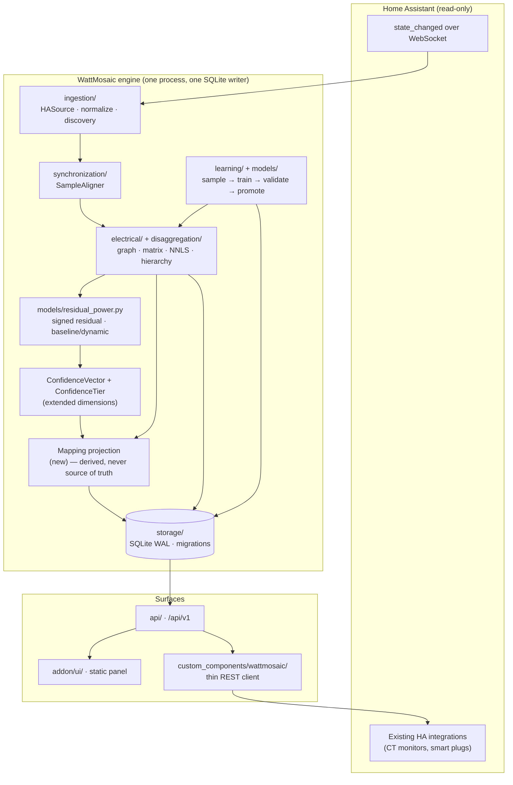

# Project overview — circuit-aware load disaggregation

**SPEC_STATUS: APPROVED_FOR_IMPLEMENTATION** — project goals, scope, the interfaces
that must survive, and the risks the target system carries.

---

## 1. The problem this specification addresses

WattMosaic today answers "how much power is this device drawing?" with a
machinery that is careful about what it does **not** know: a signed residual is
never clamped, a missing reading is never zero, an unidentifiable pair is
never split, a candidate topology is never promoted
(`docs/electrical_model.md` §1.1, §6; `docs/residual_analysis.md` §1;
`docs/association_and_topology.md` §5).

What it does not yet have is a first-class notion of the **circuit**: the
electrical scope a reading belongs to, the edges that connect scopes, the
lifecycle those edges move through, the entity that represents load nobody has
identified, and the versions that let a reader ask "which configuration
produced this number, and has the configuration changed since?".

The gap is visible in the shipped artifacts:

- Unknown consumption survives only as `Reconciliation.unknown_residual_w`; it
  has no identity, no per-circuit breakdown and no lifecycle
  (`docs/electrical_model.md` §10, last bullet).
- `RelationKind` has four kinds but no edge lifecycle state and no per-edge
  confidence dimensions (`engine/wattmosaic_engine/contracts.py:254-278`).
- `topology_versions` rows are opaque payloads with no diff, comparison or
  rollback (`engine/wattmosaic_engine/storage/migrations.py:308-315`).
- There is no Device↔Reader mapping artefact; `MeasurementMatrix` is the
  coefficient matrix `A(t)` and a different thing entirely
  (`engine/wattmosaic_engine/electrical/matrix.py:86-97`).
- Two declared confidence dimensions — `topology` and `residual` — are never
  populated (`docs/confidence_model.md` §2).

The target system closes those gaps **on top of** the existing engine. It does
not replace it.

---

## 2. Goals

| # | Goal | Observable meaning |
| --- | --- | --- |
| G-A | A reader can name the circuit a number belongs to. | Every reported device power names the circuit scope it was attributed against, and the scope has an identity that survives a restart. |
| G-B | A reader can see that a configuration changed, and when. | Every inference record names the `topology_version`, `reader_configuration_version`, `device_mapping_version` and `model_version` it was produced under, and each has a history. |
| G-C | A reader is never shown a fabricated per-device number. | Where separation is impossible the system reports a group estimate, a range or a non-identifiable status; it never invents a split. |
| G-D | Unknown load is a first-class object, not a remainder. | Unidentified consumption has an identity, a profile, a lifecycle and a per-circuit breakdown. |
| G-E | Measurement semantics are stated, not assumed. | Active power (W) and cumulative energy (kWh) are the only measured quantities; phase, polarity, leg pairing, resolution, reliability and the three timestamps travel with the reading. |
| G-F | The system survives configuration change. | A relocated smart plug, a replaced CT reader, a re-clamped CT or a changed calibration produces a traceable configuration event, and historical data is never rewritten. |
| G-G | Uncertainty is reported in dimensions, never blended. | Measurement quality, event association, model fit, topology consistency, identifiability, evidence count/coverage, freshness and residual uncertainty are each separately observable, and none is a calibrated probability. |

**Rule.** No goal is satisfied by adding a module. Each is satisfied by an
observable outcome, and each outcome is stated as a requirement in
[`01-requirements.md`](01-requirements.md).

---

## 3. Scope

### 3.1 In scope

1. **Measurement semantics** — the quantities the system can actually measure,
   the phase and polarity metadata, the leg-pairing rule, resolution and
   reliability, and the three timestamp semantics.
2. **Measurement topology** — a typed relationship set over circuits, readers
   and devices; edge lifecycle states; asymmetric parent/child treatment;
   residual-aware edge inference; nested-child double-count prevention;
   topology versioning and rollback; topology change detection and
   reconciliation; partial observability.
3. **Residuals** — per-reader baseline/dynamic/noise decomposition; residuals as
   first-class data; residual drift and change detection; unknown residual
   events as learning input.
4. **Device and load models** — power-model classes; standby/idle/active/
   transient power; state-transition power deltas; devices with no HA
   integration; the five distinct entities (physical device, HA entity,
   measurement endpoint, load component, unknown load profile).
5. **Disaggregation** — joint inference over HA state changes, HA attributes,
   smart-plug measurements, CT measurements, topology, residual events and
   learned models; simultaneous device changes; explicit identifiability;
   group-level estimates and ranges.
6. **Storage and lifecycle** — L1/L2/L3/L4 tiers, configurable retention, batch
   writes, indexes, compression, recovery, migration safety, historical replay.
7. **Event and inference** — HA-driven, measurement-driven and unknown-residual
   events; automation event groups; response delays; event windows; cross-reader
   event vectors; late-arriving data; duplicates; incomplete groups.
8. **Confidence and identifiability** — multidimensional confidence reconciled
   with the existing `ConfidenceVector` and `ConfidenceTier`.
9. **Mapping matrix** — a derived Device↔Reader mapping artefact supporting
   1:1, 1:N, N:1 and N:N with per-cell observability, contribution range,
   confidence, evidence count and status.
10. **Dynamic topology and self-healing** — configuration events for relocation,
    replacement, direction change, calibration change, reconfiguration, install
    and removal.
11. **User interface** — reader inventory, measurement quality, topology
    visualisation, residuals and unknown loads, power models, mappings,
    per-device estimates, identifiability status, event history, version
    history, suspected changes, manual correction, storage and processing
    health.
12. **Deployment and testing** — build, configuration, migrations, backup,
    deployment, smoke tests, rollback, monitoring; and unit, integration,
    synthetic-scenario, replay, regression, performance, migration and UI
    tests.

### 3.2 Out of scope

- **Any implementation.** This set specifies; it does not build.
- **Files `03`–`15`** of this folder, which other agents are authoring, and the
  two forthcoming delivery appendices (`16`, `17`).
- **Electrical quantities the hardware cannot produce.** Voltage, RMS current,
  power factor, reactive power, apparent power and frequency are not
  measurable by the installed CT monitors and must not be synthesised (§6.2).
- **Deep learning or black-box attribution** (`docs/architecture.md` §8;
  `docs/implementation_plan_v2.md` §8).
- **Automation-aware disaggregation of contaminated events.** A contaminated
  event is excluded, never decomposed (`docs/limitations_v2.md` §2).
- **Any claim of real-house per-device accuracy.** All published accuracy
  evidence is simulator-derived (`docs/limitations_v2.md` §1; §9 of this
  document).
- **Control of household devices** (`docs/architecture.md` §8).
- **A new database, a new service, a message bus or distributed
  infrastructure** (`docs/implementation_plan_v2.md` §0).

---

## 4. Non-goals, stated as rules

**Rule.** The target system does not infer physical wiring from correlation
alone. A child-to-parent correlation is containment evidence only when repeated
and validated (`docs/association_and_topology.md` §2.2, §5).

**Rule.** The target system does not enforce exact parent–child power
conservation. An unexplained parent change does not disprove containment
(`docs/association_and_topology.md` §5).

**Rule.** The target system does not redistribute a residual onto devices, and
does not write the unknown-load slack back into a device
(`docs/residual_analysis.md` §9; `docs/electrical_model.md` §4.2).

**Rule.** The target system does not present confidence as a probability.
`confidence_is_calibrated` stays `false` (`docs/confidence_model.md` §6).

**Rule.** The target system does not promote a candidate topology or a mapping
automatically. `MAX_CONFIDENCE = 0.99` and `requires_confirmation` is always
true (`docs/association_and_topology.md` §5).

**Rule.** The target system does not rewrite history. A new model version, a new
topology version or a new mapping version does not alter a stored record.

**Rule.** The target system does not introduce a second implementation of the
maths. The integration renders what the engine decided
(`docs/architecture.md` §1).

---

## 5. Existing interfaces that must be preserved

These are frozen by `docs/interface_contracts.md`. The target system adds
alongside them; it does not replace them.

| Interface | Owner | Frozen shape | Evidence |
| --- | --- | --- | --- |
| Engine ↔ HA ingestion | Engine `ingestion/` | Read-only WebSocket; `get_states`, `config/*_registry/list`, `subscribe_events`, `render_template`. **No service calls.** | `docs/interface_contracts.md` §2.1; ADR-0002 |
| Engine API | Engine `api/` | `/api/v1` prefix; `X-WattMosaic-Contract-Version` on every response; `X-API-Token` with a constant-time compare; validation failures return **400** and 422 is never exposed. | `docs/interface_contracts.md` §2.2; `engine/wattmosaic_engine/api/server.py:58-59`, `:284`, `:341` |
| Engine bind address | Engine `api/` | The code default is `0.0.0.0:8787` (`engine/wattmosaic_engine/config/settings.py:145-146`); the container and `addon/run.sh:249` override it to the loopback `127.0.0.1:8788`. The deployment binding is what the interface contract describes. | `engine/wattmosaic_engine/config/settings.py:145-146`; `addon/run.sh:249` |
| Integration → engine | `custom_components/wattmosaic/` | Polls `/snapshot` (default `scan_interval` 30 s) and `/health`; publishes HA entities; never computes inference; marks entities unavailable beyond the threshold or when the result is stale. | `docs/interface_contracts.md` §2.3; `custom_components/wattmosaic/const.py:70` |
| Panel → engine | `addon/ui/` | Static files served by the gateway on `:8787`; the gateway injects the token for ingress peers; the panel is read-only apart from confirming an already-inferred topology. | `docs/architecture.md` §6; `addon/gateway.py:53-54`, `:268` |
| Engine internal API | `disaggregation/` | `DisaggregationEngine.infer(window, device_states=…, models=…, topology=…) -> InferenceBatch`; `InferenceBatch` carries `results`, `reconciliation`, `diagnostics`. | `docs/interface_contracts.md` §3.4 |
| Contracts | `engine/wattmosaic_engine/contracts.py` | Single source of truth; JSON schemas exported to `data/schemas/` by `tools/dev/export_schemas.py`; CI hard-fails on schema drift. | `docs/interface_contracts.md` preamble; `.github/workflows/ci.yml:28-29` |
| Schema | `storage/migrations.py` | Forward-only, additive, idempotent; `PRAGMA user_version`; the current schema version (11 migrations), computed from the migrations tuple. | `engine/wattmosaic_engine/storage/migrations.py:792`; `docs/implementation_plan_v2.md` §5 |
| HA registry boundary | Integration | The engine never reads the HA entity/device registry; the integration resolves links and writes entity ids into `DeviceTopology.metadata`. | `docs/architecture.md` §2.1; ADR-0028 |

**Rule.** The change protocol is binding: change `contracts.py` → bump
`CONTRACT_VERSION` → regenerate `data/schemas/` via `tools/dev/export_schemas.py`
→ update the docs → run `pytest tests/` (`docs/interface_contracts.md` §5).

**Rule.** Every contract change is additive and optional, so an existing reader
keeps validating (`docs/implementation_plan_v2.md` §0).

### 5.1 The 23 existing routes that must keep their meaning

`/health`, `/status`, `/snapshot`, `/devices`, `/devices/{id}`,
`/confidence_tiers`, `/topology` (GET/PUT), `/topology/confirm`,
`/topology/nesting`, `/topology/tree`, `/quality`, `/diagnostics`, `/circuits`,
`/relations`, `/devices/{id}/records`, `/residuals`, `/isolation`,
`/models/{id}`, `/commands`, `/discover/placements`, `/export/{id}`, `/metrics`
(`engine/wattmosaic_engine/api/server.py:760-784`). New target-side read paths
are **additive routes**, not replacements.

---

## 6. Core architecture

### 6.1 The shape of the target

The target is the shipped engine with four new *conceptual layers* and no new
process:

**Rule.** The mapping projection is derived. It is never the historical source
of truth for anything, and it is rebuilt from the relations, the residual
history and the model registry rather than written by hand.

### 6.2 What is new, at concept level

| Concept | Today | Target |
| --- | --- | --- |
| Circuit scope | `Circuit` exists with `CircuitClass` and a candidate status (`contracts.py:686-759`) | Circuit keeps its identity across versions and gains a per-circuit unknown-load breakdown and a residual profile |
| Relation edge | Four `RelationKind`s, `status` is candidate/confirmed/rejected, `valid_from`/`valid_to` present (`contracts.py:762-843`) | A richer lifecycle vocabulary (candidate → provisional → confirmed → suspected change → under review → conflicted → rejected → retired) on top of the existing `TopologyStatus`, with per-edge confidence dimensions |
| Topology version | `topology_versions` rows are opaque payloads (`migrations.py:308-315`); `Topology.version` is an int | A diffable, comparable, rollback-able version object, with a separate `reader_configuration_version` and `device_mapping_version` |
| Unknown load | `Reconciliation.unknown_residual_w` only (`contracts.py:1697`) | A first-class unknown-load entity with an identity, a profile and a lifecycle |
| Mapping | `MeasurementMatrix` is the coefficient matrix (`matrix.py:86-97`) | A derived Device↔Reader mapping artefact with per-cell observability, contribution range, confidence dimensions and status |
| Confidence | Five dimensions; `topology` and `residual` never filled (`docs/confidence_model.md` §2) | Every dimension populated where evidence exists; `None` stays distinct from `0.0` |
| Storage tiers | Raw plus aggregates; seven audit tables exempt from prune and growing forever (`docs/limitations_v2.md` §7.2) | Named L1/L2/L3/L4 tiers with configurable retention per tier |
| UI | Five routes (`addon/ui/app.js:655-660`); none of the confidence vector, residual decomposition, isolation verdicts, association candidates, version history, suspected changes, mapping matrix or storage health is exposed | Every one of those is exposed, with measured/estimated/allocated/unknown distinguished |

### 6.3 What is reused unchanged

The "must NOT be rebuilt" list in `docs/assessment_gap_analysis.md` §"What must
NOT be rebuilt" is binding: the three orthogonal taxonomy axes, the
`Source`/`ConfidenceTier` separation, the read-only HA client, declarative
entity→device linking, anchored step rescan, null-space identifiability with
explicit ambiguity, residual-never-redistributed, canonical-alias and
multiplier applied once on read, nested-CT refusal to auto-write parent links,
`learning.effective_state`, migration discipline, stratified simulation metrics
with an oracle self-check, and the panel tree as a read-time projection.

---

## 7. Measurement semantics — the floor everything else stands on

The installed hardware is a multi-channel CT energy monitor. It publishes
**active power (W)** and **cumulative energy (kWh)**. Nothing else.

**Rule.** Voltage (V), RMS current (A), power factor, reactive power (VAR),
apparent power (VA) and frequency (Hz) are **not measurable today**. The
target system must not synthesise, estimate or display them as if they were
measurements.

`Measurement.unit` is `Literal["W", "kW", "kWh", "Wh"]` and nothing else
(`engine/wattmosaic_engine/contracts.py:1074`); `CTChannel.nominal_voltage` is
a *declared constant* for a current-only channel and is never an ingested
quantity (`contracts.py:1147`; `engine/wattmosaic_engine/electrical/factors.py:40`).
The HA integration's registry vocabulary does list `current`, `voltage`,
`reactive_power`, `apparent_power`, `power_factor` and `frequency` as
*measurement* device classes
(`custom_components/wattmosaic/state_links.py:86-99`), which is how a future
instrument would be recognised — it is **not** a statement that the current
install produces them.

Three timestamps travel with every observation, and conflating them is a
correctness bug (`docs/data_flow.md` §2):

| Field | Meaning |
| --- | --- |
| `state_timestamp` | HA `last_updated` for the state object |
| `received_at` | when the engine actually observed it |
| `physical_timestamp` | hardware sample time, if the instrument ever exposes one (`null` for polling CT integrations) |

Staleness is `age = received_at − state_timestamp`, default `stale_after_s = 120`
(`engine/wattmosaic_engine/config/settings.py:157`). A repeated identical value
is flagged `repeated=True` and is **not** new evidence
(`docs/data_flow.md` §2; ADR-0003).

**Rule.** The audited CT state-update cadence is a **median of ~15.7 s**, not
2 s. No event window, sampling grid or quality threshold may assume a 2 s
cadence (`docs/risks.md` R4; `PROJECT_STATUS.md:28`, which records
`two_second_assumption_supported: false`; ADR-0003:42-44; the committed
`docs/ct_update_profile.md:26-28` is the **synthetic** profile and reports a
15.8 s median over 36 channels).

Phase (`Phase.L1` / `L2` / `BOTH` / `UNKNOWN`), CT polarity
(`Polarity.NORMAL` / `INVERTED`, sign preserved and never clamped),
`CTChannel.paired_ct_id`, `resolution_w`, `reliability` and leg skew all exist
today (`contracts.py:1121-1150`) and must be honoured, not re-derived.

---

## 8. Engineering principles

1. **Additive and optional.** Every contract field has a neutral default so an
   older payload still validates (`contracts.py:464-474`; ADR-0007 era
   convention, `docs/implementation_plan_v2.md` §0).
2. **Unknown over fabricated.** A refusal with a machine reason code is a
   better answer than a plausible number (`docs/electrical_model.md` §6;
   `docs/residual_analysis.md` §5).
3. **Evidence is the argument.** Every published number carries the statistics
   that produced it, so a reader can recompute it
   (`docs/association_and_topology.md` §2.1).
4. **Separate axes stay separate.** `Source`, `ConfidenceTier`,
   `MonitoringLevel`, `CTType`, `CircuitClass`, `MeasurementBasis`,
   `RelationKind` and `IsolationStatus` answer different questions
   (`contracts.py:129-143`).
5. **One writer, one file.** SQLite in WAL mode with a single writer
   (`docs/limitations_v2.md` §7.1).
6. **Determinism.** The same inputs and the same algorithm version produce the
   same output, with no randomness in the analysis path
   (`docs/confidence_model.md` §6).
7. **Negative verification.** A guard is proven by removing it and watching its
   test fail (`tools/dev/negverify_nesting.py`).
8. **Versions travel with values.** `algorithm_version`, `model_version` and
   `topology_version` accompany every stored inference
   (`contracts.py:887-894`, `:1679-1682`).

---

## 9. Dependencies

### 9.1 Internal (existing modules)

| Dependency | Used for | Status |
| --- | --- | --- |
| `engine/wattmosaic_engine/ingestion/` | HA read-only client, normalisation, discovery, correlation | Exists |
| `engine/wattmosaic_engine/synchronization/aligner.py` | `SampleAligner`, bounded ring buffers, `ChannelHealth` | Exists |
| `engine/wattmosaic_engine/electrical/` | `TopologyGraph`, `build_measurement_matrix`, `ElectricalModel`, solver, `main_power_w`, `analyse_identifiability`, `infer_nesting`, `HierarchyFinder`, `FactorRegistry`, `build_panel_tree` | Exists |
| `engine/wattmosaic_engine/disaggregation/` | `DisaggregationEngine`, `EventIsolator`, `AssociationFinder`, `CircuitClassifier`, `compute_confidence`, `evidence_tier`, `AuditPass`, `plan_placements`, `detect_step` | Exists |
| `engine/wattmosaic_engine/models/` | `residual_power.py`, the model classes and the registry | Exists |
| `engine/wattmosaic_engine/learning/` | sample collection, filtering, training, validation, promotion | Exists |
| `engine/wattmosaic_engine/storage/` | `Database`, `MIGRATIONS`, `apply_migrations`, `current_version`, `LATEST_VERSION`, `prune` | Exists |
| `engine/wattmosaic_engine/api/` | aiohttp `/api/v1` server and facade | Exists |
| `custom_components/wattmosaic/` | HA integration: `sensor`/`binary_sensor`/`button`, config flow, 13 services, `async_migrate_entry` | Exists |
| `addon/` | `run.sh`, `gateway.py`, `healthcheck.py`, `discovery.py`, `config.yaml`, `ui/` | Exists |
| `tools/dev/` | `verify.py` (12 required gates + 1 optional), `export_schemas.py`, `check_panel.py`, `negverify_nesting.py` | Exists |
| `tools/simulator/` | `SimulatorConfig`, `HouseholdScenario`, `HouseholdTopology`, `REAL_HOME_TOPOLOGY`, `LabHouse` with separate `observations()` and `ground_truth()` | Exists |
| `tools/audit/` | `collect_samples.py`, `profile_samples.py`, `passive_validation.py`, `replay_capture.py`, `build_topology.py`, `derive_state_entities.py` | Exists |

### 9.2 Runtime

Python ≥3.11 (container 3.12), `pydantic` v2, `aiohttp`, `websockets`, `numpy`,
`scipy`, `PyYAML`; `pytest`, `pytest-asyncio`, `ruff`, `mypy` for development
(`pyproject.toml`). **No new runtime dependency is permitted**
(`docs/implementation_plan_v2.md` §0).

### 9.3 External systems

Home Assistant OS over a read-only WebSocket; the Supervisor App with
`ingress: true` on port 8787 and a `/healthz` watchdog; GHCR as the image
registry (`docs/deployment.md` §"Deployment shapes", `addon/config.yaml`).

---

## 10. Major technical risks

| ID | Risk | Likelihood | Impact | Mitigation carried by this specification |
| --- | --- | --- | --- | --- |
| R-LD-01 | A rewrite regresses the invariants that the currently passing tests protect (2 827 collected; the last recorded run of that suite, at HEAD `612e1233` on 2026-11-16, reported 2 803 passed, 15 skipped, 9 errors). | Low | Critical | The target is specified as additive deltas (§6.2), never a replacement (§6.3). |
| R-LD-02 | A richer edge lifecycle is mistaken for permission to auto-promote. | Medium | Critical | Lifecycle states never imply confirmation; `requires_confirmation` stays true and `MAX_CONFIDENCE` stays 0.99 (REQ-TOPO-*, REQ-CONFIDENCE-*). |
| R-LD-03 | A new unknown-load entity becomes a dumping ground for unattributed residual, i.e. residual redistribution by another name. | Medium | Critical | The unknown-load entity holds a *profile and a scope*, never a device attribution; the residual is still never redistributed (REQ-RESIDUAL-*). |
| R-LD-04 | The mapping matrix becomes a second source of truth and drifts from the relations. | Medium | High | The matrix is derived, rebuilt from evidence, and versioned by the artefacts it derives from (REQ-MAPPING-*). |
| R-LD-05 | Synthetic accuracy evidence is read as real-house accuracy. | Certain | Critical | No requirement may claim real-house per-device accuracy; the limitation is stated in the requirements themselves (REQ-TEST-*, REQ-FOUNDATION-*). |
| R-LD-06 | Configuration change detection fires on noise and floods the operator with false "suspected change" hypotheses. | Medium | High | A suspected change is a *hypothesis with evidence*, validated before promotion, and the evidence bar is stated (REQ-CHANGE-*). |
| R-LD-07 | Retention work deletes the evidence that makes an audit possible. | Medium | Critical | Evidence tiers are named and the deletion rule per tier is explicit; a new model version never deletes historical evidence (REQ-STORAGE-*). |
| R-LD-08 | New UI surfaces invite a reader to treat an estimate as a measurement. | Medium | High | Measured, estimated, allocated and unknown are distinguished at every surface, and missing data never renders as 0 W (REQ-UI-*). |
| R-LD-09 | Two engine processes on one SQLite file contend. | Low | High | The single-writer rule is preserved; no distributed infrastructure is introduced (REQ-DEPLOY-*). |
| R-LD-10 | The documented cadence drifts and event windows are sized on a stale assumption. | Medium | Medium | Cadence is measured per channel and the observed value travels with the reading (REQ-MEASURE-*, REQ-EVENT-*). |
| R-LD-11 | `mypy engine` errors accumulate against a non-blocking baseline (112 measured at this checkout — 112 errors in 27 of 80 checked files — against a recorded historical baseline of 120 in `docs/final_validation_report.md:23`). | Medium | Low | The delta-zero policy applies: the specification adds no new type errors (REQ-TEST-*). |
| R-LD-12 | The nine live-capture tests keep skipping, so a real-install guard is never exercised. | Certain | Medium | The capture-replay path is named as a verification vehicle for every guard that depends on real measurements (REQ-TEST-*). |
| R-LD-13 | Documentation drift: a stale contract version or a retired vocabulary reappears in shipped prose. `docs/api.md:7` states `1.6.0` and `docs/architecture.md:3` states `1.4.0`, while the code says `2.0.0`. | Medium | Medium | This specification cites the current values only (`2.0.0`, schema 11) and the prose gate in `tests/unit/test_docs_vocabulary.py` continues to guard `docs/`. |

**Residual risk statement.** The largest remaining risk is electrical topology
uncertainty, and it does not go away with more software
(`docs/risks.md` R1, R5, R11). The target system reduces the *cost* of that
uncertainty by making it explicit and versioned; it does not remove it.

---

## 11. Assumptions

1. The engine keeps its current process topology: one asyncio process, one
   SQLite writer, one HTTP API (`docs/architecture.md` §2).
2. The panel keeps its no-build, CSP-safe, static-file shape
   (`docs/architecture.md` §6; `tools/dev/check_panel.py`).
3. The HA integration keeps its role as a thin REST client that renders what
   the engine decided (`docs/architecture.md` §1).
4. The simulator remains the only source of per-device ground truth
   (`docs/limitations_v2.md` §1; `tools/simulator/labhouse.py:122-129`).
5. The `G1`–`G20` gap list remains the canonical gap register; this
   specification adds `G21+` identifiers only where a gap is not in it (§14).
6. The audited cadence (~15.7 s median) remains representative of the installed
   hardware; the system measures it per channel rather than assuming it.

---

## 12. Open decisions

These are decisions a human must make. Each is recorded with the option this
specification assumes, so the specification is complete as written and a change
of mind is a bounded edit rather than a rewrite.

| ID | Decision | Options | Assumption used here | Blocks |
| --- | --- | --- | --- | --- |
| OD-01 | Does the target system introduce a first-class `UnknownLoad` entity in the contract, or keep unknown load as a residual attribute? | (a) new contract entity; (b) residual-only attribute; (c) both, with the entity as a projection | **(a)+(c)**: a contract entity exists, and the residual remains the authoritative total | REQ-RESIDUAL-005, REQ-MAPPING-004 |
| OD-02 | Is the relation lifecycle a new enum, or an extension of `TopologyStatus`? | (a) new enum; (b) extend `TopologyStatus`; (c) lifecycle field separate from `status` | **(c)**: a separate lifecycle vocabulary, with `TopologyStatus` untouched so existing readers keep working | REQ-TOPO-002 |
| OD-03 | What is the raw retention horizon: the shipped 30 days, or the 7–14 days the target brief names? | (a) 30 d (shipped); (b) 7–14 d (target) | **(b) with a 30 d ceiling**: raw is configurable in 7–14 d, defaulting to the current 30 d until an operator opts in | REQ-STORAGE-003 |
| OD-04 | Does `reader_configuration_version` become a new column or a field inside the topology payload? | (a) new column in `topology_versions`; (b) payload field | **(b)**: a payload field, so the version object stays one row and no new table is needed | REQ-CHANGE-004 |
| OD-05 | Should a mapping-matrix cell be persisted, or rebuilt on read? | (a) persisted table; (b) derived at read time | **(b)**: derived, because a persisted matrix is a second source of truth | REQ-MAPPING-002 |
| OD-06 | Is a "suspected topology change" a `TopologyRelation` of a new kind, or a distinct artefact? | (a) new `RelationKind`; (b) distinct artefact | **(b)**: a distinct artefact, because a hypothesis is not a relation between two objects | REQ-CHANGE-002 |
| OD-07 | Does the target keep `Source.DIRECT_MEASURED` in the enum? | (a) keep for historical readability; (b) remove | **(a)**: kept, because historical rows must stay readable (ADR-0034 decision 5) | REQ-POWER-004 |
| OD-08 | Is the panel's topology view a new route or an extension of `#/topology`? | (a) new route `#/topology/<id>`; (b) extend `#/topology` | **(b)**: extend the existing route, because the panel's router is a closed list (`addon/ui/app.js:655-660`) | REQ-UI-006 |

None of these decisions changes the requirement count or the invariant set. A
decision that *would* violate an invariant is not a decision; it is a defect,
and the specification states the conflict rather than absorbing it.

---

## 13. Relationship to the existing gap register

The table below summarises the **status** of the pre-existing register
`docs/assessment_gap_analysis.md` §11 against this specification; it is not a
register of identifiers. The register of record for a gap identifier is §13.2;
§13.1 is the upstream source for the `G21`–`G32` band.

| Existing gap (`docs/assessment_gap_analysis.md` §11) | Status | Addressed by |
| --- | --- | --- |
| G1, G2, G3 — factor semantics, interval, basis | PARTIAL / MISSING / MISSING | Preserved and surfaced; REQ-LEARNING-005, REQ-MEASURE-001, REQ-DISAGG-007 |
| G4, G5, G6, G7 — isolation status, windows, dedup, dead concurrency guard | MISSING / MISSING / MISSING / PARTIAL (dead) | Preserved; REQ-EVENT-008, REQ-EVENT-004, REQ-EVENT-007, REQ-EVENT-002 |
| G8, G9 — relation with evidence, association history | PARTIAL / MISSING | Extended; REQ-TOPO-001, REQ-CONFIDENCE-007, REQ-CHANGE-004, REQ-STORAGE-003 |
| G10 — circuit classification with confidence | PARTIAL | Preserved; REQ-TOPO-011, REQ-CONFIDENCE-004 |
| G11 — CT parent/child discovery | PARTIAL | Preserved, not widened; REQ-TOPO-004, REQ-TOPO-005 |
| G12, G13 — residual decomposition, residual history | MISSING / MISSING | Extended; REQ-RESIDUAL-002, REQ-RESIDUAL-003 |
| G14 — independent confidence dimensions | PARTIAL | Extended; REQ-CONFIDENCE-001 … 004 |
| G15, G16 — versioned inference, retention-safe records | PARTIAL / MISSING | Extended; REQ-STORAGE-007, REQ-CHANGE-003, REQ-STORAGE-005, REQ-STORAGE-003 |
| G17 — device history read path | MISSING (defect) | Fixed in place; REQ-STORAGE-012 |
| G18, G19 — simulator fidelity, richer household | MISSING / PARTIAL | Extended; REQ-TEST-003, REQ-POWER-002 |
| G20 — per-device thresholds | MISSING | Preserved as a later refinement; REQ-LEARNING-006 |

### 13.1 Source register — gaps found while writing this specification (new `G21+` identifiers)

These are **not** in `docs/assessment_gap_analysis.md` §11 and are therefore
given new identifiers here, as the gap register requires.

**This table is the upstream source, not the register of record.** It records
where each gap raised while writing this specification was first observed, the
status found there, and the requirement that addresses it. The register of
record for a gap *identifier* is §13.2: a reader asking "what does `G21`
mean?" must read §13.2, and a reader asking "where was it first observed, and
which requirement carries it?" must read this table. The `Gap` column below
therefore carries the observation made at the source and is not a second
definition of the identifier.

| ID | Gap | Status | Addressed by | Evidence |
| --- | --- | --- | --- | --- |
| G21 | No edge lifecycle state beyond candidate/confirmed/rejected, and no per-edge confidence dimensions | MISSING | REQ-TOPO-002, REQ-CONFIDENCE-007 | `contracts.py:782-791` |
| G22 | No topology-version object with diffing, comparison or rollback | MISSING | REQ-TOPO-008, REQ-CHANGE-006 | `migrations.py:308-315` |
| G23 | No first-class Device↔Reader mapping artefact | MISSING | REQ-MAPPING-001, REQ-MAPPING-003 | `contracts.py` has no such model; `electrical/matrix.py:86-97` is the coefficient matrix |
| G24 | No first-class unknown-load entity | MISSING | REQ-RESIDUAL-006, REQ-MAPPING-004 | `docs/electrical_model.md` §10, last bullet |
| G25 | No storage lifecycle tier concept | MISSING | REQ-STORAGE-001, REQ-STORAGE-002 | `storage/database.py:1304-1344`; `docs/limitations_v2.md` §7.2 |
| G26 | No `reader_configuration_version` or `device_mapping_version` | MISSING | REQ-CHANGE-003 | `contracts.py` has only `topology_version` (`:893`, `:1689`) and `model_version` (`:1650`) |
| G27 | The UI exposes none of the confidence vector, residual decomposition, isolation verdicts, association candidates, version history, suspected changes, mapping matrix or storage health | MISSING | REQ-UI-001 … `REQ-UI-013` | `addon/ui/app.js:655-660` (five routes); `docs/limitations_v2.md` §8 |
| G28 | No configuration-event object for topology or reader changes | MISSING | REQ-CHANGE-001 | `storage/migrations.py` has no such table |
| G29 | `MeasurementFactor` has no creation path from the integration or the HTTP API | MISSING | REQ-LEARNING-005, REQ-MEASURE-001 | `docs/limitations_v2.md` §5; `storage/database.py:704` |
| G30 | No cross-reader event vector: an event's per-reader effect is not recorded | MISSING | REQ-EVENT-005 | `contracts.py:1547-1569` (`DeviceEvent` is per-entity) |
| G31 | No observable "measured vs estimated vs allocated vs unknown" field on a per-device estimate beyond `Source` and `MeasurementBasis` | PARTIAL | REQ-FOUNDATION-005, REQ-UI-007 | `contracts.py:1642-1682` |
| G32 | The published accuracy evidence is simulator-derived only; there is no real-house per-device ground truth | MISSING (limitation) | REQ-TEST-010, REQ-FOUNDATION-005 | `docs/limitations_v2.md` §1 |

### 13.2 Reconciliation register — the register of record for every gap identifier in the specification set

This section is the **sole register of record for gap identifiers** in this
specification set. Every gap cited anywhere in `00`–`15` appears here exactly
once: each identifier has exactly one row here, and the row's *Source* column
names the upstream source that first observed it. The upstream sources —
`docs/assessment_gap_analysis.md` §11, §13.1 and the sibling specifications' own
gap registers — are **source registers, not second definitions**; their rows are
references to this table, and a row here and a row there are two views of one
gap, not two gaps.

**Rule.** A gap identifier is valid only together with its entry in this table.
An identifier that is absent from this table is not a gap identifier, whatever
file it appears in.

**Rule.** A **canonical** identifier (`G1`–`G32`, `G60`–`G95`) names a gap
whose definition is this table; a **local** identifier
(`G-STORE-*`, `G-TOPO-*`, `G-EVENT-*`, `G-API-*`, `G-TEST-*`, `G-DEPLOY-*`) is
scoped to the file named in the *Source* column and is valid only together with
its entry here. The local namespaces exist because `03-…` and `06-…` had already
claimed `G21`–`G34`; they are registered here rather than renumbered, and their
meaning is unchanged.

**Rule.** `G1`–`G20` are pre-existing in `docs/assessment_gap_analysis.md` §11 and
are **never renumbered**. `G21`–`G32` are the gaps found while writing this
specification (§13.1). `G60`–`G95` are the gaps found by the sibling
specifications, each in the band allocated to it. Each of those is the
*upstream source* of the corresponding rows below; the definition of the
identifier is the row below, not the source row.

| ID | Gap | Source | Scope |
| --- | --- | --- | --- |
| G1 | Factor semantics | `docs/assessment_gap_analysis.md` §11 (via `00-…` §13) | canonical |
| G2 | Factor interval | `docs/assessment_gap_analysis.md` §11 (via `00-…` §13) | canonical |
| G3 | Factor basis | `docs/assessment_gap_analysis.md` §11 (via `00-…` §13) | canonical |
| G4 | Isolation status | `docs/assessment_gap_analysis.md` §11 (via `00-…` §13) | canonical |
| G5 | Isolation windows | `docs/assessment_gap_analysis.md` §11 (via `00-…` §13) | canonical |
| G6 | Event dedup | `docs/assessment_gap_analysis.md` §11 (via `00-…` §13) | canonical |
| G7 | Dead concurrency guard | `docs/assessment_gap_analysis.md` §11 (via `00-…` §13) | canonical |
| G8 | Relation with evidence | `docs/assessment_gap_analysis.md` §11 (via `00-…` §13) | canonical |
| G9 | Association history | `docs/assessment_gap_analysis.md` §11 (via `00-…` §13) | canonical |
| G10 | Circuit classification with confidence | `docs/assessment_gap_analysis.md` §11 (via `00-…` §13) | canonical |
| G11 | CT parent/child discovery | `docs/assessment_gap_analysis.md` §11 (via `00-…` §13) | canonical |
| G12 | Residual decomposition | `docs/assessment_gap_analysis.md` §11 (via `00-…` §13) | canonical |
| G13 | Residual history | `docs/assessment_gap_analysis.md` §11 (via `00-…` §13) | canonical |
| G14 | Independent confidence dimensions | `docs/assessment_gap_analysis.md` §11 (via `00-…` §13) | canonical |
| G15 | Versioned inference | `docs/assessment_gap_analysis.md` §11 (via `00-…` §13) | canonical |
| G16 | Retention-safe records | `docs/assessment_gap_analysis.md` §11 (via `00-…` §13) | canonical |
| G17 | Device history read path | `docs/assessment_gap_analysis.md` §11 (via `00-…` §13) | canonical |
| G18 | Simulator fidelity | `docs/assessment_gap_analysis.md` §11 (via `00-…` §13) | canonical |
| G19 | Richer household | `docs/assessment_gap_analysis.md` §11 (via `00-…` §13) | canonical |
| G20 | Per-device thresholds | `docs/assessment_gap_analysis.md` §11 (via `00-…` §13) | canonical |
| G21 | No edge lifecycle state beyond candidate/confirmed/rejected, and no per-edge confidence dimensions | `00-project-overview.md` §13.1 | canonical |
| G22 | No topology-version object with diffing, comparison or rollback | `00-project-overview.md` §13.1 | canonical |
| G23 | No first-class Device↔Reader mapping artefact | `00-project-overview.md` §13.1 | canonical |
| G24 | No first-class unknown-load entity | `00-project-overview.md` §13.1 | canonical |
| G25 | No storage lifecycle tier concept | `00-project-overview.md` §13.1 | canonical |
| G26 | No `reader_configuration_version` or `device_mapping_version` | `00-project-overview.md` §13.1 | canonical |
| G27 | The UI exposes none of the confidence vector, residual decomposition, isolation verdicts, association candidates, version history, suspected changes, mapping matrix or storage health | `00-project-overview.md` §13.1 | canonical |
| G28 | No configuration-event object for topology or reader changes | `00-project-overview.md` §13.1 | canonical |
| G29 | `MeasurementFactor` has no creation path from the integration or the HTTP API | `00-project-overview.md` §13.1 | canonical |
| G30 | No cross-reader event vector: an event's per-reader effect is not recorded | `00-project-overview.md` §13.1 | canonical |
| G31 | No observable "measured vs estimated vs allocated vs unknown" field on a per-device estimate beyond `Source` and `MeasurementBasis` | `00-project-overview.md` §13.1 | canonical |
| G32 | The published accuracy evidence is simulator-derived only; there is no real-house per-device ground truth | `00-project-overview.md` §13.1 | canonical |
| G60 | The six unmeasured electrical quantities (V, A, PF, VAR, VA, Hz) have no contract representation at all, so a surface that wants them has no honest place to put them. | `03-measurement-and-electrical-domain.md` §17 | canonical |
| G61 | The engine cannot read a declared `state_class`, so counter monotonicity is inferred from observed resets rather than declared. | `03-measurement-and-electrical-domain.md` §17 | canonical |
| G62 | No per-device phase-split fraction; `α` is a single global scalar, so a declared asymmetric double-pole load cannot be represented. | `03-measurement-and-electrical-domain.md` §17 | canonical |
| G63 | There is no explicit unknown-load entity, so unattributable load has no per-circuit breakdown and no lifecycle. | `03-measurement-and-electrical-domain.md` §17 | canonical |
| G64 | The master class `DELAYED` has no representation: neither `ModelType` (`contracts.py:90`) nor `PowerBehavior` (`contracts.py:367`) expresses a response delay, so a delayed device is indistinguishable from a prompt one in the model. | `06-device-and-load-model-spec.md` §13 | canonical |
| G65 | The master class `ALWAYS_ON` has no representation. `BinaryDeviceModel` (`models/binary.py:59`) assumes an off state, so an always-on device is either mis-modelled with a zero-power off state or rejected. | `06-device-and-load-model-spec.md` §13 | canonical |
| G66 | `DeviceConfiguration` (`contracts.py:1376`) carries no field for the master's six-way power model class; `PowerBehavior` (`contracts.py:367`) has only four values and describes a different axis. | `06-device-and-load-model-spec.md` §13 | canonical |
| G67 | A Load Component is not a first-class entity. `CompositeDeviceModel` (`models/composite.py:35`) and `sample_component` (`models/composite.py:15`) model one, but there is no contract type, no identity, no lifetime and no way to report a component independently of its parent. | `06-device-and-load-model-spec.md` §13 | canonical |
| G68 | `ExpectedPower.startup_w` / `shutdown_w` (`contracts.py:1249`) have no declared binding to `OperatingStage` (`contracts.py:1572`), so the transient envelope and the recognised stage vocabulary are not linked. | `06-device-and-load-model-spec.md` §13 | canonical |
| G69 | There is no learned response delay. `ControllerConfiguration.on_delay_s` / `off_delay_s` (`contracts.py:1342`) are declared constants; `state_lag_s` (`tools/simulator/scenario.py:70`) and `channel_delay_s` (`tools/simulator/scenario.py:74`) are environment parameters, not engine estimators. | `06-device-and-load-model-spec.md` §13 | canonical |
| G70 | There is no contract-level unknown-load artifact with a lifecycle. `docs/electrical_model.md:844-872` §10 states there is no explicit unknown-load entity, and `contracts.py:791` gives `requires_confirmation` only on the association side. | `06-device-and-load-model-spec.md` §13 | canonical |
| G71 | A "no HA integration" device has no representation distinct from a device whose entities are merely absent at this moment. `HaConnectivity` (`contracts.py:339`) has `NOT_CONNECTED` and `UNKNOWN`, but nothing records that a device is *known* to have no integration. | `06-device-and-load-model-spec.md` §13 | canonical |
| G72 | `min_validation_r2` (`learning/thresholds.py:99-107`) is a single global gate. A monotone-curve fit can pass R² while being non-monotone, and a shape model with no control state is judged by a criterion written for a state model. | `06-device-and-load-model-spec.md` §13 | canonical |
| G73 | No rule prevents an unknown load profile from being attached to a device by the learning pipeline's own matching. `LearningPipeline.consider` (`learning/pipeline.py:273`) and `training_quality` (`learning/trainer.py:154`) score samples, but nothing forbids a profile-to-device promotion without confirmation. | `06-device-and-load-model-spec.md` §13 | canonical |
| G74 | `ResidualPower` has no noise term: the residual's third component is unmodelled | `05-residual-model-spec.md` §14 | canonical |
| G75 | The production audit pass never populates the baseline window, so every live residual is `no_window_current_only` | `05-residual-model-spec.md` §14 | canonical |
| G76 | No residual drift or change event exists | `05-residual-model-spec.md` §14 | canonical |
| G77 | No unknown-residual event type exists for the learning hand-off | `05-residual-model-spec.md` §14 | canonical |
| G78 | The residual evidence row carries no version identifiers | `05-residual-model-spec.md` §14 | canonical |
| G79 | `ConfidenceVector.residual` is declared but never populated | `05-residual-model-spec.md` §14 | canonical |
| G80 | Per-dimension confidence vector has no UI | `10-ui-and-user-experience-spec.md` §14 | canonical |
| G81 | Residual decomposition has no UI | `10-ui-and-user-experience-spec.md` §14 | canonical |
| G82 | Isolation verdicts have no UI | `10-ui-and-user-experience-spec.md` §14 | canonical |
| G83 | Association candidate verdicts and refusal reasons have no UI | `10-ui-and-user-experience-spec.md` §14 | canonical |
| G84 | Circuit-classification detail has no UI | `10-ui-and-user-experience-spec.md` §14 | canonical |
| G85 | Topology version history and diff have no UI | `10-ui-and-user-experience-spec.md` §14 | canonical |
| G86 | Suspected topology changes have no UI | `10-ui-and-user-experience-spec.md` §14 | canonical |
| G87 | Device↔reader mapping matrix has no UI | `10-ui-and-user-experience-spec.md` §14 | canonical |
| G88 | Device power model detail is only summarised | `10-ui-and-user-experience-spec.md` §14 | canonical |
| G89 | Identifiability status has no UI | `10-ui-and-user-experience-spec.md` §14 | canonical |
| G90 | Storage health and retention have no UI | `10-ui-and-user-experience-spec.md` §14 | canonical |
| G91 | Processing-health strip, restart counts and contract version have no UI | `10-ui-and-user-experience-spec.md` §14 | canonical |
| G92 | Topology edges carry no lifecycle state or confidence in the tree | `10-ui-and-user-experience-spec.md` §14 | canonical |
| G93 | Topology edge retire and flag flows do not exist | `10-ui-and-user-experience-spec.md` §14 | canonical |
| G94 | Event and inference-record history have no UI | `10-ui-and-user-experience-spec.md` §14 | canonical |
| G95 | No UI test harness exists | `10-ui-and-user-experience-spec.md` §14 | canonical |
| G-TOPO-01 | No typed mapping from Measurement Topology edges to physical electrical topology | `04-topology-spec.md` "New gap register" | local |
| G-TOPO-02 | No typed relationship semantics on an edge; `CONTAINS`/`SHARED_LOAD`/`PAIRED_LEG` absent from the stored kinds | `04-topology-spec.md` "New gap register" | local |
| G-TOPO-03 | No discriminator separating `PAIRED_LEG` from `CORRELATED` | `04-topology-spec.md` "New gap register" | local |
| G-TOPO-04 | Five of eight lifecycle states unrepresented | `04-topology-spec.md` "New gap register" | local |
| G-TOPO-05 | No lifecycle transition guard | `04-topology-spec.md` "New gap register" | local |
| G-TOPO-06 | Edge confidence is a scalar, not dimensional | `04-topology-spec.md` "New gap register" | local |
| G-TOPO-07 | `reader_configuration_version`, `device_mapping_version`, `model_version` absent | `04-topology-spec.md` "New gap register" | local |
| G-TOPO-08 | No unified candidate admission path across the five discovery mechanisms | `04-topology-spec.md` "New gap register" | local |
| G-TOPO-09 | No residual-aware containment estimator | `04-topology-spec.md` "New gap register" | local |
| G-TOPO-10 | Absolute constraints not typed as basis-bearing edges | `04-topology-spec.md` "New gap register" | local |
| G-TOPO-11 | No per-event, per-edge evidence accounting | `04-topology-spec.md` "New gap register" | local |
| G-TOPO-12 | Cycle refusal not scoped to the offending edges | `04-topology-spec.md` "New gap register" | local |
| G-TOPO-13 | No transitive-summary marker on a relation | `04-topology-spec.md` "New gap register" | local |
| G-TOPO-14 | `CircuitClassifier` does not consult topology to explain residuals | `04-topology-spec.md` "New gap register" | local |
| G-TOPO-15 | No version diffing | `04-topology-spec.md` "New gap register" | local |
| G-TOPO-16 | No rollback path | `04-topology-spec.md` "New gap register" | local |
| G-TOPO-17 | Change-detection triggers unimplemented | `04-topology-spec.md` "New gap register" | local |
| G-TOPO-18 | Configuration events carry no version identifiers | `04-topology-spec.md` "New gap register" | local |
| G-TOPO-19 | Unknown residual not surfaced as a topology attribute | `04-topology-spec.md` "New gap register" | local |
| G-TOPO-20 | Panel-tree projection not labelled at consumers | `04-topology-spec.md` "New gap register" | local |
| G-EVENT-01 | First-class ingestion timestamp on the event record | `07-event-and-inference-spec.md` §21 | local |
| G-EVENT-02 | Explicit simultaneous-change group in the inference path | `07-event-and-inference-spec.md` §21 | local |
| G-EVENT-03 | Automation event-group primitive | `07-event-and-inference-spec.md` §21 | local |
| G-EVENT-04 | Evidence-estimated device response delay | `07-event-and-inference-spec.md` §21 | local |
| G-EVENT-05 | Cross-reader event vector object | `07-event-and-inference-spec.md` §21 | local |
| G-EVENT-06 | Replay endpoint and `EventEvidenceRecord` | `07-event-and-inference-spec.md` §21 | local |
| G-EVENT-07 | Supersession record for late data | `07-event-and-inference-spec.md` §21 | local |
| G-EVENT-08 | Consistent event identity | `07-event-and-inference-spec.md` §21 | local |
| G-EVENT-09 | Incomplete-group outcome | `07-event-and-inference-spec.md` §21 | local |
| G-EVENT-10 | Range and group-level outcomes surfaced to consumers | `07-event-and-inference-spec.md` §21 | local |
| G-EVENT-11 | Unknown residual event shape | `07-event-and-inference-spec.md` §21 | local |
| G-EVENT-12 | `system_events` row on queue drop | `07-event-and-inference-spec.md` §21 | local |
| G-EVENT-13 | `events_expired` as a report field | `07-event-and-inference-spec.md` §21 | local |
| G-STORE-01 | Evidence train/evaluation split | `08-storage-and-data-lifecycle.md` §17 | local |
| G-STORE-02 | Evidence state context | `08-storage-and-data-lifecycle.md` §17 | local |
| G-STORE-03 | Split usable for fitting and identifiable for evaluation | `08-storage-and-data-lifecycle.md` §17 | local |
| G-STORE-04 | Explicit L2/L4 horizon | `08-storage-and-data-lifecycle.md` §17 | local |
| G-STORE-05 | L1 horizon exceeds the repair lookback | `08-storage-and-data-lifecycle.md` §17 | local |
| G-STORE-06 | Compaction / export over L2 | `08-storage-and-data-lifecycle.md` §17 | local |
| G-STORE-07 | Topology version-history index | `08-storage-and-data-lifecycle.md` §17 | local |
| G-STORE-08 | Mapping-matrix index | `08-storage-and-data-lifecycle.md` §17 | local |
| G-STORE-09 | Storage-health read surface | `08-storage-and-data-lifecycle.md` §17 | local |
| G-STORE-10 | Event evidence index by type and time | `08-storage-and-data-lifecycle.md` §17 | local |
| G-STORE-11 | Queue-drop `system_events` row | `08-storage-and-data-lifecycle.md` §17 | local |
| G-STORE-12 | Explicit column list vs contract model | `08-storage-and-data-lifecycle.md` §17 | local |
| G-STORE-13 | Observed values on evidence records | `08-storage-and-data-lifecycle.md` §17 | local |
| G-STORE-14 | Explicit gap markers on evidence records | `08-storage-and-data-lifecycle.md` §17 | local |
| G-STORE-15 | Correction chain (`supersedes`) | `08-storage-and-data-lifecycle.md` §17 | local |
| G-STORE-16 | Replay resolution beyond the L1 horizon | `08-storage-and-data-lifecycle.md` §17 | local |
| G-STORE-17 | Per-device replay error | `08-storage-and-data-lifecycle.md` §17 | local |
| G-API-01 | Event identity is generated, not derived (`ingestion/ha_source.py:1186`; `disaggregation/isolation.py:356-369`), so replay and dedup cannot rely on `event_id` | `09-api-and-data-contracts.md` §14.2 | local |
| G-API-02 | `docs/api.md:7` reports contract version `1.6.0` while the code is `2.0.0` (`contracts.py:32`) | `09-api-and-data-contracts.md` §14.2 | local |
| G-API-03 | No route exposes the topology as diffable edges with a lifecycle | `09-api-and-data-contracts.md` §14.2 | local |
| G-API-04 | `topology_versions` is an opaque payload table with no diff or rollback semantics (`storage/migrations.py:308-316`) | `09-api-and-data-contracts.md` §14.2 | local |
| G-API-05 | No route exposes storage health, prune time, queue depth or schema version | `09-api-and-data-contracts.md` §14.2 | local |
| G-API-06 | `Identifiability` (`electrical/solver.py:60`) is not exposed over HTTP | `09-api-and-data-contracts.md` §14.2 | local |
| G-API-07 | Residual decomposition is computed internally but not exposed per window | `09-api-and-data-contracts.md` §14.2 | local |
| G-API-08 | No replay entry point for stored evidence | `09-api-and-data-contracts.md` §14.2 | local |
| G-API-09 | The device ↔ reader mapping is not a first-class contract, so contribution bounds and observability have no home | `09-api-and-data-contracts.md` §14.2 | local |
| G-API-10 | No version identifier links a configuration change to the artefacts it invalidates | `09-api-and-data-contracts.md` §14.2 | local |
| G-API-11 | `WM_AUDIT_ALGORITHM_VERSION` (`disagg@2.0`) is configuration-only and is not surfaced | `09-api-and-data-contracts.md` §14.2 | local |
| G-API-12 | There is no concept of an unknown-load profile in the current contracts | `09-api-and-data-contracts.md` §14.2 | local |
| G-API-13 | Rollback semantics are undefined for the topology aggregate | `09-api-and-data-contracts.md` §14.2 | local |
| G-API-14 | The contract-version bump cadence for additive changes is undefined | `09-api-and-data-contracts.md` §14.2 | local |
| G-TEST-01 | Coverage reporting unavailable: `pytest-cov` is declared but `--cov` is used nowhere in CI | `11-test-and-validation-plan.md` §15.1 | local |
| G-TEST-02 | Hot-tub variant sets diverge: `monitor_published` is in the simulator's 10, not in the fixture's 9 | `11-test-and-validation-plan.md` §15.1 | local |
| G-TEST-03 | `MATRIX_STRATA` has zero J rows while the matrix document defines 9 J rows | `11-test-and-validation-plan.md` §15.1 | local |
| G-TEST-04 | No browser/UI test harness exists | `11-test-and-validation-plan.md` §15.1 | local |
| G-TEST-05 | Nine capture tests skip without a local `WATTMOSAIC_REAL_DB` capture | `11-test-and-validation-plan.md` §15.1 | local |
| G-TEST-06 | No per-device real-world ground truth exists, so every accuracy figure is simulator-derived | `11-test-and-validation-plan.md` §15.1 | local |
| G-TEST-07 | `homeassistant` is not installed locally; HA-bound integration tests are static/AST or stub-HA | `11-test-and-validation-plan.md` §15.1 | local |
| G-TEST-08 | `ExpectedPower.startup_w` exists in the contract; the simulator's motor profile now produces one (`tools/simulator/behavior.py:404-444`, `tools/simulator/labhouse.py:679-722`), but no test asserts that one 5× spike does not inflate the steady-state estimate | `11-test-and-validation-plan.md` §15.1 | local |
| G-TEST-09 | Group J (learning/regression) has 0 COVERED rows | `11-test-and-validation-plan.md` §15.1 | local |
| G-TEST-10 | The fixed T-catalogue contains no factor or startup-surge scenario, so the group B and A6/H4 matrix gaps cannot be closed by a T-scenario | `11-test-and-validation-plan.md` §15.1 | local |
| G-TEST-11 | `replay_capture.py`'s `evaluation_shape` reports empty per-device strata, so capture-derived topology metrics are unavailable today | `11-test-and-validation-plan.md` §15.1 | local |
| G-TEST-12 | `SimulatorConfig` has **no** relocation or replacement capability, so T11 and T12 cannot be expressed as configuration today | `11-test-and-validation-plan.md` §15.1 | local |
| G-TEST-13 | `UnknownLoadProfile` is a bounded random walk, not a recurring pattern, so T10's "discovered profile" has no producible fixture today | `11-test-and-validation-plan.md` §15.1 | local |
| G-TEST-14 | The reference topology contains **no** generation device, so T15's "solar or another source" framing cannot be exercised literally | `11-test-and-validation-plan.md` §15.1 | local |
| G-TEST-15 | `HouseholdTopology.true_ct_powers` aggregates a device's **static** `circuits` map, so a mid-run circuit move is not expressible | `11-test-and-validation-plan.md` §15.1 | local |
| G-DEPLOY-01 | No backup cadence or retention policy is defined anywhere in the repository | `12-deployment-and-rollback.md` §13.1 | local |
| G-DEPLOY-02 | The release's stale-tag guard means a re-release of the same version is impossible; the operator needs guidance on what to do when a release attempt is refused | `12-deployment-and-rollback.md` §13.1 | local |
| G-DEPLOY-03 | The audit tables have no retention horizon, so the database grows without bound over long deployments | `12-deployment-and-rollback.md` §13.1 | local |
| G-DEPLOY-04 | `latest_inference_results()` scans without bound, so its latency grows with history | `12-deployment-and-rollback.md` §13.1 | local |
| G-DEPLOY-05 | There is no operator-facing rollback runbook for a migrated database; `docs/deployment.md:358-381` states only the constraint | `12-deployment-and-rollback.md` §13.1 | local |

**Counts.** 32 canonical gaps from the pre-existing and project-level registers
(`G1`–`G32`); 36 canonical gaps from the sibling specifications (`G60`–`G95`);
84 locally-scoped gaps in six families (`G-STORE-01`–`G-STORE-17`,
`G-TOPO-01`–`G-TOPO-20`, `G-EVENT-01`–`G-EVENT-13`, `G-API-01`–`G-API-14`,
`G-TEST-01`–`G-TEST-15`, `G-DEPLOY-01`–`G-DEPLOY-05`). 152 gap identifiers in
total.

---

---

## 14. How to read the rest of this specification

The full file index is in [`README.md`](README.md) §2. The set reads in this
order:

- [`01-requirements.md`](01-requirements.md) — 130 requirements, each with an
  ID, description, priority, rationale, acceptance criteria, dependencies and
  verification method.
- [`02-architecture.md`](02-architecture.md) — the module boundaries, the data
  flow, the event flow, the online/batch split, failure isolation, the
  extension points and the explicit "new versus reused" table.
- [`03-measurement-and-electrical-domain.md`](03-measurement-and-electrical-domain.md)
  — what the system can observe, in what units, with what semantics.
- [`04-topology-spec.md`](04-topology-spec.md) — the two topologies, the typed
  relationship set, the edge lifecycle and the version rules.
- [`05-residual-model-spec.md`](05-residual-model-spec.md) — the per-Reader
  residual decomposition and the immutable evidence record.
- [`06-device-and-load-model-spec.md`](06-device-and-load-model-spec.md) — the
  five device entities, the power-model classes and the learned-model lifecycle.
- [`07-event-and-inference-spec.md`](07-event-and-inference-spec.md) — the
  event taxonomy, correlation, replay and the identifiability solve.
- [`08-storage-and-data-lifecycle.md`](08-storage-and-data-lifecycle.md) — the
  four logical tiers, retention, indexing, replay and recovery.
- [`09-api-and-data-contracts.md`](09-api-and-data-contracts.md) — the
  normative API and contract shapes.
- [`10-ui-and-user-experience-spec.md`](10-ui-and-user-experience-spec.md) — the
  panel capabilities and the labelling rules they carry.
- [`11-test-and-validation-plan.md`](11-test-and-validation-plan.md) — the test
  layers, the measured suite baseline and the acceptance thresholds.
- [`12-deployment-and-rollback.md`](12-deployment-and-rollback.md) — the
  deployment, backup, smoke-test and rollback procedures.
- [`13-open-decisions-and-assumptions.md`](13-open-decisions-and-assumptions.md)
  — the open decisions and the V1 assumptions.
- [`14-requirement-traceability.md`](14-requirement-traceability.md) — the
  requirement-to-task-to-test traceability matrix.
- [`15-implementation-plan.md`](15-implementation-plan.md) — the 36 tasks in 5
  waves, the ownership matrix and the acceptance gates.
- [`phase0-repository-and-environment-discovery.md`](phase0-repository-and-environment-discovery.md)
  — the discovery output this set was written from.

`16-final-verification-report.md` and `17-deployment-report.md` are the
forthcoming delivery and acceptance appendices; they do not exist yet, so no
link to them is given here.

---

## 15. Related documents

- [`README.md`](README.md) — the specification index and the conventions.
- [`01-requirements.md`](01-requirements.md) — the normative requirements.
- [`02-architecture.md`](02-architecture.md) — the architecture.
- `docs/architecture.md` — the shipped module boundaries and inference cycle.
- `docs/interface_contracts.md` — the frozen contracts and the change protocol.
- `docs/electrical_model.md` — measurement model, double counting, identifiability.
- `docs/residual_analysis.md` — the signed residual and its decomposition.
- `docs/confidence_model.md` — the confidence dimensions and their limits.
- `docs/association_and_topology.md` — relation kinds, evidence rules, hierarchy bar.
- `docs/limitations_v2.md` — what the shipped system does not do.
- `docs/assessment_gap_analysis.md` — `G1`–`G20` and the "must NOT be rebuilt" list.
- `docs/implementation_plan_v2.md` — the governing decisions and acceptance gates.
- `docs/data_flow.md` — timestamp semantics, retention tiers, backpressure.
- `docs/test_scenario_matrix.md` — the existing `A1`–`J9` scenario matrix.
- `docs/risks.md` — the shipped risk register.
