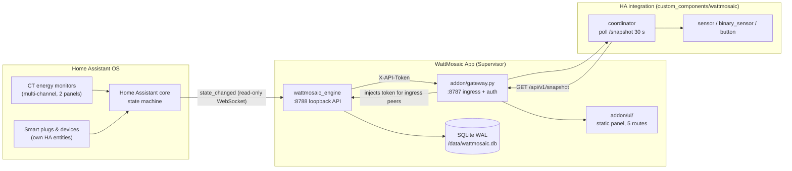
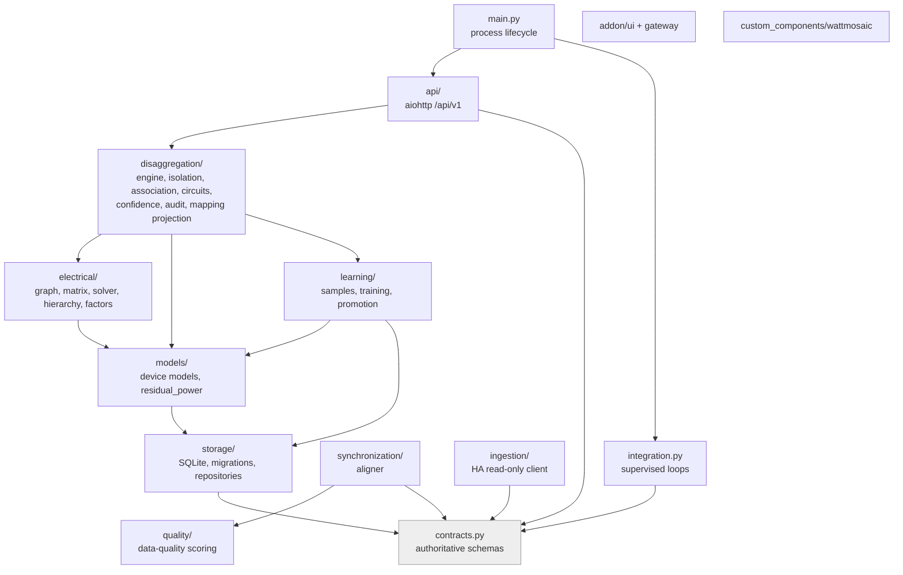
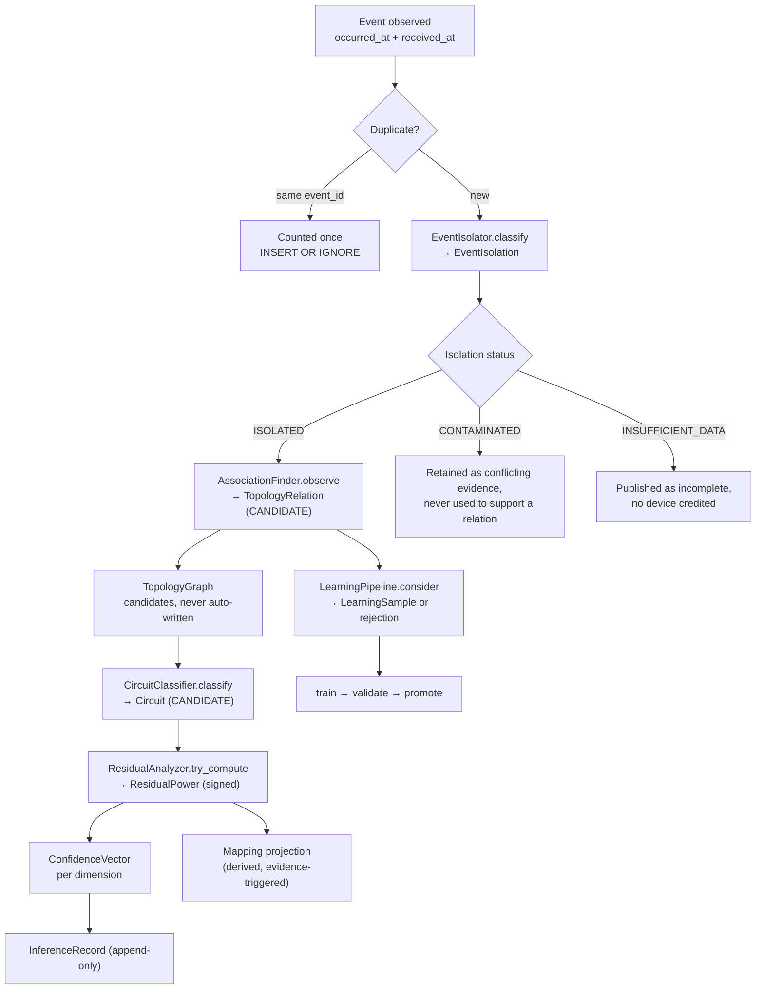

# Architecture — circuit-aware load disaggregation

**SPEC_STATUS: APPROVED_FOR_IMPLEMENTATION** — the module boundaries, data flow,
event flow, dependency relationships, online/batch split, failure isolation,
extension points and the explicit new-versus-reused table.

---

## 1. Architectural position

The target system is the shipped engine plus a small number of **conceptual
layers** and **no new process**. It obeys the repository's governing
decisions:

> **No new runtime dependencies. No new database. No new service. No message
> bus.** Everything ships as: additive contract fields with safe defaults, a
> forward-only migration, new modules inside existing packages, new tests in
> existing suites, simulator extensions inside `tools/simulator/`.
> — `docs/implementation_plan_v2.md` §0

The architecture therefore has to answer one question first: **where do the new
concepts live inside the existing module layout?** §6 answers it.

---

## 2. System context



**Boundaries that must not move.**

- The engine reads Home Assistant over a **read-only** WebSocket. There is no
  service-call code path (`docs/architecture.md` §6; ADR-0002).
- The integration **never computes power**; it renders what the engine decided
  (`docs/architecture.md` §1).
- The engine **never reads** the HA entity/device registry; the integration
  resolves links and writes entity ids into `DeviceTopology.metadata`
  (`docs/architecture.md` §2.1; ADR-0028).
- The panel is served by the gateway, is CSP-safe, has no build step, and is
  read-only apart from confirming an already-inferred topology
  (`docs/architecture.md` §6; ADR-0027).

---

## 3. What is new and what is reused

This is the table the orchestrator should read first. Everything in the
"new" column is a **concept or a derived artefact inside an existing module**,
not a new module, unless the row says otherwise.

| Concern | Reused, unchanged | New in the target | Where it lives |
| --- | --- | --- | --- |
| HA ingestion | `HASource`, `normalize.py`, `discovery.py`, `candidate_entities.py`, `BoundedQueue` | none | `ingestion/` |
| Alignment and staleness | `SampleAligner`, `ObservationWindow`, `coerce_window`, `clamp_cadence`, `ChannelHealth` | cadence published per reader as a first-class field | `synchronization/` |
| Measurement contract | `Measurement`, `CTChannel`, `Phase`, `Polarity`, `QualityStatus` | none — the semantics are already correct | `contracts.py` |
| Topology graph | `TopologyGraph`, `canonical_channel_id`, `effective_feeds`, `scale_w`, `multiplier_for` | a **versioned topology object** with diff and rollback | `electrical/topology.py` + `storage/` |
| Relation edges | `TopologyRelation`, `RelationKind`, `TopologyStatus`, `valid_from`/`valid_to` | an **edge lifecycle vocabulary** and per-edge confidence dimensions | `contracts.py` |
| Circuits | `Circuit`, `CircuitClass`, `CircuitClassifier` | per-circuit unknown-load breakdown and a residual profile | `disaggregation/circuits.py` |
| Measurement matrix | `MeasurementMatrix`, `build_measurement_matrix`, `ElectricalModel` | none | `electrical/matrix.py` |
| Mapping matrix | nothing exists | the **entire Device↔Reader mapping projection** — derived, never persisted as truth | new module inside `electrical/` or `disaggregation/` |
| Unknown load | `Reconciliation.unknown_residual_w`, the solver's unknown slack | a **first-class unknown-load identity and profile** | `contracts.py` + `models/` |
| Residual | `ResidualAnalyzer`, `ResidualPower`, `ResidualTrend`, `persist` | drift detection and a change event | `models/residual_power.py` |
| Solver | `solve_constrained_nnls`, `augment_with_unknown_slack`, `analyse_identifiability` | group estimates with min/max ranges published alongside the batch | `electrical/solver.py` |
| Disaggregation | `DisaggregationEngine`, `InferenceBatch`, `_reconcile`, `_solve_system` | the four-state label (measured / estimated / allocated / unknown) | `disaggregation/engine.py` |
| Events | `DeviceEvent`, `EventIsolator`, `EventIsolation`, `detect_step`, `StepTracker` | a **cross-reader event vector** | `disaggregation/events.py`, `disaggregation/isolation.py` |
| Associations | `AssociationFinder`, `Observation`, `AssociationConfig` | none | `disaggregation/association.py` |
| Hierarchy | `HierarchyFinder`, `HierarchyConfig`, `ValidationResult`, `parent_cycle` | branch→branch proposals are **not** added; the evidence bar stays | `electrical/hierarchy.py` |
| Circuit classification | `CircuitClassifier`, `CircuitConfig` | none | `disaggregation/circuits.py` |
| Confidence | `ConfidenceVector`, `ConfidenceDimension`, `compute_confidence`, `evidence_tier`, `ConfidenceTier` | the two dead dimensions (`topology`, `residual`) get real derivations; the five member names stay | `disaggregation/confidence.py`, `disaggregation/tiers.py` |
| Models | `ModelType`, `ModelStatus`, `DeviceModelVersion`, the registry, `serde.py` | the target's **load-shape class** as a separate axis, not a new `ModelType` member set | `models/` |
| Learning | `LearningPipeline`, sample collection, filtering, training, validation, promotion | unknown-residual events as a learning source | `learning/pipeline.py` |
| Storage | `Database`, `MIGRATIONS`, `apply_migrations`, `prune`, `AUDIT_TABLES` | a **tier registry** and a per-tier retention policy | `storage/` |
| API | the aiohttp `/api/v1` server, the facade protocol, the gateway | **additive read routes** for the mapping matrix, the version history and the configuration events | `api/server.py`, `api/facade.py` |
| Integration | the thin REST client, `async_migrate_entry`, entity identity by `unique_id` | none | `custom_components/wattmosaic/` |
| Panel | the static `addon/ui/` shell, `el()`, the `STRINGS` table, the five-route router | **additional panels inside the existing routes**; the router's route list stays closed unless `OD-08` decides otherwise | `addon/ui/app.js` |
| Deployment | `run.sh`, `gateway.py`, `healthcheck.py`, `config.yaml`, the GHCR pipeline | one or two option-table entries | `addon/` |
| Verification | `tools/dev/verify.py` (12 required gates + 1 optional), `tools/simulator/`, `tools/audit/` | `T01`–`T15` builders | `tools/` |

**Rule.** The row "Reused, unchanged" is a commitment. A change that rewrites
any of those subsystems is out of scope for this specification and would need a
new gap analysis.

---

## 4. Module boundaries and dependency direction

The shipped dependency direction is strictly downward (`docs/architecture.md`
§2):

```text
main → api → disaggregation → electrical → contracts
     → learning → models → storage → contracts
     → ingestion → synchronization → quality → contracts
```

`contracts.py` imports nothing from the package; `storage` imports only
`contracts`. That keeps the schema stable and testable in isolation.

The target adds no arrow that points upward. Concretely:



**Rule.** The mapping projection lives inside `disaggregation/` or
`electrical/` — never in `api/`, never in `storage/`. It is a *view*, like the
panel tree, which is itself a read-time projection rather than a second source
of truth (`docs/assessment_gap_analysis.md` §"What must NOT be rebuilt").

**Rule.** `contracts.py` remains the only schema authority. A new concept
that needs a persisted identity gets a contract model and a JSON schema; a
concept that is derived gets neither.

### 4.1 Where each new concept lives

| New concept | Contract | Module | Storage | API | Panel |
| --- | --- | --- | --- | --- | --- |
| Edge lifecycle vocabulary | `TopologyRelation` gains a lifecycle field (OD-02) | `disaggregation/association.py`, `electrical/hierarchy.py` | `topology_relations` (existing table) | `GET /relations` (existing route) | `#/topology` |
| Versioned topology object | new fields on `Topology` and a version model | `electrical/topology.py` | `topology_versions` (existing table, payload + columns) | `GET /topology/versions`, `GET /topology/diff` | `#/topology` |
| `reader_configuration_version`, `device_mapping_version` | fields on the version model (OD-04) | as above | `topology_versions` payload | as above | `#/topology` |
| Unknown-load identity and profile | a new contract model (OD-01) | `models/residual_power.py` | `residual_power` payload plus a profile column | `GET /residuals` | `#/quality` |
| Mapping matrix | **no contract model** — it is derived | `disaggregation/` (new module) | **no table** — derived on read (OD-05) | `GET /mapping` | `#/topology` |
| Configuration event | a new contract model | `disaggregation/audit.py` | a new table in a new migration | `GET /changes` | `#/topology` |
| Cross-reader event vector | fields on `EventIsolation` | `disaggregation/isolation.py` | `isolation_verdicts` (existing table) | `GET /isolation` | `#/diagnostics` |
| Four-state label | a field on `InferenceResult` | `disaggregation/engine.py` | `inference_results` column | `GET /snapshot`, `GET /devices` | `#/devices`, `#/device/:id` |
| Storage tier registry | no contract model — configuration | `storage/` | `schema_metadata` rows | `GET /status` | `#/diagnostics` |
| Topology and residual confidence derivations | none — the `ConfidenceVector` members already exist | `disaggregation/confidence.py`, `disaggregation/audit.py` | `inference_records` payload | `GET /devices/{id}/records` | `#/device/:id` |

**Rule.** The mapping matrix has no table and no contract model. If a future
design needs one, that is a new decision, recorded as a new open decision —
not a quiet addition.

### 4.2 The two contract facts the target must not mis-state

Two claims in the repository's own documentation do not match the code. The
target specification is written against the **code**, and the discrepancy is
recorded here so no reader inherits it.

| Claim | Code | Consequence for the target |
| --- | --- | --- |
| "Device events carry `event_id` derived from `sha1(entity_id + last_updated + new_state)`" (`docs/data_flow.md:75-78`) | The production path builds `event_id=str(uuid.uuid4())` (`engine/wattmosaic_engine/ingestion/ha_source.py:1186`); the deterministic fallback is `device@timestamp` (`engine/wattmosaic_engine/disaggregation/isolation.py:356-369`). Idempotency is enforced in storage by the `event_id` primary key with `INSERT OR IGNORE` (`engine/wattmosaic_engine/storage/migrations.py:336`; `engine/wattmosaic_engine/storage/database.py:533`). | The event-identity requirement is written against the **observable** behaviour — a re-delivered event counts once — not against the documented derivation. The derivation itself is a separate, open documentation item and is **not** a requirement of this set. |
| "`Topology.version` is a string" | It is `int` (`engine/wattmosaic_engine/contracts.py:1217`), as are `InferenceRecord.topology_version` (`:893`) and `Reconciliation.topology_version` (`:1689`). | The version identifiers are **integers** everywhere. `REQ-CHANGE-003`'s additional identifiers follow the same type unless a decision says otherwise. |

**Rule.** No requirement in this set may rest on a documented claim that the
code contradicts. Where the code and the documentation disagree, the code
wins and the discrepancy is recorded.

---

## 5. Data flow

### 5.1 The shipped inference cycle

The shipped cycle is ten steps (`docs/architecture.md` §3):

1. **Ingest.** `HASource` receives `state_changed`; power entities become
   `Measurement`, state-bearing entities become `DeviceEvent`.
2. **Deduplicate.** An unchanged numeric value is stored with `repeated=True`.
3. **Buffer.** `SampleAligner` keeps a bounded ring buffer per reader.
4. **Align.** At inference time each channel contributes its freshest reading
   within `max_age_s`, with `age_seconds` and quality.
5. **Build matrix.** `ElectricalModel` produces `y = A x` respecting nesting,
   phases and double-pole pairing.
6. **Solve.** Constrained NNLS gives device powers for identifiable devices;
   unidentifiable ones are marked ambiguous rather than guessed.
7. **Reconcile.** Direct / inferred / model / residual are computed. The
   residual is reported, never distributed.
8. **Learn.** Events inside the window become learning-sample candidates;
   rejected ones retain a reason code.
9. **Persist.** Results, samples, reconciliation, aggregates.
10. **Serve.** The integration polls `/snapshot`; entities update.

### 5.2 The target cycle — the same ten steps, with three additions

The target does **not** replace the cycle. It adds three readings of the same
cycle:

```mermaid
sequenceDiagram
    participant HA as Home Assistant
    participant SRC as HASource
    participant AL as SampleAligner
    participant AUD as AuditPass<br/>(analysis pass)
    participant DIS as DisaggregationEngine
    participant MAP as Mapping projection
    participant ST as SQLite
    participant API as /api/v1
    participant UI as addon/ui

    HA->>SRC: state_changed (read-only WS)
    SRC->>AL: Measurement / DeviceEvent
    Note over AL: three timestamps kept;<br/>repeated=True is not new evidence
    AL->>DIS: AlignedWindow (per reader, age, quality)
    DIS->>DIS: matrix → NNLS → identifiability
    DIS->>DIS: reconcile (signed residual, never distributed)
    DIS-->>AUD: InferenceBatch (results + reconciliation + diagnostics)
    AUD->>AUD: isolation → association → circuits → hierarchy
    AUD->>AUD: residuals, confidence dimensions, records
    AUD->>MAP: relations + residual history + models
    MAP-->>AUD: mapping cells (derived, per evidence change)
    AUD->>ST: append-only records, evidence, versions
    ST-->>API: read paths
    API-->>UI: panel fetch (5 routes)
    UI-->>API: confirm topology only
```

**Addition 1 — the analysis pass reads the cycle's output.** The audit pass
already derives isolation verdicts, associations, circuits, residuals and
inference records from one inference batch
(`engine/wattmosaic_engine/disaggregation/audit.py`). The target populates the
two dead confidence dimensions there, because that is where the hierarchy and
residual evidence is already in hand (`docs/confidence_model.md` §2).

**Addition 2 — the mapping projection is computed after the analysis pass.**
It is derived from the relations, the residual history and the model registry,
never from the samples. It is recomputed when the evidence or the models
change, not per sample (REQ-MAPPING-005).

**Addition 3 — the configuration event stream.** Every change to the readers,
the devices or the declared configuration produces a configuration event with
a version identifier, and the affected inference records are reconciled against
the new version (REQ-CHANGE-001, REQ-CHANGE-007).

### 5.3 Timestamp semantics, restated because they are load-bearing

| Field | Meaning | Source |
| --- | --- | --- |
| `state_timestamp` | HA `last_updated` for the state object | HA state machine |
| `received_at` | when the engine actually observed it | engine monotonic + wall clock |
| `physical_timestamp` | hardware sample time, if the instrument ever exposes one | usually `null` |

Consequences carried by the target:

- `age = engine_now − state_timestamp` is the honest staleness measure.
- A burst of many entities within milliseconds is one poll cycle.
- Repeated identical values (common at the audited ~15.7 s cadence) are **not**
  new samples; they update the current value but not the evidence count.
- `observed_at` and `ingested_at` are both preserved for events and never
  conflated (REQ-EVENT-009).

### 5.4 Retention flow, and the tier concept

The shipped flow (`docs/data_flow.md` §4):

```text
raw samples (30 d default)
   └─► 5-minute power/energy aggregates
          └─► 1-hour aggregates
                 └─► retained 730 d default
```

The target names four tiers so that the retention rule is a property of the
data, not of the table name (REQ-STORAGE-001):

| Tier | Content | Horizon | Rule |
| --- | --- | --- | --- |
| **L1** high-resolution raw measurements | `ct_samples` | 30 d default, target 7–14 d (`OD-03`) | deleted on the raw horizon |
| **L2** immutable event evidence | `device_events`, `isolation_verdicts`, `inference_records`, `evidence_records` | long-term | **never** deleted by `prune` |
| **L3** aggregated measurements | `power_aggregates`, `energy_aggregates`, `device_runs` | 730 days | deleted on the aggregate horizon |
| **L4** versioned models and topology | `device_models`, `device_model_versions`, `device_configurations`, `topology_versions`, `circuits`, `topology_relations`, `ct_measurement_factors`, `ha_entity_bindings`, `residual_power`, `schema_metadata`, `device_flags`, `engine_state` | indefinite | never deleted by `prune` |

**Rule.** The tier names, the table lists and the per-tier horizons are fixed by
[`08-storage-and-data-lifecycle.md`](08-storage-and-data-lifecycle.md) §2; this
table restates them and does not define a second classification.

**Rule.** `prune` reports each exempt table with a count of `0` and leaves it
untouched, so "deleted nothing" is visible rather than merely absent
(`engine/wattmosaic_engine/storage/database.py:1304-1344`).

**Rule.** A new model version, a new topology version or a new mapping version
never deletes historical evidence (REQ-STORAGE-005).

---

## 6. Event flow

### 6.1 The three event kinds

| Kind | Source | Contract | Notes |
| --- | --- | --- | --- |
| HA-driven | a Home Assistant state or attribute change | `DeviceEvent` | `event_type` covers `state_changed`, `power_change`, `cycle_start`, `stage_change`, `cycle_end`, `availability` (`contracts.py:1551-1557`) |
| Measurement-driven | a detected step in a reader | `StepChange` / `detect_step` | anchored rescan, not a generic detector |
| Unknown-residual | a change in the unexplained remainder | a residual event | new; consumable by learning |

### 6.2 The path of one event



**Rule.** A `CONTAMINATED` event is retained and counted; it is never used to
support a relation and never decomposed (`docs/association_and_topology.md`
§2.2; `docs/limitations_v2.md` §2).

**Rule.** A candidate edge is a proposal. `requires_confirmation` is always
true and the confidence never exceeds 0.99.

### 6.3 The cross-reader event vector

A new, small addition: for each event, the per-reader effect it caused — the
before/after level, the delta and the quality. It is what lets the system say
"this device moved and *this* reader saw it, and that reader did not" without
re-deriving anything. The correlation module already computes a per-reader
delta (`_step`, `engine/wattmosaic_engine/ingestion/correlation.py:397`); the
vector is its published form (REQ-EVENT-005).

### 6.4 Late data and duplicates

| Situation | Behaviour | Evidence |
| --- | --- | --- |
| A late event arrives | classified as late; `occurred_at` untouched; the window is not rewritten | `EventIsolator.reclassify` (`docs/event_isolation.md` §6.1) |
| A duplicate event arrives | counted once; `event_id` is `sha1(entity_id + last_updated + new_state)` | `docs/data_flow.md` §3 |
| Two entities of one device change together | one physical device change; one credit | `docs/event_isolation.md` §4 |
| A group is incomplete | published as incomplete with the missing part named; no credit | `IsolationStatus.INSUFFICIENT_DATA` |

---

## 7. Online versus batch processing

The engine runs supervised loops in one asyncio process
(`engine/wattmosaic_engine/main.py:1183`, `:1308`). The target adds nothing to
that topology and distinguishes three kinds of work.

| Kind | Cadence | Deadline | On failure |
| --- | --- | --- | --- |
| **Online — observation** | per sample, as HA delivers it | none | the sample is dropped with a counted metric; the ring buffer absorbs the gap |
| **Online — inference** | every inference interval (default 5 s, `WM_INFERENCE_INTERVAL_S`) | one cycle | a device that raises is isolated; the batch continues and the error is logged to `system_events` (`docs/architecture.md` §5) |
| **Online — event analysis** | per event, inside the inference cycle | one cycle | a rejected event keeps its reason code |
| **Batch — periodic re-analysis** | `WM_REANALYSIS_INTERVAL_S` (default 3600 s) | none | the previous records remain; nothing is rewritten |
| **Batch — learning and promotion** | on sample intake | none | a candidate that does not beat the active model is not promoted |
| **Batch — maintenance** | retention, aggregation, checkpoint | none | `prune` is transactional; a failure rolls back and leaves the tables untouched |

**Rule.** Nothing in the target path blocks the event loop indefinitely. Every
network call has a timeout and the long analysis runs off the loop
(ADR-0031, ADR-0033).

**Rule.** The health probe does no verification work (ADR-0018); verification
is a separate, explicit step (REQ-DEPLOY-006).

---

## 8. Failure isolation

The shipped failure model (`docs/architecture.md` §5) is preserved and extended:

| Failure | Shipped behaviour | Target behaviour |
| --- | --- | --- |
| HA disconnects | reconnect with jittered backoff; DB writes continue; entities go stale → unavailable | unchanged; the event vector shows the gap |
| One device raises | per-device isolation; batch continues; error logged | unchanged |
| Malformed sample | skipped with a quality event | unchanged |
| Engine restarts | migrations idempotent; topology/models reloaded; last energy bucket recomputed | unchanged |
| DB corrupt | `PRAGMA integrity_check` at startup; refuses to run on corruption | unchanged |
| Queue full | drop-oldest with a counted metric | unchanged |
| A single reader goes stale | its row is excluded with a reason; the rest of the cycle proceeds | unchanged; a paired leg excludes **both** rows |
| A topology change is suspected | — | a hypothesis is recorded; the live configuration is untouched until validated |
| The mapping projection cannot be built | — | the mapping route reports the missing evidence and names it; it never guesses a cell |
| A second engine process opens the same file | the loser gets a `busy` error after the `busy_timeout` | unchanged; the single-writer rule is preserved (`docs/limitations_v2.md` §7.1) |

**Rule.** No failure path produces a fabricated number. Every refusal carries a
machine reason code.

---

## 9. Extension points

The target is designed so that the *next* addition does not need a rewrite.

| Extension point | How a new thing attaches | Constraint |
| --- | --- | --- |
| A new **relation kind** | a `RelationKind` member plus a producer in `disaggregation/` or `electrical/` | a new kind never implies an existing one |
| A new **device power-model class** | a load-shape axis beside `PowerBehavior`; the solver and the registry consult it | the three orthogonal taxonomy axes stay separate (`contracts.py:129-143`) |
| A new **reader instrument** | a new `MeasurementBasis` member and a normalisation rule in `ingestion/normalize.py` | an unestablished basis is `UNKNOWN`, never a guess |
| A new **event kind** | a `DeviceEvent.event_type` member plus an isolator rule | a new kind must state whether it is load evidence |
| A new **confidence dimension** | a `ConfidenceVector` member plus a derivation | no aggregate is ever added; `None` stays distinct from `0.0` |
| A new **storage tier** | a tier-registry entry and a retention rule | a new tier states its horizon and its deletion rule |
| A new **API read path** | a route on the aiohttp server plus a facade method | additive; 400 for validation failures; the contract header on every response |
| A new **panel view** | a view function inside the existing route, using `el()` and the `STRINGS` table | no build step; CSP-safe; text-only insertion |
| A new **scenario** | a deterministic builder in `tools/simulator/` with a `LabHouse` stratum | the builder separates `observations()` from `ground_truth()` |

---

## 10. Integration with the existing interfaces

### 10.1 The contract

- New fields are **additive and optional**; an older payload still validates
  (`docs/implementation_plan_v2.md` §0).
- The change protocol is followed exactly: bump `CONTRACT_VERSION` → regenerate
  `data/schemas/` → update the docs → run the suite
  (`docs/interface_contracts.md` §5).
- CI hard-fails on schema drift (`.github/workflows/ci.yml:28-29`).
- `CONTRACT_VERSION` is currently `2.0.0` (`engine/wattmosaic_engine/contracts.py:32`);
  the target's first change moves it forward. The stale values in
  `docs/api.md:7` (`1.6.0`) and `docs/architecture.md:3` (`1.4.0`) are **not**
  repeated here and are not to be trusted.

### 10.2 The HTTP API

- New routes are **additive**: `GET /mapping`, `GET /topology/versions`,
  `GET /topology/diff`, `GET /changes`, `GET /storage`.
- Every route returns the contract header, authenticates with the constant-time
  token compare, and returns **400** — never 422 — on a validation failure
  (`engine/wattmosaic_engine/api/server.py:12-13`, `:284`, `:341`).
- The facade protocol grows in step with the server
  (`engine/wattmosaic_engine/api/facade.py:94-148`); `NullFacade` must answer
  for every new method so a missing backend does not 500.
- Existing routes keep their meaning; the target adds, it does not redefine
  (`docs/interface_contracts.md` §2.2).

### 10.3 The Home Assistant integration

- Unchanged in role: a thin REST client that renders the engine's decisions
  (`docs/architecture.md` §1).
- New engine concepts do **not** become new HA entities by default. A reader
  inventory and a mapping matrix are engine-side read paths, surfaced through
  the panel and the API.
- Entity identity remains `unique_id`-based and stable across a `device_id`
  change; `entity_id` never changes because of a topology change
  (ADR-0021).
- `async_migrate_entry` remains the mechanism for a config-entry change
  (`custom_components/wattmosaic/__init__.py:71`).

### 10.4 The panel

- The panel stays static: `index.html`, `app.css`, `app.js`, `mark.svg`, served
  from a fixed allowlist by the gateway, under `script-src 'self'`
  (`docs/deployment.md` §"Panel assets"; ADR-0027).
- All DOM is built with `el()` and inserted as text, never as markup
  (`tools/dev/check_panel.py`).
- New labels go into the `STRINGS` table (`addon/ui/app.js:264-292`) so the
  static gate can check them.
- The router's route list is closed (`addon/ui/app.js:655-660`); under `OD-08`
  the new content goes inside the existing routes.

### 10.5 The database

- New schema changes are new numbered migrations, forward-only, additive and
  idempotent; the current version is 11
  (`engine/wattmosaic_engine/storage/migrations.py:792`).
- The configuration-event table is the only genuinely new table in the first
  wave; everything else reuses `topology_versions`, `topology_relations`,
  `inference_records`, `isolation_verdicts`, `residual_power` and
  `circuit` storage.
- `PRAGMA user_version` is the version marker; `busy_timeout=10000` and the
  single writer are preserved.

---

## 11. The physical electrical topology versus the measurement topology

This distinction is the spine of the whole design and is stated separately so
that no reader conflates them.

| | Physical electrical topology | Measurement topology |
| --- | --- | --- |
| **What it is** | the wiring: which conductors feed which circuits | the graph the engine actually reasons over: readers, circuits, devices and the relations between them |
| **Who owns it** | the electrician and the house | the engine, from measurement and declaration |
| **How it is known** | a declaration, or an inference that met the evidence bar | inference and declaration, recorded as typed relations |
| **Can it be derived from correlation alone?** | **No.** "Correlation is not topography, and a bigger reading is not upstream." | Correlation is *evidence toward* a hypothesis; it is never the conclusion. |
| **What happens when it is wrong** | the house is wrong | the affected edges are marked, the affected records keep their version, and the residual grows |
| **Stored where** | `topology_versions` payload (the declared wiring) | `topology_relations` (the typed edges) plus `circuit` rows |

**Rule.** Physical wiring is never inferred from correlation alone. A
child-to-parent correlation is containment evidence only when it is repeated
and validated, and an unexplained parent change does not disprove containment
(`docs/association_and_topology.md` §5; REQ-TOPO-004).

**Rule.** Exact parent–child power conservation is never enforced. The
containment check tolerates the documented violation fraction and records the
violation (REQ-TOPO-005).

**Rule.** The graph may be incomplete. An unplaced device, an unconnected
reader and an unresolved circuit are all valid states that the system reports
(REQ-TOPO-010).

**Rule.** The relationship set is typed and the kinds never imply one another:
containment, shared load, leg pairing and correlation are four different
claims about four different things (REQ-TOPO-001).

---

## 12. Design decisions taken here, and their alternatives

| # | Decision | Alternative rejected | Why |
| --- | --- | --- | --- |
| D1 | The target is additive deltas on the existing engine. | A parallel rewrite | The engine already owns topology inference, residual modelling, power models, event correlation and confidence, with a suite of 2 827 collected tests protecting the invariants; a rewrite would regress them (`docs/implementation_plan_v2.md` §0). |
| D2 | The mapping matrix is derived on read and has no table. | A persisted matrix table | A persisted matrix is a second source of truth and would drift from the relations (OD-05). |
| D3 | The mapping matrix lives in `disaggregation/`, not `api/` or `storage/`. | An API-layer projection | The projection must be reusable by the API, the panel and any exporter; the API layer must not own domain logic. |
| D4 | The edge lifecycle is a separate vocabulary from `TopologyStatus`. | Extending `TopologyStatus` | `TopologyStatus` has three members and is read by existing consumers; extending it would break them (`contracts.py:84-87`, OD-02). |
| D5 | The four-state label is a field, not prose. | Prose labels in the panel | A prose label cannot be asserted by a test and cannot be carried by the API (`README.md` §4). |
| D6 | The confidence dimensions keep the existing five member names. | A new dimension set | A second set would fork the contract and break `dimensions()`; the target fills the two dead dimensions instead (`docs/confidence_model.md` §2). |
| D7 | The target's load-shape class is a separate axis from `ModelType`. | New `ModelType` members | `ModelType` names *model implementations* (`BINARY`, `DIMMABLE`, …); the load-shape class names *how a device draws power*. Overloading one enum is the failure the four-axis rule exists to prevent (`contracts.py:129-143`). |
| D8 | The configuration event is a distinct artefact. | A new `RelationKind` | A hypothesis about a change is not a relation between two objects (OD-06). |
| D9 | The panel gains views inside the existing routes. | New hash routes | The router's route list is closed and the panel is deliberately small; the target's content fits the existing five routes (`addon/ui/app.js:655-660`, OD-08). |
| D10 | The unknown-load identity is a contract object. | A residual attribute only | The target brief requires unknown load to be a first-class entity with a lifecycle; a residual attribute cannot carry one (OD-01). |
| D11 | The topology version is diffable but stored as one row per version. | A new version-diff table | A diff is computable from two payloads; a second table would be redundant (OD-04). |
| D12 | The analysis pass populates the two dead confidence dimensions. | A separate confidence pass | The hierarchy and residual evidence is already in hand at that point; a separate pass would re-derive it (`docs/confidence_model.md` §2). |

---

## 13. Diagram index

| Diagram | Section |
| --- | --- |
| System context — HA, App, integration, storage | §2 |
| Module and dependency view | §4 |
| Inference-cycle sequence (the ten steps plus three additions) | §5.2 |
| Event flow — one event from observation to record | §6.2 |
| Retention tiers (L1–L4) | §5.4 (table) |

---

## 14. Related documents

- [`README.md`](README.md) — the specification index and the conventions.
- [`00-project-overview.md`](00-project-overview.md) — goals, scope, invariants,
  risks and the open decisions referenced here (`OD-01`, `OD-02`, `OD-04`,
  `OD-05`, `OD-06`, `OD-08`).
- [`01-requirements.md`](01-requirements.md) — the normative requirements this
  architecture carries.
- `docs/architecture.md` — the shipped module boundaries and the inference cycle.
- `docs/interface_contracts.md` — the frozen contracts and the change protocol.
- `docs/data_flow.md` — timestamp semantics, retention tiers, backpressure.
- `docs/electrical_model.md` — the measurement model, the double-counting rule,
  the solver and identifiability.
- `docs/residual_analysis.md` — the signed residual, its validity rules and its
  decomposition.
- `docs/confidence_model.md` — the five dimensions, the dead ones, and the
  calibration boundary.
- `docs/association_and_topology.md` — the four relation kinds, the eight
  evidence rules and the hierarchy evidence bar.
- `docs/event_isolation.md` — the two windows and the isolation verdict.
- `docs/limitations_v2.md` — what the shipped system does not do, and the open
  defects.
- `docs/assessment_gap_analysis.md` — `G1`–`G20` and the "must NOT be rebuilt"
  list.
- `docs/implementation_plan_v2.md` — the governing decisions and the seven
  acceptance gates.
- `docs/deployment.md` — the deployment shapes and the panel asset rules.
- `docs/decisions/README.md` — the accepted ADRs this architecture relies on.
