# 03 — Measurement and Electrical Domain

**SPEC_STATUS: APPROVED_FOR_IMPLEMENTATION** — Specification — measurement semantics, quantities, units, nullability, phase/leg rules and electrical-domain behaviour of the existing WattMosaic engine, with the deltas required to make the final system guarantee them.

**Date:** 2026-11-16 · **Baseline:** branch `main`, HEAD `612e1233`, engine version `0.2.1-dev.36`, `CONTRACT_VERSION = "2.0.0"` (`engine/wattmosaic_engine/contracts.py:32`), SQLite schema `LATEST_VERSION = 11` (`engine/wattmosaic_engine/storage/migrations.py:792`).

**Purpose.** This document answers one question: *what does the system actually observe, in what units, with what semantics, and what can it not observe at all?* It is the measurement half of the specification. The topology half is [04-topology-spec.md](04-topology-spec.md).

**Quantifier convention used throughout.** **measured** = read directly from the source or a committed artifact; **estimated** = derived from a measurement by a stated rule; **allocated** = assigned by a model or heuristic; **unknown** = not present in the repository. These are the four values of the `Source`/`MeasurementBasis` vocabulary and are used consistently here.

**How to read the status markers.** Every capability in this document carries one of:

| Marker | Meaning |
| --- | --- |
| **EXISTS** | Implemented and cited to `file:line`. The behaviour is a fact about the shipped engine. |
| **PARTIAL** | Implemented, with a named shortfall that is stated in the same row. |
| **MISSING** | No code path exists. The required behaviour is specified below and named as the extension it needs. |

Gap identifiers reuse `docs/assessment_gap_analysis.md` `G1`–`G20` where one applies. Where this document identifies a genuinely new gap, it uses the `G60`–`G63` band allocated to this file by the canonical register in `00-project-overview.md` §13.2 — the register of record for gap identifiers — and says so explicitly. §17 is the upstream source for the gaps this document lists.

---

## 1. The governing measurement reality

### 1.1 Active power in watts is the only power quantity

**EXISTS.** `Measurement.unit` is `Literal["W","kW","kWh","Wh"]` (`contracts.py:1074`); `value_w` is `float | None` (`:1075`); `effective_power_w()` performs the unit conversion and the polarity sign flip (`:1107-1113`). There is no other power unit in the contract.

kW is normalised to W at ingestion, before anything else sees the value: `normalize_unit(value, unit)` returns `(value * 1000.0, "W")` for `kW` (`ingestion/normalize.py:48-64`); `canonical_unit()` (`:41-46`) maps the vendor spellings (`watt`, `kilowatt`, `watt-hour`, `watt_hours`, …) onto the four contract spellings and returns `None` for anything unsupported, which makes the caller raise rather than treat an unknown unit as watts.

Detection of what a reading *is* is by unit **or** by device class:

```text
is_power  = unit in ("W", "kW") or device_class == "power"
is_energy = unit in ("kWh", "Wh") or device_class == "energy"
```

(`ingestion/ha_source.py:1065-1066`). An energy reading is only ingested when `include_energy` is true (`ha_source.py:1067`; `include_energy: bool = True` at `ha_source.py:349`, and `stale_after_s` at `:364`).

**Rule.** Every power value that enters the engine is in watts. A consumer that receives a value in any other unit has either bypassed the ingestion path or is reading a stored raw row.

### 1.2 The measurement pipeline, end to end

```mermaid
graph LR
    HA["Home Assistant<br/>state_changed event"] --> SRC["HASource<br/>ingestion/ha_source.py"]
    SRC --> NORM["normalize_unit<br/>kW to W"]
    NORM --> M["Measurement<br/>contracts.py:1062"]
    M --> AL["SampleAligner<br/>synchronization/aligner.py:425"]
    AL --> WIN["CoercedWindow<br/>electrical/window.py:182"]
    WIN --> MX["MeasurementMatrix<br/>electrical/matrix.py"]
    MX --> SOL["solve_constrained_nnls<br/>electrical/solver.py"]
    SOL --> INF["InferenceResult<br/>contracts.py:1642"]
    INF --> REC["Reconciliation<br/>contracts.py:1685"]
```



The aligner routes by unit: `kWh`/`Wh` go to the **energy** buffers and are never converted to watts and never enter a power window; `W`/`kW` go to the power buffers (`synchronization/aligner.py:451-470`). A malformed or non-finite sample is counted in `rejected_count` and dropped — it never raises out of the ingestion loop (`:471-475`).

### 1.3 What the engine never reads

**EXISTS.** Home Assistant is accessed over a read-only WebSocket client with an explicit command whitelist (`READ_ONLY_COMMANDS`, `ingestion/ha_source.py:147-164`, enforced at `:932`). The engine never calls an HA service (ADR-0002; `docs/architecture.md:142-160`).

**EXISTS.** The engine never polls CT values. HA pushes `state_changed` and the engine subscribes (`ha_source.py:830`). The engine additionally reads recorder history for backfill, splitting any window longer than 24 h into 12 h slices with a seam-exact merge (`ha_source.py:103-135`, `:231-334`; `HISTORY_SLICE_HOURS = 12.0`, `HISTORY_SLICE_THRESHOLD_HOURS = 24.0`, `HISTORY_BOUNDARY_NUDGE = 1 µs`).

**Rule.** No new acquisition path may be introduced. A measurement arrives because HA pushed a state change, or because the engine read recorder history. There is no polling loop and there must not be one.

---

## 2. Reader types

### 2.1 The closed `CTType` vocabulary

**EXISTS.** `CTType` has exactly three members — `MAIN`, `BRANCH`, `UNKNOWN` (`contracts.py:44-47`). The values are `"main"`, `"branch"`, `"unknown"`.

| Value | Electrical meaning | Can be a device's attribution CT? |
| --- | --- | --- |
| `MAIN` | An incoming line or panel feed. It measures a *conductor* that carries the aggregate of everything downstream of it. | **No.** A main is a containment constraint, never an attribution row (`docs/electrical_model.md:31-46`). |
| `BRANCH` | A circuit. It carries zero or more known devices and may itself contain child CTs. | **Yes** — this is the only role a load CT can take. |
| `UNKNOWN` | Unverified. | **No.** `TopologyGraph._validate_channels` records a validation problem for an unknown-phase channel and treats phase-dependent rows as `BOTH`; an unattributed `UNKNOWN` channel contributes no attribution (`docs/electrical_model.md:826-846`). |

**Rule.** `branch` is the only load role. Nothing in the topology asserts that a circuit feeds exactly one load. A single-device circuit is a `branch` row with exactly one declaring device — a structural fact the solver detects, not a declared role (`docs/electrical_model.md:31-46`).

### 2.2 The retired "dedicated device" role

**EXISTS (retired).** The `dedicated_device` CT type is gone. It was removed by migration 11, `retire_dedicated_device_role`, which rewrites `ct_channels.ct_type` from `'dedicated_device'` to `'branch'` and `inference_results.monitoring_level` from `'dedicated'` to `'shared'` (`storage/migrations.py:768-789`). The `CTType` enum was narrowed to three members and `CONTRACT_VERSION` was broken from 1.5.0 to 2.0.0 (`docs/decisions/README.md` ADR-0034, "Decision" §1–§5).

Also removed by the same decision: the Level-1 direct-measurement path (`resolve_direct`, `DirectReading`, `dedicated_channel_for`), `EffectiveConfig.allows_direct_measurement`, `MonitoringLevel.DEDICATED` and `DeviceTopology.dedicated_ct_ids` (ADR-0034, "Decision" §2–§4). Historical `Source.DIRECT_MEASURED` rows stay readable because the enum member survives (ADR-0034, "Decision" §5).

**Consequence.** A device alone on its row is now reported as `Source.INFERRED` at the tier the evidence supports, with no special confidence floor (`docs/electrical_model.md:691-706`).

### 2.3 The three orthogonal device axes

**EXISTS.** `HaConnectivity`, `MonitoringLevel` and `PowerBehavior` are separate axes (ADR-0011; `contracts.py:313-364`):

| Axis | Question | Values |
| --- | --- | --- |
| `HaConnectivity` (`contracts.py:316-331`) | Can HA observe or actuate the device? | `CONNECTED`, `NOT_CONNECTED`, `UNKNOWN` |
| `MonitoringLevel` (`contracts.py:351-364`) | How closely does the electrical tree observe it? | `SHARED`, `HOME_TOTAL_ONLY`, `UNMONITORED`, `UNKNOWN` |
| `PowerBehavior` (`contracts.py:367-391`) | How does power relate to the control state? | `FIXED`, `VARIABLE`, `COMPLEX`, `UNKNOWN` |

**Rule.** These axes are never collapsed into one enum. `CTType` describes a sensor, `MonitoringLevel` describes a device's visibility, and `CircuitClass` describes a circuit's scope; none of them can substitute for another.

---

## 3. Active power

### 3.1 Units, sign and nullability

| Property | Value | Evidence |
| --- | --- | --- |
| Unit | W (normalised at ingestion) | `contracts.py:1074`; `ingestion/normalize.py:48-64` |
| `Measurement.value` | `float`, finite (validator rejects NaN/Inf) | `contracts.py:1075`, `:1100-1105` |
| `Measurement.value_w` | `float \| None` — `None` means "not populated"; `effective_power_w()` falls back to `value` | `contracts.py:1075`, `:1108-1111` |
| Sign | Preserved. Never clamped to zero. | `contracts.py:15-16`; `docs/electrical_model.md:611-643` |
| `effective_power_w()` | `raw * sign`, where `sign = -1` iff `polarization == Polarity.INVERTED` | `contracts.py:1107-1113` |

**Rule.** A negative power value is a real observation. It means reverse flow, a mis-declared polarity, or a measurement fault — never "no load". See §11.

### 3.2 Measured versus estimated: the `Source` vocabulary

**EXISTS.** `Source` (`contracts.py:62-75`) answers *how the value was obtained*:

| `Source` member | Meaning | Where it is produced |
| --- | --- | --- |
| `DIRECT_MEASURED` | Read directly from the source. **Retained for historical rows only** — the Level-1 direct path was deleted with ADR-0034 (`docs/decisions/README.md` ADR-0034 §2, §5). | No live producer since ADR-0034. |
| `INFERRED` | Solved from the measurement matrix. The normal path for an attributed device. | `disaggregation/engine.py`, the NNLS solve. |
| `MODEL_ESTIMATED` | Produced by a validated device model, not by a measurement of this device. | `learning/` promotion path. |
| `CONFIGURED_PRIOR` | Derived only from user configuration. Weaker than a validated model: an assertion, not a fit. | `ExpectedPower` (`contracts.py:1249-1263`) and `disaggregation/configuration.py`. |
| `UNKNOWN` | Not established. | The default on `InferenceResult.source` is not `UNKNOWN` — it is required (`contracts.py:1647`) — but `ResidualPower.basis` and `InferenceRecord.source` default to `UNKNOWN`. |

**Rule.** `Source` and `ConfidenceTier` are separate axes and are never merged (`docs/confidence_model.md:31-34`). `Source` says how; the tier says what kind of evidence.

### 3.3 What kind of instrument produced the watts: `MeasurementBasis`

**EXISTS.** `MeasurementBasis` (`contracts.py:186-211`) is orthogonal to `Source`:

| `MeasurementBasis` | Meaning |
| --- | --- |
| `CT_MEASURED` | A physical CT reading of the conductor, used as reported. |
| `MONITOR_REPORTED` | The monitor published the whole load itself (e.g. Refoss). |
| `FACTOR_ADJUSTED` | A per-circuit scaling factor was applied to the reading. |
| `ESTIMATED_APPLIANCE_TOTAL` | An appliance total estimated from a model or a configured prior, not measured. |
| `UNKNOWN` | The basis is not established; no scaling or interpretation is claimed. |

The basis travels on both the channel (`CTChannel.measurement_basis`, `contracts.py:1170`) and the individual reading (`Measurement.measurement_basis`, `contracts.py:1086`), because a factor change mid-history makes per-channel state ambiguous.

**EXISTS.** `Measurement.multiplier_applied` (`contracts.py:1088`) records the scaling *this specific reading* received; `1.0` means none. It must be strictly positive and finite (`:1090-1097`).

### 3.4 Compatibility between bases is deliberately non-transitive

**EXISTS.** `bases_are_compatible` (`models/residual.py:166`, per `docs/residual_analysis.md:89-104`):

| Pair | Comparable? | Physical reason |
| --- | --- | --- |
| same basis | yes | trivially |
| `CT_MEASURED` ↔ `MONITOR_REPORTED` | **yes** (`_PHYSICAL`) | both are measurements of that conductor |
| `MONITOR_REPORTED` ↔ `FACTOR_ADJUSTED` | **yes** (`_WHOLE_APPLIANCE`) | a monitor that applied the factor *is* the factor-adjusted case |
| `FACTOR_ADJUSTED` ↔ `CT_MEASURED` | **no** | one side claims an appliance total, the other a leg; only a recorded multiplier can bridge them |
| `ESTIMATED_APPLIANCE_TOTAL` ↔ anything measured | **no** | an estimate may be reported, not subtracted from a reading |

**Rule.** Compatibility is not transitive, on purpose. `CT_MEASURED` and `FACTOR_ADJUSTED` are each compatible with `MONITOR_REPORTED` and incompatible with each other. A consumer must not infer compatibility through an intermediate basis.

---

## 4. RMS current, voltage, power factor, reactive power, apparent power, frequency

### 4.1 The verdict: NOT MEASURED

**MISSING — these six quantities do not exist in the system, in any form.**

A repository-wide search of `engine/wattmosaic_engine/` for voltage, current, reactive power, apparent power, power factor and frequency tokens returns **no measurement quantity**. There is no field, no enum member, no ingestion branch, no solver term and no API surface for any of them. The `Measurement` contract carries exactly four units (`contracts.py:1074`) and exactly one numeric value.

| Quantity | Contract field | Status | What the system does instead |
| --- | --- | --- | --- |
| RMS current (A) | none | **NOT MEASURED** | Nothing. The system reasons about watts only. |
| Voltage (V) | `CTChannel.nominal_voltage` (`contracts.py:1147`) is a **declared constant for current-only channels**, not a measurement. | **NOT MEASURED** | See §4.2. |
| Power factor | none | **NOT MEASURED** | Nothing. |
| Reactive power (VAR) | none | **NOT MEASURED** | Nothing. |
| Apparent power (VA) | none | **NOT MEASURED** | Nothing. |
| Frequency (Hz) | none | **NOT MEASURED** | Nothing. |

### 4.2 Why `nominal_voltage` is not a measurement

**EXISTS.** `CTChannel.nominal_voltage: float | None = None` (`contracts.py:1147`), documented as "Optional nominal voltage for current-only channels." It is a **declared constant** attached to a channel: it says what the conductor's nominal rating is, so that a current-only CT could in principle be interpreted. The engine does not use it to derive anything.

**Rule.** `nominal_voltage` must never be surfaced as a measured voltage, must never be populated from a reading, and must never be used to compute a current from a power. There is no code path that converts watts to amperes, because amperes are not observed (§4.1).

**Consequence.** Power cannot be converted to current in this system without a declared nominal, and even with one the conversion would be an *estimate*, not a measurement. The system does not do it and this specification does not require it.

### 4.3 The prohibition

**Rule.** These six quantities must never be synthesised, estimated, back-computed or displayed as measured. Specifically:

* No field named `voltage`, `current_a`, `power_factor`, `reactive_var`, `apparent_va` or `frequency_hz` may be added to `Measurement`, `CTChannel`, `InferenceResult` or `Reconciliation` on the basis that a producer could fill it. No such producer exists (CON-001, `docs/specs/load-disaggregation/phase0-repository-and-environment-discovery.md:362-364`).
* The API must not return a computed amperage alongside a wattage. A consumer that needs current must declare the nominal itself and label the result as its own estimate.
* The panel must not render a reactive-power or power-factor figure derived from watts.

**Related existing gaps.** `docs/electrical_model.md:844-870` (§10) already records two related absences: there is **no explicit unknown-load entity** in the contract (unknown load is `Reconciliation.unknown_residual_w` plus solver slack, with no per-circuit breakdown), and there is **no per-device phase-split fraction** (`α` is a single global `phase_split_l1`). Both are recorded here as scope boundaries for the measurement domain; neither is closed by this document.

**Gap register.** `G60` — the six unmeasured electrical quantities have no contract representation at all. See §14.

---

## 5. Energy measurements

### 5.1 The counter semantics

**EXISTS.** Cumulative energy is a separate domain from power.

* `HaEntityRole.ENERGY_COUNTER` (`contracts.py:291`) — "The entity reports cumulative energy, never instantaneous watts."
* `SampleAligner.add()` routes `kWh`/`Wh` into dedicated energy buffers (`synchronization/aligner.py:463-466`); "it is never converted to watts and never enters a power window."
* `InferenceResult.energy_kwh: float | None` (`contracts.py:1646`) — the integrated energy of an inference result, nullable because it is only populated once an interval has elapsed.
* Ingestion is gated by `include_energy` (`ha_source.py:1067`, `:349`).

**Rule.** A cumulative counter is a **monotonically increasing total**, not a rate. It is never converted to instantaneous watts and never substituted for a power reading.

### 5.2 `total_increasing` versus a derived rate

**PARTIAL.** The engine does not model an HA `state_class: total_increasing` attribute directly. What it does instead:

* The energy buffer records the counter value and its timestamps; a counter reset is detected as a drop and penalised (`QualityThresholds.energy_reset_penalty = 0.30`, `energy_reset_min_drop_kwh = 1e-6`, `quality/engine.py:141-143`).
* A derived rate (counter Δ over elapsed time) is the *only* legitimate way to relate a counter to power, and the engine derives that relation inside the energy aggregator rather than at ingestion.

**MISSING.** There is no contract field that records the source's declared `state_class`. The consequence is that the engine cannot distinguish "this entity reports a total that only increases" from "this entity reports a monotonically increasing but resettable total" from the payload alone; it infers reset behaviour from observed drops. A `state_class` field on the binding would make this explicit. This is `G61` (§14).

### 5.3 The energy aggregator: trapezoid on real elapsed time, nothing across a gap

**EXISTS.** `aggregation/aggregator.py`:

| Rule | Evidence |
| --- | --- |
| Energy is integrated with the **trapezoidal rule over actual elapsed time** between consecutive inference results for a device. No sample rate is assumed; timestamp jitter is handled exactly. | `aggregator.py:5-8`; `docs/interface_contracts.md:178-185` |
| An interval longer than `stale_after_s` is a **gap**: no energy is accrued across it. | `aggregator.py:8-10`, `:220` |
| The interval is additionally clamped to the *freshness* of the newest measurement: a reading already `measurement_age_s` old can describe at most `max(0, stale_after_s - measurement_age_s)` seconds of the interval. A CT that stopped updating stops accruing energy as soon as its held value goes stale. | `aggregator.py:12-17`, `:210` |
| A result that is not a measurement at all is never integrated. `Source.UNKNOWN`, a placeholder watt value (`provenance["power_w_is_placeholder"]`) and `quality_status` of `bad`/`missing` contribute no kWh. | `aggregator.py:11-14`; `_is_measurable` at `:247` |
| Out-of-order or duplicate results accrue nothing. | `aggregator.py:202-205` |
| The interval is split at bucket boundaries, so a 5-minute bucket never inherits energy from a neighbouring bucket. | `aggregator.py:18-19`; `_floor_bucket` at `:112` |
| A gap **ends a device run** with reason `"gap"` and the note `ended_on_measurement_gap`. | `aggregator.py:400-407`, `:462-469` |
| Restart safety: `recompute_incomplete_buckets()` replays stored `inference_results` to rebuild buckets. | `aggregator.py:24-26`, `:535` |

**Rule.** Missing energy is never zero energy. A gap contributes nothing and is reported as a gap; it is not integrated as a flat interval.

### 5.4 The counter and the trapezoid are different things

**Rule.** The energy aggregator integrates **inference results** (per-device power), not raw counter deltas. The raw counter is stored in the energy buffer and is the authority for the counter domain; the trapezoid is the authority for the disaggregated energy. A disagreement between the two is a diagnostic, not a correction.

---

## 6. Sampling interval and averaging window

### 6.1 The audited cadence: 15.7 s median

**EXISTS.** The median observed CT state-update interval is **15.7 s**, not the ~2 s originally assumed (`PROJECT_STATUS.md:27`; `docs/decisions/README.md` ADR-0003:42-44). Some channels exceed 30 s; one is under 1 s (`PROJECT_STATUS.md:297`). `two_second_assumption_supported` is `false` (`PROJECT_STATUS.md:28`). Home Assistant exposes **no hardware sample timestamp** for a polling power integration (ADR-0003, "Context").

**Rule.** No window, threshold or assumption may be derived from a 2 s cadence. Event windows are derived from observed cadence (configurable), never hardcoded (ADR-0003, "Consequences").

### 6.2 The three cadences in the system

| Cadence | Value | Meaning | Evidence |
| --- | --- | --- | --- |
| HA state-update cadence | **15.7 s median** (audited, per channel) | How often the source publishes a new state. This is the *physical* data rate. | `PROJECT_STATUS.md:27`; ADR-0003:42-44 |
| Engine inference cadence | **5.0 s** (`inference_interval_s = 5.0`, `config/settings.py:158`) | How often the engine runs an inference cycle and a quality cycle. | `settings.py:158`, `:267`; `main.py:1168`, `:1183` |
| Engine configured sample interval | **10.0 s** (`default_sample_interval_s = 10.0`, `config/settings.py:156`) | A **configuration default**, not a measurement. It is the fallback cadence when nothing better is observed. | `settings.py:156`; CON-003 |

**Rule.** A 5 s inference tick over 15.7 s data **repeats rather than refines**. Between two genuine state updates the engine re-solves against an unchanged window. A repeated value is flagged `repeated=True` and is not new evidence (§7.3). The inference cadence therefore sets the *reporting* rate, not the *information* rate.

### 6.3 Cadence derivation and clamping

**EXISTS.** `electrical/window.py`:

* `DEFAULT_CADENCE_S = 15.7` (`window.py:39`) — the documented fallback, taken from the real audit.
* `MIN_CADENCE_S = 0.25`, `MAX_CADENCE_S = 120.0` (`window.py:42-43`) — "Real channels update between ~1 s and ~45 s. Clamping prevents pathological windows."
* `clamp_cadence(value)` (`window.py:201-204`) returns `DEFAULT_CADENCE_S` for a non-finite or non-positive value, else clamps into `[MIN_CADENCE_S, MAX_CADENCE_S]`.
* `observed_cadence_s(window, default=DEFAULT_CADENCE_S)` (`window.py:207-239`) resolves in a fixed priority order:
  1. an explicit `window.cadence_s` (the synchroniser's estimate),
  2. the **median of the per-channel median history intervals**,
  3. the median of the per-channel `expected_interval_s`,
  4. the documented default (15.7 s).
* `coerce_window(window, *, at=None)` (`window.py:303`) normalises any supported window representation into a `CoercedWindow` (`window.py:182`), so callers may pass `ObservationWindow`, a raw `Measurement`, a mapping or a generic sample object.
* `ChannelReading.median_history_interval_s()` (`window.py:83-94`) computes the median of strictly positive inter-sample gaps.
* `ObservationWindow.before_after_seconds()` (`window.py:161-179`) derives the before/after window from the observed cadence, bounded by `min_before_s=5.0`/`max_before_s=60.0` and `min_after_s=2.5`/`max_after_s=30.0`.

**Rule.** A window width is a function of the *observed* cadence. A hardcoded window width is a defect.

**Rule.** The two documented cadence defaults are **independent by design**, and they answer different questions — do not wire them together. `DEFAULT_CADENCE_S = 15.7` is the **audited physical median** (§6.1) and is the fallback used when resolving a cadence: it describes what this installation's readers actually do, so it is an honest last resort for `resolve_channel_cadence` and `observed_cadence_s`. `default_sample_interval_s = 10.0` is a **configurable operator placeholder**, overridable by `WM_DEFAULT_SAMPLE_INTERVAL_S`, deliberately labelled "not a measurement"; it is **not** fed into the cadence resolver. Substituting a configured placeholder for an audited measurement is forbidden. `WM_DEFAULT_SAMPLE_INTERVAL_S` therefore overrides the placeholder only — it does not feed cadence resolution. See `13-open-decisions-and-assumptions.md` §4 `ASM-08`.

### 6.4 Alignment and staleness

**EXISTS.** `SampleAligner` (`synchronization/aligner.py:425`) holds bounded per-channel ring buffers (`DEFAULT_MAX_AGE_S`, `DEFAULT_MAX_SAMPLES_PER_CHANNEL`, `stale_after_s`); a channel's samples are aged out and the buffer is trimmed. `ChannelReading.is_usable(max_age_s)` (`electrical/window.py:67-73`) returns `False` when `value_w is None`, when the quality is `MISSING` or `BAD`, or when the reading is older than the age bound.

**Rule.** A missing reading is `None`, not `0.0`. `ChannelReading.value_w: float | None` is nullable precisely so that "no value" and "measured zero watts" are distinguishable (`electrical/window.py:55-56`).

---

## 7. Timestamp semantics

### 7.1 The three timestamps

**EXISTS.** Every measurement carries three timestamps (`contracts.py:14-17`; `docs/data_flow.md:60-64`):

| Field | Type | Meaning | Evidence |
| --- | --- | --- | --- |
| `state_timestamp` | `datetime` (required) | The HA state timestamp — `last_updated`, falling back to `last_changed`, then to the event time, then to `utcnow()`. | `contracts.py:1076`; `ingestion/ha_source.py:1129-1134`; `parse_state_timestamp` (`ingestion/normalize.py`) |
| `received_at` | `datetime` (default `utcnow()`) | When the engine actually observed it. | `contracts.py:1077` |
| `physical_timestamp` | `datetime \| None` | Hardware sample time, **if the integration exposes one**. Usually `None` for a polling CT integration. | `contracts.py:1078`; `docs/data_flow.md:64` |

### 7.2 The ordering rule and the staleness definition

**EXISTS.** Staleness is `age = received_at − state_timestamp`, computed at ingestion (`ingestion/ha_source.py:1136`) and compared against `stale_after_s` (default **120 s**, `config/settings.py:157`; `ha_source.py:364`):

```python
age = max(0.0, (received_at - state_ts).total_seconds())
quality = QualityStatus.STALE if age > self.stale_after_s else QualityStatus.GOOD
```

(`ha_source.py:1136-1137`).

**Rule.** Age is measured from `state_timestamp`, **never from arrival** (ADR-0003; `docs/decisions/README.md:387-390`). `last_updated` is a *state-update* timestamp, not proof of a physical measurement (ADR-0003, title). A consumer that computes age from `received_at` is measuring its own queue delay, not the data.

**Rule.** `physical_timestamp` is the only timestamp that would prove a physical sample time, and for a polling CT integration it is `None`. No consumer may treat `physical_timestamp is not None` as guaranteed.

### 7.3 `repeated` — a repeated value is not a new measurement

**EXISTS.** `Measurement.repeated: bool = False` (`contracts.py:1080`) — "marks a state update whose numeric value is unchanged from the previous observation — the engine must not treat it as a new physical measurement." The detection is a per-entity last-value comparison at ingestion:

```python
repeated = self._last_numeric.get(entity_id) == value
self._last_numeric[entity_id] = value
if repeated:
    self.stats["repeated_samples"] += 1
```

(`ingestion/ha_source.py:1139-1142`).

**Consequences that exist today.** A repeated state update **halves that row's weight** in the solve, because it is not a new physical sample (`docs/electrical_model.md:186-199`). A repeated sample is penalised in the quality score (`repeated_penalty = 0.20`, `quality/engine.py:127-128`) and in the confidence score (`penalties["repeated"] = 0.90`, `disaggregation/confidence.py:176-177`).

**Rule.** A repeated value is `repeated=True` and is degraded evidence. It is never counted as a second observation, and never as an independent event.

### 7.4 Event identity — an open decision

**EXISTS, but different from the documentation.** The ingestion path builds device events with a **random UUID**:

```python
event = DeviceEvent(event_id=str(uuid.uuid4()), ...)
```

(`ingestion/ha_source.py:1186`). The isolation path falls back to a deterministic synthetic id when the source has none: `f"{device_id}@{occurred_at.isoformat()}"` (`disaggregation/isolation.py:356-369`, `_identity`).

**The documented derivation is not present in the code.** `docs/data_flow.md:75-78` states that device events carry an `event_id` derived from `sha1(entity_id + last_updated + new_state)` so an HA reconnect does not duplicate the event. A repository-wide search of `engine/` and `tools/` for `sha1` finds only `tools/dev/check_manifests.py` (unrelated). **The sha1 derivation was not located in the current code.**

**Consequence.** `device_events` uses `INSERT OR IGNORE` (`storage/database.py:533`), so idempotency depends entirely on the `event_id` being stable across a reconnect. With a random UUID the row is inserted again after a reconnect, and the reconnect produces a *second* `DeviceEvent` for one physical transition.

> **Open decision OD-03.1 — event id derivation.**
> **Assumption proceeded on:** the event-evidence contract must specify a **content-addressed** `event_id`, because `INSERT OR IGNORE` (`storage/database.py:533`) is the only idempotency mechanism the storage layer has and it is worthless with a random id. The specified derivation is `sha256("<entity_id>|<state_timestamp>|<new_state>")`, prefixed `evt_`, replacing `str(uuid.uuid4())` at `ingestion/ha_source.py:1186`. The `_identity` fallback in `disaggregation/isolation.py:356-369` is retained for events that arrive without an id (production transitions are bridged from `main.py` as plain dicts), and the two must agree on the format.
> **Why this is a decision, not an implementation detail:** changing the id derivation changes the identity of every stored event and therefore the idempotency of every re-delivery. It also contradicts a shipped document (`docs/data_flow.md:75-78`) and must be reconciled with it. The orchestrator must route this to the owner.

**Rule.** Until OD-03.1 is decided, no consumer may rely on event de-duplication across a reconnect.

### 7.5 Idempotency and ordering

**EXISTS.**

| Property | Mechanism | Evidence |
| --- | --- | --- |
| Every measurement gets a monotonically increasing `sequence` per process | `Measurement.sequence: int = 0` (`contracts.py:1082`); `self._sequence += 1` (`ha_source.py:1144`) | `docs/data_flow.md:73` |
| Event insertion is idempotent on `event_id` | `INSERT OR IGNORE INTO device_events(...)` (`storage/database.py:533`) | — |
| A burst of many entities within milliseconds is one poll cycle, not many independent measurements | `docs/data_flow.md:67-68` | — |
| Out-of-order inference results accrue no energy | `aggregator.py:202-205` | — |

---

## 8. Phase and leg information

### 8.1 The `Phase` vocabulary

**EXISTS.** `Phase` has exactly four members (`contracts.py:50-54`):

| Value | Meaning |
| --- | --- |
| `L1` | The channel observes leg 1 of a split-phase service. |
| `L2` | The channel observes leg 2. |
| `BOTH` | A double-pole 240 V load, or a CT spanning both legs. |
| `UNKNOWN` | Nobody declared it. |

`CTChannel.phase` (`contracts.py:1121`) and `DeviceTopology.phase` (`contracts.py:1209`) are the two places phase is declared.

### 8.2 The phase-coefficient rules

**EXISTS.** `TopologyGraph.phase_coefficient(device_id, row_phase, *, solo=False)` (`electrical/topology.py:509-556`) is the single coefficient function. `A[i,j] = phase_coefficient(device_j, row_phase_i)` (`docs/electrical_model.md:201-253`):

| Device phase | Row `L1` | Row `L2` | Row `BOTH` |
| --- | --- | --- | --- |
| `L1` | 1 | 0 | 1 |
| `L2` | 0 | 1 | 1 |
| `BOTH` (double-pole), one leg only | `α` | `1-α` | 1 |
| `BOTH` (double-pole), **both legs measured** | **0.5** | **0.5** | 1 |

* `α = phase_split_l1`, default **0.5**, configurable (`electrical/topology.py:64`; `TopologyGraph.__post_init__` requires `0.0 < phase_split_l1 < 1.0`, `:84-85`; `ElectricalModel.phase_split_l1 = 0.5`, `electrical/__init__.py:91`).
* The split is applied **only** when the topology declares the device `double_pole=True` / `phase=BOTH`. A single-phase load is never smeared across both legs.
* **`x_j` is always the total device power.** On a `BOTH` row a 2 400 W dryer contributes `1 · 2 400`; on separate L1/L2 rows it contributes 1 200 to each. The device is still one column and one result (`docs/electrical_model.md:227-230`).
* `phase=UNKNOWN` yields **1.0 on the device's own row** (`solo=True`) — because the CT there is an observation of the whole device, and halving it would fabricate a missing leg. On a *containing* row the configured split applies, because a shared row's total must be apportioned somehow (`electrical/topology.py:544-552`).
* A device whose phase nobody declared has its phase **derived** from its attribution CTs: all `L1` → `L1`; all `L2` → `L2`; both `L1` and `L2` → `BOTH`; anything else → `UNKNOWN` (`electrical/topology.py:475-487`; `docs/electrical_model.md:231-253`).

**Rule.** A declared phase split is an assumption, never a measurement, and it is applied only where the observation is partial (`docs/electrical_model.md:829-833`).

### 8.3 The leg-pair rules

**EXISTS.** `CTChannel.paired_ct_id` (`contracts.py:1132`) marks the two physical legs of a single load.

| Rule | Behaviour | Evidence |
| --- | --- | --- |
| **A pair is usable only as a pair.** | If either leg is stale, missing, bad quality, or the two legs were sampled more than `max_leg_skew_s` apart, **both rows are excluded** from the solve, with reason `partial_leg_measurement:<ct>` or `leg_skew_exceeded:<ct>:<partner>:<a>s>:<b>s`. | `disaggregation/engine.py:909-947`; `docs/electrical_model.md:285-295`; CON-020 (`phase0…md:440-442`) |
| **The skew bound.** | `max_leg_skew_s`, default **20 s**. | `DEFAULT_MAX_LEG_SKEW_S = 20.0` (`electrical/direct.py:27`), used at `disaggregation/engine.py:488`, `:500`, `:939` |
| **A pair is a leg pair only when the partner is enabled and names the same `device_id`.** | `TopologyGraph.double_pole_leg()` — "The field is free text and nothing upstream enforces it: two independent circuits whose CTs happen to be named `..._ct1`/`..._ct2` get paired by the discovery heuristic." A partner that is missing, disabled, or names a different `device_id` is **not** a leg. | `electrical/topology.py:363-386`; `docs/electrical_model.md:279-283` |
| **Symmetry is validated.** | Asymmetric pairing is reported as a validation problem: `pairing is not symmetric: <a> -> <b> but <b> -> <c>`. A self-pair is reported. A paired leg marked `BOTH` is reported; a paired leg must be `L1` or `L2`. | `electrical/topology.py:186-231` |
| **A complete pair is not split by the declaration.** | `TopologyGraph.complete_leg_pair()` returns the pair only when the device is `BOTH`, the attribution group is exactly two CTs, and each is the other's partner. `leg_coefficient()` then returns a fixed **0.5** per leg, independent of `α`. | `electrical/topology.py:339-361`, `:488-507`; `docs/electrical_model.md:265-279` |
| **The two legs are never two devices.** | A double-pole pair sums its legs into one `power_w`. | `docs/electrical_model.md:279-283` |

**Rule.** A partial pair is not silently treated as zero either: the power stays in the residual (`docs/electrical_model.md:293-295`).

**Rule.** Double-pole handling must never degrade to "use the good leg". One live leg reads one leg's power, not the load's, and no coefficient in the model knows the difference (`disaggregation/engine.py:912-916`).

### 8.4 Where the phase split is *not* available

**PARTIAL.** `α` is a **global** scalar (`ElectricalModel.phase_split_l1`, `electrical/__init__.py:91`; `TopologyGraph.phase_split_l1`, `electrical/topology.py:64`). There is **no per-device phase-split fraction** in the contract (`docs/electrical_model.md:853-856`).

**MISSING (required).** `DeviceTopology` needs an additive, optional per-device split override to make a declared double-pole asymmetry representable. The field must be nullable, must default to the global `α`, and must not be applied when a complete leg pair exists (the complete-pair rule in §8.2 short-circuits it). This is `G62` (§14).

---

## 9. Voltage reference

### 9.1 How the nominal voltage is declared

**EXISTS.** `CTChannel.nominal_voltage: float | None = None` (`contracts.py:1147`), documented as "Optional nominal voltage for current-only channels."

**Rule.** The nominal voltage is a **declared constant**, entered by a person against a channel. It is not read, not inferred and not derived. It says what the conductor's rating is, not what the voltage currently is.

### 9.2 Why it is not a measurement

**Rule.** A declared nominal voltage must never be reported as an observed voltage. The distinction is structural: `nominal_voltage` is a *property of the channel*, declared once; a voltage measurement would be a *property of an instant*, produced per sample. The contract has exactly one voltage-named field and it lives on the channel, not on the measurement.

### 9.3 The consequence

**Rule.** Power cannot be converted to current without a declared nominal, and the system does not do so.

* The declared nominal is per **channel**, not per **sample**.
* The conversion would produce an *estimate*, and the system has no mechanism to label a current reading as estimated — `Measurement.unit` accepts only `W`/`kW`/`kWh`/`Wh` (`contracts.py:1074`).
* Voltage varies with time and load; a single nominal cannot represent it.

**Rule.** Any future amps conversion must be a *derived* field with its own label, never a `Measurement.unit` member and never a `Source.DIRECT_MEASURED` result. This document does not specify such a field and does not authorise one.

---

## 10. CT polarity, calibration and uncertainty

### 10.1 Polarity

**EXISTS.** `Polarity` has exactly two members, `NORMAL` and `INVERTED` (`contracts.py:57-60`), carried on `CTChannel.polarity` (`contracts.py:1128`) and on `Measurement.polarization` (`contracts.py:1081`).

**Rule.** Orientation is corrected **exactly once**, upstream, by the declared polarity — never by taking an absolute value.

| Path | Correction | Evidence |
| --- | --- | --- |
| `Measurement.effective_power_w()` | `sign = -1.0 if self.polarization == Polarity.INVERTED else 1.0` (`contracts.py:1112-1113`) | — |
| `ChannelReading.signed_w()` | `-value_w if polarization == INVERTED else value_w` (`electrical/window.py:75-79`) | — |
| Association evidence | The reversed step is **withheld** with `opposite_direction`. The module does not take an absolute value. | `docs/association_and_topology.md:227-235`; `association.py:645-652` |

**Rule.** A backwards clamp reports `-delta` where the device reports `+delta`. Silently flipping the sign would hide a wiring fault and make "the device turned on and the CT fell" indistinguishable from a neighbouring load switching off (`docs/association_and_topology.md:233-235`).

### 10.2 Resolution, reliability and the derived row uncertainty

**EXISTS.** `CTChannel.resolution_w: float | None` (`contracts.py:1148`) and `CTChannel.reliability: float = 1.0` (`contracts.py:1150`).

The derived per-row standard deviation is

```text
σ_i = max(noise_floor, resolution_i / 2) / reliability_i
noise_floor = 1.0 W
```

(`electrical/matrix.py:43-59`, `row_sigma`; `DEFAULT_NOISE_FLOOR_W = 1.0` at `:43`. Same constant at `disaggregation/events.py:80`. Documented at `docs/electrical_model.md:186-199`.)

* The floor prevents a channel that reports a tiny resolution from receiving an infinite weight.
* `reliability ∈ (0,1]` divides the sigma: a channel with reliability 0.5 is treated as twice as noisy. The value is clamped into `[0.05, 1.0]` (`electrical/matrix.py:55-56`).
* The row weight is `w_i = 1/σ_i`, applied as `min ‖W(Ax − y)‖²` (`docs/electrical_model.md:186-186`).
* A **repeated** state update halves that row's weight, because it is not a new physical sample (`docs/electrical_model.md:196-199`).

**Rule.** `resolution_w` and `reliability` are **declared constants** for a channel. They are not measurements and are never read from a sample.

### 10.3 The measured per-channel noise floor

**EXISTS.** The quality layer measures the per-channel innovation MAD and publishes it into the window metadata as `channel_noise_floor_w` (`main.py:1231-1241`; `disaggregation/engine.py:726-756`, `_noise_floors`). The per-channel scalar `noise_floor_w` on the engine constructor defaults to **1.0 W** (`disaggregation/engine.py:484`).

**Rule.** The scalar stays the **floor** of every entry, not a default that a mapping replaces: `floors[cid] = max(self.noise_floor_w, measured)` (`disaggregation/engine.py:756`). A measured MAD below the configured floor never lowers the threshold below what the caller asked for.

**Rule.** The measured MAD is a *diagnostic of the channel's noise*, not a statement about the load. It is never used to alter a power value.

### 10.4 The measurement multiplier

**EXISTS.** `CTChannel.measurement_multiplier: float = 1.0` (`contracts.py:1145`) is a **per-circuit user declaration** for the "one CT on one leg of a 240 V load, doubled in software by the monitor" case.

**Rule.** The multiplier is **never** inferred from `phase` or `ct_type` — the device commonly applies the circuit multiplier itself and already publishes the full load, so inferring it would double-count (`contracts.py:1139-1144`; `electrical/topology.py:609-614`).

**Rule.** The multiplier is applied **exactly once, on the read path**. `TopologyGraph.scale_w()` is the only place a value is scaled; "Readings are only ever scaled on the way out of this method. Nothing writes the scaled value back into a window or a reading object, so the multiplier cannot be applied twice to the same measurement" (`electrical/topology.py:622-641`). With a `FactorRegistry` the decision is delegated to `factors.scale_reading()`, which is "the only place a factor changes a value" (`electrical/factors.py:676-700`).

**Rule.** A multiplier must be strictly positive and finite (`contracts.py:1179-1190`): zero would silently hide the circuit, and a negative value would look like export.

### 10.5 `MeasurementFactor` — the interval-bearing factor

**EXISTS.** `MeasurementFactor` (`contracts.py:585-649`) is the first-class, interval-bearing factor object: `ct_id`, `multiplier > 0`, `effective_from`, `effective_to` (exclusive; `None` = still in force), `applied_by ∈ {monitor, user, unknown}`, `declared_by ∈ {user, import, default}`, `note`. Intervals are half-open `[from, to)` and `validate_factor_intervals()` rejects overlapping intervals for the same `ct_id` (`contracts.py:653-682`).

**Rule.** A reading is resolved against the interval covering its `state_timestamp`; today's factor is never applied to a past sample (`contracts.py:591-596`; `factors.resolve_factor_ownership` requires a keyword-only `timestamp` "because resolving a historical sample against 'now' is the retroactive application this module forbids", `electrical/factors.py:755-760`).

**PARTIAL — GAP `G1`/`G2`/`G3` (already in the register).** The factor machinery exists in full, but:

* The **scalar** `CTChannel.measurement_multiplier` is the only thing a real install can carry, and it has no validity interval, so a factor change is unreconstructable (`docs/assessment_gap_analysis.md:415`, G2).
* There is **no creation path** from the integration or the HTTP API. `Database.insert_measurement_factor` (`storage/database.py:704`) has exactly one non-test caller set: the tests and the simulator builders. Nothing in `custom_components/` or `main.py` inserts one. Consequently `FactorRegistry.from_database` reads an empty factor store on a real install and **every channel classifies as `no_factor_declared` → `CT_MEASURED`** (`docs/limitations_v2.md` §5; `electrical/factors.py:104`).
* A factor-adjusted reading is therefore **not distinguishable** from a raw one on a live install, even though the contract field `Measurement.measurement_basis` and `Measurement.multiplier_applied` both exist (`contracts.py:1086`, `:1088`).

**Required delta.** A creation path for `MeasurementFactor` — one that carries an effective interval — must exist before any factor semantics are observable in production. This is the `G2` remedy from the assessment register and is not re-opened here.

---

## 11. Bidirectional power flow

### 11.1 The sign is preserved, and nothing is clamped

**EXISTS.** The contract's own header says it: "Sign is preserved. Negative power means export/reverse flow; it is never clamped to zero" (`contracts.py:15-16`). The pipeline honours it:

| Location | Behaviour | Evidence |
| --- | --- | --- |
| `Measurement.effective_power_w()` | Multiplies by `−1` for `INVERTED`; never clamps | `contracts.py:1107-1113` |
| `ChannelReading.signed_w()` | Same | `electrical/window.py:75-79` |
| `main_power_w()` | "Sign is preserved: `-1 500 + 400 = -1 100 W` → `has_export=True`. Nothing is clamped to zero anywhere in the pipeline." | `docs/electrical_model.md:611-620`; `electrical/main_power.py:377` |
| The solve | `x ≥ 0` is a constraint on a **device's average consumption**, not on the meter's reading. "Export is a property of the **main** CT and is preserved in `Reconciliation.main_power_w`." | `docs/electrical_model.md:302-308` |

**Rule.** The non-negativity constraint applies to the *solved device power*, not to the *measured row*. A negative device-level reading is either export (a main property) or an unmetered generation source, which must be modelled explicitly rather than as a negative appliance (`docs/electrical_model.md:836-840`).

### 11.2 A missing main is not a zero main

**EXISTS.** A missing or `NaN` main is `missing_channels` and sets `complete=False`; it is **not** treated as `0 W`. This holds for a feed inside a conflict group too — a member with no reading may carry a disjoint leg or may be the outer feed the measured member nests inside, and neither can be decided without the value. It is named in `notes` as `feed_group_unmeasured` and forces `complete=False` rather than being dropped from the group (`docs/electrical_model.md:621-627`).

**Rule.** A refusal of the total is a **missing** total: `complete=False`, `quality_status=MISSING`. A consumer that averages windows (a replay tool, a daily summary) has to exclude the instant and report how many it excluded, or it fabricates a collapse to no load whenever the wiring is momentarily undecidable (`docs/electrical_model.md:632-636`).

### 11.3 The simulator support that proves the semantics

**EXISTS.**

| Capability | Where |
| --- | --- |
| Physically reversed channels in a scenario | `ScenarioConfig.inverted_channels: tuple[str, ...]` (`tools/simulator/scenario.py:53`); applied at `:149` |
| Mid-run polarity flips | `ScenarioConfig.polarity_flips: dict[str, float]` (`tools/simulator/scenario.py:88`); applied at `:361` |
| A household topology with inverted channels | `build_real_home_topology(inverted_channels=...)` (`tools/simulator/topology.py:296-302`) |
| The `negative_ct` stratum | `tools/simulator/labhouse.py:869-895` — "A physically inverted CT for the whole run: negative readings with polarity declared inverted. The sign must be corrected once, and true export must stay negative." Its `expectations` are `{"inverted_channel": "ct_sub_l1", "sign_corrected_once": True}` |
| The matrix mapping | `tests/fixtures/labhouse.py:53` — stratum `negative_ct` is required; it is mapped at matrix rows `C7` and `F5` (`:85`, `:108`) |

### 11.4 The requirement

**Rule.** Reverse flow must **never** be reported as a negative load.

* A negative main reading is export and is reported as `main_power_w < 0` with `has_export=True`, in `Reconciliation.main_power_w` (`contracts.py:1690`).
* A negative *device* reading is a modelling signal, not a load. It is either an unmetered generation source or a polarity declaration that is wrong — and the second must be visible, so it is never silently absorbed.
* `Reconciliation` has a dedicated phase split: `l1_power_w` and `l2_power_w` (`contracts.py:1691-1692`), produced in the **same call, from the same `main_power_w()` over the same window** as `main_power_w`, so the phases cannot lag the total by a cycle (`docs/electrical_model.md:645-666`; `electrical/main_power.py:382-388` `phase_power_w`).

**Rule.** `l1_power_w + l2_power_w == main_power_w` holds **to within floating-point summation order**, not bit-exactly: the largest measured gap on the reference capture is `1.8e-12 W`. Consumers must compare with a tolerance, never with exact equality (`docs/electrical_model.md:655-666`).

---

## 12. Split-phase and 240 V handling

### 12.1 The representation

**EXISTS.** A double-pole 240 V load is represented as **two legs, each carrying half**, with the device declared as `phase=BOTH` and `double_pole=True`:

| Declaration | Where |
| --- | --- |
| `DeviceTopology.phase: Phase` | `contracts.py:1209` |
| `DeviceTopology.double_pole: bool = False` | `contracts.py:1210` |
| `CTChannel.phase: Phase` | `contracts.py:1121` |
| `CTChannel.paired_ct_id: str \| None` | `contracts.py:1132` |

A `phase=BOTH` device without `double_pole=True` is a validation problem, and so is a `double_pole=True` device declared `L1`/`L2` (`docs/electrical_model.md:253-255`; `electrical/topology.py:224-231`).

### 12.2 Avoiding duplicate attribution

**EXISTS — the double-counting rule.** "A device is attributed using exactly **one** most-specific CT: its **deepest** enclosing branch CT" (`docs/electrical_model.md:48-53`).

| Mechanism | Evidence |
| --- | --- |
| `TopologyGraph.most_specific_branch_group()` returns the deepest set of branch CTs that observe the device. | `electrical/topology.py:299-327` |
| For a double-pole device whose two legs are measured by a symmetric pair, the group contains **both** legs, so neither half of the load is lost. | `electrical/topology.py:318-327`; `docs/electrical_model.md:299-303` |
| `attribution_ct_ids()` returns "CTs that carry this device's power **once** (its measurement rows)". | `electrical/topology.py:388-390` |
| An ancestor branch row does **not** contain a second copy of the device. The ancestor row carries the child CT in `MeasurementMatrix.nested_children`, and the child's measured value is **subtracted** when the target vector `y` is built. | `docs/electrical_model.md:54-80` |

**Rule.** One physical load observed through two legs is **one** device, one `power_w`, one `InferenceResult` (`docs/electrical_model.md:279-283`).

**Rule.** A cross-device pairing (two independent circuits whose CTs happen to be named `..._ct1`/`..._ct2`) must not be summed: `double_pole_leg()` refuses a partner that names a different `device_id` (§8.3).

### 12.3 The simulator and the strata

**EXISTS.**

| Item | Where |
| --- | --- |
| `DoublePoleProfile` | `tools/simulator/behavior.py:377`; registered for `SimDeviceType.DOUBLE_POLE` at `:546` |
| `unbalanced` stratum | `tools/simulator/labhouse.py:502`; required at `tests/fixtures/labhouse.py:40`; mapped at rows `A2` (`:62`), `B8` (`:76`), `C2` (`:80`) |
| `noisy_legs` stratum | `tools/simulator/labhouse.py:473`; required at `tests/fixtures/labhouse.py:39`; mapped at rows `A2` (`:62`), `B8` (`:76`), `H8` (`:133`) |

**Rule.** The simulator keeps the observation stream and the ground truth separate (`tools/simulator/frames.py` `observation_view` / `truth_view` / `OBSERVABLE_MEASUREMENT_FIELDS`), so a stratum's truth is computed independently of the measurement pipeline that corrupts it.

---

## 13. Measurement quality and error semantics

### 13.1 `QualityStatus`

**EXISTS.** `QualityStatus` (`contracts.py:76-83`) has five members:

| Member | Meaning |
| --- | --- |
| `GOOD` | Within every configured bound. |
| `DEGRADED` | Usable, but something is wrong (jitter, skew, overlap, a small penalty). |
| `STALE` | Older than `stale_after_s`. |
| `BAD` | Outside the acceptable bounds (absurd magnitude, excessive noise, bad skew). |
| `MISSING` | No value. |

`score_to_status(score, thresholds)` maps a quality score to a status using `QualityThresholds.good_min` / `degraded_min` / `stale_min` (`quality/engine.py:167-176`; thresholds at `:99-165`).

**Rule.** Missing is never zero. A missing, NaN, stale or refused reading is `MISSING`/degraded — never `0 W` (CON-016, `phase0…md:424-426`; `docs/electrical_model.md:561-583`).

### 13.2 `SampleRejection` — the eleven refusal reasons

**EXISTS.** `SampleRejection` (`contracts.py:109-122`) names every way a learning sample can be refused:

| Reason | Fires when |
| --- | --- |
| `STALE_MEASUREMENT` | The supporting reading is older than `stale_after_s`. |
| `TIMESTAMP_UNRELIABLE` | The state timestamp cannot be trusted. |
| `CONCURRENT_EVENTS` | Another device changed state in the same window. |
| `MISSING_MEASUREMENT` | No usable measurement on the supporting CT. |
| `UNSTABLE_READING` | The reading is too noisy to be a step. |
| `AMBIGUOUS_TOPOLOGY` | The topology is not confirmed, so the attribution is not usable as training evidence. |
| `EXCESSIVE_NOISE` | The noise level is above the bound. |
| `INCONSISTENT_CHANGE` | The measured step contradicts the declared behaviour. |
| `UNCONFIRMED_ASSOCIATION` | The device↔CT relation is still a candidate. |
| `DUPLICATE_STATE` | The state repeated with no new measurement. |
| `INSUFFICIENT_MAGNITUDE` | The step is below the floor. |

All eleven are checked in `learning/sample_filter.py` (`:247-413`) and reported through `learning/reporting.py`, which names the dominant reason (`:229-231`).

**Rule.** A refusal is recorded, not silent. The reason is the answer; a dropped sample with no reason is a defect.

### 13.3 `MeasurementFactor` and `MeasurementBasis` compatibility

Covered in §3.4 and §10.5. The two constraints that bind the measurement domain:

* **Compatibility is non-transitive** (§3.4).
* **An unknown basis is refused outright** (`basis_unestablished`): "with unestablished semantics, multiplying and not multiplying both guess" (`docs/association_and_topology.md:81-84`).

### 13.4 The gap: every real install classifies as `no_factor_declared`

**PARTIAL — `G1`, `G2`, `G3`.** See §10.5. The summary is:

* The contract objects exist and are correct.
* The **creation path does not exist** (`docs/limitations_v2.md` §5).
* Therefore `FACTOR_ADJUSTED` and `MONITOR_REPORTED` are reachable only through the simulator and the unit tests, and a real install classifies every channel as `no_factor_declared` → `CT_MEASURED`.

**Required delta.** Before any factor-aware semantics are observable in production, a creation path for `MeasurementFactor` must exist. Until then, any statement about factor semantics in a user-facing surface is false for a real install.

---

## 14. The consolidated quantity table

Every quantity the system can hold, in one place. **Domain** is the electrical scope in which the value is valid.

| # | Quantity | Unit | Where it lives (contract field) | Nullability | Class | Domain of validity | Status |
| --- | --- | --- | --- | --- | --- | --- | --- |
| 1 | Raw channel reading | W (after ingestion normalisation) | `Measurement.value` (`contracts.py:1075`) | required `float`, finite | measured | the conductor the channel observes | **EXISTS** |
| 2 | Normalised power | W | `Measurement.value_w` (`contracts.py:1075`) | `float \| None`; `None` = not populated, `effective_power_w()` falls back to `value` | measured | the conductor | **EXISTS** |
| 3 | Effective (unit- and polarity-corrected) power | W | `Measurement.effective_power_w()` (`contracts.py:1107-1113`) | returns `float` | measured | the conductor, sign-corrected | **EXISTS** |
| 4 | Aligned channel reading | W | `ChannelReading.value_w` (`electrical/window.py:56`) | `float \| None`; `None` = missing | measured | the conductor, at one instant | **EXISTS** |
| 5 | Channel sign-corrected reading | W | `ChannelReading.signed_w()` (`electrical/window.py:75-79`) | `float \| None` | measured | the conductor | **EXISTS** |
| 6 | Row target `y` | W | `MeasurementMatrix` (`electrical/matrix.py`) | per-row float | measured | a row = one channel (or a channel minus its nested children) | **EXISTS** |
| 7 | Row standard deviation `σ_i` | W | `row_sigma()` (`electrical/matrix.py:46-59`) | `float` | estimated (from declarations) | the row | **EXISTS** |
| 8 | Main (whole-home) power | W | `Reconciliation.main_power_w` (`contracts.py:1690`) | `float = 0.0` | measured | the parallel main CTs only | **EXISTS** |
| 9 | Leg-1 main power | W | `Reconciliation.l1_power_w` (`contracts.py:1691`) | `float \| None` | measured | leg 1 of the home feed | **EXISTS** |
| 10 | Leg-2 main power | W | `Reconciliation.l2_power_w` (`contracts.py:1692`) | `float \| None` | measured | leg 2 of the home feed | **EXISTS** |
| 11 | Phase convenience view | W | `phase_power_w()` (`electrical/main_power.py:382-388`) | `dict[str, float \| None]` | measured | the main CTs | **EXISTS** |
| 12 | Device power | W | `InferenceResult.power_w` (`contracts.py:1645`) | required `float` | measured (INFERRED) / estimated (MODEL_ESTIMATED) / estimated (CONFIGURED_PRIOR) | one device | **EXISTS** |
| 13 | Device energy | kWh | `InferenceResult.energy_kwh` (`contracts.py:1646`) | `float \| None` | estimated (trapezoid on inferred power) | one device, since the previous sample | **EXISTS** |
| 14 | Cumulative energy counter | kWh (Wh normalised) | `Measurement.unit ∈ {kWh, Wh}` (`contracts.py:1074`); energy buffers (`synchronization/aligner.py:463-466`) | required | measured | one counter, monotonic | **EXISTS** |
| 15 | Accounted power | W | `Reconciliation.direct_measured_w` / `inferred_w` / `model_estimated_w` / `configured_prior_w` (`contracts.py:1693-1696`) | `float = 0.0` each | allocated by source | the home | **EXISTS** |
| 16 | Unknown residual | W (signed) | `Reconciliation.unknown_residual_w` (`contracts.py:1697`) | `float = 0.0` | unknown | the home, minus everything attributed | **EXISTS** |
| 17 | Residual as an object | W (signed) | `ResidualPower.residual_w` (`contracts.py:534`) | `float = 0.0`, sign-checked against `kind` | unknown | one scope | **EXISTS** |
| 18 | Unmonitored load | W | `Reconciliation.unmonitored_w` (`contracts.py:1719`) | `float = 0.0` | unknown | the home | **EXISTS** |
| 19 | Meter disagreement (clipped) | W | `Reconciliation.meter_disagreement_w` (`contracts.py:1720`) | `float = 0.0` | unknown | the home | **EXISTS** |
| 20 | Meter spread (unbounded) | W | `Reconciliation.meter_spread_w` (`contracts.py:1724`) | `float = 0.0` | measured (diagnostic) | the two meters on the same conductors | **EXISTS** |
| 21 | Residual baseline / dynamic split | W | `ResidualPower.baseline_w` / `dynamic_w` (`contracts.py:557-560`) | `float \| None` | estimated | the residual scope | **EXISTS** |
| 22 | Measurement age | s | `InferenceResult.measurement_age_seconds` (`contracts.py:1654`); `ChannelReading.age_s` (`electrical/window.py:57`) | `float` | measured | the reading | **EXISTS** |
| 23 | Channel resolution | W | `CTChannel.resolution_w` (`contracts.py:1148`) | `float \| None` | declared constant | the channel | **EXISTS** |
| 24 | Channel reliability | dimensionless ∈ (0,1] | `CTChannel.reliability` (`contracts.py:1149`) | `float = 1.0` | declared constant | the channel | **EXISTS** |
| 25 | Measured per-channel noise floor | W | `window.metadata["channel_noise_floor_w"]` (`main.py:1231-1241`) | `dict[str, float]`, absent when unmeasured | measured (MAD) | the channel | **EXISTS** |
| 26 | Measurement multiplier | dimensionless > 0 | `CTChannel.measurement_multiplier` (`contracts.py:1141`); `Measurement.multiplier_applied` (`contracts.py:1088`) | `float = 1.0` | declared constant | the channel / the reading | **EXISTS** |
| 27 | Factor in force | dimensionless > 0 | `MeasurementFactor.multiplier` (`contracts.py:602`) | required `float > 0` | declared constant | a `[from, to)` interval on one channel | **EXISTS**, no creation path (§10.5) |
| 28 | Nominal voltage | V | `CTChannel.nominal_voltage` (`contracts.py:1147`) | `float \| None` | **declared constant, NOT a measurement** | the channel's conductor rating | **EXISTS** |
| 29 | Phase | — | `CTChannel.phase` (`contracts.py:1121`); `DeviceTopology.phase` (`contracts.py:1209`) | `Phase = UNKNOWN` | declared | the channel / the device | **EXISTS** |
| 30 | Polarity | — | `CTChannel.polarity` (`contracts.py:1128`); `Measurement.polarization` (`contracts.py:1081`) | `Polarity = NORMAL` | declared | the channel / the reading | **EXISTS** |
| 31 | CT type | — | `CTChannel.ct_type` (`contracts.py:1120`) | `CTType = UNKNOWN` | declared | the channel | **EXISTS** |
| 32 | Quality status | — | `Measurement.quality` (`contracts.py:1079`); `InferenceResult.quality_status` (`contracts.py:1653`) | `QualityStatus = GOOD` | measured | the reading / the result | **EXISTS** |
| 33 | RMS current | A | — | — | **NOT MEASURED** | — | **MISSING** (§4) |
| 34 | Voltage (instantaneous) | V | — | — | **NOT MEASURED** | — | **MISSING** (§4) |
| 35 | Power factor | — | — | — | **NOT MEASURED** | — | **MISSING** (§4) |
| 36 | Reactive power | VAR | — | — | **NOT MEASURED** | — | **MISSING** (§4) |
| 37 | Apparent power | VA | — | — | **NOT MEASURED** | — | **MISSING** (§4) |
| 38 | Frequency | Hz | — | — | **NOT MEASURED** | — | **MISSING** (§4) |
| 39 | Per-device phase-split fraction `α` | dimensionless | — (global `phase_split_l1` only, `electrical/__init__.py:91`) | — | **declared, global only** | the whole model | **PARTIAL** (§8.4) |
| 40 | Explicit unknown-load entity | W | — (only `Reconciliation.unknown_residual_w` + solver slack) | — | **unknown, no per-circuit breakdown** | the home | **MISSING** (`docs/electrical_model.md:865-870`) |

---

## 15. Explicitly unsupported and unknown capabilities

This section is the guard against the UI or the API implying capabilities that do not exist. Each entry is a promise the system **cannot** keep today.

| # | The system cannot… | Why | Consequence |
| --- | --- | --- | --- |
| 1 | …measure or report voltage | No field, no producer (§4.1). `nominal_voltage` is a declared constant (`contracts.py:1147`). | Any voltage shown must be labelled as a user-declared nominal. |
| 2 | …measure or report RMS current | No field, no producer (§4.1). | Watts only. An amps figure would be a user-derived estimate, not a measurement. |
| 3 | …report power factor, reactive power or apparent power | No field, no producer (§4.1). | These may not appear in any surface. |
| 4 | …report frequency | No field, no producer (§4.1). | May not appear in any surface. |
| 5 | …produce instantaneous power from an energy counter | A counter is a total; the engine keeps it in a separate buffer and never converts it to watts (`synchronization/aligner.py:463-466`). | Energy counters support cumulative totals, not live watts. |
| 6 | …know the hardware sample time of a CT reading | Home Assistant exposes no hardware sample timestamp for a polling power integration (ADR-0003, "Context"). `physical_timestamp` is `None` in practice (`contracts.py:1078`). | `state_timestamp` is a state-update time, not a physical measurement time. |
| 7 | …guarantee a fresh reading every inference tick | The state-update cadence is 15.7 s median (ADR-0003); the inference cadence is 5 s (`settings.py:158`). | A 5 s tick over 15.7 s data repeats; `repeated=True` marks it. |
| 8 | …sub-second resolution | The audited cadence is 15.7 s; the fastest audited channel is under 1 s but the median is not. | Windows are cadence-derived (`electrical/window.py:207-239`). |
| 9 | …de-duplicate device events across an HA reconnect | The event id is a random UUID today (`ingestion/ha_source.py:1186`); the documented sha1 derivation was not located in the code. See **OD-03.1** (§7.4). | Until OD-03.1 is decided, a reconnect may produce a second event for one transition. |
| 10 | …report a per-device phase split | `α` is a single global scalar (`electrical/__init__.py:91`); no per-device field exists. See §8.4, `G62`. | A declared asymmetric double-pole load is modelled with the global `α`. |
| 11 | …know a circuit's unattributable load as an entity | There is no unknown-load entity; unknown load is `Reconciliation.unknown_residual_w` plus solver slack (`docs/electrical_model.md:865-870`). | Unknown load has no per-circuit breakdown. |
| 12 | …distinguish a factor-adjusted reading on a real install | `MeasurementFactor` has no creation path from the integration or the API (§10.5, `docs/limitations_v2.md` §5). | Every live channel classifies as `no_factor_declared` → `CT_MEASURED`. |
| 13 | …use one leg of a declared pair when the other is unusable | A pair is usable only as a pair; a stale, missing or skewed leg excludes **both** rows (`disaggregation/engine.py:909-947`). | The missing half stays in the residual, not in a device. |
| 14 | …report a reverse flow as a load | Sign is preserved and never clamped (`contracts.py:15-16`); export is a property of the main CT. | Negative device values are a modelling signal, not consumption. |
| 15 | …convert a negative row into a positive one | `effective_power_w()` and `signed_w()` never take an absolute value; association withholds reversed steps with `opposite_direction`. | A mis-declared polarity stays visible as a fault. |
| 16 | …claim a two-second cadence | `two_second_assumption_supported` is `false` (`PROJECT_STATUS.md:28`). | Windows are derived from observed cadence. |
| 17 | …report a per-device live accuracy figure | A local live-capture replay reports no per-device error, because there is no ground truth for a real house (`docs/limitations_v2.md` §1). | Accuracy claims are simulator-derived only. |
| 18 | …treat a repeated value as a new sample | `repeated=True` is set and the row's weight is halved (`docs/electrical_model.md:196-199`). | Evidence counts do not increase on a repeat. |
| 19 | …attribute power to a device from correlation alone | A candidate is a proposal; `requires_confirmation` is always `True` (`contracts.py:791`). | See [04-topology-spec.md](04-topology-spec.md). |
| 20 | …mix incompatible measurement bases | Compatibility is non-transitive (§3.4) and an `UNKNOWN` basis is refused outright. | A factor-adjusted total is never subtracted from a raw leg reading. |

### 15.1 The unknown that must stay unknown

**Rule.** Each of the twenty rows above is a *known* limitation with a *stated* consequence. The failure mode this section exists to prevent is a capability appearing in a surface without one of these rows covering it. If a new surface needs a quantity this table does not list, the quantity is either new (and needs a contract field, a producer and a nullability rule) or it is one of rows 33–40 and must not be shown as measured.

---

## 16. Open decisions

| Id | Decision | Assumption proceeded on | Where it must be routed |
| --- | --- | --- | --- |
| **OD-03.1** | The `DeviceEvent.event_id` derivation. `docs/data_flow.md:75-78` documents `sha1(entity_id + last_updated + new_state)`; the code builds `str(uuid.uuid4())` (`ha_source.py:1186`) and `isolation.py:356-369` falls back to `f"{device_id}@{occurred_at.isoformat()}"`. | The event-evidence contract must specify a **content-addressed** id (`sha256("<entity_id>\|<state_timestamp>\|<new_state>")`, prefixed `evt_`), because `INSERT OR IGNORE` (`storage/database.py:533`) is the only idempotency mechanism available and it is worthless with a random id. The `isolation.py` fallback is retained for id-less production transitions and must agree on the format. | Owner: the id derivation changes the identity of every stored event and contradicts a shipped document. |
| **OD-03.2** | Per-device phase-split fraction. `α` is global today (`electrical/__init__.py:91`). | An additive, nullable `DeviceTopology.phase_split_l1` is added, defaulting to the global value, applied only to a *partially* observed double-pole device. The complete-leg-pair rule short-circuits it (§8.2). | Orchestrator: a contract field, so it must be additive + optional (CON-010). |
| **OD-03.3** | Energy-counter `state_class`. The engine infers counter behaviour from observed resets rather than reading a declared `state_class`. | A nullable `state_class` on the entity binding is added so a `total_increasing` counter is distinguishable from a resettable one. | Orchestrator: additive field; no new producer is required — the value comes from HA attributes the engine already receives. |
| **OD-03.4** | Whether the six unmeasured electrical quantities (rows 33–38) get a representation at all. | They get **none**. The contract must not grow a field that no producer populates (CON-001). If the owner wants them, it is an acquisition change outside this repository. | Owner: this is a product decision about hardware the engine does not have. |

---

## 17. New gaps introduced by this document

The gap register `G1`–`G20` lives in `docs/assessment_gap_analysis.md:414-433`. The gaps below are **new** and were introduced by this specification; they occupy the `G60`–`G63` band allocated to this file by the canonical register in `00-project-overview.md` §13.2, which is the register of record for gap identifiers. The table below is the upstream source for the gaps it lists.

| Id | Gap | Status | Required change | Blocking? |
| --- | --- | --- | --- | --- |
| **G60** | The six unmeasured electrical quantities (V, A, PF, VAR, VA, Hz) have no contract representation at all, so a surface that wants them has no honest place to put them. | MISSING | No contract change. A documented "not measured" answer is required in every surface that would otherwise show them. | No — the fix is the prohibition in §4.3 and the table rows 33–38. |
| **G61** | The engine cannot read a declared `state_class`, so counter monotonicity is inferred from observed resets rather than declared. | MISSING | Additive nullable `state_class` on the entity binding (OD-03.3). | No. |
| **G62** | No per-device phase-split fraction; `α` is a single global scalar, so a declared asymmetric double-pole load cannot be represented. | PARTIAL | Additive nullable `DeviceTopology.phase_split_l1` (OD-03.2). | No — the global `α` is a safe default. |
| **G63** | There is no explicit unknown-load entity, so unattributable load has no per-circuit breakdown and no lifecycle. | MISSING | The unknown-load profile artifact belongs to [05-…](05-residual-model-spec.md) (out of scope here) and must not be invented inside the measurement domain. | Yes for per-circuit reporting; no for the home-level residual, which exists. |

Gaps **G1**, **G2** and **G3** from the existing register are *reaffirmed* here (§10.5, §13.4): the factor semantics are implemented in the contract and the solver, and unreachable in production because the creation path does not exist.

---

## 18. Related documents

### 18.1 Sibling specifications in this directory

- [00-project-overview.md](00-project-overview.md) — project overview
- [01-requirements.md](01-requirements.md) — requirements
- [02-architecture.md](02-architecture.md) — architecture
- [04-topology-spec.md](04-topology-spec.md) — the Measurement Topology model
- [05-residual-model-spec.md](05-residual-model-spec.md) — residual modelling and the unknown-load artifact
- [06-device-and-load-model-spec.md](06-device-and-load-model-spec.md) — device model classes

### 18.2 Governing documents relied on

- [../../electrical_model.md](../../electrical_model.md) — the measurement model, phase handling, leg pairing, residual split, identifiability *(§2.2, §2.3, §3, §4.2, §4.2.4, §5, §6, §7, §7a, §9, §10)*
- [../../residual_analysis.md](../../residual_analysis.md) — the signed residual identity and the basis-compatibility matrix
- [../../association_and_topology.md](../../association_and_topology.md) — evidence rules, polarity orientation, the evidence bar
- [../../confidence_model.md](../../confidence_model.md) — confidence dimensions; nothing is blended
- [../../data_flow.md](../../data_flow.md) — the three timestamps, ordering, idempotency, retention *(§2, §3, §4)*
- [../../interface_contracts.md](../../interface_contracts.md) — the aggregation contract and the error/quality semantics *(§3.6, §4)*
- [../../limitations_v2.md](../../limitations_v2.md) — the measured limits of the shipped v2 feature set *(§1, §5)*
- [../../assessment_gap_analysis.md](../../assessment_gap_analysis.md) — the gap register `G1`–`G20` and the "must not be rebuilt" list
- [../../implementation_plan_v2.md](../../implementation_plan_v2.md) — the governing constraints *(§0, §1)*
- [../../decisions/README.md](../../decisions/README.md) — ADR-0003 (cadence and timestamps), ADR-0011 (taxonomy axes), ADR-0012 (mode entities), ADR-0024 (placement consent), ADR-0025/0026 (declared wattage, attribute the step), ADR-0034 (the retirement of the dedicated-CT role)
- [../../ct_update_profile.md](../../ct_update_profile.md) — the audited CT cadence profile
- [phase0-repository-and-environment-discovery.md](phase0-repository-and-environment-discovery.md) — the verified repository constraints `CON-001`–`CON-044`
