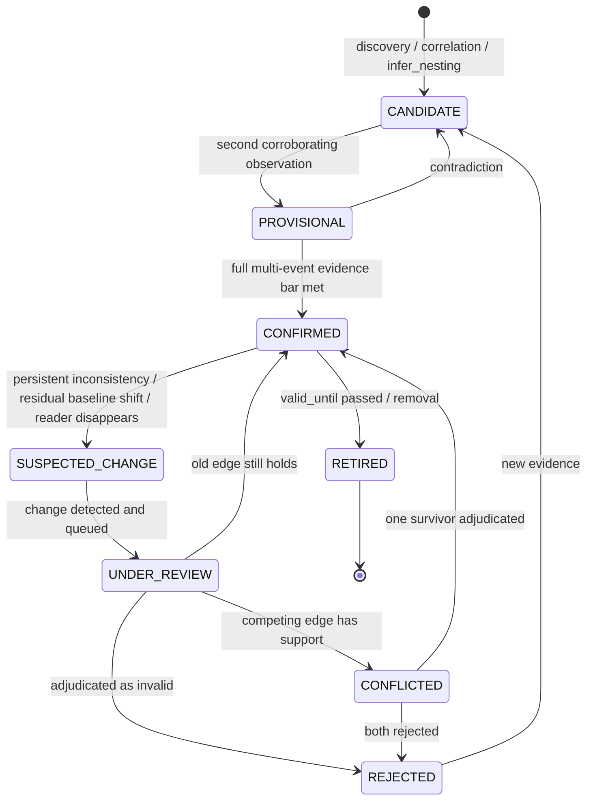
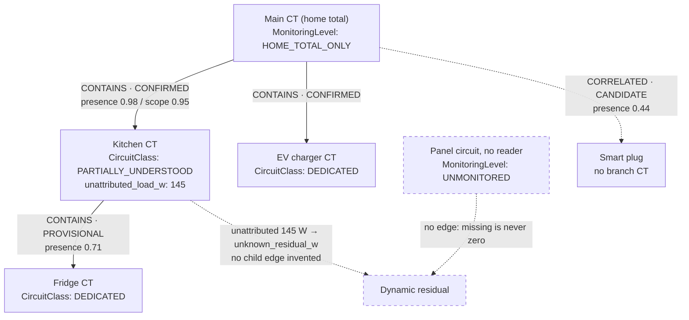

# Measurement Topology — Specification

Status: additive delta over the built topology subsystem; every existing behaviour is cited `file:line`, every new behaviour is marked `MISSING` with a locally-scoped gap ID.

Citation convention: calls about the **built system** cite `file:line` in the repository. Calls about **contracts fixed by a sibling specification** cite that specification by document and contract name, because those documents are authored concurrently and are not line-verified against the implementation. Every such call is marked `EXISTS as specified` so it is never confused with a line-verified implementation claim.

---

## 1. Two distinct topologies

The WattMosaic system carries **two different topologies**, and conflating them is the single most damaging modelling error available.

| | Physical Electrical Topology | Measurement Topology |
|---|---|---|
| Subject | Panels, breakers, circuits, phases, legs, bus connections, wire runs | The actual electrical loads **observed** by each reader |
| Evidence | Installation metadata, breaker schedules, inspection photos, measured continuity | Observation and association evidence over telemetry |
| Truth | May be progressively enriched, but never guessed | The primary inference target |
| Storage | Not stored as wiring truth today | Stored as typed edges with lifecycle and validity intervals |

The **primary inference target of this system is the Measurement Topology** — the graph of what each reader actually sees, including what each reader fails to see.

**Rule.** Physical electrical topology and Measurement Topology are distinct models; an edge in one is never evidence of an edge in the other without an explicit, typed, declared mapping.

**Rule.** Physical wiring is never inferred from statistical correlation alone; a correlation, even a strong one, may only ever produce a Measurement Topology **candidate**.

The Measurement Topology is *not* required to be a tree, is *not* required to be complete, and is *not* required to conserve power exactly. It is a partially observed graph over reader-observed domains.

Existing evidence for the separation:

- `docs/association_and_topology.md` §5 — *correlation is not topography, and a bigger reading is not upstream*. EXISTS — line-verified companions: `electrical/nesting.py:577` `infer_nesting` refuses explicitly with `not_inferable`; `electrical/nesting.py:142` `_NESTABLE_CHILD_TYPES` asserts a load's *level* is not inferable; `electrical/hierarchy.py:489` `HierarchyFinder.overlaps` emits `implies_parenthood: False`.
- `docs/association_and_topology.md` §1 — the four `RelationKind`s must never imply one another. EXISTS — line-verified companions: `engine/wattmosaic_engine/contracts.py:254-280` `RelationKind` defines the four as independent kinds with no implication edge; `electrical/hierarchy.py:489` `HierarchyFinder.overlaps` emits `implies_parenthood: False`.
- `electrical/panel_tree.py:1150` `build_panel_tree` — a **read-time projection**, explicitly not stored wiring truth. EXISTS.
- `electrical/nesting.py:142` `_NESTABLE_CHILD_TYPES = {"main"}` — only a main may be a nested child, because a load's *level* is not inferable. EXISTS.

Gap `G-TOPO-01`: no typed, persisted mapping from Measurement Topology edges to physical electrical topology records. **MISSING** — `electrical/panel_tree.py:1150` `build_panel_tree` and `electrical/panel_tree.py:270` `_TreeBuilder` exist but build a projection only; `electrical/panel_tree.py:216` `_DisjointSet` merges rows without asserting wiring.

---

## 2. The typed relationship set

The Measurement Topology is a directed, typed multigraph. Four relationship types are specified.

| Product-facing kind | Meaning | Direction | `RelationKind` member (`contracts.py:254-280`) | Confidence dimensions | Status | Evidence |
|---|---|---|---|---|---|---|
| `CONTAINS` | Reader A's measured domain encloses reader B's measured domain | parent → child | `ELECTRICAL_PARENT_CHILD` | presence, structure, magnitude, timing, scope | PARTIAL — `electrical/hierarchy.py:489` `HierarchyFinder` emits the immediate parent; `electrical/nesting.py:577` `infer_nesting` proposes it | `electrical/hierarchy.py:489`, `electrical/nesting.py:577` |
| `SHARED_LOAD` | Two domains observe overlapping load, neither enclosing the other | symmetric | `CT_MEASUREMENT_OVERLAP` | presence, magnitude, distinctness | PARTIAL — overlap is detected (`electrical/hierarchy.py:489` `HierarchyFinder.overlaps`, `implies_parenthood: False`) but is not a distinct stored kind | `electrical/hierarchy.py:489`, `engine/wattmosaic_engine/contracts.py:254-280` |
| `PAIRED_LEG` | Two domains are the two legs of one split-phase load | symmetric | `DEVICE_CT_ASSOCIATION` | presence, timing, phase | PARTIAL — leg pairing is visible in the contracts (`engine/wattmosaic_engine/contracts.py:50-54` `Phase`, `:57-60` `Polarity`) but is not a stored relation kind | `engine/wattmosaic_engine/contracts.py:50-54`, `:57-60`, `:254-280` |
| `CORRELATED` | Two domains show coincident activity without structural implication | symmetric | `DEVICE_CT_ASSOCIATION` | presence, timing | EXISTS — `ingestion/correlation.py:438` `correlate` produces exactly this evidence | `ingestion/correlation.py:438` |

Existing vocabulary — `engine/wattmosaic_engine/contracts.py:254-280` `RelationKind` with `DEVICE_CT_ASSOCIATION`, `CT_MEASUREMENT_OVERLAP`, `CIRCUIT_MEMBERSHIP`, `ELECTRICAL_PARENT_CHILD`. **EXISTS.**

Existing carrier — `engine/wattmosaic_engine/contracts.py:762-843` `TopologyRelation` with `status` (`:782`), scalar `confidence` (`:785`), `valid_from` (`:800`), `valid_to` (`:803`). **EXISTS.**

**Rule.** The typed relationship set is expressed through the **existing `RelationKind`** (`engine/wattmosaic_engine/contracts.py:254-280`) plus the **product-facing kind names** of `01-requirements.md` (REQ-TOPO-001): `CONTAINS`, `SHARED_LOAD`, `PAIRED_LEG`, `CORRELATED`. **No new relationship-kind enum is minted.** The API contract is authoritative: `09-api-and-data-contracts.md` §7.1 carries `relation_kind` as the existing `RelationKind` and states that no new member is minted there.

Mapping precision:

- `CONTAINS` **refines** `ELECTRICAL_PARENT_CHILD`. `ELECTRICAL_PARENT_CHILD` carries no exclusivity of domain: the `CONTAINS` reading adds `contains_exclusive: bool` (whether the child domain is fully inside the parent) and `depth`. It does **not** replace the existing kind.
- `SHARED_LOAD` **refines** `CT_MEASUREMENT_OVERLAP`, adding `overlap_frac` and `distinct_domains: bool`.
- `PAIRED_LEG` **sits beside** `DEVICE_CT_ASSOCIATION`. It is a distinct product-facing reading; it does not refine, because the existing kind asserts *device* identity while `PAIRED_LEG` asserts only *leg pairing*.
- `CORRELATED` **sits beside** `DEVICE_CT_ASSOCIATION`, and is the *weaker* of the two: it asserts coincident activity only, never device identity.
- `CIRCUIT_MEMBERSHIP` is retained as a physical-side relation and is **not** part of the Measurement Topology relationship set.

**Rule.** The four existing `RelationKind` values must never imply one another; the four product-facing relationship types inherit that prohibition.

**Rule.** Identical response is still not containment: two legs of one appliance respond identically, and that identity is evidence of *coincidence*, not of a parent–child relationship.

Gap `G-TOPO-02`: the edges carry no typed relationship semantics — no stored relation distinguishes containment (`CONTAINS`) from shared load (`SHARED_LOAD`), leg pairing (`PAIRED_LEG`) or plain correlation (`CORRELATED`); the existing `RelationKind` carries only the four coarse kinds. **MISSING** — `engine/wattmosaic_engine/contracts.py:254-280` carries only the four coarse kinds.

Gap `G-TOPO-03`: `PAIRED_LEG` and `CORRELATED` are not distinguishable in stored relations. **MISSING** — `engine/wattmosaic_engine/contracts.py:762-843` `TopologyRelation` has no discriminator field beyond `kind` and `status`.

---

## 3. Edge lifecycle states

The lifecycle vocabulary is fixed by the API specification and is **not** invented here.

`EdgeLifecycle` — `CANDIDATE`, `PROVISIONAL`, `CONFIRMED`, `SUSPECTED_CHANGE`, `UNDER_REVIEW`, `CONFLICTED`, `REJECTED`, `RETIRED`. **EXISTS (specified)** — API spec `09-api-and-data-contracts.md`, contract `EdgeLifecycle`, carried by `TopologyEdge`; the implemented subset is `engine/wattmosaic_engine/contracts.py:84-89` `TopologyStatus`.

The carrier contract is `TopologyEdge` (API spec `09-api-and-data-contracts.md`), which **refines** the existing `engine/wattmosaic_engine/contracts.py:762-843` `TopologyRelation`: it adds the full `EdgeLifecycle` vocabulary, the per-edge `ConfidenceVector`, and the `valid_until` spelling. `TopologyRelation` is retained and deprecated, not removed.

The subset that exists **today** in code is the three-value `TopologyStatus` — `CANDIDATE` / `CONFIRMED` / `REJECTED`. **PARTIAL** — `engine/wattmosaic_engine/contracts.py:84-89` `TopologyStatus`.

| State | Entry condition | Exit condition | Who may advance | Evidence required |
|---|---|---|---|---|
| `CANDIDATE` | Discovery produced a proposal | Promotion to `PROVISIONAL` on first corroborating observation | automatic | one qualifying observation; `requires_confirmation` is true |
| `PROVISIONAL` | Candidate corroborated on a second, independent event | `CONFIRMED` on threshold evidence; back to `CANDIDATE` on contradiction | automatic | `min_events=2` bar met, magnitude within tolerance |
| `CONFIRMED` | Provisional edge met the full evidence bar | `SUSPECTED_CHANGE` on inconsistency; `RETIRED` on end of validity | user-confirmed, or automatic on the full bar | repeated multi-event evidence, validated |
| `SUSPECTED_CHANGE` | Persistent measurement inconsistency or a residual baseline shift | `UNDER_REVIEW` on detection; `CONFIRMED` if the old edge still holds; `CONFLICTED` if both hold | automatic | inconsistency statistic over a window |
| `UNDER_REVIEW` | A change was suspected and queued for adjudication | `CONFIRMED`, `CONFLICTED`, or `REJECTED` | user-confirmed | a configuration event or an adjudicated observation |
| `CONFLICTED` | Two mutually exclusive edges both have support | Resolution to one survivor | user-confirmed | two candidate edges with overlapping validity |
| `REJECTED` | Edge failed validation or was refused by an operator | `CANDIDATE` only on new evidence | user-confirmed | negative evidence |
| `RETIRED` | Validity interval ended; the edge no longer describes reality | None (terminal) | configuration-driven | `valid_until` in the past |

**Rule.** Only validated `CONTAINS` edges participate in circuit hierarchy calculations; `CANDIDATE`, `SUSPECTED_CHANGE`, `UNDER_REVIEW` and `CONFLICTED` `CONTAINS` edges are excluded from hierarchy computation.

**Rule.** No automatic promotion of a candidate topology exists; `requires_confirmation` is always true and `MAX_CONFIDENCE = 0.99` bounds every automatic score. EXISTS — `docs/association_and_topology.md` §5 and the association evidence bar at `docs/association_and_topology.md:97-129`.

Existing behaviour that supports the `CANDIDATE` semantics:

- `ingestion/discovery.py:208` `discover_candidate_topology` — structural candidate discovery. EXISTS.
- `main.py:678-681` — discovery **only ever creates a candidate**, never overwrites, never confirms, never invents state links. EXISTS.
- `main.py:738` — candidates are saved with the note "startup: candidate discovery". EXISTS.

Gap `G-TOPO-04`: `SUSPECTED_CHANGE`, `UNDER_REVIEW`, `CONFLICTED`, `PROVISIONAL` and `RETIRED` have no representation in code. **MISSING** — `engine/wattmosaic_engine/contracts.py:84-89` `TopologyStatus` exposes three values only.

Gap `G-TOPO-05`: no transition guard or state-machine validation exists. **MISSING** — no module cited in this document performs a lifecycle transition check; the only lifecycle carrier is `engine/wattmosaic_engine/contracts.py:84-89` `TopologyStatus`.

---

## 4. Edge metadata and versioning

### 4.1 Validity interval

| Field | Today | Target | Change |
|---|---|---|---|
| start | `valid_from` — `engine/wattmosaic_engine/contracts.py:800` | `valid_from` | none |
| end | `valid_to` — `engine/wattmosaic_engine/contracts.py:803` | `valid_until` | **rename, additive**: `valid_to` deprecated, retained as an optional alias; new writes populate `valid_until` |

**Rule.** The `valid_to` → `valid_until` rename is additive and optional; `valid_to` is deprecated, never removed, and existing rows remain readable.

### 4.2 Confidence

The scalar `confidence` at `engine/wattmosaic_engine/contracts.py:785` is a single float. **PARTIAL** — it exists but is dimensionally insufficient: a single number cannot distinguish *"we are confident the edge exists"* from *"we are confident the edge is correctly nested"*.

The per-edge `ConfidenceVector` is specified in the API spec, and the existing `ConfidenceVector` at `engine/wattmosaic_engine/contracts.py:476-513` has five dimensions and **no aggregate** field. EXISTS.

**Rule.** Confidence is multidimensional and never blended; a single scalar must not be computed by combining dimensions, and the existing scalar `confidence` is not a blend of the vector.

| Edge dimension | Question it answers | Typical sources |
|---|---|---|
| `presence` | Is there any relationship here? | discovery, correlation |
| `structure` | Is it containment, shared, paired or merely correlated? | nesting inference, hierarchy |
| `magnitude` | Is the magnitude relationship consistent? | ratio, closure, magnitude-ratio rules |
| `timing` | Do the events co-occur? | lag correlation, stability |
| `scope` | Are the measured domains what we think they are? | scope evidence, calibration evidence |

**Rule.** A candidate edge carries `presence` confidence only; the other dimensions are undefined until evidence populates them, and an undefined dimension is never read as zero.

Gap `G-TOPO-06`: per-edge confidence dimensions are absent; the relation carries a scalar. **PARTIAL** — `engine/wattmosaic_engine/contracts.py:785` scalar `confidence` against `engine/wattmosaic_engine/contracts.py:476-513` `ConfidenceVector`.

### 4.3 Version identifiers

Four version identifiers govern the system:

| Identifier | Scope | Today | Evidence |
|---|---|---|---|
| `topology_version` | The Measurement Topology graph | `engine/wattmosaic_engine/contracts.py:1217` — an **int** | `engine/wattmosaic_engine/contracts.py:1216-1217` |
| `reader_configuration_version` | Per-reader configuration (gain, polarity, multiplier) | MISSING | `engine/wattmosaic_engine/contracts.py:762-843` `TopologyRelation` carries no such field |
| `device_mapping_version` | Device-to-CT assignments | MISSING | `engine/wattmosaic_engine/contracts.py:762-843` `TopologyRelation` carries no such field |
| `model_version` | Model and algorithm versions | MISSING | `engine/wattmosaic_engine/contracts.py:762-843` `TopologyRelation` carries no such field |

Existing version carriers — `engine/wattmosaic_engine/contracts.py:1216` `Topology` with `version` as an `int` (`:1217`); `engine/wattmosaic_engine/contracts.py:1199-1213` `DeviceTopology` with `topology_version` (`:893`); `engine/wattmosaic_engine/contracts.py:1689` `Reconciliation.topology_version`. EXISTS.

**Rule.** `Topology.version` remains an `int` for compatibility; the new version object is introduced under a distinct type (`TopologyVersion`) and is referenced by the integer, never by replacing it.

Gap `G-TOPO-07`: `reader_configuration_version`, `device_mapping_version` and `model_version` do not exist. **MISSING** — `engine/wattmosaic_engine/contracts.py:1216-1217` carries only the integer `version`.

---

## 5. Candidate discovery

Discovery is the only route into the Measurement Topology. Every discovery mechanism produces **candidates**, never confirmed edges.

| Mechanism | Location | Guarantee |
|---|---|---|
| Structural discovery | `ingestion/discovery.py:208` `discover_candidate_topology` | builds a candidate graph from known CT/device metadata; never confirms |
| Correlation | `ingestion/correlation.py:438` `correlate` | produces association proposals with per-clause refusal reasons (ADR-0024) |
| Nesting inference | `electrical/nesting.py:577` `infer_nesting` | proposes containment; refuses explicitly via `not_inferable` |
| Hierarchy finder | `electrical/hierarchy.py:489` `HierarchyFinder` | validates the 11-requirement evidence bar; emits the immediate parent only |
| Auto-placement | `disaggregation/auto_placement.py:159` `plan_placements` | proposes device→row placements; merged by `merge_placements` (`:274`) |

Exact guarantees, each cited:

- `ingestion/discovery.py:208` — structural discovery. EXISTS.
- `main.py:678-681` — discovery only creates a candidate, never overwrites, never confirms, never invents state links. EXISTS.
- `ingestion/correlation.py:438` `correlate`, `ingestion/correlation.py:412` `estimate_row_noise` — refusal reasons are per-clause, not silent drops. EXISTS.
- `electrical/nesting.py:577` `infer_nesting` — joint-activity / relative-difference / magnitude-ratio rules with an explicit `not_inferable` refusal. EXISTS.
- `electrical/nesting.py:281` `containment`, `:309` `duplicate_evidence`, `:354` `closure_fraction`, `:392` `build_nodes`, `:133` `CLOSURE_MIN = 0.95`. EXISTS.
- `electrical/nesting.py:142` `_NESTABLE_CHILD_TYPES = {"main"}`. EXISTS.
- `electrical/hierarchy.py:489` `HierarchyFinder`, `:112` `HierarchyConfig`, `:160` `ValidationResult`, `:1157` `persist`. EXISTS.
- `electrical/hierarchy.py:438` `parent_cycle`. EXISTS.
- `disaggregation/auto_placement.py:159` `plan_placements`, `:274` `merge_placements`, `:87` `auto_device_id`. EXISTS.

**Rule.** `infer_nesting` and `HierarchyFinder` never write `parent_ct_id` or `alias_of_ct_id`; those fields are written only by an explicit, confirmed topology edit.

Gap `G-TOPO-08`: no unified candidate-ingest path; candidates arrive by at least five independent mechanisms with no shared admission rule. **MISSING** — `ingestion/discovery.py:208`, `ingestion/correlation.py:438`, `electrical/nesting.py:577`, `electrical/hierarchy.py:489` and `disaggregation/auto_placement.py:159` each write candidates independently, and no single module writes a candidate into a common store.

---

## 6. Asymmetric parent/child treatment

The Measurement Topology is deliberately **asymmetric**: a parent observes many loads that no child observes, and a child's observations are a subset of its parent's, minus contamination.

### 6.1 Containment evidence

Child-to-parent correlation is containment evidence **only when repeated and validated**. EXISTS — `docs/association_and_topology.md` §5 and the evidence bar at `docs/association_and_topology.md:97-129`.

**Rule.** An unexplained parent change does not disprove a containment relationship; the parent may legitimately contain unobserved loads.

**Rule.** Exact parent–child power conservation is never enforced. EXISTS — `docs/electrical_model.md:412-445` and the residue handling at `docs/electrical_model.md:359-381`.

### 6.2 Residual-aware containment

The containment test is residual-aware. For parent `p` with children `c`:

```
ΔY_p = Σ_c β_pc ΔY_c + ΔR_p + ε_p
```

- `ΔY_p` — observed change in the parent's measurement window.
- `β_pc` — regression coefficient of the child's change on the parent's change, in `[0, 1]`.
- `ΔR_p` — the **unexplained** part of the parent's change: the parent's residual, which is exactly what an unobserved load contributes.
- `ε_p` — measurement noise on the parent.

Fitting is **robust**: median/MAD, never mean/stdev. EXISTS in precedent — `docs/association_and_topology.md:97-129` states noise is measured with median/MAD, never mean/stdev, with `MAD_TO_SIGMA = 1.4826`.

**Rule.** The residual `ΔR_p` is the load-bearing term: an explanation is accepted when the residual is small **relative to the parent's own noise**, not when the residual is zero.

**Rule.** Nested children must not be double-counted. EXISTS — `docs/electrical_model.md:48-53,153-168`: one device is attributed using exactly **one** most-specific CT, its deepest enclosing branch CT; ancestor rows carry the child in `nested_children` and the child's value is **subtracted**.

Row-level implementation that already respects this:

- `electrical/matrix.py:86` `MeasurementMatrix`, `:271` `build_measurement_matrix`, `:46` `row_sigma`, `:63` `PreparedSystem`. EXISTS.
- `docs/electrical_model.md:153-168` — row construction decides the exclusion of nested children by a **coefficient test**, not by `CTType`. EXISTS.
- `docs/electrical_model.md:188-199` — row uncertainty `σ_i = max(noise_floor, resolution_i/2) / reliability_i` with `noise_floor = 1.0 W`; a repeated state update halves that row's weight. EXISTS.

Gap `G-TOPO-09`: no residual-aware containment estimator exists; `infer_nesting` uses joint-activity / relative-difference / magnitude-ratio rules only. **MISSING** — `electrical/nesting.py:577` `infer_nesting` has no regression term.

---

## 7. Absolute measurement constraints

An **absolute measurement constraint** is a stated bound on a measured quantity — a declared wattage, a nameplate rating, an interval total, a phase balance limit.

### 7.1 When an absolute constraint is valid

- It is valid when its **basis** matches the basis of the quantity it bounds.
- A declared wattage is a **non-relaxable upper bound** on a shared row. EXISTS — `docs/electrical_model.md:412-445`.
- A constraint derived from the same reader configuration and the same validity interval as the quantity it bounds.

### 7.2 When it is not valid

- When its basis is incompatible, or merely *adjacent* in the compatibility relation.
- When its validity interval does not overlap the observation window.

### 7.3 The non-transitive basis matrix

Basis compatibility is **non-transitive on purpose**. EXISTS — `docs/residual_analysis.md:89-104`.

| | `CT_MEASURED` | `MONITOR_REPORTED` | `FACTOR_ADJUSTED` | `ESTIMATED_APPLIANCE_TOTAL` |
|---|---|---|---|---|
| `CT_MEASURED` | — | compatible | **not compatible** | **not compatible** |
| `MONITOR_REPORTED` | compatible | — | compatible | not compatible |
| `FACTOR_ADJUSTED` | **not compatible** | compatible | — | not compatible |
| `ESTIMATED_APPLIANCE_TOTAL` | not compatible | not compatible | not compatible | — |

**Rule.** An absolute constraint may **bound** an attribution but never **manufacture** one; a value that exists only because a constraint bounded it is an allocation, and is never presented as a measurement.

**Rule.** Never present an estimated or allocated value as a direct measurement.

**Rule.** Missing is never zero; an absent constraint, an absent measurement and a measured zero are three different states.

Supporting contracts — `engine/wattmosaic_engine/contracts.py:186` `MeasurementBasis`, `:585` `MeasurementFactor`, `:158-185` `CircuitClass` with `metadata.unattributed_load_w` / `unattributed_note` required for `PARTIALLY_UNDERSTOOD` (`:745-758`), `:351-364` `MonitoringLevel`, `:50-54` `Phase`, `:57-60` `Polarity`, `:44-47` `CTType` (`MAIN`/`BRANCH`/`UNKNOWN` only), `:62` `Source`, `:76` `QualityStatus`, `:660` `HaEntityBinding`. EXISTS.

Gap `G-TOPO-10`: absolute constraints are not represented as typed, basis-bearing edges in the topology. **MISSING** — `engine/wattmosaic_engine/contracts.py:762-843` `TopologyRelation` carries no constraint field.

---

## 8. Multi-event evidence

### 8.1 The existing evidence bar

All parameters cited from `docs/association_and_topology.md:97-129`. EXISTS.

| Parameter | Value |
|---|---|
| `min_events` | 2 |
| `min_magnitude_w` | 10.0 |
| `max_lag_s` | 60.0 |
| `magnitude_tolerance_frac` | 0.10 |
| `stability_min` | 0.70 |
| `conflict_penalty` | 0.15 |
| `algorithm_version` | `assoc@1.0` |
| `noise_sigmas` | 3.0 |
| `lag_step_s` | 15.0 |
| `MAD_TO_SIGMA` | 1.4826 |
| `MAX_CONFIDENCE` | 0.99 |
| `SINGLE_EVENT_CAP` | 0.5 |
| `SPLIT_MULTIPLIER` | 0.75 |
| `AMBIGUOUS_MULTIPLIER` | 0.25 |

### 8.2 The eight rules and their failing branches

| # | Rule | Failing branch |
|---|---|---|
| 1 | Minimum event count | fewer than `min_events` → insufficient evidence; capped by `SINGLE_EVENT_CAP` |
| 2 | Minimum magnitude | below `min_magnitude_w` → no edge candidate |
| 3 | Maximum lag | beyond `max_lag_s` → rejected |
| 4 | Magnitude tolerance | outside `magnitude_tolerance_frac` → rejected |
| 5 | Stability | below `stability_min` → rejected |
| 6 | Conflict penalty | competing explanation → confidence multiplied by `(1 - conflict_penalty)` |
| 7 | Split disambiguation | split load → `SPLIT_MULTIPLIER` |
| 8 | Ambiguity | unresolved attribution → `AMBIGUOUS_MULTIPLIER` |

Orientation is handled separately: the module does **not** take an absolute value; a reversed step is withheld as `opposite_direction`; orientation is corrected exactly once upstream by declared `Polarity.INVERTED`. EXISTS — `docs/association_and_topology.md` §2.9, with the line-verified contract `engine/wattmosaic_engine/contracts.py:57-60` `Polarity`.

### 8.3 The residual-aware multi-event criterion

The criterion asks: *given a child step observed at event `t`, how much of it appears in the parent?* The parent's own step at `t` may be **contaminated** by an unobserved load switching at the same time.

Test procedure per event `t`:

1. Estimate the child's expected parent contribution: `β̂_pc · ΔY_c(t)` from the robust fit of §6.2.
2. Compare the parent's *residual* `ΔR_p(t) = ΔY_p(t) − Σ_c β̂_pc ΔY_c(t)` against the parent's noise band `σ_p · noise_sigmas`.
3. **Contaminated parent step**: `ΔR_p(t)` is large *and* sign-aligned with `ΔY_c(t)`. Then the parent's step cannot be used as clean evidence for or against the edge; the event contributes to presence but not to magnitude.
4. **Clean parent step**: `ΔR_p(t)` is within the noise band. Then the event contributes a usable ratio observation `ΔY_c(t)/ΔY_p(t)` toward magnitude confidence.

**Rule.** A contaminated parent step weakens the edge's confidence without invalidating it; the event is *discounted*, never counted as disconfirming.

**Rule.** An unexplained parent change does not disprove containment (repeated from §6.1) — the residual term `ΔR_p` exists precisely because the parent may contain loads nobody observes.

Gap `G-TOPO-11`: no per-event, per-edge evidence accounting exists; evidence is aggregated before persistence. **MISSING** — `ingestion/correlation.py:438` `correlate` and `electrical/nesting.py:577` `infer_nesting` return aggregate verdicts; neither stores per-event edge evidence, and `engine/wattmosaic_engine/contracts.py:762-843` `TopologyRelation` has no event list.

---

## 9. Cycle prevention and transitive redundancy

### 9.1 Cycle prevention

- `electrical/hierarchy.py:438` `parent_cycle` — an explicit cycle detector. EXISTS.
- `electrical/hierarchy.py:489` `HierarchyFinder` with `:112` `HierarchyConfig` and `:160` `ValidationResult`. EXISTS.
- The 11-requirement evidence bar, with defaults `min_independent_devices=2`, `min_response_consistency=0.9`, `max_power_violation_frac=0.02`, `require_scope_evidence=True`. EXISTS — `electrical/hierarchy.py:112` `HierarchyConfig`.
- **Only the immediate parent is emitted**; other candidates are recorded as `superseded` / `not_the_immediate_parent`. EXISTS — `electrical/hierarchy.py:489` `HierarchyFinder`.
- A declared pair is skipped — `declared_wins`. EXISTS — `electrical/hierarchy.py:489` `HierarchyFinder`.
- `electrical/hierarchy.py` `HierarchyFinder.overlaps` emits `implies_parenthood: False`. EXISTS — `electrical/hierarchy.py:489` `HierarchyFinder`.

**Rule.** A cycle in a **candidate** set is refused, and the refusal invalidates only the edges on that cycle; unrelated `CONFIRMED` edges are unaffected.

**Rule.** A `CONFIRMED` edge is never demoted by a later candidate cycle; the candidate cycle is refused and the confirmed edge stands.

Gap `G-TOPO-12`: cycle refusal is not scoped to the offending edges. **MISSING** — `electrical/hierarchy.py:438` `parent_cycle` reports the cycle but no scoped-refusal semantics exist in the digest.

### 9.2 Transitive redundancy

If `a → b → c` is established and `a → c` is also proposed, the graph is transitively redundant. Resolution:

1. Prefer the **immediate parent** relation; `a → c` is a transitive summary and is recorded as `superseded` / `not_the_immediate_parent`, matching the existing hierarchy outcome. EXISTS — `electrical/hierarchy.py:489` `HierarchyFinder` (immediate-parent-only rule).
2. A transitive summary edge may still be stored, but only in a distinct summary role; it is never the edge used for row exclusion or double-counting subtraction. EXISTS — `docs/electrical_model.md:48-53,153-168` (exclusion is by the deepest enclosing branch CT).
3. `declared_wins` applies: an explicitly declared relation outranks an inferred transitive summary. EXISTS — `electrical/hierarchy.py:489` `HierarchyFinder`.

**Rule.** Transitive redundancy is resolved by keeping the immediate parent and marking the longer path `superseded`; no edge is deleted to resolve redundancy.

### 9.3 Implementation constraints on new topology modules

**Rule.** New modules import existing contracts and helpers; they do not re-implement window statistics, alignment, alias resolution or quality scoring.

**Rule.** Contract changes are additive and optional; the existing suite stays green.

**Rule.** A new module that implements edge discovery, edge validation or edge persistence reuses `ingestion/correlation.py:412` `estimate_row_noise`, the `canonical_channel_id` / `effective_feeds` / `scale_w` / `multiplier_for` helpers of `electrical/topology.py:60` `TopologyGraph`, and the existing quality scoring contracts at `engine/wattmosaic_engine/contracts.py:76` `QualityStatus`; it does not provide a second implementation of any of them.

Gap `G-TOPO-13`: no explicit transitive-summary representation exists on a relation. **PARTIAL** — `engine/wattmosaic_engine/contracts.py:762-843` `TopologyRelation` has `status` (`:782`) but no summary/transitive marker.

---

## 10. Partial observability

The Measurement Topology is a graph over **partially observed** domains. It is not required to be complete, and it is never required to conserve power exactly.

| Property | Requirement |
|---|---|
| Coverage | No complete coverage required; readers may observe loads with no representation in the graph |
| Conservation | No exact conservation required; conservation is a soft, residual-aware signal only |
| Empty readers | A reader with no children is legitimate, not an error |
| Unobserved loads | A parent may observe many loads no child observes |

Supporting classifications — `engine/wattmosaic_engine/contracts.py:351-364` `MonitoringLevel` with `SHARED`, `HOME_TOTAL_ONLY`, `UNMONITORED`, `UNKNOWN`; `:158-185` `CircuitClass` with `DEDICATED`, `SHARED`, `PARTIALLY_UNDERSTOOD`, `UNKNOWN`; `:686-759` `Circuit`. EXISTS.

**Rule.** `CircuitClass.PARTIALLY_UNDERSTOOD` requires `metadata.unattributed_load_w` and `metadata.unattributed_note`; the class may not be used without them. EXISTS — `engine/wattmosaic_engine/contracts.py:745-758`.

`CircuitClassifier` — the classifier that assigns `CircuitClass` and `MonitoringLevel` to a domain, including the `PARTIALLY_UNDERSTOOD` determination and the attribution of the unattributed wattage. EXISTS — it consumes `engine/wattmosaic_engine/contracts.py:158-185` `CircuitClass`, `:351-364` `MonitoringLevel` and `:686-759` `Circuit`, whose `metadata.unattributed_load_w` / `unattributed_note` fields at `:745-758` carry the unattributed figure.

**Rule.** Missing is never zero; a domain classified `UNMONITORED` or `UNKNOWN` carries no numeric assumption.

Gap `G-TOPO-14`: `CircuitClassifier` does not consult the topology graph to decide whether a residual is explainable by a known child. **MISSING** — classification consumes `Circuit`/`CircuitClass` contracts (`engine/wattmosaic_engine/contracts.py:158-185`, `:686-759`) without topology input.

---

## 11. Topology versioning, change detection, reconciliation, rollback

### 11.1 The version object

`TopologyVersion` — a diffable, rollbackable version of the Measurement Topology. **EXISTS (specified)** — API spec `09-api-and-data-contracts.md`, contract `TopologyVersion`; the store for it is `storage/migrations.py:308-316`.

The gap: `topology_versions` rows are **opaque payloads**, with no diffing, comparison, lifecycle or rollback. **MISSING** — `storage/migrations.py:308-316`.

`InferenceRecord.topology_version` references those rows. EXISTS — `storage/migrations.py:308-316`.

| Version field | Content |
|---|---|
| `version` | integer identity; ties to `engine/wattmosaic_engine/contracts.py:1217` `Topology.version` |
| `parent_version` | predecessor, for diffing |
| `valid_from` / `valid_until` | interval during which the version is authoritative |
| `edges` | the typed relationship set with per-edge lifecycle and confidence |
| `derived_from` | the configuration events and evidence that produced it |
| `change_summary` | human-readable delta versus `parent_version` |

The API surface — `GET /topology/edges`, `GET /topology/versions`, `GET /topology/diff?from=&to=`, `POST /topology/rollback`, `GET /changes`. **EXISTS (specified)** — API spec `09-api-and-data-contracts.md`; the underlying store is `storage/migrations.py:308-316`.

### 11.2 The interval model

Every topology-bearing object carries `valid_from` / `valid_until`:

| Object | Fields | Today |
|---|---|---|
| `TopologyRelation` | `valid_from` `engine/wattmosaic_engine/contracts.py:800`, `valid_to` `:803` | EXISTS (rename pending, §4.1) |
| `Topology` | `version` `engine/wattmosaic_engine/contracts.py:1217` | EXISTS |
| `DeviceTopology` | `topology_version` `engine/wattmosaic_engine/contracts.py:893` | EXISTS |
| `Reconciliation` | `topology_version` `engine/wattmosaic_engine/contracts.py:1689` | EXISTS |
| `TopologyVersion` | `valid_from` / `valid_until` | MISSING — `storage/migrations.py:308-316` stores opaque payloads |

**Rule.** Validity intervals are half-open `[valid_from, valid_until)`; an edge with no `valid_until` is open-ended.

### 11.3 Change detection triggers

| Trigger | Signal | First response |
|---|---|---|
| Persistent measurement inconsistency | edge contradicts over repeated events | candidate → `SUSPECTED_CHANGE` |
| Residual baseline change | `ΔR_p` baseline shifts persistently | candidate → `SUSPECTED_CHANGE` |
| New correlation pattern | a previously unexplained joint pattern appears | new `CANDIDATE` edge |
| Reader disappears | no telemetry for a known reader | candidate → `SUSPECTED_CHANGE`; affected edges → `UNDER_REVIEW` |
| Reader appears | new reader with no topology | new `CANDIDATE` edges from discovery |

Detection must be **residual-aware**: an inconsistency is only a trigger if it exceeds the parent's noise band and is not explained by a known child.

### 11.4 The nine change classes

Each produces a traceable `ConfigurationChangeEvent` (API spec `09-api-and-data-contracts.md`).

| # | Change class | Edges affected | Version produced |
|---|---|---|---|
| 1 | Smart-plug relocation | `DEVICE_CT_ASSOCIATION` edges | `device_mapping_version` |
| 2 | CT reader relocation | `ELECTRICAL_PARENT_CHILD` / `CONTAINS` edges | `topology_version` |
| 3 | Reader replacement | `ELECTRICAL_PARENT_CHILD` / `CONTAINS` edges; `reader_configuration_version` | `topology_version` + `reader_configuration_version` |
| 4 | CT direction change | `CONTAINS` scope; orientation evidence | `reader_configuration_version` |
| 5 | Calibration change | row sigma (`docs/electrical_model.md:188-199`); scope confidence | `reader_configuration_version` |
| 6 | Circuit reconfiguration | `CONTAINS`, `SHARED_LOAD` edges | `topology_version` |
| 7 | Reader installation | new `CANDIDATE` edges | `topology_version` |
| 8 | Reader removal | `RETIRED` edges, closed interval | `topology_version` |
| 9 | Measurement scope change | `scope` confidence; `CORRELATED`/`SHARED_LOAD` edges | `topology_version` + `reader_configuration_version` |

**Rule.** Historical topology is never rewritten; a change creates a new hypothesis, validates it, and promotes it to a new version only when sufficient evidence exists.

**Rule.** When evidence is insufficient, uncertainty is preserved rather than forcing an update; the affected edges move to `SUSPECTED_CHANGE` / `UNDER_REVIEW` and the previous version remains authoritative for its interval.

**Rule.** A declared wattage remains a non-relaxable upper bound across a change; a calibration change may tighten the observed value but never relaxes the declared bound. EXISTS — `docs/electrical_model.md:412-445`.

### 11.5 Reconciliation and rollback

- `engine/wattmosaic_engine/contracts.py:1689` `Reconciliation.topology_version` binds a reconciliation to the topology version that produced it. EXISTS.
- `POST /topology/rollback` — restores a prior `TopologyVersion` as the current authoritative version, closing the current version's interval and opening a new one that points at the restored content. **EXISTS (specified)** — API spec `09-api-and-data-contracts.md`; the store for it is `storage/migrations.py:308-316`.

**Rule.** Rollback is additive: it never deletes a version, never rewrites history, and always records a `ConfigurationChangeEvent` of kind `rollback`.

**Rule.** Every reconciliation remains bound to the `topology_version` that was authoritative when it was computed; a rollback does not retroactively change historical reconciliations.

Gap `G-TOPO-15`: no diffing between versions. **MISSING** — `storage/migrations.py:308-316` stores opaque payloads.

Gap `G-TOPO-16`: no rollback path. **MISSING** — `storage/migrations.py:308-316` exposes no lifecycle, comparison or restore operation.

Gap `G-TOPO-17`: change detection triggers are not implemented; the four triggers of §11.3 have no implementation. **MISSING** — no detector module is cited in this document; the only change-detection behaviour is the persistence of candidates at `main.py:678-681` and `main.py:738`, which never overwrites or confirms.

Gap `G-TOPO-18`: `reader_configuration_version`, `device_mapping_version` and `model_version` are not stored on configuration change events. **MISSING** — `engine/wattmosaic_engine/contracts.py:762-843` `TopologyRelation` carries `valid_from`/`valid_to` only.

---

## 12. Unknown and unobserved loads in the topology

A reader may observe loads that **no child observes**. That is a **dynamic residual**, not a topology failure.

- The unknown-load slack: `electrical/solver.py:258` `augment_with_unknown_slack` adds one non-negative column per main row, reported in `diagnostics["unknown_slack"]`, folded into `Reconciliation.unknown_residual_w`, and **never** written back into a device. EXISTS — `docs/electrical_model.md:359-381`.
- `engine/wattmosaic_engine/contracts.py:1689` `Reconciliation` carries `unknown_residual_w`. EXISTS.
- `docs/electrical_model.md` §7a — the nesting proposal is **candidate generation only**. EXISTS — line-verified companion: `electrical/nesting.py:577` `infer_nesting` returns proposals with an explicit `not_inferable` refusal and never writes `parent_ct_id` or `alias_of_ct_id`.
- The nesting evidence set — containment (+30 W), excitation (5 % of parent), closure (`CLOSURE_MIN` 0.95), duplicate (jointly active ≥200 W for ≥50 %, median rel diff ≤0.15, magnitude ratio ≤1.25). EXISTS — `docs/electrical_model.md` §7a with `electrical/nesting.py:133`, `:281`, `:309`, `:354`.
- Parallel mains without a declared relation are resolved from the measurements — outermost node within `_CONTAINMENT_TOL_W` = 30 W or 2 %; if undecidable, the refusal is `parallel_mains_without_declared_relation` with `usable=False`. EXISTS — `docs/electrical_model.md:48-53,153-168`.
- "a refusal is per instant, not per topology". EXISTS — `docs/electrical_model.md:48-53,153-168`.

**Rule.** An unknown residual is a legitimate, persistent state of a partially observed domain; it is represented by `unknown_residual_w` and the slack column, never by inventing a child edge.

**Rule.** Missing is never zero; an unexplained residual is never recorded as a measured load.

Gap `G-TOPO-19`: the unknown residual is not surfaced as a topology-level attribute (a reader's "known unexplained share"). **MISSING** — `electrical/solver.py:258` reports the slack in diagnostics only.

---

## 13. The panel tree as a read-time projection

`build_panel_tree` — `electrical/panel_tree.py:1150`; `_Panel` — `:255`; `_TreeBuilder` — `:270`; `_DisjointSet` — `:216`. EXISTS.

The panel tree is a **read-time projection** computed from the current measurement topology for presentation and navigation. It is **not** stored wiring truth.

**Rule.** No component may read the panel tree as evidence of physical wiring; the projection is derived, and a disagreement between the projection and a physical record is a reporting defect, not a topology fact.

**Rule.** The panel tree is recomputed, never persisted as authoritative; `electrical/panel_tree.py:216` `_DisjointSet` merges rows for projection purposes only.

Gap `G-TOPO-20`: the projection is not labelled as such at its consumers, so a physical-wiring claim could be made from it. **MISSING** — `electrical/panel_tree.py:1150` `build_panel_tree` exposes no projection marker.

---

## Consolidated relationship register

| Name | Meaning | Direction | `RelationKind` member (`contracts.py:254-280`) | Lifecycle states | Confidence dimensions | Creates it | Invalidates it |
|---|---|---|---|---|---|---|---|
| `CONTAINS` | A's measured domain encloses B's | parent → child | `ELECTRICAL_PARENT_CHILD` | `CANDIDATE` `PROVISIONAL` `CONFIRMED` `SUSPECTED_CHANGE` `UNDER_REVIEW` `CONFLICTED` `REJECTED` `RETIRED` | presence, structure, magnitude, timing, scope | `infer_nesting` containment + closure + duplicate (`electrical/nesting.py:281`, `:309`, `:354`, `:133`); `HierarchyFinder` 11-requirement bar (`electrical/hierarchy.py:489`) | persistent residual inconsistency; reader disappearance; cycle refusal on the offending edges |
| `SHARED_LOAD` | Overlapping load, neither enclosing | symmetric | `CT_MEASUREMENT_OVERLAP` | `CANDIDATE` `PROVISIONAL` `CONFIRMED` `SUSPECTED_CHANGE` `UNDER_REVIEW` `CONFLICTED` `REJECTED` `RETIRED` | presence, magnitude, distinctness | `duplicate_evidence` (`electrical/nesting.py:309`); `HierarchyFinder.overlaps` with `implies_parenthood: False` (`electrical/hierarchy.py`) | divergence of the overlap fraction; scope change |
| `PAIRED_LEG` | Two legs of one split-phase load | symmetric | `DEVICE_CT_ASSOCIATION` | `CANDIDATE` `PROVISIONAL` `CONFIRMED` `SUSPECTED_CHANGE` `UNDER_REVIEW` `CONFLICTED` `REJECTED` `RETIRED` | presence, timing, phase | `infer_nesting` joint-activity on paired channels; `noisy_legs` / `unbalanced` strata | leg imbalance beyond tolerance; reader replacement |
| `CORRELATED` | Coincident activity only | symmetric | `DEVICE_CT_ASSOCIATION` | `CANDIDATE` `PROVISIONAL` `CONFIRMED` `SUSPECTED_CHANGE` `UNDER_REVIEW` `CONFLICTED` `REJECTED` `RETIRED` | presence, timing | `correlate` (`ingestion/correlation.py:438`) with the §8.1 bar | stability below `stability_min`; conflict with a stronger edge |
| `CIRCUIT_MEMBERSHIP` | Physical-side circuit membership | physical | `CIRCUIT_MEMBERSHIP` (retained, physical side) | not in the Measurement Topology lifecycle | n/a | installation metadata | n/a |
| `DEVICE_CT_ASSOCIATION` | Device identity bound to a CT | device → CT | `DEVICE_CT_ASSOCIATION` (retained) | not in the Measurement Topology lifecycle | n/a | `plan_placements` (`disaggregation/auto_placement.py:159`) | device relocation (change class 1) |

**Rule.** A relationship's confidence dimensions are never blended; the register above names the dimensions that apply, and no others.

---

## Edge lifecycle state diagram



Only `CONFIRMED` `CONTAINS` edges participate in circuit hierarchy calculations.

---

## Partially observed topology — example



Reading the example:

- The dashed `ORPHAN` node is a physical circuit with no reader. It has **no** edge: the graph represents only observed domains, and the physical circuit's existence is not inferred into the measurement topology.
- `KITCHEN` is `PARTIALLY_UNDERSTOOD`; its `metadata.unattributed_load_w` is populated, and the unattributed share is carried by `unknown_residual_w` and the solver's slack column — **not** by a synthetic child edge.
- `PLUG` is correlated with the main but encloses nothing known; the correlation is a `CANDIDATE` with presence confidence only, and the other dimensions are undefined, not zero.
- The dashed `RESID` node is a residual, not a node in the graph.

---

## New gap register (locally scoped)

| Gap ID | Statement | Status | Evidence |
|---|---|---|---|
| `G-TOPO-01` | No typed mapping from Measurement Topology edges to physical electrical topology | MISSING | `electrical/panel_tree.py:1150`, `:270`, `:216` |
| `G-TOPO-02` | No typed relationship semantics on an edge; `CONTAINS`/`SHARED_LOAD`/`PAIRED_LEG` absent from the stored kinds | MISSING | `engine/wattmosaic_engine/contracts.py:254-280` |
| `G-TOPO-03` | No discriminator separating `PAIRED_LEG` from `CORRELATED` | MISSING | `engine/wattmosaic_engine/contracts.py:762-843` |
| `G-TOPO-04` | Five of eight lifecycle states unrepresented | MISSING | `engine/wattmosaic_engine/contracts.py:84-89` |
| `G-TOPO-05` | No lifecycle transition guard | MISSING | `engine/wattmosaic_engine/contracts.py:84-89` `TopologyStatus` is the only lifecycle carrier; no transition check exists |
| `G-TOPO-06` | Edge confidence is a scalar, not dimensional | PARTIAL | `engine/wattmosaic_engine/contracts.py:785` vs `:476-513` |
| `G-TOPO-07` | `reader_configuration_version`, `device_mapping_version`, `model_version` absent | MISSING | `engine/wattmosaic_engine/contracts.py:1216-1217` |
| `G-TOPO-08` | No unified candidate admission path across the five discovery mechanisms | MISSING | `ingestion/discovery.py:208`, `ingestion/correlation.py:438`, `electrical/nesting.py:577`, `electrical/hierarchy.py:489`, `disaggregation/auto_placement.py:159` |
| `G-TOPO-09` | No residual-aware containment estimator | MISSING | `electrical/nesting.py:577` |
| `G-TOPO-10` | Absolute constraints not typed as basis-bearing edges | MISSING | `engine/wattmosaic_engine/contracts.py:762-843` |
| `G-TOPO-11` | No per-event, per-edge evidence accounting | MISSING | `ingestion/correlation.py:438`, `electrical/nesting.py:577`, `engine/wattmosaic_engine/contracts.py:762-843` |
| `G-TOPO-12` | Cycle refusal not scoped to the offending edges | MISSING | `electrical/hierarchy.py:438` |
| `G-TOPO-13` | No transitive-summary marker on a relation | PARTIAL | `engine/wattmosaic_engine/contracts.py:762-843` `:782` |
| `G-TOPO-14` | `CircuitClassifier` does not consult topology to explain residuals | MISSING | `engine/wattmosaic_engine/contracts.py:158-185`, `:686-759` |
| `G-TOPO-15` | No version diffing | MISSING | `storage/migrations.py:308-316` |
| `G-TOPO-16` | No rollback path | MISSING | `storage/migrations.py:308-316` |
| `G-TOPO-17` | Change-detection triggers unimplemented | MISSING | `main.py:678-681`, `main.py:738` |
| `G-TOPO-18` | Configuration events carry no version identifiers | MISSING | `engine/wattmosaic_engine/contracts.py:762-843` `:800`, `:803` |
| `G-TOPO-19` | Unknown residual not surfaced as a topology attribute | MISSING | `electrical/solver.py:258` |
| `G-TOPO-20` | Panel-tree projection not labelled at consumers | MISSING | `electrical/panel_tree.py:1150` |

**Note.** These IDs are locally scoped to this document. They are **registered** in the canonical gap register (`00-project-overview.md` §13.2), which is the register of record and the single source of truth for gap identifiers; a locally-scoped ID is valid only together with its entry there. The table above is the upstream source for the gaps it lists.

---

## Open decisions

Continuing the numbering from `OD-51`. This document's own decisions occupy the **`OD-51`–`OD-60`** band allocated to it by the canonical register in `13-open-decisions-and-assumptions.md` §5.2; the project-level decisions `OD-01`–`OD-08` live in `00-project-overview.md` §12 and are referenced, not restated.

| ID | Decision | Assumption proceeded on | Why it needs a decision |
|---|---|---|---|
| `OD-51` | Does `CANDIDATE` mean "proposed, unvalidated" only, or also "validated but not yet user-confirmed"? | `CANDIDATE` = proposed and unvalidated; `PROVISIONAL` = validated but not user-confirmed | A candidate is a proposal (`requires_confirmation` always true), yet a machine may have validated it; the two states must not collapse |
| `OD-52` | Is `SUSPECTED_CHANGE` a state of the *edge* or a separate overlay on the edge? | It is a lifecycle state of the edge; the prior edge's history is preserved by the interval model | Overlaying would preserve the `CONFIRMED` edge but would break the API's single-lifecycle-per-edge contract |
| `OD-53` | May a `CONFIRMED` edge be demoted automatically on persistent inconsistency, or only to `SUSPECTED_CHANGE`? | Only to `SUSPECTED_CHANGE`; demotion to `REJECTED` requires user confirmation | Automatic demotion of a human-confirmed edge risks silently changing hierarchy |
| `OD-54` | Should `CONTAINS` edges be allowed to overlap (a child in two parents)? | No — a domain has at most one immediate parent; a second parent is `CONFLICTED` | The double-counting rule subtracts the child from the ancestor row, which requires a unique immediate parent (`docs/electrical_model.md:48-53,153-168`) |
| `OD-55` | Are `PAIRED_LEG` edges allowed to be `CONFIRMED` on timing alone, or do they require phase evidence? | They require phase evidence in addition to timing | The `noisy_legs` and `unbalanced` strata distinguish phase from noise |
| `OD-56` | Is a `CORRELATED` edge ever `CONFIRMED`, or does it terminate at `PROVISIONAL`? | `CORRELATED` may reach `CONFIRMED` — correlation is a legitimate measurement-topology fact | The prohibition is on correlation implying *structure*, not on confirming the correlation itself |
| `OD-57` | Does `valid_until` rename happen on the `TopologyRelation` contract, or on a new `MeasurementEdge` type? | On `TopologyRelation`, additively, with `valid_to` deprecated | Keeps the existing contract type and avoids a parallel type; the orchestrator should confirm against the API spec |
| `OD-58` | Does rollback create a new version pointing at old content, or restore in place? | New version pointing at old content | Historical topology is never rewritten |
| `OD-59` | Is `topology_version` an integer that increments, or an opaque identifier? | Integer increment, matching `engine/wattmosaic_engine/contracts.py:1217` | Keeps the existing `int` contract and `Reconciliation.topology_version` binding |
| `OD-60` | Should the unknown residual be surfaced on the topology edge, or only in reconciliation diagnostics? | Surfaced as a topology-level attribute, additive and optional | The `CircuitClass.PARTIALLY_UNDERSTOOD` metadata (`engine/wattmosaic_engine/contracts.py:745-758`) already requires an explicit unattributed figure |

---

## Traceability

| Requirement | Section | Observable outcome a test asserts | Verification vehicle |
|---|---|---|---|
| `REQ-TOPO-001` | §1 | A physical circuit with no reader produces **no** measurement-topology edge; the panel tree never yields a wiring claim | `shared`, `main_subpanel_overlap` strata |
| `REQ-TOPO-002` | §2 | The four relationship types are distinguishable in a stored edge; no relation kind implies another | `shared`, `ambiguous_pair` strata |
| `REQ-TOPO-003` | §3 | Only `CONFIRMED` `CONTAINS` edges participate in hierarchy; a `CANDIDATE` edge changes no circuit calculation | `main_subpanel_overlap` strata |
| `REQ-TOPO-004` | §4 | An edge carries a validity interval; a per-edge confidence vector with no aggregate; the four version identifiers exist | unit assertions on contracts |
| `REQ-TOPO-005` | §5 | Every discovery mechanism yields `requires_confirmation=true` candidates with `MAX_CONFIDENCE = 0.99` | `shared`, `ambiguous_pair` strata |
| `REQ-TOPO-006` | §6 | A parent with an unexplained step keeps its `CONTAINS` edge; nested children are not double-counted | `main_subpanel_overlap`, `missing_intervals` strata |
| `REQ-TOPO-007` | §7 | An absolute constraint bounds but never manufactures an attribution; incompatible bases are refused | `ambiguous_pair`, `noisy_legs` strata |
| `REQ-TOPO-008` | §8 | A contaminated parent step discounts an event without invalidating the edge; the eight-rule bar rejects single-event and low-magnitude evidence | `noisy_legs`, `unbalanced`, `reversed_orientation` strata |
| `REQ-TOPO-009` | §9 | A cycle in candidates is refused without demoting unrelated `CONFIRMED` edges; a transitive `a → c` is marked superseded | `main_subpanel_overlap`, `ambiguous_pair` strata |
| `REQ-TOPO-010` | §10 | A reader with no children is legitimate; `PARTIALLY_UNDERSTOOD` carries `unattributed_load_w` and `unattributed_note` | `missing_intervals`, `unbalanced` strata |
| `REQ-TOPO-011` | §11 | A topology change creates a new version; the prior version remains readable; a rollback restores it additively; each of the nine change classes emits a `ConfigurationChangeEvent` | `main_subpanel_overlap`, `missing_intervals` strata |

Additional observable outcomes tied to the simulator strata:

| Stratum | Observable outcome | Vehicle |
|---|---|---|
| `shared` | A shared load yields `SHARED_LOAD` evidence, not `CONTAINS`; no double-counting | simulator stratum `shared` |
| `ambiguous_pair` | Two plausible readings yield competing candidates, one `CONFLICTED`; neither is promoted automatically | simulator stratum `ambiguous_pair` |
| `main_subpanel_overlap` | Overlapping main/subpanel domains yield `CONTAINS` with `nested_children` subtraction and an immediate-parent-only hierarchy | simulator stratum `main_subpanel_overlap` |
| `noisy_legs` | Noisy legs yield `PAIRED_LEG` candidates that fail the magnitude-tolerance branch and are not confirmed | simulator stratum `noisy_legs` |
| `unbalanced` | Unbalanced phases yield a `PARTIALLY_UNDERSTOOD` classification with a populated `unattributed_load_w` | simulator stratum `unbalanced` |
| `reversed_orientation` | A reversed step is withheld as `opposite_direction`, never absorbed as an absolute value | simulator stratum `reversed_orientation` |
| `missing_intervals` | A gap in telemetry leaves the prior version authoritative; the edge moves to `SUSPECTED_CHANGE`, history is not rewritten | simulator stratum `missing_intervals` |

---

## Related documents

- [Load disaggregation master specification](00-project-overview.md)
- [Requirements](01-requirements.md)
- [Architecture](02-architecture.md)
- [Measurement and electrical domain](03-measurement-and-electrical-domain.md)
- [Residual model](05-residual-model-spec.md)
- [Device and load model](06-device-and-load-model-spec.md)
- [Event and inference](07-event-and-inference-spec.md)
- [Storage and data lifecycle](08-storage-and-data-lifecycle.md)
- [API and data contracts](09-api-and-data-contracts.md)
- [UI and user experience](10-ui-and-user-experience-spec.md)
- [Test and validation plan](11-test-and-validation-plan.md)
- [Open decisions and assumptions](13-open-decisions-and-assumptions.md)
- [Requirement traceability](14-requirement-traceability.md)
- [Electrical model](../../electrical_model.md)
- [Association and topology](../../association_and_topology.md)
- [Residual analysis](../../residual_analysis.md)
