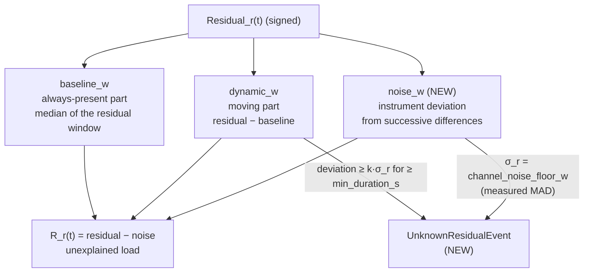
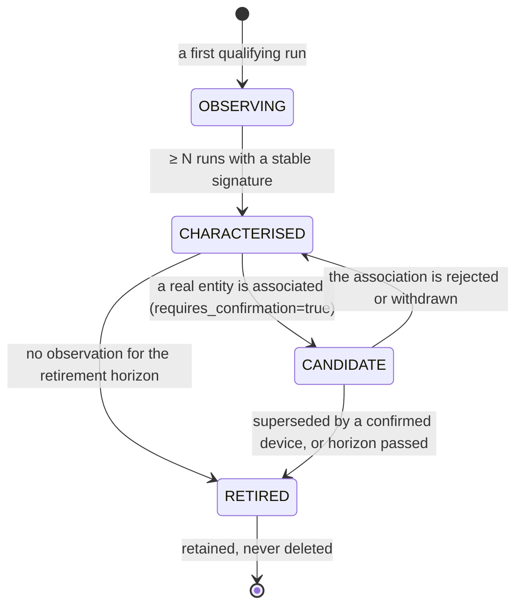

# 05 — Per-Reader Residual Model

**Status:** Specification — the per-Reader residual model: the three-component decomposition, the signed-residual rules, baseline estimation and drift, unknown-event detection, the residual split, the unknown-load profile lifecycle, and the immutable evidence record.

**Date:** 2026-11-16 · **Baseline:** branch `main`, HEAD `612e1233`, engine version `0.2.1-dev.36`, `CONTRACT_VERSION = "2.0.0"` (`engine/wattmosaic_engine/contracts.py:32`), SQLite schema `LATEST_VERSION = 11` (`engine/wattmosaic_engine/storage/migrations.py:792`).

**Purpose.** This document answers one question: *for one Reader, what exactly is the residual, how is it composed, when does it become an event, and what is allowed to happen to it afterwards?* It is the residual half of the specification. The measurement half is [03-measurement-and-electrical-domain.md](03-measurement-and-electrical-domain.md); the topology half is [04-topology-spec.md](04-topology-spec.md).

**Vocabulary used throughout.** A **Reader** is one measurement point on one conductor — a CT, a monitor-published reading, or a factor-adjusted reading. It is identified by its canonical `ct_id`. A **scope** is the electrical extent of a Reader plus the loads known on it (`ResidualScope`, `engine/wattmosaic_engine/models/residual_power.py:195`). A **Reader's residual** is the signed difference between the Reader's measured scope power and the known load on that scope.

**Quantifier convention.** **measured** = read from an instrument; **estimated** = derived from a measurement by a stated rule; **allocated** = assigned by a model or heuristic; **unknown** = not present in the repository. These match the `Source`/`MeasurementBasis` vocabulary of [03-measurement-and-electrical-domain.md](03-measurement-and-electrical-domain.md) §1.

**How to read the status markers.** Every capability carries one of:

| Marker | Meaning |
| --- | --- |
| **EXISTS** | Implemented and cited to `file:line`. A fact about the shipped engine. |
| **PARTIAL** | Implemented, with a named shortfall stated in the same row. |
| **MISSING** | No code path exists. The required behaviour is specified below and named as the extension it needs. |

---

## 1. Purpose and the scope boundary

### 1.1 What a residual is

**EXISTS.** The residual of a scope is the signed difference between the measured scope power and the sum of the known load contributions on that scope:

```text
Residual(t) = ScopePower(t) − Σ KnownLoadContributions(t)
```

`_signed_residual(circuit_power_w, known_load_w)` (`engine/wattmosaic_engine/models/residual_power.py:298`) is the **only** subtraction in the module. It applies no `max(0.0, …)`, no `abs()` and no epsilon (`docs/residual_analysis.md` §1, 16-38).

A residual is a **first-class object**, not a derived view: `ResidualPower` (`contracts.py:529`) carries the signed value, the derived kind, the resolution state, the age of the question, the basis and the baseline/dynamic split; it is persisted per observation (`storage/database.py:1018`) and served over `GET /residuals` (`api/server.py:778`).

### 1.2 What a residual is **not**

| Not this | Why |
| --- | --- |
| **Not an error.** | A negative residual means accounted power exceeds the measured total. That is a contradiction of the accounting, published with its sign; it never promotes a classification (`docs/residual_analysis.md` §9, 270-281). |
| **Not noise by default.** | A residual may be a fixed background, a cycling load, a duty-cycled appliance or an intermittent unknown. The system publishes the pattern it observes **without naming a device for it** (REQ-RESIDUAL-004). |
| **Not an allocation target.** | A residual is never redistributed onto devices, never used to raise a device's estimate, never written back into an attribution (`docs/residual_analysis.md` §9, 270-281; `electrical/solver.py:258-296`). |
| **Not zero when absent.** | "No history is not `0 W`": `before_w`/`unexplained_w` are `None` and `quality_status` is `MISSING` (`models/residual_power.py:479-495`; `docs/residual_analysis.md` §5, 167-197). |
| **Not a confidence score.** | Confidence is multidimensional and never blended; the residual's own confidence lives in `ConfidenceVector.residual` (`contracts.py:476-512`), which is a *dimension*, not a scalar (§6.4). |

**Rule.** The residual is the honest remainder of the accounting. It is preserved, reported, versioned and explained — never smoothed into a device and never silently rounded away.

### 1.3 The scope boundary of this document

| In scope | Out of scope |
| --- | --- |
| The per-Reader residual model: components, estimation, detection, evidence | The circuit/reader topology model — [04-topology-spec.md](04-topology-spec.md) |
| The unknown-load profile entity and its lifecycle | Device model classes and power models — `06-device-and-load-model-spec.md` (another owner) |
| The residual split and its invariant | Requirements text — [01-requirements.md](01-requirements.md) |
| The residual evidence record and its storage tier | Architecture — [02-architecture.md](02-architecture.md) |

**Rule.** This document specifies behaviour only. It introduces no code, no table outside the existing `residual_power` table's migration path, no service, no dependency and no message bus (`docs/implementation_plan_v2.md` §0).

---

## 2. The residual model

### 2.1 The equation

For one Reader `r` at instant `t`:

```text
Y_r(t)  =  Σ_{c ∈ C(r)} β_rc · Y_c(t)  +  R_r(t)  +  ε_r(t)
```

| Symbol | Meaning | Class |
| --- | --- | --- |
| `Y_r(t)` | The Reader `r`'s measured scope power at `t`, in W, after unit normalisation and one polarity correction. | measured |
| `C(r)` | The set of **compatible child measurements** of `r` (§2.2). | — |
| `Y_c(t)` | Child `c`'s measured contribution at `t`, in W. | measured |
| `β_rc` | The **calibrated measurement relationship** between child `c` and Reader `r` (§2.3). Dimensionless. | declared or estimated |
| `R_r(t)` | The **unexplained load** on `r` at `t`: the part of the residual that is not measurement noise. | estimated (derived from a measurement) |
| `ε_r(t)` | The **measurement noise** on `r` at `t`: the zero-mean deviation of the instrument around the true scope power. | estimated from the instrument's own noise |

Rearranged, this is the identity the engine already computes:

```text
Residual_r(t)  =  Y_r(t) − Σ_{c ∈ C(r)} β_rc · Y_c(t)  =  R_r(t) + ε_r(t)
```

**Rule.** The equation does **not** assume that residual consumption is random noise. `R_r` and `ε_r` are distinct components, and the residual is not automatically noise. A Reader with a steady 40 W background has `R_r ≈ 40 W` and `ε_r ≈ 0 W`; a Reader with a clean 0 W scope and a jittery CT has `R_r ≈ 0 W` and a non-zero `ε_r`.

### 2.2 The compatible-child rule

**EXISTS.** A child is admissible only if its `MeasurementBasis` is compatible with the scope's own basis. `bases_are_compatible(scope, contribution)` (`models/residual_power.py:166`) allows the same basis, `CT_MEASURED ↔ MONITOR_REPORTED` and `MONITOR_REPORTED ↔ FACTOR_ADJUSTED`; it refuses `FACTOR_ADJUSTED ↔ CT_MEASURED` and refuses `ESTIMATED_APPLIANCE_TOTAL` against anything measured (`models/residual_power.py:157-188`; `docs/residual_analysis.md` §2).

**Rule.** Compatibility is non-transitive on purpose. A consumer must never infer compatibility through an intermediate basis ([03-measurement-and-electrical-domain.md](03-measurement-and-electrical-domain.md) §3.4).

**EXISTS.** An incompatible contribution refuses the **whole scope** with `incompatible_basis` (`models/residual_power.py:736-747`) — it is not silently dropped. A contribution with no stated basis inherits the scope's own (`models/residual_power.py:721-728`). A scope whose own basis is `UNKNOWN` is refused `unknown_scope_basis` (`models/residual_power.py:715-716`).

**EXISTS.** Each conductor is counted **once**. A contribution observed by a CT that resolves to another contribution's canonical channel is a `duplicate_of:<kept>`; a contribution whose CT sits under another contribution's CT is `enclosed_by:<other>` (`models/residual_power.py:750-836`). Excluded contributions land in `evidence["excluded_contributions"]` (`models/residual_power.py:426`, `:773-777`).

**Rule.** `C(r)` is the set of children that are (a) electrically contained in `r`'s scope per the topology, (b) basis-compatible with `r`, and (c) neither duplicates nor enclosures. A child failing (b) refuses the scope; a child failing (a) or (c) is excluded with its reason recorded.

### 2.3 The β rule

| Case | `β_rc` | Source | Class |
| --- | --- | --- | --- |
| Direct nesting, no multiplier | **1.0 by construction** | The child reading is a subset of the parent's; one conductor is counted once (`models/residual_power.py:750-836`) | declared |
| A recorded multiplier is in force for `c` at `t` | the **recorded** multiplier, applied exactly once | `MeasurementFactor.multiplier` (`contracts.py:597`); the factor is resolved against the reading's timestamp (`contracts.py:591`; `electrical/factors.py:762`) | declared |
| `MONITOR_REPORTED ↔ FACTOR_ADJUSTED` | **estimated**, never assumed 1.0 | The two bases are comparable but are not the same observation | estimated |
| `duplicate_of` / `enclosed_by` | **excluded** (`β` = not in `C(r)`) | `models/residual_power.py:750-836` | — |

**Rule.** `β_rc` is 1.0 **by construction** only for a direct nesting with no multiplier. Everywhere else it is either the *recorded* multiplier or an explicitly labelled estimate. An estimated `β_rc` carries its own confidence dimension and never justifies distributing the residual.

**EXISTS.** Scaling happens exactly once, on the read path: `TopologyGraph.scale_w()` is the only place a value is scaled, and nothing writes a scaled value back into a window (`electrical/topology.py:622-641`; `electrical/factors.py:676-700`).

---

## 3. The three components



### 3.1 Baseline — `baseline_w`

**EXISTS.** `baseline_w` is the always-present part of the residual: `baseline_w = median(window)`, `dynamic_w = residual_w − baseline_w`, and the two always add back to the total (`models/residual_power.py:842-855`; `docs/residual_analysis.md` §3, 125-145).

| Property | Value | Evidence |
| --- | --- | --- |
| Estimator | median over the window | `models/residual_power.py:851` |
| The window holds | **residual observations**, not circuit totals | `ResidualScope.window_w` (`models/residual_power.py:236-241`) |
| Estimator name published | `median_of_window` / `no_window_current_only` | `models/residual_power.py:848`, `:852` |
| Sample count published | `evidence["window_samples"]` | `models/residual_power.py:849`, `:853` |
| Window spread published | `evidence["window_span_w"]` | `models/residual_power.py:854` |
| No window | `baseline_w = residual_w`, `dynamic_w = 0.0` | `models/residual_power.py:846-850` |
**Why the median.** The residual window routinely contains a minority of large excursions — a compressor start, a meter glitch — that would move a mean by kilowatts and leave the median untouched. The split says "this much is always there, this much is moving", and a robust central tendency is the only estimator that does not turn one spike into a permanent baseline (`docs/residual_analysis.md` §3, 125-145).

**Rule.** A persistent non-zero background is a **baseline**, not a stream of unknown events. A Reader whose residual sits at 40 W for a week has a baseline of 40 W and no events.

### 3.2 Dynamic — `dynamic_w`

**EXISTS.** `dynamic_w = residual_w − baseline_w` (`models/residual_power.py:855`). It is the part of the residual that moves relative to its own recent history. It is a *difference of two numbers about the same scope*, never a difference across scopes.

**Rule.** `dynamic_w` is the only quantity an unknown-event detector may threshold. `baseline_w` and `dynamic_w` always add back to `residual_w` — exactly, for every published decomposition (REQ-RESIDUAL-002).

### 3.3 Noise — `ε_r(t)`

**MISSING.** `ResidualPower` carries `baseline_w` (`contracts.py:557`) and `dynamic_w` (`contracts.py:560`) and **no noise term**. There is no contract field, no estimator and no persisted value for the noise component of a residual. This is the principal gap of this document.

#### 3.3.1 Where a noise floor already exists

| Source | What it measures | Evidence |
| --- | --- | --- |
| `channel_noise_floor_w` | The **measured** per-Reader innovation MAD, published into the inference metadata | `main.py:1093` `_channel_noise_floors()`; published at `main.py:1231-1241` |
| `estimate_row_noise` | A **second** estimator: `1.4826 × MAD` of successive differences of the raw row series | `ingestion/correlation.py:412` |
| `noise_floor_w = 5.0` | The **quality engine's own configured floor** — a threshold, not a measurement, and distinct from the measured MAD | `quality/engine.py:133` |
| `robust_noise` | A segmentation helper: `1.4826 × MAD(diff) / √2` | `models/segmentation.py:66` |
| `DEFAULT_NOISE_FLOOR_W = 1.0` | The matrix row-sigma floor, a **declared constant** | `electrical/matrix.py:43` |

**Rule.** The quality engine's `5.0 W` and the matrix's `1.0 W` are **floors and thresholds**, not measurements. They must never be reported as a Reader's observed noise. The measured MAD is a diagnostic of the channel's noise, never a statement about the load, and it is never used to alter a power value ([03-measurement-and-electrical-domain.md](03-measurement-and-electrical-domain.md) §10.3).

#### 3.3.2 The specified noise estimate

**Required delta — new type `ResidualNoiseEstimate`.** The noise component of a Reader's residual is estimated as:

```text
σ_r  =  1.4826 × median( |Δ Y_r| )          over the Reader's own successive differences
```

with two admissible sources, in priority order:

1. the **measured** per-Reader innovation MAD already published as `channel_noise_floor_w` (`main.py:1231-1241`);
2. `estimate_row_noise` (`ingestion/correlation.py:412`), which computes the same quantity from the raw row series when the metadata mapping is absent.

**Rule.** The noise estimate is computed from the Reader's **successive differences**, never from the baseline-relative dynamic series. Successive differences are invariant to a constant offset, so a slowly drifting baseline cannot inflate the noise estimate; conversely the baseline's median is invariant to the noise.

**Rule.** The two admissible sources must agree in construction, and a third quantity — the quality engine's `5.0 W` — must never be substituted for either. A Reader whose measured MAD is *below* a configured floor keeps the floor: `floors[cid] = max(self.noise_floor_w, measured)` (`disaggregation/engine.py:756`).

#### 3.3.3 A Reader with no measurement history

**Rule.** A Reader with no measured noise floor has **no** noise estimate. `noise_w` is `None`, the noise-floor field is `None`, and `quality_status` is `MISSING`. It is **never** `0.0 W` and never the configured floor presented as an observation.

| Reader state | `noise_w` | `noise_floor_w` | `quality_status` |
| --- | --- | --- | --- |
| Measured MAD available | the instantaneous deviation estimate | the measured MAD | `GOOD` |
| Reader exists, no MAD yet | `None` | `None` | `MISSING` |
| Reader stale / refused | `None` | `None` | `STALE` / `MISSING` |

**Rule.** Any rule that needs `σ_r` — the event threshold of §7 — is **not evaluated** when `σ_r` is unknown. It does not fall back to zero, which would fire on every sample, and it does not fall back to a threshold, which would invent an observation.

#### 3.3.4 Required delta — the contract field

**Required delta — extends `ResidualPower` (`contracts.py:529`).** An **additive, optional** `noise_w: float | None = None` and `noise_floor_w: float | None = None` on `ResidualPower`, plus a `noise_source: str | None` naming the derivation (`measured_mad` / `row_mad` / `None`). Optional and additive: a `2.0.0` reader keeps validating (`docs/implementation_plan_v2.md` §0).

**Rule.** `R_r` is published as `residual_w − noise_w` **only when** `noise_w` is not `None`. When it is `None`, `R_r` is `None` — never `residual_w`, which would claim that the whole residual is unexplained load and hide the fact that the noise component is unmeasured.

---

## 4. The signed-residual rule

These are **guarantees already in force**, not proposals.

| # | Rule | Evidence |
| --- | --- | --- |
| 1 | The signed residual is the **only** subtraction. No `max(0.0, …)`, no `abs()`, no epsilon clamp. | `models/residual_power.py:298-305`; `docs/residual_analysis.md` §1 |
| 2 | `kind` is `POSITIVE` for any residual above zero; `NEAR_ZERO` **only** at exactly zero; `NEGATIVE` below. | `derived_residual_kind` (`contracts.py:516-527`); `ResidualKind` (`contracts.py:238-252`) |
| 3 | `ZERO_TOL_W = 1e-9` has exactly **one** purpose: deciding "resolved". It never moves a value towards zero. | `models/residual_power.py:112`, `:436`, `:569` |
| 4 | A residual is **never redistributed** onto devices. Unknown consumption is preserved and reported, never allocated. | `docs/residual_analysis.md` §9, 270-281; `electrical/solver.py:258-296` |
| 5 | `resolved=False` is a legitimate, possibly permanent state; `unresolved_since` preserves the age of the question. | `models/residual_power.py:436-437`; `docs/residual_analysis.md` §4 |
| 6 | A surplus (negative residual) is a contradiction of the accounting, never invented load, and never promotes a classification. | `models/residual_power.py:520-526`; `docs/residual_analysis.md` §9 |
| 7 | Missing is never zero. A missing, NaN, stale or refused reading is `MISSING`. | `models/residual_power.py:414-415`, `:432-433`; `docs/electrical_model.md` §4.3 |

**Rule.** A Reader's residual keeps its sign from the instrument to the API. A consumer that needs a magnitude takes `abs()` **for itself** and must label the result as a magnitude; the system never does it.

---

## 5. Validity and refusal

### 5.1 The gates, in order

**EXISTS.** `ResidualAnalyzer.try_compute(scope, circuit_power_w, now)` (`models/residual_power.py:396`) runs six gates in order and returns a `ResidualAttempt` carrying `refused`, `reason_code` and `evidence` (`models/residual_power.py:334-355`): the scope power is finite (`:409-415`), the scope spans exactly one canonical conductor (`:681-683`), the scope's basis is established (`:715-716`), every contribution's basis is compatible (`:736-747`), every recorded conversion is positive and finite (`:731-734`), and the residual is finite (`:432-433`). The refusal code each gate raises is in §5.5.

### 5.2 The basis-compatibility matrix

| Pair | Comparable? | Physical reason | Evidence |
| --- | --- | --- | --- |
| same basis | yes | trivially | `models/residual_power.py:185-186` |
| `CT_MEASURED` ↔ `MONITOR_REPORTED` | **yes** | both are measurements of that conductor | `models/residual_power.py:157-159`, `:188` |
| `MONITOR_REPORTED` ↔ `FACTOR_ADJUSTED` | **yes** | a monitor that applied the factor *is* the factor-adjusted case | `models/residual_power.py:161-163`, `:188` |
| `FACTOR_ADJUSTED` ↔ `CT_MEASURED` | **no** | one side claims an appliance total, the other a leg | `models/residual_power.py:178-181` |
| `ESTIMATED_APPLIANCE_TOTAL` ↔ anything measured | **no** | an estimate may be reported, not subtracted from a reading | `models/residual_power.py:180-181` |

**Rule.** Compatibility is **not transitive**. `CT_MEASURED` and `FACTOR_ADJUSTED` are each compatible with `MONITOR_REPORTED` and incompatible with each other.

### 5.3 One residual per single-CT scope, and the multi-CT refusal

**EXISTS.** The audit pass computes **one residual per single-CT circuit scope** and refuses the rest (`disaggregation/audit.py:1712-1747`):

| Condition | `report.refused[...]` | Evidence |
| --- | --- | --- |
| `len(circuit.ct_ids) != 1` | `multi_ct_scope` | `disaggregation/audit.py:1738`; `REFUSED_MULTI_CT_SCOPE` (`:98`) |
| no current reading for the CT | `no_scope_reading` | `disaggregation/audit.py:1743`; `REFUSED_NO_READING` (`:99`) |
| the basis is `UNKNOWN` | `unknown_scope_basis` | `disaggregation/audit.py:1747`; `REFUSED_UNKNOWN_BASIS` (`:100`) |

**Rule.** A multi-CT circuit is **deliberately not summed**. Two clamps may be the two legs of one 240 V appliance (the total is their sum) or two monitors on one wire (the sum is a double count), and nothing in the evidence distinguishes them. A number that would be wrong half the time is worse than a named refusal (`docs/residual_analysis.md` §7, 223-252).

### 5.4 The alias-spread rule

**EXISTS.** When several raw CTs observe the same canonical conductor, their spread is recorded as `evidence["alias_spread_w"] = max(values) − min(values)` and is **never added to the total** (`models/residual_power.py:691-701`).

**Rule.** A meter spread is a diagnostic of two instruments on one wire. It is not load, it is not residual, and it is never summed into a scope total.

### 5.5 The refusal-code table

| Code | Raised by | Meaning | Evidence |
| --- | --- | --- | --- |
| `non_finite_circuit_power` | residual analyzer | the scope power is not a finite number | `models/residual_power.py:412`, `:415` |
| `non_finite_residual` | residual analyzer | the subtraction produced a non-finite value | `models/residual_power.py:433` |
| `scope_spans_multiple_channels` | residual analyzer | the scope covers more than one conductor | `models/residual_power.py:683` |
| `unknown_scope_basis` | residual analyzer / audit pass | the scope's basis is not established | `models/residual_power.py:716`; `disaggregation/audit.py:1747` |
| `incompatible_basis` | residual analyzer | a contribution's basis is not comparable with the scope's | `models/residual_power.py:747` |
| `invalid_conversion` | residual analyzer | a recorded multiplier is not positive and finite | `models/residual_power.py:733` |
| `multi_ct_scope` | audit pass | the circuit has more than one CT | `disaggregation/audit.py:1738` |
| `no_scope_reading` | audit pass | the circuit's CT has no current reading | `disaggregation/audit.py:1743` |
| `no_residual_history` | `decompose` | there is no residual history to decompose | `models/residual_power.py:490` |
| `residual_is_negative` | `decompose` | the latest residual is negative — a surplus, not load to explain | `models/residual_power.py:524` |
| `residual_not_disaggregable` | `decompose` | no candidate is a positive finite load | `models/residual_power.py:554` |
| `candidates_over_explain_residual` | `decompose` | the candidates exceed the residual — a contradiction | `models/residual_power.py:564` |
| `residual_resolved` | `decompose` | the candidates explain the residual exactly | `models/residual_power.py:586` |
| `residual_partially_explained` | `decompose` | the candidates explain part of it; the rest stays unresolved | `models/residual_power.py:586` |
| **`no_noise_floor`** | **new** | the Reader has no measured noise floor, so a σ-relative rule cannot be evaluated | §3.3.3, §7.2 |
| **`insufficient_window`** | **new** | the residual window holds fewer observations than the estimator requires | §6.2 |
| **`baseline_drift`** | **new** | the baseline moved slowly and persistently | §6.4 |
| **`residual_step`** | **new** | the residual moved abruptly against its baseline | §7.3 |
| **`scope_change_suspected`** | **new** | a residual signal suggests the measurement scope changed | §8 |

**Rule.** A refusal is recorded, not silent. The reason code is the answer.

---

## 6. Baseline estimation and drift

### 6.1 The estimator

**EXISTS.** `baseline_w = median(window)`, `dynamic_w = residual_w − baseline_w` (`models/residual_power.py:842-855`). The estimator name is published in the evidence: `median_of_window` when a window exists, `no_window_current_only` when it does not (`models/residual_power.py:848`, `:852`).

### 6.2 The window

**EXISTS.** The window is `ResidualScope.window_w` — recent **residual observations** in W, oldest first (`models/residual_power.py:236-241`).

**PARTIAL.** The production audit pass does **not** populate it. `AuditPass._residuals` constructs `ResidualScope(scope_id=…, ct_id=…, basis=…, device_contributions=…)` with no `window_w` (`disaggregation/audit.py:1755-1760`), so every live residual today is published with `baseline_estimator = "no_window_current_only"` and `dynamic_w = 0.0` (`models/residual_power.py:846-850`). The decomposition machinery exists and is exercised by unit tests; the production path never supplies the input it needs.

**Required delta.** The audit pass must supply the scope's recent **residual observations** as the window. The window is per scope, holds residual values (never circuit totals), and is read back from the persisted `residual_power` history (`storage/database.py:1045`) — it is never re-derived from raw samples.

| Property | Value | Rationale |
| --- | --- | --- |
| Content | residual observations in W, oldest first | `ResidualScope.window_w` (`models/residual_power.py:236-241`) |
| Length | the last **N** residual observations of that scope, N configurable, default **32** | long enough for a robust median, short enough that a step replaces the majority of the window quickly |
| Minimum for a robust median | **8** observations; below that the estimator is refused `insufficient_window` | `evidence["window_samples"]` is already published (`models/residual_power.py:853`) |
| Source | the persisted `residual_power` history (`storage/database.py:1045`), read backwards in time | the residual history is the only record of *residual* observations |
| Cadence | N is a count of observations, not a duration — the data cadence is observed, not assumed (15.7 s median; `docs/electrical_model.md` §6) | [03-measurement-and-electrical-domain.md](03-measurement-and-electrical-domain.md) §6 |

**Rule.** The window holds **residual observations**. A window of circuit totals would make the baseline a statement about the circuit rather than about the residual, and the split meaningless (`models/residual_power.py:237-241`).

### 6.3 Adaptation

**Rule.** The baseline is a **sliding** estimate over the scope's window. It adapts by the median, which moves only when the new level becomes the majority of the window. This is what distinguishes a slow drift (the median creeps) from a step (the median jumps once the step occupies half the window).

**Rule.** A **persistent** non-zero background is a baseline. A Reader whose residual is stable at 40 W for a week has `baseline_w ≈ 40 W` and `dynamic_w ≈ 0 W`. It is not a stream of unknown events, and it never produces one event per cycle.

### 6.4 Drift

**MISSING.** Nothing today detects or reports residual drift. `ResidualTrend` publishes `cause_counts` and `sign_changes` in its evidence (`models/residual_power.py:646-655`), which is a *description of history*, not a change event.

**Required delta — new type `ResidualBaselineChange`.** A drift is a **slow, persistent movement of the baseline**:

| Property | Rule |
| --- | --- |
| Signal | `|baseline_new − baseline_old| > 0` **and** `≤ max_baseline_step_w` (the step bound of §6.5) **and** the same sign across `≥ drift_windows` consecutive windows |
| Bound | the baseline may move at most `max_baseline_step_w` per window; a larger move is a **step**, not a drift |
| Default bound | the step threshold of §7.2, i.e. `max(k·σ_r, absolute_floor_w)` |
| Default persistence | **3** consecutive windows in the same direction |
| Recorded | scope id, previous baseline, new baseline, delta, direction, window count, window samples, timestamps, noise floor in force, estimator name |
| Never | the previously stored residual points are **not rewritten** |

**Rule.** Drift is recorded as a new, versioned observation. It never mutates a stored residual row and never rewrites a baseline that was already published (`REQ-RESIDUAL-005`; `REQ-STORAGE-003`).

**Rule.** The **API home** of `ResidualBaselineChange` is the **change surface**: it is **its own item in the change list** returned by `GET /changes`, not a `ConfigurationChangeKind` variant. The API contract specifies the type field-for-field in [09-api-and-data-contracts.md](09-api-and-data-contracts.md) §7.10 and the change-surface union in §8.1 (N-04); that document's field set is the exported-schema surface and repeats the semantics of this section.

### 6.5 Step versus drift

| | Drift | Step |
| --- | --- | --- |
| Shape | slow, monotone over several windows | abrupt, inside one window |
| Magnitude per window | below `max_baseline_step_w` | at or above the step threshold |
| Direction | persistent | may be either |
| Reported as | `baseline_drift` | `residual_step` |

**Rule.** The two are distinguished by magnitude and persistence, never by an assumed schedule. A Reader whose baseline moves 5 W per window for a week is drifting; a Reader whose baseline moves 300 W in one window has stepped.

---

## 7. Unknown event detection

### 7.1 What an event is

A **dynamic residual event** is a sustained, σ-relative departure of a Reader's residual from its own baseline, on a scope that no device explains. It is the residual-side analogue of a device event and is the hand-off to the learning system (§11).

### 7.2 The threshold

**Rule.** An event fires when the deviation from the baseline exceeds the Reader's **own** noise floor:

```text
|d(t)|  =  |dynamic_w(t)|  ≥  max( k · σ_r , absolute_floor_w )
```

| Term | Value | Source |
| --- | --- | --- |
| `d(t)` | `dynamic_w` — the departure from the baseline | `models/residual_power.py:855` |
| `σ_r` | the measured per-Reader noise floor (§3.3.2) | `main.py:1231-1241`; `ingestion/correlation.py:412` |
| `k` | configurable, default **3** | new configuration, §7.5 |
| `absolute_floor_w` | configurable, default **1.0 W** | the matrix's existing row-sigma floor (`electrical/matrix.py:43`) |

**Rule.** The threshold is **relative to the Reader**. A 0.3 W inverter CT and a 30 W load-manager CT get different thresholds; one global threshold would either flood the first or blind the second (`main.py:1231-1238`).

**Rule.** When `σ_r` is unknown the event is **not evaluated**: the detection is refused `no_noise_floor` and the cycle produces no event. It does not fall back to `absolute_floor_w` alone for a σ-relative rule, and it never substitutes the quality engine's `5.0 W` for a measurement.

### 7.3 The minimum duration

**Rule.** The deviation must persist for at least `min_duration_s`, derived from the **observed** cadence and never hardcoded:

```text
min_duration_s  =  min_duration_windows × observed_cadence_s
```

with `min_duration_windows` configurable, default **3**. The observed cadence is the median of the Reader's per-channel median history intervals, clamped to `[MIN_CADENCE_S, MAX_CADENCE_S]` (`electrical/window.py:39-43`, `:207-239`).

**Rule.** A deviation shorter than `min_duration_s` is a **transient**, not an event. It is not reported and it never updates a baseline.

### 7.4 The de-duplication rule

| Rule | Behaviour |
| --- | --- |
| One event per contiguous run | A run is a maximal set of consecutive qualifying observations. It produces **one** event, not one per cycle. |
| The event closes when | the deviation returns below the threshold and stays below for `dedup_gap_s` (= `min_duration_s`). |
| Re-arming | a new run after the gap produces a **new** event with a new identity; the previous event is not extended or rewritten. |
| Idempotency | the event identity is content-addressed (§12.4), so a replayed window produces the same identity and does not duplicate the event. |
| Negative residuals | a negative deviation is a **surplus**, not an unknown event. It is recorded as a `residual_step` with the direction, never as an unknown load. |

**Rule.** De-duplication is by **contiguity**, never by magnitude: two separate 200 W excursions an hour apart are two events, and one 200 W excursion reported over five cycles is one event.

### 7.5 The evidence record

**Required delta — new type `UnknownResidualEvent`.** An event is replayable only if it carries the inputs that produced it:

| Field | Content |
| --- | --- |
| `event_id` | content-addressed identity (§12.4) |
| `scope_id`, `reader_id` | the scope and the canonical `ct_id` |
| `window_start`, `window_end` | the run's first and last observation timestamps |
| `window` | the residual observations in the run, oldest first |
| `baseline_w` | the baseline in force at the run's start |
| `dynamic_w` | the run's peak departure from the baseline |
| `residual_w` | the residual at the run's peak |
| `noise_floor_w`, `noise_source` | the `σ_r` used and where it came from (§3.3.2) |
| `threshold_w`, `k` | the threshold applied and its multiplier |
| `min_duration_s`, `observed_cadence_s` | the duration rule applied and the cadence it came from |
| `estimator` | `median_of_window` / `no_window_current_only` (`models/residual_power.py:848`, `:852`) |
| `basis` | the scope's `MeasurementBasis` |
| `quality_status` | the input quality |
| `contract_version`, `topology_version`, `algorithm_version` | the versions the event was produced under (§12.4) |

**Rule.** The **API home** of `UnknownResidualEvent` is the **event-evidence surface**: it is exposed through `GET /events`, as the `unknown_residual_event` payload of an `EventItem` whose `kind` is `UNKNOWN_RESIDUAL`. It is **not** a `ConfigurationChangeEvent` and does **not** appear in `GET /changes`. The API contract specifies the type field-for-field in [09-api-and-data-contracts.md](09-api-and-data-contracts.md) §7.9 and the event-evidence surface union in §8.1 (N-07); that document's field set is the exported-schema surface and repeats the semantics of this section.

**Rule.** The evidence record is **complete**: a reader can recompute the threshold, the duration and the decision from it without re-reading the raw samples. An event whose evidence is incomplete is not published.

**Rule.** The configuration defaults of §7.2 and §7.3 are **configurable settings**, not contract constants, and each is recorded on the event.

---

## 8. Residual change detection

### 8.1 The signals

| # | Signal | Observable | Maps to |
| --- | --- | --- | --- |
| S1 | **Persistent baseline shift on one Reader** | `baseline_drift` (§6.4) sustained across `drift_windows` | a scope or load change on that Reader |
| S2 | **A residual that suddenly resolves** | `resolved` flips `True` after `≥ drift_windows` unresolved observations | a device now explains the scope, or a child scope appeared |
| S3 | **A residual that suddenly appears** | a positive residual appears where the scope was resolved or near zero | a new load appeared, or a child scope disappeared |
| S4 | **A correlation pattern that changes** | the Reader's residual begins, or stops, co-varying with another Reader's residual or with a device's step | a nesting or attribution change |
| S5 | **A surplus appears** | `kind` flips to `NEGATIVE` | a metering or attribution contradiction — never load |

### 8.2 The hand-off — and the boundary

**Rule.** A residual change produces a **suspected** change proposal. It never writes a topology relation, never confirms one, never promotes a candidate, and never changes a `Circuit` classification by itself.

**Rule.** A suspected topology change is a **distinct artefact**, not a `TopologyRelation` of a new kind (OD-06, [00-project-overview.md](00-project-overview.md) §12). The residual path emits the proposal; the topology/change path owns the lifecycle. The topology rules themselves are specified in [04-topology-spec.md](04-topology-spec.md) and are **not** duplicated here.

**Rule.** A suspected change is a **hypothesis**, not a fact: it carries `requires_confirmation = True` (`contracts.py:791`) and its confidence never exceeds `MAX_CONFIDENCE = 0.99` (`disaggregation/association.py:144`).

**Rule.** A surplus (S5) is a contradiction, never invented load, and never promotes a classification (`docs/residual_analysis.md` §9, 270-281).

**Rule.** Every suspected change cites the residual evidence that produced it, so the proposal is checkable and replayable.

---

## 9. The residual split

### 9.1 The three terms and the invariant

**EXISTS.** `Reconciliation` (`contracts.py:1685`) carries the split of the home-level unknown residual:

| Term | Definition | Field | Evidence |
| --- | --- | --- | --- |
| Meter spread | `\|canonical feed total − aliased feed total\|` — measured, never guessed, **unbounded** | `meter_spread_w` (`contracts.py:1724`) | `docs/electrical_model.md` §4.2.4, 485-559 |
| Meter disagreement | `min(meter_spread_w, max(0, unknown_residual_w))` — the spread's clipped contribution to the residual | `meter_disagreement_w` (`contracts.py:1720`) | `docs/electrical_model.md` §4.2.4 |
| Unmonitored load | `unknown_residual_w − meter_disagreement_w` | `unmonitored_w` (`contracts.py:1719`) | `docs/electrical_model.md` §4.2.4 |

**Rule.** `unmonitored_w + meter_disagreement_w == unknown_residual_w` **exactly, always** (`contracts.py:1699-1718`; `docs/electrical_model.md` §4.2.4, 485-559). The total is never rewritten to either part.

**Rule.** `meter_spread_w` is `0.0` — and no claim is made — unless there is at least one enabled alias channel, the alias legs form a complete meter point, and the canonical channels they alias are exactly the enabled `effective_feeds()` of the home (`docs/electrical_model.md` §4.2.4, 485-559). An unmeasured, stale or half-measured meter is never evidence of disagreement.

**Rule.** When `meter_spread_w > unknown_residual_w`, `meter_spread_exceeds_residual` is set (`contracts.py:1730`) and the residual is **not** evidence of unmonitored load. `unmonitored_w == 0` in that case must never be read as "everything is metered".

### 9.2 The unknown-load slack

**EXISTS.** `augment_with_unknown_slack()` appends one non-negative column per main row and per declared-shared row (`electrical/solver.py:258-296`), so a main row constrains `Σ known ≤ main`. The slack is reported in `diagnostics["unknown_slack"]` and folded into `Reconciliation.unknown_residual_w`; it is **never** written back into a device (`docs/electrical_model.md` §4.2, 359-381).

**Rule.** The slack is the solver's protection against fabricating attribution. It is not a device, not a profile, and not a candidate for promotion. The unknown-load profile of §10 is a *description* of what the slack leaves over; the two are not the same object.

### 9.3 The audit-pass scope rule

**EXISTS.** One residual per single-CT circuit scope; the multi-CT scope is refused (§5.3). The pass records both the count (`report.counts["residuals"]`) and the objects (`report.residuals`), because a pass that counted residuals without keeping them would report "160 residuals" and hand back an empty list (`disaggregation/audit.py:1781-1787`).

**Rule.** The per-Reader residual of §2 is the **scope-level** object. The home-level split of §9.1 is a **different level** and neither consumes the other: the residual is a view over the same arithmetic (`docs/residual_analysis.md` §9).

---

## 10. The unknown-load profile

### 10.1 The entity

**MISSING.** There is **no explicit unknown-load entity in the contract**. Unknown load survives only as `Reconciliation.unknown_residual_w` plus the solver slack, with no per-circuit breakdown and no lifecycle (`docs/electrical_model.md` §10, 844-872; `00-project-overview.md` §1).

**Required delta — new type `UnknownLoadProfile`.** Per OD-01 ([00-project-overview.md](00-project-overview.md) §12) the entity **exists** and the residual remains the authoritative total. The profile is a *projection* over the residual evidence, never a replacement for it.

**Rule.** This is the **authoritative** field set for `UnknownLoadProfile`. It is field-for-field identical to the table in the API contract, [09-api-and-data-contracts.md](09-api-and-data-contracts.md) §7.4; the two must never diverge. The API contract is the exported-schema surface and repeats this table unchanged.

| Field | Type | Unit | Null | Default | Required | Notes |
|---|---|---|---|---|---|---|
| `profile_id` | `str` | — | no | — | `REQUIRED` | opaque `ulp-<n>`; stable identity of the pattern; never reused |
| `label` | `str` | — | no | `""` | `REQUIRED` | user-facing text; never parsed by the engine; a **proposed** name, never a confirmed one |
| `lifecycle` | `UnknownLoadLifecycle` | — | no | `OBSERVING` | `REQUIRED` | the four states of §10.3; the transitions are fixed by that section |
| `signature` | `list[float]` | unitless `0.0`–`1.0` | no | `[]` | `REQUIRED` | the time-of-day / duty-cycle shape of the pattern; `[]` = no signature computed yet |
| `scope_id` | `str` | — | no | — | `REQUIRED` | the scope the pattern was observed on |
| `reader_id` | `str` | — | no | — | `REQUIRED` | the canonical `ct_id` of the Reader the pattern was observed on |
| `first_seen_at` | `datetime` (UTC) | — | no | — | `REQUIRED` | engine clock; the start of the observation span |
| `last_seen_at` | `datetime` (UTC) | — | no | — | `REQUIRED` | engine clock; the end of the observation span; `>= first_seen_at` |
| `event_count` | `int` | count | no | `0` | `REQUIRED` | the number of qualifying runs (`occurrences`) |
| `mean_power_w` | `float` | **W** | **yes** | `None` | `REQUIRED` | median magnitude of the run's departure; `None` = not yet estimated |
| `peak_power_w` | `float` | **W** | **yes** | `None` | `REQUIRED` | peak magnitude of the run's departure; `None` = not yet estimated |
| `median_duration_s` | `float` | **s** | **yes** | `None` | `REQUIRED` | median duration of a qualifying run; `None` = not yet measured |
| `retirement_horizon_s` | `float` | **s** | no | the configured horizon (default **30 days**, `OD-43`) | `REQUIRED` | the configurable horizon after which an unobserved profile is retired |
| `promoted_device_id` | `str` | — | **yes** | `None` | `REQUIRED` | the device this profile was promoted to, if any; `None` = not promoted. A promoted identity is a **device reference**, never a lifecycle state |
| `requires_confirmation` | `bool` | — | no | `True` | `REQUIRED` | `True` while the profile is a proposal; never `False` before the association is confirmed |
| `confidence` | `ConfidenceVector` (`contracts.py:476`) | unitless | no | — | `REQUIRED` | never a blended scalar |
| `basis` | `MeasurementBasis` (`contracts.py:186`) | — | no | `UNKNOWN` | `REQUIRED` | a profile is never `DIRECT_MEASURED` (§10.2) |
| `evidence_event_ids` | `list[str]` | — | no | `[]` | `REQUIRED` | the `UnknownResidualEvent` ids (§7.5) that built it |
| `created_at` | `datetime` (UTC) | — | no | — | `REQUIRED` | |
| `updated_at` | `datetime` (UTC) | — | no | — | `REQUIRED` | |
| `version` | `int` | — | no | `1` | `REQUIRED` | row version |

**Rule.** The profile is a *projection* over the residual evidence, never a replacement for it: the residual remains the authoritative total, and a profile is never presented as an identified device.

### 10.2 How it is distinguished from a real device

| Property | A real device | An unknown-load profile |
| --- | --- | --- |
| Identity | a `device_id` | a `profile_id`; **no** `device_id` |
| Type | a `DeviceType` (`contracts.py:386`) | none — the profile has no device class |
| Source | `INFERRED` / `MODEL_ESTIMATED` / `CONFIGURED_PRIOR` / `DIRECT_MEASURED` | never `DIRECT_MEASURED`; it is estimated or unknown |
| Monitoring level | `SHARED` / `HOME_TOTAL_ONLY` / `UNMONITORED` / `UNKNOWN` (`contracts.py:351`) | `UNMONITORED` |
| Presence in the device table | present | **absent** — it is not a device row |
| Presentation | a device in a device list | an *unidentified consumption* entry that names its Reader and its contribution |

**Rule.** A profile is never presented as an identified device. It is presented as *unidentified consumption on Reader `r`*, with its magnitude, its signature and its confidence dimensions.

**Rule.** A profile never becomes a device by being *named*. It becomes a device only through the promotion rule of §10.4, which produces a **candidate** relation requiring confirmation.

### 10.3 The lifecycle



| State | Entry condition | Meaning |
| --- | --- | --- |
| `OBSERVING` | the first qualifying run | a pattern has been seen; nothing is claimed about it |
| `CHARACTERISED` | `≥ N` runs (configurable, default **3**) with a stable signature | a recurring pattern, still unidentified |
| `CANDIDATE` | an association with a real entity exists | a proposal, pending confirmation |
| `RETIRED` | the retirement horizon passed, or a confirmed device explains the same scope | the pattern is no longer unexplained |

`UnknownLoadLifecycle` — the **only** lifecycle vocabulary for an unknown-load profile: `OBSERVING`, `CHARACTERISED`, `CANDIDATE`, `RETIRED`. The API contract declares the same four members and no others ([09-api-and-data-contracts.md](09-api-and-data-contracts.md) §7.4).

**Rule.** There is **no** `CONFIRMED` state and **no** `MERGED` state. Under the project owner's decision the system may **propose** a candidate name for an unknown load, and a proposed identity is **never** auto-confirmed. A profile that now has a confirmed device carries that device in `promoted_device_id`; the confirmed identity is a **device**, not a profile state.

**Rule.** The lifecycle is **append-only in history**: a transition appends a record, it never rewrites the previous state. A retired profile is retained so the history of "this was unexplained, and then it was not" survives (`REQ-STORAGE-003`).

### 10.4 Promotion and retirement

**Rule.** Promotion to `CANDIDATE` requires an association with a **real** entity produced by the learning path. The promotion produces a candidate relation with `requires_confirmation = True` (`contracts.py:791`) and a confidence of at most `MAX_CONFIDENCE = 0.99` (`disaggregation/association.py:144`). Nothing in this document auto-confirms a promotion.

**Rule.** Retirement happens when (a) the profile has not been observed for the retirement horizon, (b) a confirmed device explains the same scope, or (c) the scope itself was retired. The reason is recorded.

**Rule.** A retired profile is **never deleted** and never silently reused.

**Rule.** `Circuit` classification `PARTIALLY_UNDERSTUDED` already requires the unattributed load to be stated in `metadata["unattributed_load_w"]` or `metadata["unattributed_note"]` (`contracts.py:750-757`). A profile supplies that statement; it does not change the classification.

---

## 11. Hand-off to the learning system

### 11.1 What must cross the boundary

**Rule.** An unknown residual event reaches the device-learning path carrying, at minimum: the **event**, its **Reader**, its **magnitude**, its **window** and its **signature** (REQ-RESIDUAL-006, REQ-LEARNING-004).

| Payload | Source | Why the learning path needs it |
| --- | --- | --- |
| the event id and its kind | §7.5 | the ledger entry's identity |
| the Reader and scope | §7.5 | which circuit the load is on |
| the magnitude (`residual_w`, `dynamic_w`) | §7.5 | the shape of the sample |
| the window (start, end, observations) | §7.5 | the sample's evidence window |
| the signature (duty, time-of-day) | §10.1 | the recurring pattern |
| the noise floor and threshold | §7.5 | how far above the instrument's own noise the event was |
| the basis and quality | §7.5 | whether the sample is admissible at all |

### 11.2 The shape of the hand-off

**EXISTS.** The learning pipeline's entry point takes events and a window and returns candidates with rejection reasons: `LearningPipeline.consider(events, window)` (`learning/pipeline.py:273-306`). Every candidate is filtered, accounted, and persisted with its decision — accepted samples are persisted, rejected ones are kept in `last_rejected` (`learning/pipeline.py:282-303`) and counted by `LearningAccounting.record` (`learning/reporting.py:99`).

**MISSING.** `DeviceEvent` (`contracts.py:1547-1564`) requires a `device_id`. An unknown residual has no device, and inventing one would be exactly the fabrication this document forbids.

**Required delta — new event type.** The hand-off is expressed as a **new, additive event model** carrying the fields of §11.1, accepted by the learning path as an event source. It reuses the pipeline's filter, accounting and persistence; it does not re-implement them.

**Rule.** An unknown-residual event appears in the learning ledger with an **accepted/rejected decision and a reason code**, exactly like a device event. A rejection reason is the answer; a silent drop is a defect.

**Rule.** An accepted unknown-residual event produces a **residual profile** (`models/residual.py` `ResidualDeviceModel`, `:16`), never a device model. The learning path learns the *pattern*; it does not manufacture an appliance.

**Rule.** The hand-off never writes to a device row. `unknown_residual_w` is preserved and reported, never allocated (`docs/residual_analysis.md` §9, 270-281).

---

## 12. Storage

### 12.1 The table and its tier

**EXISTS.** The `residual_power` table is created by migration 9 (`storage/migrations.py:716-734`) and is listed in `AUDIT_TABLES` (`storage/migrations.py:122-134`, `residual_power` at `:128`), which exempts it from `prune` — it is part of the versioned history, not a raw sample (`docs/residual_analysis.md` §8).

**Rule.** The residual evidence sits in the **L2** tier — immutable event evidence, long-term, never deleted by `prune` ([02-architecture.md](02-architecture.md) §5.4). `prune` reports each exempt table with a count of `0` and leaves it untouched (`storage/database.py:1304-1344`).

### 12.2 What is written

**EXISTS.** `persist(results, database, timestamp=…)` (`models/residual_power.py:1115-1137`) writes through `Database.insert_residual_power` (`storage/database.py:1018-1043`), which only ever **inserts**: the sign, the derived kind and the resolution state are written as computed and nothing is rewritten on the way into storage. `Database.residual_history` (`storage/database.py:1045-1063`) reads them newest first.

**Required delta — additive columns (migration 12).** The following columns are added to `residual_power`; no new table is created:

| Column | Content |
| --- | --- |
| `noise_w` | the noise component estimate, nullable |
| `noise_floor_w` | the `σ_r` in force, nullable |
| `noise_source` | `measured_mad` / `row_mad` / null |
| `window_samples` | the number of observations the baseline was based on |
| `baseline_estimator` | `median_of_window` / `no_window_current_only` |
| `algorithm_version` | the derivation that produced the row |
| `contract_version` | the contract the row was written against |
| `topology_version` | the topology the row was produced under |
| `reader_configuration_version` | the reader configuration in force (OD-04) |
| `device_mapping_version` | the device mapping in force |
| `scope_id` | the scope identity, so a history is queryable per scope |
| `reader_id` | the canonical `ct_id` |
| `evidence_json` | the event's evidence record (§7.5) |

**Rule.** Every column is **nullable with a safe default**, so the change is additive and optional and a `2.0.0` reader keeps validating (`docs/implementation_plan_v2.md` §0).

**Rule.** The migration is forward-only, has **zero non-null backfill**, and does not rewrite any existing row.

### 12.3 Immutability

**Rule.** A residual row is **append-only**. A re-analysis over the same window appends a new row; it never updates an existing one (`REQ-STORAGE-003`; `docs/residual_analysis.md` §8). `unresolved_since` is carried forward from the previous row of the same scope rather than recomputed, so the age of the question is preserved across revisions (`models/residual_power.py:437`).

**Rule.** A new model version, topology version or mapping version never deletes historical evidence (`REQ-STORAGE-005`).

### 12.4 Versioning and identity

**Required delta.** The residual evidence record carries the version identifiers it was produced under, in the style of `InferenceRecord` (`contracts.py:870-899`), which carries `algorithm_version`, `contract_version`, `topology_version`, `revision` and `previous_record_id`.

| Identifier | Meaning |
| --- | --- |
| `contract_version` | the contract the payload was written against (`contracts.py:32`) |
| `topology_version` | the topology the residual was computed under (`contracts.py:1688`) |
| `reader_configuration_version` | the reader configuration in force (OD-04 — a payload field, not a new column on `topology_versions`) |
| `device_mapping_version` | the device mapping in force |
| `algorithm_version` | the derivation, e.g. `residual@1` |
| `revision` | a monotone per-scope revision; a revision never overwrites its predecessor |

**Rule.** The `UnknownResidualEvent.event_id` is **content-addressed** over the run's identity — scope, window, baseline, threshold and the version identifiers — so a replayed window produces the same id and does not duplicate the event. The derivation follows OD-03.1's content-addressing rule ([03-measurement-and-electrical-domain.md](03-measurement-and-electrical-domain.md) §7.4) and must agree with it.

**Rule.** The residual evidence is a **first-class record, not a derived view recomputed in place**. A reader can ask for a scope's residual history over a period (`REQ-RESIDUAL-003`); `GET /residuals` (`api/server.py:778`) returns a time series, not only the latest value.

---

## 13. The consolidated capability table

| # | Capability | Status | Evidence |
| --- | --- | --- | --- |
| 1 | The signed residual is the only subtraction; no clamp, no `abs()`, no epsilon | **EXISTS** | `models/residual_power.py:298-305` |
| 2 | `kind` derived from the sign; `NEAR_ZERO` only at exactly zero | **EXISTS** | `contracts.py:516-527` |
| 3 | `ZERO_TOL_W` used for exactly one purpose — "resolved" | **EXISTS** | `models/residual_power.py:112`, `:436` |
| 4 | Baseline = median over the residual window | **EXISTS** | `models/residual_power.py:842-855` |
| 5 | Dynamic = residual − baseline; the two add back exactly | **EXISTS** | `models/residual_power.py:855` |
| 6 | The estimator name and the window sample count are published | **EXISTS** | `models/residual_power.py:848-854` |
| 7 | **An explicit noise term on the residual** | **MISSING** | `ResidualPower` (`contracts.py:529-583`) has `baseline_w` and `dynamic_w` and no noise field |
| 8 | A measured per-Reader noise floor exists and is published | **EXISTS** | `main.py:1093`, `:1231-1241` |
| 9 | A second noise estimator (MAD of successive differences) exists | **EXISTS** | `ingestion/correlation.py:412` |
| 10 | The quality engine's own floor is distinct from the measured MAD | **EXISTS** | `quality/engine.py:133` |
| 11 | A robust-noise helper exists for segmentation | **EXISTS** | `models/segmentation.py:66` |
| 12 | **The production path populates the baseline window** | **MISSING** | `disaggregation/audit.py:1755-1760` builds `ResidualScope` without `window_w`, so `baseline_estimator` is always `no_window_current_only` (`models/residual_power.py:848`) |
| 13 | The residual is persisted per observation | **EXISTS** | `models/residual_power.py:1115`; `storage/database.py:1018` |
| 14 | A residual history is readable | **EXISTS** | `storage/database.py:1045` |
| 15 | The table is exempt from pruning | **EXISTS** | `storage/migrations.py:122-134` (`:128`) |
| 16 | The table was created by migration 9 | **EXISTS** | `storage/migrations.py:716-734` |
| 17 | `GET /residuals` serves the history | **EXISTS** | `api/server.py:778` |
| 18 | `GET /models/{device_id}` serves a device's models | **EXISTS** | `api/server.py:780` |
| 19 | The `decompose` decision table with its six reason codes | **EXISTS** | `models/residual_power.py:456-590`; `docs/residual_analysis.md` §5, 167-197 |
| 20 | "No history is not `0 W`" — `None` values and `MISSING` quality | **EXISTS** | `models/residual_power.py:479-495` |
| 21 | The trend confidence `min(1.0, n/(n+8))`, `None` with no history | **EXISTS** | `models/residual_power.py:630`; `:609-624` |
| 22 | The non-transitive basis-compatibility matrix | **EXISTS** | `models/residual_power.py:166-188` |
| 23 | One residual per single-CT scope; the multi-CT refusal | **EXISTS** | `disaggregation/audit.py:1712-1747` |
| 24 | The alias spread is recorded and never added to the total | **EXISTS** | `models/residual_power.py:691-701` |
| 25 | Each conductor counted once; exclusions recorded | **EXISTS** | `models/residual_power.py:750-836`; `:426` |
| 26 | `resolved=False` is a legitimate state; `unresolved_since` preserves the age | **EXISTS** | `models/residual_power.py:436-437` |
| 27 | The residual split identity and its invariant | **EXISTS** | `contracts.py:1697-1730`; `docs/electrical_model.md` §4.2.4, 485-559 |
| 28 | The unknown-load slack exists and is never written to a device | **EXISTS** | `electrical/solver.py:258-296`; `docs/electrical_model.md` §4.2, 359-381 |
| 29 | A residual is never redistributed onto devices | **EXISTS** | `docs/residual_analysis.md` §9, 270-281 |
| 30 | Refusals are machine-coded, never silent | **EXISTS** | `models/residual_power.py:118-138`; `disaggregation/audit.py:98-100` |
| 31 | **An explicit unknown-load entity** | **MISSING** | `docs/electrical_model.md` §10, 844-872; `00-project-overview.md` §1 |
| 32 | **An unknown-residual event consumable by the learning path** | **MISSING** | `learning/pipeline.py:273-306` takes events; `DeviceEvent` (`contracts.py:1547-1564`) requires a `device_id` |
| 33 | **Residual drift / change detection as a named event** | **MISSING** | `models/residual_power.py:592-657` publishes `sign_changes` and `cause_counts` but no change event |
| 34 | **Version identifiers on the residual evidence row** | **MISSING** | `contracts.py:529-583`; contrast `InferenceRecord` (`contracts.py:870-899`) |
| 35 | **The residual confidence dimension is populated** | **PARTIAL** | `ConfidenceVector.residual` exists (`contracts.py:476-512`) and is never populated (`docs/confidence_model.md` §2) |
| 36 | **A per-Reader σ-relative event threshold** | **MISSING** | `main.py:1231-1238` measures the floors for CT step detection; the residual path has no threshold of its own |

---

## 14. New gaps

The gap register `G1`–`G20` lives in `docs/assessment_gap_analysis.md:414-433`, and the source register for the `G21`–`G32` band is `00-project-overview.md` §13.1; the register of record for gap identifiers is `00-project-overview.md` §13.2. **This document's gaps occupy the `G74`–`G79` band allocated to it by the canonical register in `00-project-overview.md` §13.2; the table below is the upstream source for the gaps it lists.**

| Id | Gap | Status | Required change | Blocking? |
| --- | --- | --- | --- | --- |
| **G74** | `ResidualPower` has no noise term: the residual's third component is unmodelled | MISSING | Additive `noise_w` / `noise_floor_w` / `noise_source` on `ResidualPower` (§3.3.4) | No — the baseline/dynamic split stays valid without it |
| **G75** | The production audit pass never populates the baseline window, so every live residual is `no_window_current_only` | MISSING | The pass must supply the scope's recent residual observations from the persisted history (§6.2) | Yes for the baseline/dynamic split to be observable in production |
| **G76** | No residual drift or change event exists | MISSING | New `ResidualBaselineChange` and the change signals of §8 (§6.4, §8.1) | No — REQ-RESIDUAL-005 is SHOULD |
| **G77** | No unknown-residual event type exists for the learning hand-off | MISSING | New additive event model carrying §11.1's payload (§11.2) | Yes for REQ-RESIDUAL-006 / REQ-LEARNING-004 |
| **G78** | The residual evidence row carries no version identifiers | MISSING | Additive columns for contract/topology/reader-configuration/device-mapping/algorithm versions and a revision (§12.4) | Yes for REQ-STORAGE-003's "strictly greater revision" |
| **G79** | `ConfidenceVector.residual` is declared but never populated | PARTIAL | Populate the `residual` dimension from the decomposition, with `method` naming the derivation; never blend it with `power` (§13 row 35) | No |

Gaps **G12** and **G13** from the existing register are **reaffirmed** here: the residual decomposition and the residual time series exist in the contract but are unreachable in production without `G75`.

---

## 15. Open decisions

The sibling `03-measurement-and-electrical-domain.md` uses `OD-03.1`–`OD-03.4`; this document's own decisions occupy the **`OD-40`–`OD-44`** band allocated to it by the canonical register in `13-open-decisions-and-assumptions.md` §5.2. The project-level decisions `OD-01`–`OD-08` live in `00-project-overview.md` §12 and are referenced, not restated.

| Id | Decision | Assumption proceeded on | Where it must be routed |
| --- | --- | --- | --- |
| **OD-40** | Does the unknown-residual event get its own contract model, or is it a `DeviceEvent` variant with a sentinel `device_id`? | **Its own model.** `DeviceEvent` requires a `device_id` (`contracts.py:1548`); a sentinel would put an unknown load into the device namespace, and the whole point of the lifecycle (§10) is that it is not a device. The new model is additive and the learning path accepts both event shapes. | Orchestrator: a contract change, so it must be additive + optional (CON-010). |
| **OD-41** | Is `R_r` (the residual minus its noise estimate) published as a field, or only derived on read? | **Derived on read**, with `noise_w` persisted. `R_r` is an estimate whose derivation depends on the noise source, so persisting it would create a second source of truth. The persisted fields are the measured residual and the measured/estimated noise components. | Orchestrator: additive contract decision. |
| **OD-42** | Is the noise floor per Reader, per scope, or per raw CT? | **Per Reader**, keyed by the canonical `ct_id`, because the measured MAD is published per channel (`main.py:1231-1241`) and the scope's canonical conductor is the one that carries the reading. A scope's noise is its canonical Reader's noise. | Owner: the alias-collapse rule decides which of several raw CTs speaks for the scope. |
| **OD-43** | What is the retirement horizon for an unknown-load profile? | **Configurable, default 30 days** of no observation, aligned with the shipped raw-retention default of 30 days (`addon/run.sh` option table). A retired profile is retained, never deleted. | Owner: a retention horizon is a product decision. |
| **OD-44** | Does the promotion of a profile to `CANDIDATE` create a `TopologyRelation`, or an artefact of its own? | **An artefact of its own**, consistent with OD-06's decision for suspected changes: a promotion is a proposal about an identity, not a relation between two objects. It carries `requires_confirmation=True` and a confidence ≤ 0.99. | Orchestrator: must be reconciled with the topology spec's artefact set. |

---

## 16. Traceability

| Delta | Requirement | Observable outcome a test asserts | Verification vehicle |
| --- | --- | --- | --- |
| 1 — three-component decomposition | REQ-RESIDUAL-002 | `ResidualPower` carries `noise_w`; `baseline_w + dynamic_w == residual_w`; with no window the estimator is `no_window_current_only` | `pytest tests/unit/test_residual_power.py`; simulator stratum `noisy_legs` (`tests/fixtures/labhouse.py:32-54`) |
| 2 — the model form and the β rule | REQ-RESIDUAL-001, REQ-MEASURE-006 | `Y_r = Σ β Y_c + R + ε` reproduces the stored residual; a `FACTOR_ADJUSTED` child against a `CT_MEASURED` scope is refused `incompatible_basis` | `pytest tests/unit/test_residual_power.py`; `pytest tests/unit/test_contracts.py` |
| 3 — baseline estimation | REQ-RESIDUAL-002 | `baseline_estimator == "median_of_window"` with a populated window; the production path populates it | `pytest tests/unit/test_residual_power.py`; capture replay via `tools/audit/replay_capture.py` |
| 4 — unknown event detection | REQ-RESIDUAL-004, REQ-RESIDUAL-006 | an event fires only above `max(k·σ_r, floor)`, only for `≥ min_duration_s`, once per contiguous run, and carries its evidence | `pytest tests/unit/test_residual_power.py`; simulator stratum `unknown_load` (`tests/fixtures/labhouse.py:32-54`) |
| 5 — stability and drift | REQ-RESIDUAL-005 | a slow baseline move emits `baseline_drift`; an abrupt one emits `residual_step`; stored residual points are unchanged | `pytest tests/unit/test_residual_power.py`; simulator stratum `standby` (`tests/fixtures/labhouse.py:32-54`) |
| 6 — change detection → topology | REQ-CHANGE-002 (cross-referenced) | a persistent baseline shift on one Reader produces a suspected-change proposal with `requires_confirmation=True`; no topology relation is written | `pytest tests/unit/test_residual_power.py`; `pytest tests/integration/test_audit_wiring.py` |
| 7 — learning hand-off | REQ-RESIDUAL-006, REQ-LEARNING-004 | an unknown-residual event appears in the learning ledger with an accepted/rejected decision and a reason code; it never becomes a device | `pytest tests/unit/test_learning.py`; simulator stratum `unknown_load` |
| 8 — unknown-load profile lifecycle | REQ-RESIDUAL-005, REQ-MAPPING-004 | a profile reaches `CHARACTERISED` after N runs; promotion yields a candidate with `requires_confirmation=True`; the profile never appears as a device | `pytest tests/unit/test_disaggregation.py::test_08_unknown_load_is_preserved_as_residual`; simulator stratum `unknown_load` |
| 9 — immutable, versioned evidence | REQ-RESIDUAL-003, REQ-STORAGE-003 | re-running the analysis appends rows and never updates one; each row carries its contract/topology/algorithm versions | `pytest tests/unit/test_residual_power.py`; `pytest tests/unit/test_api.py` (the history route) |

**Rule.** The residual-never-redistributed invariant is proved by removal, per `tools/dev/negverify_nesting.py` and `pytest tests/integration/test_safety_invariants.py` (REQ-RESIDUAL-007).

---

## 17. Related documents

### 17.1 Sibling specifications in this directory

- [00-project-overview.md](00-project-overview.md) — project overview, goals, the gap register `G21`–`G32`, open decisions `OD-01`–`OD-08`
- [01-requirements.md](01-requirements.md) — the normative requirement set (`REQ-RESIDUAL-001`…`008`, `REQ-STORAGE-003`, `REQ-MAPPING-004`, `REQ-LEARNING-004`)
- [02-architecture.md](02-architecture.md) — module boundaries, the storage tier concept, the new-concept table
- [03-measurement-and-electrical-domain.md](03-measurement-and-electrical-domain.md) — measurement semantics, basis compatibility, the measured noise floors, gaps `G60`–`G63`, open decisions `OD-03.1`–`OD-03.4`
- [04-topology-spec.md](04-topology-spec.md) — the topology and suspected-change lifecycle this document hands off to
- `06-device-and-load-model-spec.md` — device model classes (another owner)

### 17.2 Governing documents relied on

- [../../residual_analysis.md](../../residual_analysis.md) — the signed residual identity, the baseline/dynamic split, the refusal codes, the boundaries *(§1, 2, 3, 4, 5, 6, 7, 8, 9)*
- [../../electrical_model.md](../../electrical_model.md) — the unknown-load slack, the residual split and its invariant, the contract gaps *(§4.2, §4.2.2, §4.2.3, §4.2.4, §4.3, §10)*
- [../../confidence_model.md](../../confidence_model.md) — the confidence dimensions; nothing is blended *(§1, §2)*
- [../../assessment_gap_analysis.md](../../assessment_gap_analysis.md) — the canonical gap register `G1`–`G20` and the "must not be rebuilt" list
- [../../implementation_plan_v2.md](../../implementation_plan_v2.md) — the governing constraints: extend, do not redesign *(§0)*
- [../../association_and_topology.md](../../association_and_topology.md) — candidate rules, `MAX_CONFIDENCE`, `requires_confirmation`
- [../../architecture.md](../../architecture.md) — the shipped module boundaries and the inference cycle
- [../../limitations_v2.md](../../limitations_v2.md) — the measured limits of the shipped v2 feature set *(§1, §7.2)*
- [../../decisions/README.md](../../decisions/README.md) — ADR-0025/0026 (declared wattage, attribute the step), ADR-0034 (the retirement of the dedicated-CT role)
- [phase0-repository-and-environment-discovery.md](phase0-repository-and-environment-discovery.md) — the verified repository constraints `CON-001`–`CON-044`
