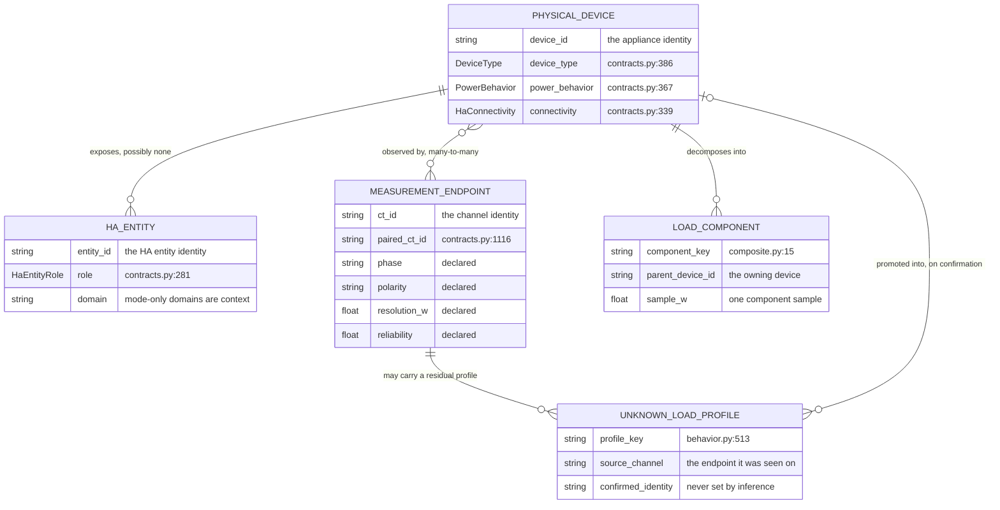

# 06 — Device and Load Model Domain

**SPEC_STATUS: APPROVED_FOR_IMPLEMENTATION** — Specification — the device and load model domain: the five distinct entities, the power model classes, the power levels, the transition rule, and the lifecycle of a learned model.

**Date:** 2026-11-16 · **Baseline:** branch `main`, HEAD `612e1233`, `CONTRACT_VERSION = "2.0.0"` (`engine/wattmosaic_engine/contracts.py:32`), SQLite schema `LATEST_VERSION = 11` (`engine/wattmosaic_engine/storage/migrations.py:792`).

**Purpose.** This document answers one question: *what is the thing we are modelling, what shape is its power, and what may we honestly claim about it?* The measurement half is [03-measurement-and-electrical-domain.md](03-measurement-and-electrical-domain.md); the residual half is [05-residual-model-spec.md](05-residual-model-spec.md), which this document does not duplicate.

**Quantifier convention used throughout.** **measured** = read directly from a source or a committed artifact; **estimated** = derived from a measurement by a stated rule; **allocated** = assigned by a model or heuristic; **unknown** = not present in the repository. Same four values as `Source` (`contracts.py:62`).

**How to read the status markers.** Every capability in this document carries one of:

| Marker | Meaning |
| --- | --- |
| **EXISTS** | Implemented and cited to `file:line`. The behaviour is a fact about the shipped engine. |
| **PARTIAL** | Implemented, with a named shortfall stated in the same row. |
| **MISSING** | No code path exists. The required behaviour is specified below and named as the extension it needs. |

---

## 1. The domain in one page

A load-disaggregation system has to answer five different questions about the same watt. Each question has a different subject, a different lifetime and a different failure mode.

| # | Question | Subject | Lifetime |
| --- | --- | --- | --- |
| 1 | What is this appliance? | **Physical Device** | Until the user retires it. |
| 2 | What does Home Assistant know about it? | **HA Entity** | As long as the integration publishes it. |
| 3 | What is actually observing its current? | **Measurement Endpoint** | As long as the reader is installed and reporting. |
| 4 | Which part of it is drawing? | **Load Component** | As long as the parent device exists. |
| 5 | What is this unexplained pattern? | **Unknown Load Profile** | Until it is identified or retired. |

**Rule.** These five entities are distinct. A measurement of an endpoint is not a measurement of a device; an entity is not a device; a component is not a device; an unknown-load profile is not a device until a human says so.

### 1.1 What breaks when they are conflated

| Conflation | The symptom it produces | Where the system already guards |
| --- | --- | --- |
| Device = HA entity | A device with no integration disappears; a device with three entities is triple-counted. | `HaConnectivity` is a separate axis (`contracts.py:339`); `device_for_entity` maps back to a device (`device_links.py:220`). |
| Entity = load evidence | A mode entity (`MODE_ONLY`) is treated as a load state, producing phantom on/off events. | `MODE_ONLY_DOMAINS` (`entity_evidence.py:40`), `is_mode_domain` (`entity_evidence.py:190`); ADR-0012. |
| Endpoint = device | A shared branch CT is reported as a per-device measurement. | `MonitoringLevel` (`contracts.py:351`); `derive_monitoring` (`disaggregation/configuration.py:150`). |
| Component = device | A multi-part appliance reports the whole load on each part. | `CompositeDeviceModel` (`models/composite.py:35`) with `sample_component` (`models/composite.py:15`). |
| Unknown profile = device | The system names a device it has not identified, or presents a proposed candidate name as an identified device. | `docs/electrical_model.md:844-872` §10: there is no explicit unknown-load entity in the contract. A **candidate name** may be proposed (`OD-03.9`); a **device** does not come into existence without the user's confirmation (§10.3). |
| Power entity = state entity | A `POWER_MEASUREMENT` entity is used as a control state, so the device is "always on". | `HaEntityRole` (`contracts.py:281`); the rule in `device_links.py` — **a power entity is measurable, not state-bearing**. |

**Rule.** A conflation is not repaired by a better number. It is repaired by naming the entity correctly and reporting the weaker claim.

---

## 2. The five entities

### 2.1 Physical Device

**Definition.** The appliance itself — the thing a person would name. It is the unit a power estimate is *about*.

**EXISTS.** `DeviceConfiguration` (`contracts.py:1376`) carries the device's identity and `device_type`; `DeviceType` (`contracts.py:386`) is a closed vocabulary of 18 values. `DeviceConfigurationSet` (`contracts.py:1510`) groups a device's configurations. `PowerBehavior` (`contracts.py:367`) is the separate axis that records how the device's power relates to its control state: `FIXED`, `VARIABLE`, `COMPLEX`, `UNKNOWN`.

**Identity.** The device is identified by its configuration record, not by any single entity id and not by any single channel id. `device_for_entity` (`device_links.py:220`) and `supporting_ct_ids` (`device_links.py:253`) resolve *to* a device from either side.

**Lifetime.** A device exists from its first configuration until it is retired. It outlives any individual entity it exposes and any individual reader that observes it.

**Rule.** A physical device may legitimately have **zero** HA entities and **zero** measurement endpoints. Neither is a precondition for existing.

### 2.2 HA Entity

**Definition.** A Home Assistant entity. It may be a load-state source, mode-only context, a power measurement, an energy counter, or an availability signal.

**EXISTS.** `HaEntityRole` (`contracts.py:281`) is the closed role vocabulary: `LOAD_STATE`, `MODE_ONLY`, `POWER_MEASUREMENT`, `ENERGY_COUNTER`, `AVAILABILITY`, `UNKNOWN`. `HaEntityBinding` (`contracts.py:660`) binds an entity to its role and to the device it belongs to.

**EXISTS.** A mode-only domain is context, never load evidence — `MODE_ONLY_DOMAINS` (`entity_evidence.py:40`), `is_mode_domain` (`entity_evidence.py:190`), `classify_entity` (`entity_evidence.py:119`). ADR-0012: an explicit user declaration always wins; a mode-only domain is context, never load evidence.

**EXISTS.** The engine's own link helpers separate the two roles: `state_entity_ids` (`device_links.py:102`), `config_load_entity_ids` (`device_links.py:112`), `link_state_entity_ids` (`device_links.py:122`), `runtime_state_entities` (`device_links.py:139`), `entity_links` (`device_links.py:169`), `ambiguous_entities` (`device_links.py:201`), `state_entity_for_device` (`device_links.py:258`), `state_key` (`device_links.py:229`).

**Rule.** A power entity is measurable, not state-bearing. A device whose only entities are `POWER_MEASUREMENT` has no control state; it may be on, it may be off, and the engine may not invent a state for it.

**Identity.** The entity id. **Lifetime.** As long as the integration publishes it; a disappearing entity does not delete the device.

### 2.3 Measurement Endpoint

**Definition.** A reader or channel that observes a load: a CT channel or a smart-plug channel.

**EXISTS.** `CTChannel` (`contracts.py:1116`) carries the endpoint identity and its declared properties: `paired_ct_id`, `phase`, `polarity`, `resolution_w`, `reliability`.

**EXISTS.** The topology treats a channel as a sensor, never as a device: `CTType` has exactly three members — `MAIN`, `BRANCH`, `UNKNOWN` (`contracts.py:44-47`) — and `branch` is the only load role.

**Rule.** One measurement endpoint may observe several physical devices, and one physical device may be observed by several endpoints. The mapping is many-to-many and it is not one-to-one.

**Identity.** The channel id plus its `ct_type` and `phase`. **Lifetime.** Until the channel is removed from the topology.

### 2.4 Load Component

**Definition.** An independently controllable or measurable part of a physical device — the compressor of a refrigerator, the motor of a fan, the lamp bank of a chandelier.

**EXISTS.** `CompositeDeviceModel` (`models/composite.py:35`) is the model class that models a device as a set of components; `sample_component` (`models/composite.py:15`) samples one component's power.

**PARTIAL.** There is no first-class persisted Load Component entity. The component is a model-internal concept in `CompositeDeviceModel`; it is not addressable in the contract, has no identity of its own, and cannot be reported on independently of its parent. See **G67**.

**Rule.** A load component's power is a share of its parent device's power. It is never added to the parent; it is part of it.

**Identity.** The component key inside the composite model. **Lifetime.** Shorter than the parent's — a composite model may be rebuilt.

### 2.5 Unknown Load Profile

**Definition.** A residual-derived pattern with no confirmed identity. It is a *pattern*, not a device.

**EXISTS.** The simulator models one: `UnknownLoadProfile` (`tools/simulator/behavior.py:513`).

**EXISTS (negative).** `docs/electrical_model.md:844-872` §10: there is **no explicit unknown-load entity in the contract**. Unknown load exists today only as `Reconciliation.unknown_residual_w` plus solver slack.

**Rule.** An unknown load profile is never presented as an identified device, and never silently renamed into one. Promotion requires an explicit human act (§10). **The system may propose a candidate name or appliance type** for an unknown load from its power signature (`OD-03.9`, owner-resolved): a proposal is a **candidate, not a device** — never presented as a measured or identified fact, never a device without the user's confirmation, and both the proposal and the confirmed identity are recorded; `requires_confirmation` is always `True` (`contracts.py:791`) and a proposal's confidence is bounded by `MAX_CONFIDENCE = 0.99` (`disaggregation/association.py:144`).

### 2.6 The relationships



### 2.7 The non-conflation rules, stated once

| Rule | Statement |
| --- | --- |
| **NC-1** | One physical device may legitimately have no HA entity. |
| **NC-2** | One physical device may legitimately have several HA entities, of which at most one per role carries load-state evidence. |
| **NC-3** | One physical device may be observed by several measurement endpoints. |
| **NC-4** | One measurement endpoint may observe several physical devices. |
| **NC-5** | A load component is not a device and is never reported as one. |
| **NC-6** | An unknown load profile is not a device until a human confirms it. |
| **NC-7** | An endpoint's reading is evidence *about* whatever observes it; it is a measurement *of* the endpoint. |
| **NC-8** | A mode-only entity is context. It never produces a load-state event. |

---

## 3. Devices with no Home Assistant integration

### 3.1 The situation

A physical device may exist on a branch circuit with no HA entity at all — no switch, no plug, no integration. The engine sees its power only as a change in the residual of the branch, or as a share of a shared-circuit solve.

**EXISTS.** `HaConnectivity` (`contracts.py:339`) is the axis that says whether HA can observe or actuate the device: `CONNECTED`, `NOT_CONNECTED`, `UNKNOWN`. `MonitoringLevel` (`contracts.py:351`) is the separate axis that says how closely the electrical tree observes it: `SHARED`, `HOME_TOTAL_ONLY`, `UNMONITORED`, `UNKNOWN`. ADR-0011 (`docs/electrical_model.md` §2.3): these axes are never collapsed into one enum.

### 3.2 How such a device is modelled and learned

A device with no HA entity has **no control state**. It therefore cannot be a state-conditioned model in the ordinary sense; it is modelled from the *shape* of its power signature, not from a state transition. **Under `OD-03.12` (owner-resolved, "Allow state model learning") a state-model-shaped fit over the reader's own step patterns is permitted**; what such a model may not claim is a state the reader never observed.

**EXISTS.** The machinery for learning from power shape exists: `SampleCollector` (`learning/sample_collector.py:136`) with `extract_control` (`learning/sample_collector.py:57`) — which yields *no* control context for a device with no state entity — `LearningPipeline.ingest_samples` (`learning/pipeline.py:305`), `LearningPipeline.train` (`learning/pipeline.py:321`), `LearningPipeline.validate_and_promote` (`learning/pipeline.py:356`), `LearningPipeline.retrain_device` (`learning/pipeline.py:373`).

**EXISTS.** The model classes that describe a power *shape* rather than a state are `TimeVaryingApplianceModel` (`models/time_varying.py:56`) with `CycleSummary` (`models/time_varying.py:42`) and `trapezoidal_energy_kwh` (`models/time_varying.py:339`), and `ResidualDeviceModel` (`models/residual.py:28`).

**EXISTS.** `infer_model_type` (`learning/trainer.py:80`) chooses the class; `model_class_for` (`models/base.py:415`) maps it to the implementation; `build_model` (`models/base.py:441`) constructs it.

**Rule.** A device with no HA integration is eligible for learning, and — under `OD-03.12` (owner-resolved, "Allow state model learning") — it may have a **state model learned from the reader's own step patterns**, not only a shape model. What it is *not* eligible for is a state-conditioned attribution: with no control context, no state transition can be attributed to it by rule §6. The learned model is an **estimate, never a measurement**; its reported power is labelled `ESTIMATED` or `ALLOCATED` per §3.3, never `MEASURED`; it carries a **weaker evidence count** than a model fitted against a confirmed state; it can **never be promoted over a direct measurement**; and the absence of a state entity is **reduced observability**, not zero power.

### 3.3 How its power is labelled

**Rule.** A device with no measurement endpoint of its own is never reported as `MEASURED`. Its value carries the weakest source that actually produced it.

| How the number was produced | `Source` member | Label shown to a user |
| --- | --- | --- |
| A promoted, validated model reproduced the device's own consumption | `MODEL_ESTIMATED` (`contracts.py:62`) | **ESTIMATED** |
| The solver allocated a share of a shared row | `INFERRED` (`contracts.py:62`) | **ALLOCATED** |
| Only a declared prior exists | `CONFIGURED_PRIOR` (`contracts.py:62`) | **ALLOCATED** (declared) |
| Nothing produced it | `UNKNOWN` (`contracts.py:62`) | **UNKNOWN** |

**Rule.** `DIRECT_MEASURED` (`contracts.py:62`) is retained for historical rows only; the Level-1 direct path was removed by ADR-0034. A device that was never on its own reader may not claim it.

**EXISTS.** The discipline the rest of the system relies on is the bound in `docs/electrical_model.md:412-445`: a declared wattage is a **non-relaxable upper bound** on a shared row.

### 3.4 Hand-off to the residual model

The *detection* and *characterisation* of unexplained power — how a residual becomes a candidate profile, how a profile is tracked, and how it is retired — belongs to [05-residual-model-spec.md](05-residual-model-spec.md), which another agent owns. This document does not re-specify it.

**Rule.** This document specifies only the interface: an unknown load profile is a residual-derived pattern (§2.5) that may be promoted into a physical device, and only through the promotion rule in §10.

---

## 4. The power model class set

### 4.1 The master's classes and their mapping

The master instruction (§4.6) names six power model classes: `FIXED`, `ADJUSTABLE`, `DYNAMIC`, `DELAYED`, `ALWAYS_ON`, `UNKNOWN`. The shipped engine has two related but different vocabularies.

**EXISTS.** `ModelType` (`contracts.py:90`) has exactly seven members: `BINARY`, `DIMMABLE`, `VARIABLE_SPEED`, `MULTI_STATE`, `COMPOSITE`, `TIME_VARYING`, `RESIDUAL`.

**EXISTS.** `PowerBehavior` (`contracts.py:367`) has exactly four members: `FIXED`, `VARIABLE`, `COMPLEX`, `UNKNOWN`.

| Master class | `ModelType` (`contracts.py:90`) | `PowerBehavior` (`contracts.py:367`) | Status |
| --- | --- | --- | --- |
| `FIXED` | `BINARY` (`models/binary.py:59`) | `FIXED` | **EXISTS** |
| `ADJUSTABLE` | `DIMMABLE` (`models/dimmable.py:31`) | `VARIABLE` | **EXISTS** |
| `DYNAMIC` | `VARIABLE_SPEED` (`models/variable_speed.py:53`), `MULTI_STATE` (`models/multi_state.py:31`), `TIME_VARYING` (`models/time_varying.py:56`) | `VARIABLE` or `COMPLEX` | **EXISTS** |
| `DELAYED` | — | — | **MISSING** — see §4.3 |
| `ALWAYS_ON` | — | — | **MISSING** — see §4.4 |
| `UNKNOWN` | `RESIDUAL` (`models/residual.py:28`) | `UNKNOWN` | **EXISTS** |

**Rule.** `ModelType` describes *the shape of the power law*. `PowerBehavior` describes *how power relates to the control state*. They are not the same axis and neither substitutes for the other. A device's `ModelType` may change as it is learned; its `PowerBehavior` is a declared property of the appliance.

### 4.2 What is already there

**EXISTS.** Every `ModelType` has a class in `engine/wattmosaic_engine/models/`, all deriving from `DeviceModel` (`models/base.py:317`): `binary.py:59`, `dimmable.py:31`, `variable_speed.py:53`, `multi_state.py:31`, `composite.py:35`, `time_varying.py:56`, `residual.py:28`.

**EXISTS.** The registry that names them: `ModelRegistry` (`models/registry.py:56`), `ModelEstimate` (`models/registry.py:25`).

### 4.3 `DELAYED` — a missing class

**MISSING.** No `ModelType` member and no `PowerBehavior` member expresses *response delay*. `PowerBehavior`'s four values describe the power-versus-state relation, not the time relation.

**Required change (named).** An **additive, optional** `response_delay_s: float | None` on `DeviceModelParameters` (`contracts.py:1582`), defaulting to `None` meaning "no delay declared". Not a new `ModelType` member.

**Why not a new `ModelType`.** Delay is orthogonal to the power law. A delayed dimmable light is still `DIMMABLE`. Adding `ModelType.DELAYED` would multiply the class vocabulary along an axis that is already carried by a field, and every `ModelType` switch (`infer_model_type`, `learning/trainer.py:80`; `model_class_for`, `models/base.py:415`) would need a branch that says "same as the others, but later". See **OD-47**.

### 4.4 `ALWAYS_ON` — a missing class

**MISSING.** No `ModelType` member and no `PowerBehavior` member expresses *a device that has no OFF state*. `BinaryDeviceModel` (`models/binary.py:59`) assumes two states, one of which is off.

**Required change (named).** An **additive, optional** `always_on: bool = False` on `DeviceModelParameters` (`contracts.py:1582`), defaulting to the existing binary behaviour. Not a new `ModelType` member.

**Why not a new `ModelType`.** `ALWAYS_ON` is the *absence of a transition*, not a different power law. A `BINARY` model with `always_on=True` uses the same state-conditioned expectation machinery, with the off-state expectation replaced by the standby expectation. See **OD-46**.

**Rule.** An always-on device is never modelled with a zero-power off state. Its minimum power is its standby power, and the rule in §5.3 applies to it unchanged.

### 4.5 Where a device's class is recorded

**MISSING.** `DeviceConfiguration` (`contracts.py:1376`) carries `device_type` but has no field that carries the master's six-way power model class. `PowerBehavior` (`contracts.py:367`) is coarser.

**Required change (named).** An **additive, optional** `power_model_class: str | None` on `DeviceConfiguration`, whose values are exactly `FIXED`, `ADJUSTABLE`, `DYNAMIC`, `DELAYED`, `ALWAYS_ON`, `UNKNOWN`. `None` means "not declared", and the engine derives a working class from `ModelType` and the model parameters instead. See **OD-45**.

---

## 5. The power levels

### 5.1 The four levels

A device's power is not one number. It is at least four.

| Level | What it is | Where it lives |
| --- | --- | --- |
| **Standby** | The device is off, or idle in a low-power state, but still connected to power. | `ExpectedPower.standby_w` (`contracts.py:1249`) |
| **Idle** | The device is on and reachable, but is not doing work. | `ExpectedPower.idle_w` (`contracts.py:1249`) |
| **Active** | The device is doing work. | `ExpectedPower.on_w` (`contracts.py:1249`) |
| **Transient** | The inrush at start-up and the decay at shutdown, which are not the operating level. | `ExpectedPower.startup_w`, `ExpectedPower.shutdown_w` (`contracts.py:1249`) |

**EXISTS.** `ExpectedPower` (`contracts.py:1249`) is the contract's declaration of a device's power envelope, with a tolerance per level.

**EXISTS.** The engine already distinguishes operating stages: `OperatingStage` (`contracts.py:1572`) in the contract, and the recognisers `recognize_stages` (`learning/stages.py:62`), `current_stage` (`learning/stages.py:103`), `segment_cycle` (`learning/stages.py:129`), `stage_distinguishable` (`learning/stages.py:133`).

**EXISTS.** The model's own view of "on" is `is_on` (`models/base.py:301`).

### 5.2 The state-conditioned expectation

**EXISTS.** The expectation is looked up, not averaged: `expected_power_w` (`electrical/models.py:127`), `resolve_model` (`electrical/models.py:268`), `model_upper_bounds` (`electrical/models.py:326`), over a `ModelView` (`electrical/models.py:44`).

**EXISTS.** `configured_power` (`disaggregation/configuration.py:790`) is the prior used when no model supplies an expectation.

### 5.3 The OFF-device rule

**EXISTS.** `docs/electrical_model.md:561-583` states the rule set:

| Condition | Rule |
| --- | --- |
| Device explicitly OFF and it has a model | Its consumption is bounded by `max(off_tolerance, 2 × standby_power)` — not zero. |
| Pinned device | Removed from identifiability analysis. |
| Only positively-"not running" states pin | `off`, `idle`, `standby`, `closed`, `paused`, `none`. |
| `unavailable` and `unknown` | **Missing information, not zero power.** |
| A model with no parameter for a state | **Must not fall back to its aggregate estimate.** |

**Rule.** An OFF device may still consume standby power. "Off" is a control state, not a promise of zero watts.

**Rule.** `unavailable` and `unknown` are missing information. A missing state never produces a zero expectation and never pins a device.

**Rule.** When a model has no parameter for the requested state, the answer is "no expectation for this state", not the model's aggregate or mean estimate. The no-fallback rule is what stops a two-state model from being asked about a third state and answering with its average.

### 5.4 Where the levels come from when there is no model

**EXISTS.** The declared prior: `ExpectedPower` (`contracts.py:1249`), consumed via `configured_power` (`disaggregation/configuration.py:790`).

**EXISTS.** The simulator ships one declared envelope per profile: `DeviceProfile` (`tools/simulator/behavior.py:54`) with `ScheduledEvent` (`tools/simulator/behavior.py:45`), and concrete profiles `BinaryProfile` (`tools/simulator/behavior.py:100`), `StandbyProfile` (`tools/simulator/behavior.py:139`), `DimmableProfile` (`tools/simulator/behavior.py:155`), `VariableSpeedProfile` (`tools/simulator/behavior.py:193`), `HVACProfile` (`tools/simulator/behavior.py:235`), `RefrigeratorProfile` (`tools/simulator/behavior.py:266`), `ApplianceCycleProfile` (`tools/simulator/behavior.py:296`), `WasherProfile` (`tools/simulator/behavior.py:347`), `DishwasherProfile` (`tools/simulator/behavior.py:358`), `DryerProfile` (`tools/simulator/behavior.py:369`), `DoublePoleProfile` (`tools/simulator/behavior.py:377`), `MotorProfile` (`tools/simulator/behavior.py:404`), `StepProfile` (`tools/simulator/behavior.py:450`), `HotTubProfile` (`tools/simulator/behavior.py:480`), `UnknownLoadProfile` (`tools/simulator/behavior.py:513`).

---

## 6. The transition rule `ΔP = P_new − P_old`

### 6.1 The definition

For a state-based model, a transition produces a power change:

```text
ΔP = P_new − P_old
```

where:

- `P_old` is the model's state-conditioned expectation for the **previous** control state,
- `P_new` is the model's state-conditioned expectation for the **new** control state.

**Rule.** `P_new` and `P_old` are *model expectations*, not raw readings. The transition rule predicts; it does not measure. A raw reading enters only later, as the quantity the prediction is compared against.

**EXISTS.** The context that selects the state-conditioned expectation: `context_control` (`models/base.py:280`), `context_numeric` (`models/base.py:293`), `context_from_sample` (`models/base.py:226`). These are duck-typed through the adapters in `models/protocols.py`.

**EXISTS.** The expectation lookup: `expected_power_w` (`electrical/models.py:127`) over `ModelView` (`electrical/models.py:44`).

### 6.2 How `ΔP` attributes a measured step

Given a measured step of `ΔP_measured` on an endpoint and a candidate device with a transition model:

1. Compute `ΔP_expected = P_new − P_old` from the device's model.
2. Compare `ΔP_measured` with `ΔP_expected` within the model's stated tolerance.
3. Attribute the step to the device only if the comparison holds **and** the device's own response is consistent with the step (§6.3).

**EXISTS.** The isolation machinery that classifies and re-classifies such steps: `EventIsolator` (`disaggregation/isolation.py:592`), `classify` (`disaggregation/isolation.py:619`), `reclassify` (`disaggregation/isolation.py:778`), producing `PhysicalDeviceEvent` (`disaggregation/isolation.py:448`) via `physical_device_events` (`disaggregation/isolation.py:505`).

**Rule.** A step is never attributed because it is "the only candidate". A step is attributed because the candidate's own declared or learned response predicts it.

### 6.3 The attribution precondition — ADR-0026's nine conditions

**EXISTS.** `docs/electrical_model.md:447-483` states the ADR-0026 step rule's nine conditions. They are the precondition for attributing any step to any device.

**Rule.** The nine conditions of `docs/electrical_model.md:447-483` are conjunctive. Failing any one of them means the step is not attributed to that device, no matter how well the numbers line up.

**Rule.** `ΔP` is a *prediction* and therefore can be wrong. A wrong prediction means the model is wrong, not that the reading is zero. The resolution of a model/reading disagreement is retraining or rollback (§11), never a silent redefinition of the expected value.

### 6.4 What `ΔP` is not

**Rule.** `ΔP` is not a difference of two raw readings taken at two arbitrary times. A raw difference over an arbitrary window contains the sum of every simultaneous change on that endpoint; `ΔP` isolates *one device's* contribution to it.

**Rule.** `ΔP` computed for a device with no model is undefined, not zero. A device with no model contributes no predicted step and therefore cannot be ruled out by the comparison in §6.2 either.

---

## 7. Non-linear and variable power

### 7.1 The rule

**Rule.** A dimmer or a variable-speed motor is not a linear function of its control input. Forcing a linear model onto either one produces a curve that is wrong at the ends — precisely where a light or a fan spends its time.

**EXISTS.** The classes that fit a curve: `DimmableDeviceModel` (`models/dimmable.py:31`), `VariableSpeedDeviceModel` (`models/variable_speed.py:53`), `MultiStateDeviceModel` (`models/multi_state.py:31`).

**EXISTS.** The curve machinery: `interpolate_curve` (`disaggregation/configuration.py:847`) and `enforce_monotonic` (`models/base.py:140`).

### 7.2 The adaptive / non-linear model class

**EXISTS.** `MultiStateDeviceModel` (`models/multi_state.py:31`) is the adaptive class: it does not assume a curve, it learns a set of discrete levels and maps a control value onto them.

**Required behaviour.** For `DIMMABLE` and `VARIABLE_SPEED` devices, the fitted response is a **monotone curve over its valid range**, enforced by `enforce_monotonic` (`models/base.py:140`) and evaluated by `interpolate_curve` (`disaggregation/configuration.py:847`).

**Rule.** A fitted curve must be monotone within the range it was fitted over. A curve that is non-monotone is rejected regardless of its fit quality, because a non-monotone dimmer is physically impossible and indicates a bad fit or a bad input ordering.

**Rule.** Outside the fitted range, the curve is undefined, not extrapolated. An extrapolated level is a fabricated per-device number.

### 7.3 The light configuration

**EXISTS.** `LightConfiguration` (`contracts.py:1273`) carries the declared parameters of a lighting load: `dimming_curve`, `watts_per_bulb_on`, `bulb_count`, `min_output_fraction`.

**Rule.** `bulb_count` × `watts_per_bulb_on` is the full-on level of the fixture. `min_output_fraction` is the floor the dimmer is declared to reach; it is a declared constant, not a measurement, and the learned curve may not contradict it without evidence.

**EXISTS.** The simulator's light strata: `DimmableProfile` (`tools/simulator/behavior.py:155`), `StepProfile` (`tools/simulator/behavior.py:450`), `DoublePoleProfile` (`tools/simulator/behavior.py:377`), and the fixture strata `dynamic`, `standby` (`tests/fixtures/labhouse.py:32-54`).

### 7.4 Fit quality for a curve

**EXISTS.** The global fit-quality helpers already exist and must be reused, not re-implemented: `median` (`models/base.py:77`), `quantile` (`models/base.py:84`), `mean` (`models/base.py:100`), `stdev` (`models/base.py:107`), `robust_sigma` (`models/base.py:114`), `error_metrics` (`models/base.py:183`), `sample_actual_w` (`models/base.py:216`).

**Rule.** New model modules import these helpers and the window statistics in `models/protocols.py`. They do not re-implement window statistics, alignment, alias resolution or quality scoring.

---

## 8. Delayed and transient response

### 8.1 The situation

An HVAC unit, a blind motor and an induction motor do not respond when they are told to. The command lands at *t*; the power changes at *t + δ*.

**EXISTS.** The two delay parameters that already exist in the environment: `state_lag_s` (`tools/simulator/scenario.py:70`) — how long the state itself takes to appear — and `channel_delay_s` (`tools/simulator/scenario.py:74`) — how long the channel takes to report it.

**EXISTS.** The declared controller delays: `ControllerConfiguration.on_delay_s` and `off_delay_s` (`contracts.py:1342`), with the state mapping `ControllerStateMapping` (`contracts.py:1323`).

**EXISTS.** The simulator's delayed and cycling profiles: `HVACProfile` (`tools/simulator/behavior.py:235`), `MotorProfile` (`tools/simulator/behavior.py:404`), `HotTubProfile` (`tools/simulator/behavior.py:480`); and the fixture strata `hvac_modulation`, `motor_startup`, `delayed_ct` (`tests/fixtures/labhouse.py:32-54`).

### 8.2 The response-delay model

**Required change (named).** The additive, optional `response_delay_s` on `DeviceModelParameters` (`contracts.py:1582`) introduced in §4.3 is the model's delay parameter. `None` means "no delay observed"; `0.0` means "observed to respond immediately"; a positive value is an estimated delay.

**Rule.** A delay is **estimated from observation, not assumed from a default**. The only declared delay that may be used without evidence is one the user explicitly configured (`ControllerConfiguration.on_delay_s` / `off_delay_s`, `contracts.py:1342`), and it is then labelled *declared*, not *measured*.

**Required behaviour.** The estimator must compare the observed time of the power change against the observed time of the control change, using the same timestamps the rest of the engine uses. The delay is a **property of the transition**, so a device may have a different delay on turn-on than on turn-off.

### 8.3 Correlating a delayed device without moving the event

**Rule.** A device's response delay shifts the *correlation window*, never the event's recorded time. The event timestamp is when the thing happened, as observed.

**Rule.** An event may be correlated to a delayed device only within a window that admits the device's declared or estimated delay. A step that falls outside the device's admissible window is not that device's step.

**Rule.** The delay is not a free parameter for the solver. It bounds which candidate may claim a step; it does not redistribute power between candidates.

**EXISTS.** The configuration path that decides whether a device can be materialised at all: `effective_config` (`disaggregation/configuration.py:298`), `EffectiveConfig` (`disaggregation/configuration.py:107`), `derive_monitoring` (`disaggregation/configuration.py:150`), `materialisation_blockers` (`disaggregation/configuration.py:563`).

### 8.4 Transient response is not a level

**Rule.** `startup_w` (`contracts.py:1249`) is an inrush bound, not a steady-state level. A transient is sampled at its peak; it is never averaged into a device's `on_w`.

**EXISTS.** The segmentation machinery that separates a cycle into its phases: `Segment` (`models/segmentation.py:35`), `SegmentationResult` (`models/segmentation.py:51`), `segment_power_series` (`models/segmentation.py:79`), `robust_noise` (`models/segmentation.py:66`); and `CycleSummary` (`models/time_varying.py:42`) with `trapezoidal_energy_kwh` (`models/time_varying.py:339`).

---

## 9. Identity association

### 9.1 What association is

Association answers: *which device does this reader observe?* It is a separate question from topology.

**Rule.** Association is **not** topology. Topology says which conductors are nested. Association says which appliance draws on a given conductor. A dedicated-looking branch may serve two devices; a device may sit on a shared branch.

**EXISTS.** The association machinery: `AssociationFinder` (`disaggregation/association.py:573`), `observe` (`disaggregation/association.py:584`), `analyze` (`disaggregation/association.py:695`), `withdraw` (`disaggregation/association.py:1174`), `withheld` (`disaggregation/association.py:1210`), `persist` (`disaggregation/association.py:1259`), with `AssociationConfig` (`disaggregation/association.py:245`) and `Observation` (`disaggregation/association.py:344`).

### 9.2 The eight evidence rules and the verdicts

**EXISTS.** The eight evidence rules and the four verdicts — `supported`, `split`, `ambiguous`, `single_event` — are documented in the `association.py` module docstring (`disaggregation/association.py:20-80`).

**EXISTS.** The confidence caps: `MAX_CONFIDENCE = 0.99` (`disaggregation/association.py:144`) and `SINGLE_EVENT_CAP = 0.5` (`disaggregation/association.py:147`).

**Rule.** A verdict of `ambiguous` is a valid, final answer. It is not a failure to be rounded up. `single_event` is capped at `0.5` and may not be reported as a confirmed association.

**Rule.** The caps are ceilings, not scalars to be blended. Confidence is multidimensional and never blended; association confidence, monitoring level and source are separate axes.

### 9.3 The monitoring level derivation

**EXISTS.** `MonitoringLevel` (`contracts.py:351`) is derived, not declared: `derive_monitoring` (`disaggregation/configuration.py:150`) inside `effective_config` (`disaggregation/configuration.py:298`), with `EffectiveConfig` (`disaggregation/configuration.py:107`) carrying the result and `materialisation_blockers` (`disaggregation/configuration.py:563`) naming what prevents a device from being materialised.

**Rule.** The monitoring level follows the evidence of the electrical tree, not the user's wish. A device on a shared branch is `SHARED`; a device observed only through the main is `HOME_TOTAL_ONLY`; a device with no path to a reader is `UNMONITORED`.

### 9.4 Entity-to-device resolution

**EXISTS.** The links between entities, devices and readers: `device_for_entity` (`device_links.py:220`), `state_entity_for_device` (`device_links.py:258`), `supporting_ct_ids` (`device_links.py:253`), `entity_links` (`device_links.py:169`), `ambiguous_entities` (`device_links.py:201`).

**Rule.** The rule that a power entity is measurable, not state-bearing (§2.2) holds here too: `config_load_entity_ids` (`device_links.py:112`) and `state_entity_ids` (`device_links.py:102`) are distinct sets, and a device may legitimately appear in neither.

**EXISTS.** The entity-evidence classifier that decides which entities are runtime-relevant: `EntityEvidence` (`entity_evidence.py:100`), `classify_entity` (`entity_evidence.py:119`), `select_runtime_entities` (`entity_evidence.py:158`), `LOAD_DOMAINS` (`entity_evidence.py:56`), `LOAD_DEVICE_CLASSES` (`entity_evidence.py:72`), `COMPLEX_DEVICE_TYPES` (`entity_evidence.py:88`).

**Rule.** ADR-0012 stands: an explicit user declaration always wins; a mode-only domain is context, never load evidence.

---

## 10. Unknown loads

### 10.1 Discovery

**EXISTS.** The only representation of unknown load in the contract today is `Reconciliation.unknown_residual_w` plus solver slack — `docs/electrical_model.md:844-872` §10 states there is no explicit unknown-load entity in the contract.

**EXISTS.** The simulator proves the shape is real: `UnknownLoadProfile` (`tools/simulator/behavior.py:513`), and the fixture stratum `unknown_load` (`tests/fixtures/labhouse.py:32-54`).

**Rule.** A discovery is a **proposal**, not a device. The same bar as association applies: `requires_confirmation` is always `True` (`contracts.py:791`). Under `OD-03.9` (owner-resolved, "Propose candidate names") the proposal **may carry a candidate name or appliance type** derived from the load's power signature; the candidate is a proposal, never an identified fact, and it becomes a device only on the user's confirmation (§10.3).

### 10.2 The lifecycle

The lifecycle stages — discovery, profiling, tracking over time, promotion, retirement — are specified by [05-residual-model-spec.md](05-residual-model-spec.md), which another agent owns. This document specifies only the **device-side** consequences:

| Stage | What this document requires |
| --- | --- |
| Discovery | The candidate is an unknown load profile (§2.5), never a device. It may carry a proposed **candidate name** (`OD-03.9`), which is a proposal and not an identified device. |
| Profiling | A profile may carry a repeatable shape (`CycleSummary`, `models/time_varying.py:42`) and may be represented by `ResidualDeviceModel` (`models/residual.py:28`). |
| Tracking | Tracking a profile is tracking *power*, not identity; an identity may be attached later without invalidating the power history. |
| Promotion | Requires explicit human confirmation (§10.3). |
| Retirement | A profile that no longer appears is retired with its history retained. It is never deleted silently. |

### 10.3 The promotion rule

**Rule.** An unknown load profile is promoted into a physical device only by an explicit human act, and the promotion creates a `DeviceConfiguration` (`contracts.py:1376`) that then earns its own model through the normal learning path.

**Rule.** An unknown load profile is **never silently renamed** into a device. A rename that changes a user's entity id to a device name without a confirmation step is a defect, not a convenience. A **candidate name proposed** under `OD-03.9` is not a rename: it is a proposal awaiting confirmation, it is never presented as an identified device, and the profile's confirmed identity is still set only by the user.

**Rule.** After promotion, the promoted device's power is labelled by the rules in §3.3. Until a model has been validated for it, a promoted device's power is `CONFIGURED_PRIOR` or `MODEL_ESTIMATED`, never `DIRECT_MEASURED`.

**Rule.** A promoted device's *identity* is now known, but its *power* has not yet been measured. Knowing what a device is and measuring what it draws are separate claims.

**PARTIAL.** There is no contract-level unknown-load artifact with a lifecycle today (`docs/electrical_model.md:844-872`). The hand-off to [05-residual-model-spec.md](05-residual-model-spec.md) is required before an unknown load can be tracked, promoted and retired as specified here. See **G70**.

---

## 11. Model versioning, promotion and rollback

### 11.1 The artifacts

**EXISTS.** `DeviceModelParameters` (`contracts.py:1582`) holds a model's fitted parameters. `DeviceModelVersion` (`contracts.py:1599`) is the versioned record of a parameter set for a device.

**EXISTS.** The registry: `ModelRegistry` (`models/registry.py:56`), `ModelEstimate` (`models/registry.py:25`).

**EXISTS.** The serialisation: `parameters_from_json` (`models/serde.py:56`), `version_from_row` (`models/serde.py:98`), `versions_from_rows` (`models/serde.py:145`), `next_version` (`models/serde.py:154`).

**Rule.** A historical model version is never overwritten. `next_version` (`models/serde.py:154`) allocates a new version; `versions_from_rows` (`models/serde.py:145`) reads the history. A retrain creates a version, it does not edit one.

### 11.2 Learning, validation and promotion

**EXISTS.** The pipeline: `LearningPipeline` (`learning/pipeline.py:119`), `consider` (`learning/pipeline.py:273`), `ingest_samples` (`learning/pipeline.py:305`), `train` (`learning/pipeline.py:321`), `validate_and_promote` (`learning/pipeline.py:356`), `retrain_device` (`learning/pipeline.py:373`), `freeze` (`learning/pipeline.py:392`), `rollback` (`learning/pipeline.py:395`), `stored_samples` (`learning/pipeline.py:399`).

**EXISTS.** Validation: `ValidationReport` (`learning/validation.py:16`), `split_holdout` (`learning/validation.py:35`), `validate_model` (`learning/validation.py:60`), `compare_models` (`learning/validation.py:138`), `_r2` (`learning/validation.py:56`).

**EXISTS.** Promotion: `PromotionDecision` (`learning/promotion.py:40`), `PromotionManager` (`learning/promotion.py:61`).

**Rule.** A model is fitted on a training split and judged on a holdout split (`split_holdout`, `learning/validation.py:35`). A model that was judged on the data it was fitted on has not been validated.

**Rule.** Promotion is a comparison, not a threshold: `compare_models` (`learning/validation.py:138`) against the incumbent, and `promotion_margin` (`learning/thresholds.py:99-107`) is the margin the challenger must beat.

### 11.3 The four threshold defaults

**EXISTS.** `learning/thresholds.py:99-107`:

| Threshold | Default | Meaning |
| --- | --- | --- |
| `min_samples_for_model` | `12` | The minimum number of admissible samples before a model may be fitted at all. |
| `min_validation_r2` | `0.70` | The minimum holdout R² a model must reach. |
| `promotion_margin` | `0.05` | The R² margin a challenger must beat the incumbent by. |
| `max_sample_rejection_ratio` | `0.60` | The maximum fraction of samples the filter may reject before the run is treated as untrustworthy. |

**Rule.** These four are the defaults, and they are the defaults for a *state-conditioned* model. A model with no control state — the shape model of §3.2 — is validated on a different question, and the criteria it must meet are an open decision (**OD-49**).

### 11.4 Sample admission

**EXISTS.** `SampleFilter` (`learning/sample_filter.py:166`) with `SampleEvidence` (`learning/sample_filter.py:43`), `SampleDecision` (`learning/sample_filter.py:73`), `rejection_summary` (`learning/sample_filter.py:490`).

**EXISTS.** `SampleCollector` (`learning/sample_collector.py:136`) with `extract_control` (`learning/sample_collector.py:57`); `Trainer` (`learning/trainer.py:202`) with `infer_model_type` (`learning/trainer.py:80`) and `training_quality` (`learning/trainer.py:154`).

**Rule.** A sample that the filter rejected does not become evidence. The rejection ratio is itself a quality signal and is bounded by `max_sample_rejection_ratio`.

### 11.5 Freeze and rollback

**EXISTS.** `freeze` (`learning/pipeline.py:392`) and `rollback` (`learning/pipeline.py:395`) on the pipeline.

**Rule.** A frozen model is not retrained by an automatic pass. A rollback restores a prior version; it does not delete the failed one, and the failed version remains in the history (`versions_from_rows`, `models/serde.py:145`).

**EXISTS.** The reporting: `LearningAccounting` (`learning/reporting.py:81`), `build_learning_status` (`learning/reporting.py:167`).

**Rule.** A model that is not promoted is reported as not promoted, with its rejection reason. It is never presented as a working estimate.

---

## 12. The consolidated capability table

| # | Capability | Status | Evidence | Where specified |
| --- | --- | --- | --- | --- |
| 1 | Physical device as a distinct entity with its own type | **EXISTS** | `DeviceConfiguration` `contracts.py:1376`; `DeviceType` `contracts.py:386`; `DeviceConfigurationSet` `contracts.py:1510` | §2.1 |
| 2 | HA entity roles including mode-only and power-measurement | **EXISTS** | `HaEntityRole` `contracts.py:281`; `HaEntityBinding` `contracts.py:660` | §2.2 |
| 3 | Mode-only domain is context, never load evidence | **EXISTS** | `entity_evidence.py:40`, `:190`, `:119`; ADR-0012 | §2.2, §9.4 |
| 4 | A power entity is measurable, not state-bearing | **EXISTS** | `device_links.py:102`, `:112`, `:122`, `:139` | §2.2, §9.4 |
| 5 | Measurement endpoint with declared phase, polarity, resolution, reliability | **EXISTS** | `CTChannel` `contracts.py:1116` | §2.3 |
| 6 | Endpoint↔device is many-to-many | **EXISTS** | `supporting_ct_ids` `device_links.py:253`; `device_for_entity` `device_links.py:220` | §2.3, §2.7 |
| 7 | Load component as an independently sampled part | **PARTIAL** | `CompositeDeviceModel` `models/composite.py:35`; `sample_component` `models/composite.py:15` | §2.4 (**G67**) |
| 8 | Load component as a persisted, reportable entity | **MISSING** | no contract type; `contracts.py:1376`-`:1620` range | §2.4 (**G67**) |
| 9 | Unknown load profile as a contract entity | **MISSING** | `docs/electrical_model.md:844-872` §10 | §2.5, §10 (**G70**) |
| 10 | Unknown load profile as a modelled shape | **EXISTS** (simulator) | `UnknownLoadProfile` `tools/simulator/behavior.py:513`; `ResidualDeviceModel` `models/residual.py:28` | §10.1 |
| 11 | HA connectivity as a separate axis | **EXISTS** | `HaConnectivity` `contracts.py:339` | §3.1 |
| 12 | Monitoring level as a separate axis, derived | **EXISTS** | `MonitoringLevel` `contracts.py:351`; `derive_monitoring` `disaggregation/configuration.py:150` | §3.1, §9.3 |
| 13 | Learning from power shape without a control state | **EXISTS** | `SampleCollector` `learning/sample_collector.py:136`; `extract_control` `learning/sample_collector.py:57`; `TimeVaryingApplianceModel` `models/time_varying.py:56` | §3.2 |
| 14 | A device with no endpoint is never reported as measured | **EXISTS** | `Source` `contracts.py:62`; `docs/electrical_model.md:412-445` | §3.3 |
| 15 | `ModelType` class set | **EXISTS** | `contracts.py:90`; `models/base.py:415`, `:441`; `learning/trainer.py:80` | §4.1–§4.2 |
| 16 | `PowerBehavior` axis | **EXISTS** | `contracts.py:367` | §4.1 |
| 17 | Master class `DELAYED` representable | **MISSING** | no member in `contracts.py:90` or `contracts.py:367` | §4.3 (**G64**) |
| 18 | Master class `ALWAYS_ON` representable | **MISSING** | no member in `contracts.py:90` or `contracts.py:367` | §4.4 (**G65**) |
| 19 | A device-level power model class field | **MISSING** | `DeviceConfiguration` `contracts.py:1376` has no such field | §4.5 (**G66**) |
| 20 | The four power levels in the contract | **EXISTS** | `ExpectedPower` `contracts.py:1249` | §5.1 |
| 21 | Operating stage recognition | **EXISTS** | `OperatingStage` `contracts.py:1572`; `learning/stages.py:62`, `:103`, `:129`, `:133` | §5.1 |
| 22 | OFF device still consumes standby | **EXISTS** | `docs/electrical_model.md:561-583` | §5.3 |
| 23 | `unavailable` / `unknown` are not zero power | **EXISTS** | `docs/electrical_model.md:561-583` | §5.3 |
| 24 | No aggregate fallback for an absent state parameter | **EXISTS** | `docs/electrical_model.md:561-583`; `expected_power_w` `electrical/models.py:127` | §5.3 |
| 25 | Declared wattage is a non-relaxable upper bound | **EXISTS** | `docs/electrical_model.md:412-445` | §3.3 |
| 26 | `ΔP = P_new − P_old` over state-conditioned expectations | **EXISTS** | `context_control` `models/base.py:280`; `context_numeric` `models/base.py:293`; `expected_power_w` `electrical/models.py:127` | §6.1 |
| 27 | Step attribution requires the device's own response to match | **EXISTS** | `docs/electrical_model.md:447-483`; `disaggregation/isolation.py:619`, `:778`, `:448`, `:505` | §6.2–§6.3 |
| 28 | Non-linear curve classes | **EXISTS** | `DimmableDeviceModel` `models/dimmable.py:31`; `VariableSpeedDeviceModel` `models/variable_speed.py:53`; `MultiStateDeviceModel` `models/multi_state.py:31` | §7.1–§7.2 |
| 29 | Monotone-curve enforcement and interpolation | **EXISTS** | `enforce_monotonic` `models/base.py:140`; `interpolate_curve` `disaggregation/configuration.py:847` | §7.2 |
| 30 | Light configuration parameters | **EXISTS** | `LightConfiguration` `contracts.py:1273` | §7.3 |
| 31 | Declared controller delays | **EXISTS** | `ControllerConfiguration` `contracts.py:1342`; `ControllerStateMapping` `contracts.py:1323` | §8.1 |
| 32 | A *learned* response delay per device | **MISSING** | no field on `DeviceModelParameters` `contracts.py:1582` | §8.2 (**G69**) |
| 33 | Delay estimation from observation | **MISSING** | no estimator in `learning/` (`learning/stages.py:62`-`:133` covers stages, not delays) | §8.2 (**G69**) |
| 34 | Association finder with eight rules and four verdicts | **EXISTS** | `disaggregation/association.py:573`, `:584`, `:695`, `:1174`, `:1210`, `:1259`; docstring `:20-80` | §9.1–§9.2 |
| 35 | Association confidence caps | **EXISTS** | `MAX_CONFIDENCE` `disaggregation/association.py:144`; `SINGLE_EVENT_CAP` `disaggregation/association.py:147` | §9.2 |
| 36 | Association is distinct from topology | **EXISTS** | `docs/association_and_topology.md`; `AssociationConfig` `disaggregation/association.py:245` | §9.1 |
| 37 | Unknown-load promotion requires confirmation | **PARTIAL** | `requires_confirmation` `contracts.py:791` (association side); no unknown-load artifact `docs/electrical_model.md:844-872` | §10.1–§10.3 (**G70**) |
| 38 | Model versions are not overwritten | **EXISTS** | `next_version` `models/serde.py:154`; `versions_from_rows` `models/serde.py:145`; `DeviceModelVersion` `contracts.py:1599` | §11.1 |
| 39 | Holdout validation with R² | **EXISTS** | `split_holdout` `learning/validation.py:35`; `validate_model` `learning/validation.py:60`; `_r2` `learning/validation.py:56` | §11.2 |
| 40 | Promotion by margin over the incumbent | **EXISTS** | `compare_models` `learning/validation.py:138`; `PromotionManager` `learning/promotion.py:61`; `PromotionDecision` `learning/promotion.py:40` | §11.2 |
| 41 | The four threshold defaults | **EXISTS** | `learning/thresholds.py:99-107` | §11.3 |
| 42 | Freeze and rollback | **EXISTS** | `learning/pipeline.py:392`, `:395` | §11.5 |
| 43 | Reused window statistics, no re-implementation | **EXISTS** | `models/base.py:77`, `:84`, `:100`, `:107`, `:114`, `:183`, `:216`; `models/protocols.py` | §7.4, §11 |

---

## 13. New gaps introduced by this document

The gap register `G1`–`G20` lives in `docs/assessment_gap_analysis.md:414-433`. The source register for the `G21`–`G32` band is `00-project-overview.md` §13.1; the register of record for gap identifiers is `00-project-overview.md` §13.2. **This document's gaps occupy the `G64`–`G73` band allocated to it by the canonical register in `00-project-overview.md` §13.2; the table below is the upstream source for the gaps it lists.**

| Id | Gap | Status | Required change | Blocking? |
| --- | --- | --- | --- | --- |
| **G64** | The master class `DELAYED` has no representation: neither `ModelType` (`contracts.py:90`) nor `PowerBehavior` (`contracts.py:367`) expresses a response delay, so a delayed device is indistinguishable from a prompt one in the model. | MISSING | Additive optional `response_delay_s: float \| None` on `DeviceModelParameters` (`contracts.py:1582`) (OD-47). | No — the default `None` preserves current behaviour. |
| **G65** | The master class `ALWAYS_ON` has no representation. `BinaryDeviceModel` (`models/binary.py:59`) assumes an off state, so an always-on device is either mis-modelled with a zero-power off state or rejected. | MISSING | Additive optional `always_on: bool = False` on `DeviceModelParameters` (`contracts.py:1582`) (OD-46). | No. |
| **G66** | `DeviceConfiguration` (`contracts.py:1376`) carries no field for the master's six-way power model class; `PowerBehavior` (`contracts.py:367`) has only four values and describes a different axis. | MISSING | Additive optional `power_model_class: str \| None` on `DeviceConfiguration` (OD-45). | No — `None` means "not declared". |
| **G67** | A Load Component is not a first-class entity. `CompositeDeviceModel` (`models/composite.py:35`) and `sample_component` (`models/composite.py:15`) model one, but there is no contract type, no identity, no lifetime and no way to report a component independently of its parent. | MISSING | A contract-level component record, additive and optional, with a parent key. No new table — the "no new database" constraint (`docs/implementation_plan_v2.md` §0) applies, so the component must live in the device's own record. | No for the model; Yes for per-component reporting. |
| **G68** | `ExpectedPower.startup_w` / `shutdown_w` (`contracts.py:1249`) have no declared binding to `OperatingStage` (`contracts.py:1572`), so the transient envelope and the recognised stage vocabulary are not linked. | PARTIAL | A stated mapping between the transient envelope and the stage vocabulary, or a documented statement that they are independent. | No. |
| **G69** | There is no learned response delay. `ControllerConfiguration.on_delay_s` / `off_delay_s` (`contracts.py:1342`) are declared constants; `state_lag_s` (`tools/simulator/scenario.py:70`) and `channel_delay_s` (`tools/simulator/scenario.py:74`) are environment parameters, not engine estimators. | MISSING | A delay estimator over the observed control-change and power-change timestamps, producing `response_delay_s` on `DeviceModelParameters`. | Yes for delayed-load attribution; no for prompt loads. |
| **G70** | There is no contract-level unknown-load artifact with a lifecycle. `docs/electrical_model.md:844-872` §10 states there is no explicit unknown-load entity, and `contracts.py:791` gives `requires_confirmation` only on the association side. | MISSING | The unknown-load artifact is owned by [05-residual-model-spec.md](05-residual-model-spec.md) and must expose enough of it for the promotion rule in §10.3 to be enforceable. | Yes for the unknown-load lifecycle; no for the home-level residual, which exists. |
| **G71** | A "no HA integration" device has no representation distinct from a device whose entities are merely absent at this moment. `HaConnectivity` (`contracts.py:339`) has `NOT_CONNECTED` and `UNKNOWN`, but nothing records that a device is *known* to have no integration. | PARTIAL | `NOT_CONNECTED` must be distinguished from `UNKNOWN` in every surface; the distinction is already in the enum and must not be collapsed. | No. |
| **G72** | `min_validation_r2` (`learning/thresholds.py:99-107`) is a single global gate. A monotone-curve fit can pass R² while being non-monotone, and a shape model with no control state is judged by a criterion written for a state model. | PARTIAL | An additional, class-appropriate acceptance check alongside R²; the R² default is unchanged (OD-49). | No — R² remains a necessary condition. |
| **G73** | No rule prevents an unknown load profile from being attached to a device by the learning pipeline's own matching. `LearningPipeline.consider` (`learning/pipeline.py:273`) and `training_quality` (`learning/trainer.py:154`) score samples, but nothing forbids a profile-to-device promotion without confirmation. | PARTIAL | The promotion rule in §10.3, enforced at the promotion boundary (`PromotionManager`, `learning/promotion.py:61`). | Yes — an automatic rename is the defect this rule prevents. |

**Rule.** Gaps `G64`–`G66` and `G69` are all satisfied by **additive, optional** fields on existing contract types. No new table, no new service, no new dependency (`docs/implementation_plan_v2.md` §0).

---

## 14. Open decisions

The sibling `03-measurement-and-electrical-domain.md` uses `OD-03.1`–`OD-03.4`. **This document's own decisions occupy the `OD-45`–`OD-50` band allocated to it by the canonical register in `13-open-decisions-and-assumptions.md` §5.2.** `OD-03.9` and `OD-03.12` below are the two **owner-resolved** decisions recorded in `13-open-decisions-and-assumptions.md` §2.4; they keep their IDs and are not renumbered. Both rows below carry the **owner's recorded answers** and are marked **RESOLVED**; before that reconciliation they held the narrower pre-decision positions (the auto-promotion half for `OD-03.9`, the conservative half for `OD-03.12`), which the register's §2.4 Impact fields preserve as the decision's history.

| Id | Decision | Assumption proceeded on | Where it must be routed |
| --- | --- | --- | --- |
| **OD-45** | How the master's six power model classes are recorded on a device: a new field on `DeviceConfiguration` (`contracts.py:1376`), a new enum, or derivation from `ModelType` plus model parameters. | An **additive, optional** `power_model_class: str \| None` on `DeviceConfiguration`, values exactly `FIXED`, `ADJUSTABLE`, `DYNAMIC`, `DELAYED`, `ALWAYS_ON`, `UNKNOWN`; `None` means "not declared" and the engine derives a working class from `ModelType` and the model parameters. No new enum: the six values are a closed set that does not need to grow. | Orchestrator: a contract field, so it must be additive and optional (CON-010). |
| **OD-46** | Whether `ALWAYS_ON` is a new `ModelType` member or a flag on an existing one. | A **flag**, `always_on: bool = False`, on `DeviceModelParameters` (`contracts.py:1582`). A new `ModelType.ALWAYS_ON` would duplicate the binary state machine with one state removed, and every `ModelType` switch (`learning/trainer.py:80`; `models/base.py:415`) would need a branch. | Orchestrator: additive and optional. |
| **OD-47** | Whether `DELAYED` is a new `ModelType` member or an orthogonal parameter. | An **orthogonal parameter**, `response_delay_s: float \| None`, on `DeviceModelParameters` (`contracts.py:1582`). Delay does not change the power law; a delayed dimmable light is still `DIMMABLE`. | Orchestrator: additive and optional. |
| **OD-48** | Whether a Load Component is a persisted contract entity or a model-internal concept. | **Model-internal for now.** `CompositeDeviceModel` (`models/composite.py:35`) keeps the component; no new table is created, per the "no new database" constraint (`docs/implementation_plan_v2.md` §0). A contract-level component record is deferred until a surface needs per-component reporting. | Orchestrator: a reporting requirement, not a modelling one. |
| **OD-03.9** | May the system name an appliance on its own? | **RESOLVED — the owner's answer is "Propose candidate names."** The system **may propose** a candidate name or appliance type from a load's power signature; the proposal is a **candidate** the user must confirm before it becomes a device. The hard rules that survive: (1) a proposal is a **candidate** — `requires_confirmation` is always `True` (`contracts.py:791`) and its confidence is bounded by the absolute ceiling `MAX_CONFIDENCE = 0.99` (`disaggregation/association.py:144`); (2) a proposal is **never presented as a measured or identified fact**; (3) a proposal **never becomes a device** without user confirmation — promotion remains an explicit human act (§10.3); (4) the confirmed identity **and** the proposal are both recorded, so the proposal's history is not lost when the user confirms a different identity. The profile's *power* history is retained and re-attributed; its *identity* is set only by the user. | Owner (decided): "Propose candidate names." **YES-WITH-CONSTRAINT** — the confirmation path must ship in the same wave; a proposal the user cannot accept or decline is worse than no proposal. |
| **OD-49** | The acceptance criteria for a model with no control state (the shape model of §3.2) and for a non-linear curve (§7.2). | `min_validation_r2` (`learning/thresholds.py:99-107`) stays a **necessary** condition for every class and is not relaxed. Two additional checks are added: for a curve, monotonicity within the fitted range (mandatory regardless of R²); for a shape model, a stability check across two independent windows. The four threshold **defaults** are unchanged. | Orchestrator: additional acceptance checks, not new defaults. |
| **OD-50** | Which `Source` labels a device that has no measurement endpoint of its own but is allocated a share of a solve. | `INFERRED` (`contracts.py:62`) for a solve-allocated share, `MODEL_ESTIMATED` for a promoted model, `CONFIGURED_PRIOR` when only a declaration exists, and `UNKNOWN` when nothing produced a value. `DIRECT_MEASURED` (`contracts.py:62`) is never used for such a device; it is retained for historical rows only (ADR-0034). | Orchestrator: a labelling rule, not a contract change. |
| **OD-03.12** | How much may be inferred for a device with no Home Assistant integration? | **RESOLVED — the owner's answer is "Allow state model learning."** A reader-observed device with no HA entity **may** have a power model learned from the reader's own step patterns. The hard rules that survive: (1) the learned model is an **estimate, never a measurement**; (2) the reported power is labelled `ESTIMATED` or `ALLOCATED`, never `MEASURED`, per §3.3; (3) it carries a **weaker evidence count** than a model fitted against a confirmed state; (4) it can **never be promoted over a direct measurement**; (5) the absence of a state entity is **reduced observability in the mapping cell**, not zero power. What remains excluded is unchanged: a state-conditioned *attribution* of a transition to a device with no control context (§3.2, §6). The simulator's `unknown_load` stratum (`tests/fixtures/labhouse.py:32-54`) proves a repeatable load can be learned without a state entity; refusing to learn it would leave the residual unmodelled. | Owner (decided): "Allow state model learning." **YES-WITH-CONSTRAINT** — the labelling constraint is not optional: an endpoint-less device reported as `MEASURED` would violate `REQ-FOUNDATION-005`. |

---

## 15. Traceability

The requirement titles are owned by [01-requirements.md](01-requirements.md). The capability column below is this document's summary of the requirement's subject, **not a quotation**. `REQ-POWER-001`…`REQ-POWER-008` are at `01-requirements.md:472-549`; `REQ-MAPPING-001`, `REQ-LEARNING-003` and `REQ-LEARNING-007` are named in the same document.

| §B item | Requirement | Observable outcome a test asserts | Verification vehicle |
| --- | --- | --- | --- |
| 1 — Five distinct entities | `REQ-MAPPING-001`; `REQ-POWER-001`…`REQ-POWER-008` (`01-requirements.md:472-549`) | A device with no HA entity is still addressable and is reported; a device with two load entities is counted once; an endpoint bound to two devices yields two attribution rows, not one; a composite device reports its components as shares of itself, never in addition to itself. | Simulator strata `dedicated`, `shared`, `ambiguous_pair` (`tests/fixtures/labhouse.py:32-54`); unit test over `CompositeDeviceModel` (`models/composite.py:35`) and `sample_component` (`models/composite.py:15`); unit test over `device_for_entity` (`device_links.py:220`). |
| 2 — Devices with no HA integration | `REQ-POWER-001`…`REQ-POWER-008` (`01-requirements.md:472-549`); `REQ-LEARNING-003` | A device with no entity produces a power value whose `Source` (`contracts.py:62`) is never `DIRECT_MEASURED`; the value is labelled ESTIMATED or ALLOCATED; the device is still learnable — including a state model learned from the reader's own step patterns (`OD-03.12`), which is an estimate, never a measurement, and never promoted over a direct measurement — and its model is promoted through the normal path. | Simulator stratum `unknown_load` (`tests/fixtures/labhouse.py:32-54`); unit test over `Source` labelling on `InferenceResult` (`contracts.py:1642`); unit test over `LearningPipeline.ingest_samples` (`learning/pipeline.py:305`). |
| 3 — Power model class set | `REQ-POWER-001`…`REQ-POWER-008` (`01-requirements.md:472-549`) | Every `ModelType` (`contracts.py:90`) has a named master-class mapping; `DELAYED` and `ALWAYS_ON` are representable; the declared class of a device is readable and the derived class agrees with it when the model is promoted. | Unit test over `model_class_for` (`models/base.py:415`) and `build_model` (`models/base.py:441`); unit test over `infer_model_type` (`learning/trainer.py:80`); unit test over `DeviceModelParameters` (`contracts.py:1582`) round-trip through `parameters_from_json` (`models/serde.py:56`). |
| 4 — Standby, idle, active, transient | `REQ-POWER-001`…`REQ-POWER-008` (`01-requirements.md:472-549`) | An explicitly OFF device with a model consumes at most `max(off_tolerance, 2 × standby_power)`, not zero; a device whose state is `unavailable` or `unknown` is not pinned and is not given a zero expectation; a model asked for a state it has no parameter for returns "no expectation", not the aggregate. | Unit test over `expected_power_w` (`electrical/models.py:127`) and `resolve_model` (`electrical/models.py:268`); simulator stratum `standby` (`tests/fixtures/labhouse.py:32-54`); unit test over `is_on` (`models/base.py:301`) and `current_stage` (`learning/stages.py:103`). |
| 5 — The transition rule `ΔP` | `REQ-POWER-001`…`REQ-POWER-008` (`01-requirements.md:472-549`) | A measured step is attributed to a device only when `P_new − P_old` from the device's own model matches within tolerance; a step whose magnitude contradicts the device's declared response is not attributed to it; a device with no model contributes no predicted step. | Unit test over `context_control` (`models/base.py:280`) and `context_numeric` (`models/base.py:293`); unit test over `EventIsolator.classify` (`disaggregation/isolation.py:619`) and `reclassify` (`disaggregation/isolation.py:778`); the ADR-0026 nine conditions of `docs/electrical_model.md:447-483` as the assertion list. |
| 6 — Non-linear and variable power | `REQ-POWER-001`…`REQ-POWER-008` (`01-requirements.md:472-549`) | A dimmable device's fitted response is monotone across its fitted range; a non-monotone fit is rejected whatever its R²; the full-on level equals `bulb_count × watts_per_bulb_on`; a level outside the fitted range is not extrapolated. | Unit test over `enforce_monotonic` (`models/base.py:140`) and `interpolate_curve` (`disaggregation/configuration.py:847`); unit test over `DimmableDeviceModel` (`models/dimmable.py:31`) and `VariableSpeedDeviceModel` (`models/variable_speed.py:53`); simulator stratum `dynamic` (`tests/fixtures/labhouse.py:32-54`); unit test over `LightConfiguration` (`contracts.py:1273`). |
| 7 — Delayed and transient response | `REQ-POWER-001`…`REQ-POWER-008` (`01-requirements.md:472-549`) | A device with a declared or estimated delay is correlated to a step inside its admissible window and not outside it; the recorded event time is unchanged by the delay; the delay is estimated from observation, not defaulted. | Simulator strata `hvac_modulation`, `motor_startup`, `delayed_ct` (`tests/fixtures/labhouse.py:32-54`) against `state_lag_s` (`tools/simulator/scenario.py:70`) and `channel_delay_s` (`tools/simulator/scenario.py:74`); unit test over `ControllerConfiguration` (`contracts.py:1342`); unit test over `segment_power_series` (`models/segmentation.py:79`). |
| 8 — Identity association | `REQ-MAPPING-001`; `REQ-LEARNING-007` | An association candidate is proposed with one of the four verdicts (`disaggregation/association.py:20-80`); a `single_event` verdict never exceeds `0.5` (`disaggregation/association.py:147`); no association exceeds `0.99` (`disaggregation/association.py:144`); the derived monitoring level matches the electrical evidence. | Simulator stratum `ambiguous_pair` (`tests/fixtures/labhouse.py:32-54`); unit test over `AssociationFinder.analyze` (`disaggregation/association.py:695`), `withdraw` (`:1174`), `withheld` (`:1210`); unit test over `derive_monitoring` (`disaggregation/configuration.py:150`). |
| 9 — Unknown loads | `REQ-LEARNING-003`; `REQ-POWER-001`…`REQ-POWER-008` (`01-requirements.md:472-549`) | An unexplained pattern is reported as an unknown load profile, never as a device; a profile is not renamed into a device without an explicit confirmation; a candidate **name** may be proposed for the pattern (`OD-03.9`) as a proposal, never as an identified device, and it becomes a device only on confirmation; a promoted device's power is labelled ESTIMATED or ALLOCATED until its own model is validated. | Simulator stratum `unknown_load` (`tests/fixtures/labhouse.py:32-54`); unit test over `ResidualDeviceModel` (`models/residual.py:28`); the hand-off contract in [05-residual-model-spec.md](05-residual-model-spec.md) as the cross-reference assertion; unit test over `requires_confirmation` (`contracts.py:791`). |
| 10 — Versioning, promotion, rollback | `REQ-LEARNING-003`; `REQ-LEARNING-007` | A retrain produces a new version and never overwrites the previous one (`next_version`, `models/serde.py:154`); a model is judged on a holdout split (`split_holdout`, `learning/validation.py:35`) with R² ≥ `0.70` (`learning/thresholds.py:99-107`); a challenger must beat the incumbent by `0.05` (`compare_models`, `learning/validation.py:138`); a rollback restores a prior version and retains the failed one; a rejected sample never becomes evidence (`max_sample_rejection_ratio` `0.60`). | Unit test over `LearningPipeline.train` (`learning/pipeline.py:321`), `validate_and_promote` (`:356`), `freeze` (`:392`), `rollback` (`:395`); unit test over `PromotionManager` (`learning/promotion.py:61`) and `PromotionDecision` (`learning/promotion.py:40`); unit test over `SampleFilter` (`learning/sample_filter.py:166`) and `rejection_summary` (`:490`); unit test over `versions_from_rows` (`models/serde.py:145`). |

---

## 16. Related documents

### 16.1 Sibling specifications in this directory

- [00-project-overview.md](00-project-overview.md) — project overview
- [01-requirements.md](01-requirements.md) — requirements (`REQ-POWER-001`…`REQ-POWER-008`, `REQ-MAPPING-001`, `REQ-LEARNING-003`, `REQ-LEARNING-007`)
- [02-architecture.md](02-architecture.md) — architecture
- [03-measurement-and-electrical-domain.md](03-measurement-and-electrical-domain.md) — the measurement domain
- [05-residual-model-spec.md](05-residual-model-spec.md) — residual modelling and the unknown-load artifact *(owned by another agent)*

### 16.2 Governing documents relied on

- [../../electrical_model.md](../../electrical_model.md) — the electrical model, the OFF-device rule, the declared-wattage bound, the ADR-0026 step rule, and §10 on the absent unknown-load entity *(§3.3, §5.3, §6.3, §10.1)*
- [../../association_and_topology.md](../../association_and_topology.md) — the evidence rules, the association/topology distinction
- [../../confidence_model.md](../../confidence_model.md) — confidence dimensions; nothing is blended
- [../../residual_analysis.md](../../residual_analysis.md) — the signed residual identity and basis compatibility
- [../../implementation_plan_v2.md](../../implementation_plan_v2.md) — the governing constraints §0: no new runtime dependency, no new database, no new service, no message bus
- [../../assessment_gap_analysis.md](../../assessment_gap_analysis.md) — the gap register `G1`–`G20`
- [../../decisions/README.md](../../decisions/README.md) — ADR-0011 (taxonomy axes), ADR-0012 (mode entities), ADR-0025 (declared wattage), ADR-0026 (attribute the step), ADR-0034 (retirement of the dedicated-CT role)
- [../../limitations_v2.md](../../limitations_v2.md) — the measured limits of the shipped v2 feature set
- [../../test_scenario_matrix.md](../../test_scenario_matrix.md) — the scenario matrix that the simulator strata feed
- [../../real_ha_validation.md](../../real_ha_validation.md) — the capture-replay procedure for live validation
