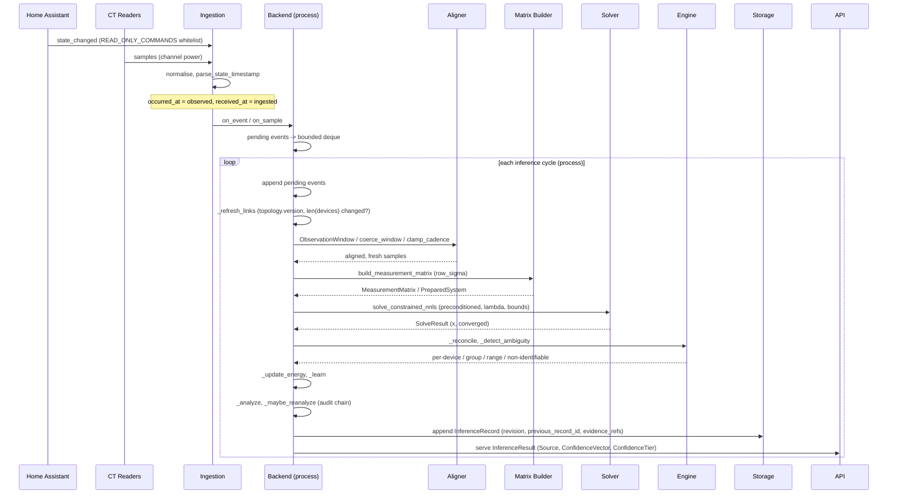

# 07 — Event and Inference Specification

**SPEC_STATUS: APPROVED_FOR_IMPLEMENTATION** — specification for the load-disaggregation event and inference layer — what exists today, what is partial, and what must be built.

**Purpose:** to specify how events are ingested, correlated and converted into per-device load estimates, including simultaneity, automation groups, device response delays, replay, late and duplicate data, and the limits of identifiability.

## 1. Scope and conventions

### 1.1 Scope

This document covers the path from a physical or state change to a published inference result: event production and ingestion (§4), event identity, timing and windows (§5–§6), correlation — isolation, association, simultaneity, automation groups and delays (§6–§11) — replay, late data, duplicates and incomplete groups (§12–§15), identifiability and the solve with its result and provenance (§16–§19), and the production cycle (§20).

Out of scope: the residual model (`05-residual-model-spec.md`), the device model (`06-device-and-load-model-spec.md`), the requirements text (`01-requirements.md`), the architecture (`02-architecture.md`), and the API surface beyond the event-evidence contract named in §12.2.

### 1.2 Conventions

| Token | Meaning |
|---|---|
| **EXISTS** | Implemented, cited to `file:line`. |
| **PARTIAL** | Implemented with a named shortfall, cited to `file:line`. |
| **MISSING** | Not present in the tree; defined here. |
| `G-EVENT-nn` | Locally-scoped gap ID. The canonical register is `00-project-overview.md` §13.2, where these IDs are registered; a locally-scoped ID is valid only together with its entry there. |
| `OD-nn` | Open decision. This document's own decisions occupy the **`OD-61`–`OD-66`** band allocated to it by the canonical register in `13-open-decisions-and-assumptions.md` §5.2 (`00-…` holds OD-01–OD-08). |

### 1.3 Rules in force everywhere below

- **Rule.** Missing is never zero; `unavailable` and `unknown` are missing information, not zero power (`docs/electrical_model.md` §4.3).
- **Rule.** An estimated or allocated value is never presented as a measurement (`docs/electrical_model.md` §4.1).
- **Rule.** A per-device number is never fabricated; a group estimate, a range or an explicit non-identifiable status is the correct answer when separation is impossible (`docs/electrical_model.md` §6).
- **Rule.** Correlation is not topography, and a bigger reading is not upstream.
- **Rule.** Confidence is multidimensional and never blended; `confidence_is_calibrated` stays false.
- **Rule.** An unexplained parent change does not disprove a containment relationship.
- **Rule.** Contaminated events are excluded, never decomposed (`docs/limitations_v2.md` §2). This is the V1 boundary.
- **Rule.** Contract changes are additive and optional; the existing suite stays green.

### 1.4 Capability summary

| Area | State | Evidence |
|---|---|---|
| HA event subscription and normalisation | EXISTS | `ingestion/ha_source.py:830`, `ingestion/ha_source.py:1024-1092` |
| Event record and event-type vocabulary | EXISTS | `contracts.py:1547`, `contracts.py:1551-1558` |
| Bounded, lossy pending-event buffer | EXISTS | `integration.py:303-361`; `ingestion/queue.py:18-113` |
| Isolation windows, contaminated-event exclusion | EXISTS | `disaggregation/isolation.py:159`, `disaggregation/isolation.py:778` |
| Association evidence rules and verdicts | EXISTS | `disaggregation/association.py:20-80`, `docs/association_and_topology.md` §2.2 |
| CT step detection | EXISTS | `disaggregation/events.py:243`, `disaggregation/events.py:480` |
| Identifiability analysis and group fit | EXISTS | `electrical/solver.py:136`, `disaggregation/group_fit.py:237` |
| Result provenance and audit chain | EXISTS | `contracts.py:870`, `docs/inference_audit.md` |
| Double-counting prevention | EXISTS | `docs/electrical_model.md:48-53,153-168` |
| Observed time vs ingestion time | PARTIAL | `occurred_at` is preserved (`docs/event_isolation.md`); ingestion time is not a contract field — `G-EVENT-01` |
| Simultaneous-change joint solve | PARTIAL | The simulator can inject simultaneity (`tools/simulator/behavior.py:563`); no event-group joint attribution — `G-EVENT-02` |
| Device response delays | PARTIAL | Configuration and simulator delays exist; no evidence-based estimate — `G-EVENT-04` |
| Historical replay | PARTIAL | `disaggregation/audit.py:832`; no `POST /events/replay` and no `EventEvidenceRecord` — `G-EVENT-06` |
| Late-arriving data | PARTIAL | History slicing exists; supersession is not recorded — `G-EVENT-07` |
| Duplicate-event suppression | PARTIAL | `storage/database.py:533`; event identity is inconsistent — `G-EVENT-08` |
| Range / group-level outcomes for consumers | PARTIAL | Computed internally, not consumable — `G-EVENT-10` |
| Automation event groups | MISSING | No grouping primitive — `G-EVENT-03`, `G-EVENT-09` |
| Cross-reader event vectors | MISSING | Per-reader deltas exist; no vector object — `G-EVENT-05` |
| Unknown residual event shape | MISSING | Defined here (§2.3), not in the tree — `G-EVENT-11` |

## 2. Event taxonomy

Three sources produce events. They differ in trigger, actor and fields, and they converge on one internal representation before isolation and association.

### 2.1 Source A — HA-driven events

| Property | Value |
|---|---|
| Trigger | A Home Assistant entity's state changes and HA emits `state_changed`. |
| Actor | The declared entity's own automation, a user, a script, or the physical device as seen by HA. |
| Fields carried | Entity id, old state, new state, `occurred_at` (parsed from the HA timestamp). |
| Produced at | `ingestion/ha_source.py:830` `subscribe_events` (read-only whitelist `ingestion/ha_source.py:147-164`), normalised in `ingestion/ha_source.py:1024-1092` `_process_state`. |
| Emitted as | `contracts.py:1547` `DeviceEvent` with `event_type` from `contracts.py:1551-1558`. |

The event-type vocabulary in force (`contracts.py:1551-1558`):

| `event_type` | Meaning | Note |
|---|---|---|
| `state_changed` | Any state attribute change. | The subscription filter value (`ingestion/ha_source.py:830`). |
| `power_change` | A power value changed. | Persisted, but a CT power entity's event never becomes device state (`main.py:869+`, counted as `power_events_not_state`). |
| `cycle_start` | A cycle started. | |
| `stage_change` | A stage within a cycle changed. | |
| `cycle_end` | A cycle ended. | |
| `availability` | The entity became available or unavailable. | Carries missing information, not zero power. |

**Level-only changes are preserved, not filtered.** A brightness or fan-speed change that does not alter the power classification still produces an event (`ingestion/ha_source.py:1094-1109` `_level_changed`). This matters because a level change is the leading edge of a delayed or staged response (§10).

**Availability is a first-class event.** When an entity becomes unavailable, the last known state is retained and marked stale; the device's load contribution becomes unknown, and the inference must not read it as zero (§1.3, first rule).

**Own-output guard.** Events produced by WattMosaic's own output entities are dropped (`ingestion/ha_source.py:424-433` `_is_own_output`; `ingestion/normalize.py:124` `is_own_entity`), so the system does not observe its own writes.

### 2.2 Source B — measurement-driven events

| Property | Value |
|---|---|
| Trigger | A step in a CT channel's power that the step detector recognises. |
| Actor | The physical load; the specific device is a hypothesis, not a fact. |
| Fields carried | Channel, signed power delta, magnitude, the sample window the delta was measured over. |
| Produced at | `disaggregation/events.py:88` `StepChange`, `disaggregation/events.py:243` `detect_step`, `disaggregation/events.py:376` `detect_changes`, `disaggregation/events.py:480` `StepTracker`. |
| Emitted as | `disaggregation/isolation.py:448` `PhysicalDeviceEvent`, after isolation classification. |

The step detector operates on the CT channel, not on the HA entity. `integration.py:146-151` records that without the tracker "production inference would silently degrade to state-only attribution" — step detection is the primary evidence path and HA state is corroboration.

`StepTracker` maintains per-channel state so that a step is a transition, not a level: the same physical value seen twice is not a second event (§14.2).

### 2.3 Source C — unknown residual events

| Property | Value |
|---|---|
| Trigger | The residual — the part of the total the model cannot explain — changes materially and cannot be attributed to any declared device. |
| Actor | Unknown. The system reports the anomaly; it never invents an owner. |
| Fields carried | Channel, residual delta, the observation window. |
| Produced at | The residual model, specified in `05-residual-model-spec.md`; the event shape it must expose is defined here and is currently MISSING — `G-EVENT-11`. |
| Emitted as | `PhysicalDeviceEvent` with an unresolved attribution. |

An unknown residual event is a **finding**, not an attribution. It states that a step happened on a channel, that the declared devices do not explain it, and that the magnitude is known within tolerance. It never states which device caused it.

### 2.4 The unified event record

All three sources are normalised into one internal event shape before isolation:

```
EventRecord
├── occurred_at        # observed event time (physical or device-reported)
├── received_at        # ingestion time, monotonic within a process
├── event_type         # the vocabulary of §2.1, plus measurement and residual kinds
├── entity_id          # HA entity, or the CT channel key for measurement events
├── device_id          # resolved owning device, when known
├── channel            # CT channel the event was observed on
├── magnitude_delta    # signed power delta, for measurement events
├── state_before / state_after
└── correlation_group  # optional grouping key (§9)
```

The contract types already in force are `contracts.py:1538` `DeviceState`, `contracts.py:1547` `DeviceEvent`, `disaggregation/isolation.py:448` `PhysicalDeviceEvent` and `contracts.py:1620` `LearningSample`. The unified record above is an **additive** union of those, not a replacement: each existing type keeps its own shape and remains readable.

**Rule.** A contract change is additive and optional. Existing producers and consumers of `DeviceEvent`, `PhysicalDeviceEvent` and `InferenceResult` continue to work unchanged, and the existing test suite stays green.

## 3. Identifiability: the governing constraint

Nothing here may produce a per-device number that the electrical model cannot separate. The governing analysis EXISTS and is quoted so that every rule below refers to a real mechanism: the null-space analysis of `Aw = U S Vᵀ` (`electrical/solver.py:136` `analyse_identifiability`, `electrical/solver.py:60` `Identifiability`, `electrical/matrix.py:86` `MeasurementMatrix`); the null-share threshold `≤ 1e-8`; the ambiguous groups by union-find over columns with `|N[i,k]| > 1e-6`; the reported condition number, which is not used to hide values (`docs/electrical_model.md` §6); the group fit (`disaggregation/group_fit.py:219` `GroupFit`, `disaggregation/group_fit.py:237` `individually_identifiable`); and the engine's ambiguity detection (`disaggregation/engine.py:1332` `_detect_ambiguity`). Surfacing the permitted non-point outcomes to consumers is PARTIAL — `G-EVENT-10`; the mechanism table is in §16.1.

The documented statement is binding: "Two devices on one branch with both ON is *not* identifiable … Reporting 250/250 would be fabrication." (`docs/electrical_model.md` §6)

**Rule.** When separation is impossible the output is one of: a per-device value (separable), a **group-level estimate** (members separable only together), a **range** (bounded but not point-identifiable), or an explicit **non-identifiable** status. A per-device number is never fabricated to fill a table cell. The permitted outcomes are specified in §16.2.

## 4. Ingestion

### 4.1 The HA source

`HASource` (`ingestion/ha_source.py:337`) connects to Home Assistant and reads only whitelisted read-only commands (`ingestion/ha_source.py:147-164` `READ_ONLY_COMMANDS`). It subscribes to `state_changed` (`ingestion/ha_source.py:830`), normalises each event (`ingestion/ha_source.py:1024-1092`), and emits measurements and device events (`ingestion/ha_source.py:1111`, `ingestion/ha_source.py:1162`).

`ConnectionState` (`ingestion/ha_source.py:167`) and `compute_backoff` (`ingestion/ha_source.py:186`) govern reconnects: 1 s → 60 s, jittered, unlimited retries (`ingestion/ha_source.py:712-754`). History is sliced on reconnect (`ingestion/ha_source.py:103-135` and `231-334`) so a dropped connection does not silently lose state — `state_snapshot` (`ingestion/ha_source.py:553`), `history` (`ingestion/ha_source.py:567`) and `registries` (`ingestion/ha_source.py:701`).

Entity timestamps are parsed by `parse_state_timestamp` (`ingestion/normalize.py:94`); this is where the observed event time is separated from the wall-clock arrival time.

### 4.2 The pending-event path

The backend buffers pending events in a bounded deque and processes them once per cycle (`integration.py:303-361` `WattMosaicBackend.process`). The order inside one cycle is fixed (§20.1).

A linked event is written into `device_states` keyed by **device_id** (`main.py:869+` `on_event`). A CT power entity's event is persisted but counted under `power_events_not_state` and never becomes device state. An unlinked entity is counted `unlinked_events_ignored` and **not** persisted — the docstring records that writing every undeclared change grew `device_events` at ~1.5 GB/day, 99.98 % of all rows.

**Rule.** The unlinked-event drop is a deliberate, measured capacity decision, not a correctness shortcut. It is counted, and the count stays visible in diagnostics.

### 4.3 The bounded queue and the documented gap

`BoundedQueue` (`ingestion/queue.py:18-113`) is bounded and non-blocking: `put_nowait` returns `False` on a drop and `total_dropped` is counted. On a full queue the oldest entry is dropped with a counted metric.

**Known documentation/behaviour gap.** `main.py:867`, `main.py:915` and `main.py:931` discard the return value of `put_nowait`, so **no `system_events` row is written** for a dropped item, while `docs/data_flow.md:100-102` claims one is. This spec records the code as the source of truth and flags the doc for correction — `G-EVENT-12`.

**Rule.** A dropped event is recorded as a counted loss, never as a silent loss. The count remains visible even where the row is not written.

### 4.4 The event id, and why it is open

The event-identity question is **already open** as `OD-03.1` in `03-measurement-and-electrical-domain.md`. This document does not re-open it; it records its consequences for deduplication (§14) and replay (§12).

| Derivation | Location | Form |
|---|---|---|
| Documented | `docs/data_flow.md:75-78` | `sha1(entity_id + last_updated + new_state)` |
| Code | `ingestion/ha_source.py:1186` | `uuid.uuid4()` |
| Code fallback | `disaggregation/isolation.py:356-369` `_identity` | `f"{device_id}@{occurred_at.isoformat()}"` |

**Rule.** Until `OD-03.1` is decided, deduplication (§14) and replay (§12) must not assume a particular event id. Both work from a **content-derived identity** — the tuple `(entity or channel, occurred_at, kind, discriminating payload)` — and must tolerate the current random ids.

## 5. Timing: the two timestamps

### 5.1 Three facts

| Fact | Meaning | Source |
|---|---|---|
| `occurred_at` | When the event physically happened, or when the device reported it happened. | HA entity `last_updated` / `last_changed` (`ingestion/normalize.py:94` `parse_state_timestamp`); the CT sample time. |
| `received_at` | When WattMosaic observed it. | The ingestion clock. |
| `physical_at` | When the physical action occurred, when known and different from `occurred_at`. | Reported by the device, e.g. a delayed actuator reporting late (§10). |

**Rule.** `occurred_at` is **never** mutated by analysis. `docs/event_isolation.md` guarantees this explicitly and it binds every stage below: isolation, association, group fitting, replay and reanalysis all read `occurred_at` and none writes it.

**Rule.** Analysis lateness is recorded, not erased. The interval `received_at − occurred_at` is carried as an observation on the event and reported in diagnostics; it is never used to move `occurred_at` earlier.

### 5.2 The published timestamp set

`docs/data_flow.md:60-78` documents the three timestamps the data flow carries. This spec keeps that set intact: the observed time, the ingestion time, and the physical time where the device reports one.

### 5.3 Timestamps in the audit chain

`InferenceRecord` (`contracts.py:870`) is the append-only audit chain with `revision`, `previous_record_id` and `evidence_refs`. Each record carries the observation time of the cycle it describes. A later revision with a later observation time supersedes an earlier one for *readers*, but does not rewrite it (§12.5).

## 6. Event windows and isolation

### 6.1 The isolation model

Isolation asks: was this step on this channel caused by this one device, alone, within a window long enough to be distinct from anything else?

| Element | State | Evidence |
|---|---|---|
| `IsolationWindow`, `IsolationConfig` | EXISTS | `disaggregation/isolation.py:159`, `disaggregation/isolation.py:228` |
| `EventIsolator` / `classify` / `reclassify` | EXISTS | `disaggregation/isolation.py:592`, `disaggregation/isolation.py:619`, `disaggregation/isolation.py:778` |
| `EventIsolation` contract | EXISTS | `contracts.py:987` |
| Per-class / per-device overrides | EXISTS | `config/settings.py:207` `isolation_by_class`, `config/settings.py:209` `isolation_by_device`, `config/settings.py:214` `isolation_device_classes` |
| Timing-key allowlist | EXISTS | `config/settings.py:25-29` `ISOLATION_TIMING_KEYS` |
| Defaults | EXISTS | `analysis_offset_s` 195 (`config/settings.py:195`), `isolation_window_s` 30 (`config/settings.py:199`), `isolation_power_window_s` 60 (`config/settings.py:200`) |

**Rule.** The `ISOLATION_TIMING_KEYS` allowlist governs which configuration keys may express timing. A new timing knob must be added to the allowlist or it has no effect.

### 6.2 The three isolation verdicts

| Verdict | Meaning | Consequence |
|---|---|---|
| `ISOLATED` | The window contains only this device's change. | The event is eligible as association evidence. |
| `CONTAMINATED` | The window contains another load's change. | The event is **excluded** from clean attribution. It is not decomposed, not apportioned, not partially used. |
| `INSUFFICIENT_DATA` | The window cannot be evaluated — missing samples, an offline reader, too little history. | The event carries no evidentiary weight; it is recorded and excluded. |

`docs/limitations_v2.md` §2 is binding: contaminated events are excluded, never decomposed; no primitive attributes a shared power change to two devices at once; `verdict="split"` is a confidence penalty, not a decomposition.

**Rule.** A `CONTAMINATED` event is excluded from clean attribution and is never used to produce a number for any device. It remains in the record with its verdict, so a reader can see why it was excluded.

### 6.3 Reclassification

`reclassify` (`disaggregation/isolation.py:778`) re-evaluates an event when the window changes — for example when a delayed response arrives later and shifts the true overlap. Reclassification updates the verdict and the reason; it does not mutate `occurred_at` and does not rewrite the published inference chain (§12.5).

## 7. Correlation and association

### 7.1 The evidence rules

`AssociationFinder` (`disaggregation/association.py:573`) observes events (`observe`, `disaggregation/association.py:584`) and analyses them (`analyze`, `disaggregation/association.py:695`), against `AssociationConfig` (`disaggregation/association.py:245`) and `Observation` (`disaggregation/association.py:344`). The eight evidence rules and the verdicts are documented in the module docstring (`disaggregation/association.py:20-80`) and in `docs/association_and_topology.md` §2.2. Each rule has a recorded failing branch.

| Rule | Substance | Failing branch |
|---|---|---|
| Isolation precondition | Only isolated events are evidence. | A contaminated event is not evidence. |
| Magnitude consistency | The step magnitude must be compatible with the candidate. | Magnitude mismatch rejects. |
| Repeatability | A candidate needs `min_events` observations. | A single coincidence is not repeatability. |
| Lag | The response lag must be within `max_lag_s`. | Excess lag rejects. |
| Noise | Robust statistics: median and MAD. | Never mean/stdev. |
| Basis compatibility | The candidate's power basis must be compatible. | `UNKNOWN` basis is refused. |
| Overlap | Equal deltas prove overlap, not loads. | `summing_allowed=False`. |
| Ambiguity | Ambiguity is named in `evidence["verdict"]`. | An ambiguous candidate is not a winner. |

### 7.2 The evidence object

`docs/association_and_topology.md` §2.1 fixes the keys: `verdict`, `stats`, `supporting`, `conflicting`, `overlap`, `peer_ct_ids`, `algorithm_version`, `config`, `isolation`, `split_with`, `ambiguous_with`. `stats` is exhaustive so that a reader can recompute the confidence.

**Rule.** `stats` remains exhaustive. A consumer must be able to recompute the reported confidence from the recorded statistics alone.

### 7.3 Verdicts and confidence

`docs/association_and_topology.md` §2.4/§2.5 fixes the formula and the constants: verdicts `supported` / `split` / `ambiguous` / `single_event`; `MAX_CONFIDENCE=0.99`; `SINGLE_EVENT_CAP=0.5`; `SPLIT_MULTIPLIER=0.75`; `AMBIGUOUS_MULTIPLIER=0.25`.

**Rule.** `MAX_CONFIDENCE` is a ceiling, not a target. A confidence of 0.99 means "as confident as the model permits", not "certain".

### 7.4 Orientation

`docs/association_and_topology.md` §2.9: the module does **not** take an absolute value. A reversed step is withheld as `opposite_direction`. Orientation is corrected exactly once upstream, by a declared `Polarity.INVERTED`.

**Rule.** A reversed step is withheld, never sign-flipped inside the correlation layer. The single correction point is the declared polarity.

### 7.5 Withholding, withdrawal, persistence

`withdraw` (`disaggregation/association.py:1174`) removes an event's support; `withheld` (`disaggregation/association.py:1210`) lists what was withheld and why; `persist` (`disaggregation/association.py:1259`) writes the analysis out.

**Rule.** Withdrawn evidence is recorded as withdrawn. It is not silently dropped, and it does not reduce the confidence of a device it was never allowed to support.

### 7.6 Audit of the correlation

`AuditPass` (`disaggregation/audit.py:595`) re-analyses recorded evidence with `analyze` (`disaggregation/audit.py:775`) and `reanalyze` (`disaggregation/audit.py:832`), against `AuditConfig` (`disaggregation/audit.py:130`), producing an `AuditReport` (`disaggregation/audit.py:325`) over aligned series (`disaggregation/audit.py:395`).

## 8. Simultaneous device changes

### 8.1 What exists, and the shortfall

The simulator can inject simultaneous changes: `SimulatorConfig.simultaneous_event_batches` and `inject_simultaneous_events` in `tools/simulator/behavior.py:563`. The engine's `infer` (`disaggregation/engine.py:512`) builds one system and solves it (`_solve_system`, `disaggregation/engine.py:967`), so multiple devices are in principle solved against the same matrix.

There is no explicit *event group* for simultaneity: the engine sees a set of events and a matrix, but nothing records that these events were simultaneous, no cross-reader vector is formed, and the association stage has no way to reason about a joint change — `G-EVENT-02`.

### 8.2 The cross-reader event vector

**Definition.** A **cross-reader event vector** is the set of per-reader deltas observed within one window, expressed as a vector over the readers (CT channels) that were live in that window.

```
EventVector
├── window_start / window_end      # the observed window
├── readers: [{channel, delta_w, n_samples, freshness, sigma}]
├── reference_channel              # the channel the vector is expressed against
└── magnitude / direction          # signed; no absolute value
```

**Rule.** A vector is only formed from readers whose samples are fresh and mutually compatible (§8.3). A reader whose sample is stale or missing is excluded from the vector, and the exclusion is recorded in the vector, so the vector's reader list is never a silent subset.

**Rule.** A reversed step within a vector is withheld as `opposite_direction` (§7.4), exactly as in single-channel association. The vector does not take an absolute value.

### 8.3 Alignment and tolerance

Alignment uses the existing primitives: the `SampleAligner` (`synchronization/aligner.py`), `ChannelReading` (`electrical/window.py:48`), `ObservationWindow` (`electrical/window.py:96`), `CoercedWindow` (`electrical/window.py:182`), `coerce_window` (`electrical/window.py:303`) and `clamp_cadence` (`electrical/window.py:201`).

**Rule.** A reader whose sample arrives after its window has closed is excluded from that window's vector and is recorded as a late arrival (§13). The tolerance is defined by the window's cadence: a reader is compatible when its samples cover the window after cadence clamping.

**Rule.** A window solved while a member reader was still late is solved with the member excluded and the exclusion recorded, not with a placeholder of zero (§1.3, first rule).

### 8.4 The joint-solve rule

**Rule.** A set of simultaneous changes is solved **jointly** against the measurement matrix. A per-event independent attribution is not permitted for simultaneous changes, because independent attribution of a shared delta is exactly the fabrication `docs/electrical_model.md` §6 forbids.

**Rule.** The joint solve is the ordinary solve of `docs/electrical_model.md` §4.1 applied to the window containing the simultaneous changes, with the shared-row slack enabled **only** when the siblings are unmodelled (`EffectiveConfig.shared_unmodelled`; `docs/electrical_model.md` §4.2.1). The guard is not a "one claimant" rule.

**Rule.** Simultaneity is a *candidate* grouping, exactly like an automation group (§9.3): it requires evidence and never forces a split.

## 9. Automation event groups

### 9.1 What exists today

An automation's member entity changes arrive as **separate** `DeviceEvent`s. There is no grouping primitive: nothing in `contracts.py` or `disaggregation/` carries the identity of the automation that caused a change, or the fact that two changes came from one cause. **MISSING** — `G-EVENT-03`.

### 9.2 The group contract

```
EventGroup
├── group_id
├── member_event_ids[]        # membership
├── cause                     # automation id / script id / user action, when known
├── observed_window           # the group's observed window
├── kind                      # "automation" | "simultaneous" | "manual"
└── completeness              # complete | incomplete | unresolved
```

| Property | Rule |
|---|---|
| Membership | Declared by the HA automation's `id` on each member entity, plus observed time proximity. |
| Observed window | The union of the members' windows, extended by the delay model (§10). |
| Candidate status | A group is a **candidate** grouping requiring evidence (§9.3). |
| Completeness | Recorded explicitly; an incomplete group has a defined outcome (§15). |

### 9.3 The candidate rule

**Rule.** A group is a **candidate** grouping requiring evidence. Declaring an automation group does not attribute its members to a device, does not prove simultaneity, and does not authorise a split.

**Rule.** A group whose members are indistinguishable is reported **as a group**, not split per member. The output carries the group's aggregate delta and the group's non-identifiability, not a per-member number (§16.2).

**Rule.** Contaminated events are excluded, never decomposed (`docs/limitations_v2.md` §2). A group does not license decomposition: including a member whose window is contaminated excludes that member's evidence; it does not split the shared delta across the remaining members.

### 9.4 Consequence for attribution

- Group members separable in the joint solve → per-member values with the group's provenance attached.
- Group members separable only together → one group-level estimate, explicitly labelled as a group (§16.2).
- Some members contaminated → those members' evidence is excluded; the group is reported incomplete (§15).
- Members indistinguishable and no slack available → an explicit non-identifiable status for the group (§16.2).

## 10. Device response delays

### 10.1 The delay model

Some devices do not respond at the moment of the trigger: HVAC ramps, blinds travel for tens of seconds, compressors restart after a delay, and motors draw an inrush followed by a settle.

| Element | State | Evidence |
|---|---|---|
| Controller on/off delay | EXISTS | `ControllerConfiguration.on_delay_s` / `off_delay_s` |
| Simulator state lag and channel delay | EXISTS | `state_lag_s` and `channel_delay_s` in the simulator configuration |
| Delay estimated from evidence | MISSING | `G-EVENT-04` |
| Delay carried on the event | MISSING | `G-EVENT-04` |

### 10.2 Estimating a delay from evidence

**Rule.** A delay is **estimated from evidence**, never assumed from a nominal constant when evidence exists. The estimator takes the observed distribution of `(physical step time − trigger time)` for the device's own confirmed associations, and reports a median and a MAD, using the robust statistics already in force (`docs/association_and_topology.md` §2.2, noise rule).

**Rule.** The estimator requires a minimum number of confirmed associations, consistent with the `min_events` repeatability rule. Below that count the delay is **unknown**, not zero.

**Rule.** A configured `on_delay_s` / `off_delay_s` is a **prior**, used only where the estimate is unavailable. It is labelled as configured where it is used, so a reader can tell a configured delay from an estimated one.

### 10.3 The correlation window with a delay

**Rule.** A delayed device's event keeps its **original** `occurred_at`. The delay does not rewrite the event time; it widens the correlation window.

**Rule.** The correlation window for a delayed device is `[occurred_at, occurred_at + estimated_delay + isolation_window_s]`. When the delay is unknown the window uses the configured prior's upper bound, and the event's isolation verdict may be `INSUFFICIENT_DATA` rather than a guess.

**Rule.** A device whose observed step falls outside its declared delay window, or whose delay exceeds the configured prior, is flagged. A long-unexplained delay is evidence about the device, not a licence to widen every window.

### 10.4 Load classes affected

| Class | Behaviour | Delay relevance |
|---|---|---|
| HVAC | Ramp after a thermostat call; multi-stage compressor start. | Ramp delay; stage changes arrive as separate events (`stage_change`). |
| Blinds / shades | Motor travel over seconds; the load is a transient, not a steady state. | Travel time defines the event duration, not the correlation window alone. |
| Motors / pumps | Inrush then settle; the CT delta is a step, the state settles later. | Inrush magnitude differs from steady magnitude — the association magnitude rule must use the observed step, not a nominal rating. |
| Compressors | Restart delay after a cycle end; state and load are separated in time. | Restart delay widens the correlation window. |

**Rule.** For transient load classes the reported value is qualified as a transient when the event's magnitude is not the steady-state magnitude. A transient is never reported as a steady device load without that qualification.

## 11. The CT step detector

`detect_step` (`disaggregation/events.py:243`) and `detect_changes` (`disaggregation/events.py:376`) produce `StepChange` records (`disaggregation/events.py:88`); `StepTracker` (`disaggregation/events.py:480`) maintains the per-channel state so a level is not mistaken for a step.

**Rule.** Detection is performed on the CT channel. The HA state change is corroborating evidence, never the sole basis for a magnitude.

**Rule.** A step on a channel with no declared device is an unknown residual finding (§2.3), not a device event.

## 12. Historical replay

### 12.1 What exists

Reanalysis over stored evidence exists (`disaggregation/audit.py:832` `AuditPass.reanalyze`), as do the append-only audit chain with revisions (`contracts.py:870` `InferenceRecord`; `docs/inference_audit.md`), the chain validation and identity (`record_id_for`), and the `InferenceBatch` (`disaggregation/engine.py:111`). The replay endpoint and the `EventEvidenceRecord` contract are **MISSING** — `G-EVENT-06`.

### 12.2 The replay endpoint

The API spec has fixed the event-evidence contract as `EventEvidenceRecord` with a `replay_sufficient` flag, and the replay endpoint as `POST /events/replay`, consuming only `replay_sufficient` records. This spec aligns to those names and does not define a parallel contract.

**Rule.** `POST /events/replay` consumes **only** records whose `replay_sufficient` is true. A record that is not replay-sufficient is skipped with a reason, never partially replayed.

Inputs: `from` / `to` (the observation-time interval to replay); `device_id` / `channel` (optional filter); `mode` (`reanalyze` to re-run inference over stored evidence, or `audit` to re-run the audit pass); `config_source` (the configuration to replay with, recorded in the result).

### 12.3 What replay must do

**Rule.** Replay re-derives the models and the topology **from the stored evidence**, without rewriting history.

**Rule.** Replay must never:
- mutate `occurred_at` on any stored event (`docs/event_isolation.md`);
- delete or overwrite an existing `InferenceRecord`; it appends a new revision (`docs/inference_audit.md`);
- use a record whose `replay_sufficient` is false;
- present a non-converged or non-identifiable solve as a measurement (§16.2).

**Rule.** A reanalysis does not rewrite history (`docs/inference_audit.md` §4, "what a reanalysis does *not* do"). The prior revision remains readable and its `revision` / `previous_record_id` links remain intact.

### 12.4 Replay and event identity

Because the event id is open (`OD-03.1`, §4.4), replay deduplication is content-based: the same capture replayed twice must produce the same evidence set, not twice the evidence.

**Rule.** A replayed capture does not double-count (§14.4).

### 12.5 Supersession, not rewriting

A replay or reanalysis that produces a different result from the published one appends a new `InferenceRecord` with an incremented `revision` and a `previous_record_id` pointer. Readers see the current revision; the history remains intact.

## 13. Late-arriving data

History slicing on reconnect exists (`ingestion/ha_source.py:103-135`, `231-334`), as does the simulator's late-delivery model and the live path that updates the current value. A published inference must **not** be altered retroactively (`docs/inference_audit.md`). The supersession record is MISSING — `G-EVENT-07`.

**Rule.** A late sample updates the "current value" — the device's present state and the latest window — but does **not** retroactively alter a published inference.

**Rule.** When a late sample shows that an earlier inference was superseded, the system records that fact: the earlier `InferenceRecord` is left intact, and a new revision is appended that references it, with the reason recorded as a supersession caused by late data (`docs/inference_audit.md`).

**Rule.** The lateness interval is retained as an observation (`received_at − occurred_at`, §5.1) and is visible in the audit trail, so a reader can see how much of the record is late.

**Rule.** A sample that arrives after its window has been closed is not inserted into that window. It enters the next window, or is recorded as a late-arrival observation. A closed window's contents are immutable.

## 14. Duplicate events

### 14.1 Idempotent persistence

`INSERT OR IGNORE` (`storage/database.py:533`) makes persistence idempotent on the key the database enforces.

**Rule.** Idempotency is enforced at the storage boundary. The same logical event persisted twice yields one row, not two.

### 14.2 Duplicate events versus repeated values

A **repeated value** is the same numeric value observed again (`repeated=True`); it is **not new evidence**, and a step detector must not treat a steady level as a second step (`disaggregation/events.py:480` `StepTracker`). A **duplicate event** is the same logical event delivered twice — a reconnect replay, an HA re-delivery, a replay of a capture — and is deduplicated by identity.

**Rule.** The `repeated=True` rule is about *values*, not about *event identity*. It says a repeat observation is not new evidence; it does not by itself deduplicate an event.

### 14.3 Event identity

The identity of an event is **open** as `OD-03.1` in `03-measurement-and-electrical-domain.md`. The documented derivation (`docs/data_flow.md:75-78`, `sha1(entity_id + last_updated + new_state)`) and the code (`ingestion/ha_source.py:1186`, `uuid.uuid4()`; fallback `disaggregation/isolation.py:356-369`, `device@timestamp`) disagree.

**Rule.** Until `OD-03.1` is decided, deduplication uses a **content-derived identity**: the tuple `(entity or channel, occurred_at, kind, discriminating payload)`, where the discriminating payload is the new state for a state change, the signed delta for a step, and the cycle identifier for a cycle event.

**Rule.** A random id may be *stored* as the row's surrogate key but may not be the *deduplication* key, because a reconnect replay would then be counted twice.

### 14.4 Replay does not double-count

**Rule.** A replayed capture does not double-count. Replay against the same content-derived identity yields the same evidence set; a second replay of the same capture yields no new evidence and no new inference revision, unless the configuration changed — in which case the new revision records the configuration it ran with (`docs/association_and_topology.md` §2.1, `config` key).

## 15. Incomplete event groups

### 15.1 The failure modes

| Failure mode | Detection |
|---|---|
| A member is missing from the retained events | The declared membership of the automation is known; the member's event is absent. |
| A member's reader was offline | The reader's samples are missing across the group's window; the freshness check (§8.3) fails for that channel. |
| The window falls partly outside the retained evidence | The group's `observed_window` is not fully covered by the stored samples. |

### 15.2 The outcomes

**Rule.** An incomplete group is reported as **incomplete**, with its known members listed and the missing members named explicitly. The report never presents the group as complete.

**Rule.** The confidence of the group's attribution is reduced. The reduction is recorded in the evidence object's `stats`, so that it is recomputable (§7.2).

**Rule.** A fabricated per-member attribution is never produced for a member whose evidence is missing. A member with no evidence is **unknown**, not zero and not "the remainder".

**Rule.** The group's known members are still attributed, and their attribution is still bound by the V1 boundary: a contaminated member is excluded, never decomposed (§6.2).

**Rule.** When the incompleteness is structural — the missing member is the one that would have separated the group — the group's outcome is non-identifiable, not a group estimate that silently absorbs the missing member's load.

**MISSING** — `G-EVENT-09` (the incomplete-group outcome); the group itself is `G-EVENT-03`.

## 16. Identifiability in the inference result

### 16.1 The existing analysis

All of the following EXISTS: the null-space / SVD identifiability analysis and `Identifiability` (`electrical/solver.py:136`, `electrical/solver.py:60`); the null-share threshold `1e-8`, the union-find grouping and the reported condition number (`docs/electrical_model.md` §6); `augment_with_unknown_slack` (`electrical/solver.py:258`); `solve_constrained_nnls` and `SolveResult` (`electrical/solver.py:378`, `electrical/solver.py:93`); `residual_summary` (`electrical/solver.py:578`); the group fit with `GroupMember` and `individually_identifiable` (`disaggregation/group_fit.py:219`, `disaggregation/group_fit.py:205`, `disaggregation/group_fit.py:237`); and the engine's ambiguity detection (`disaggregation/engine.py:1332` `_detect_ambiguity`). What is PARTIAL is surfacing the outcomes below to a consumer — `G-EVENT-10`.

### 16.2 The four permitted outcomes

**Rule.** The inference result for a device takes exactly one of four outcomes:

| Outcome | When | What is reported |
|---|---|---|
| **Per-device value** | The device's column is separable from the others. | The value, with `Source` and confidence. |
| **Group-level estimate** | The device is separable only together with one or more others (an ambiguous group by union-find). | One value for the group, labelled as a group, with the members listed and each member marked as belonging to it. |
| **Range** | The device's value is bounded but not point-identifiable. | A lower and an upper bound, explicitly a range; no point estimate presented as the value. |
| **Non-identifiable** | Not separable at all. | An explicit status. No number. |

**Rule.** A per-device number is never fabricated to fill the cell that a group, a range or a non-identifiable status occupies.

**Rule.** A non-converged solve is never reported as a measurement. `SolveResult.converged=False` for status `0`/`-1`, and the returned `x` "must not be presented as a measurement" (`docs/electrical_model.md` §4.1).

**Rule.** `u_j` is a prior, not a cap. A binding bound is relaxed and recorded as `model_upper_bound_relaxed` (`docs/electrical_model.md` §4.1).

**Rule.** `λ` defaults to 0 and the solve is deterministic: `scipy.optimize.nnls` / `lsq_linear(method="trf")`, `SOLVER_TOL=1e-10`, `SOLVER_MAX_ITER=1000`.

### 16.3 The preconditioned solve

Preconditioning and zero-norm column splicing are defined in `docs/electrical_model.md` §4.1.1 and are part of the solve; the event layer does not bypass them.

### 16.4 The state constraints

`docs/electrical_model.md` §4.3: only positively-"not running" states pin a device to zero. `unavailable` and `unknown` are missing information, not zero power.

**Rule.** A device whose state is `unavailable` or `unknown` is constrained as *missing*, not as zero. Its contribution is either unknown or belongs to the residual.

**Rule.** A CT power entity's event is persisted but counted under `power_events_not_state` and never becomes device state (`main.py:869+`); a measurement-only device therefore relies on the CT and the model, not on a state constraint that does not exist.

### 16.5 The slack

The slack for a user-declared shared row is added **only** when the siblings are unmodelled (`EffectiveConfig.shared_unmodelled`; `docs/electrical_model.md` §4.2.1). The guard is not a "one claimant" rule.

## 17. The inference result and its provenance

### 17.1 `InferenceResult` and `Source`

`InferenceResult` (`contracts.py:1642`) is the published result. Its `Source` values are `DIRECT_MEASURED` (measured directly on a dedicated meter), `INFERRED` (solved from the measurement matrix), `MODEL_ESTIMATED` (from the learned model), `CONFIGURED_PRIOR` (from configuration) and `UNKNOWN` (no defensible value is available).

**Rule.** `Source` is mandatory and truthful. `INFERRED` is never used for a value that was actually a prior, and `DIRECT_MEASURED` is never used for a value that came from a solve.

**Rule.** `UNKNOWN` is a legitimate result. It is not an error, and it is not zero.

### 17.2 The confidence vector and the tier

`ConfidenceVector` carries five dimensions and they are **never blended**. `ConfidenceTier` grades the result 0–4. The tier and the vector are reported **separately**.

**Rule.** The tier and the vector are separate fields, and no consumer may derive one from the other. A grade-3 tier with a weak measurement dimension is a real and reportable state.

**Rule.** `confidence_is_calibrated` stays false. A confidence is a self-reported strength of evidence, not a probability.

### 17.3 The audit chain

`InferenceRecord` (`contracts.py:870`) is the append-only record: identity `record_id_for`, chain validation, `revision`, `previous_record_id`, `evidence_refs`, the confidence vector, reason codes, explanation and evidence. `docs/inference_audit.md` defines what is recorded and what is not, including `_changed`, which decides whether a new revision is written — an unchanged result does not create a revision.

**Rule.** Every `evidence_refs` entry must resolve to a stored evidence record. A reference that cannot be resolved is a broken chain and a defect, not a tolerated dangling pointer.

**Rule.** A reanalysis does not rewrite history (`docs/inference_audit.md`).

### 17.4 The documented gaps in the audit pass

`docs/limitations_v2.md` §8 records eight gaps; four constrain this spec:

- `events_expired` is a counter, not a report field — an expired event cannot be listed in a report, and the counter is the only trace (`G-EVENT-13`).
- Pending events are bounded at 256 and lossy — a burst above the bound loses events; §4.3's counted loss applies.
- A reanalysis only records devices with a live result — a device whose result disappeared is not represented in the new revision.
- No on-demand reanalysis — `POST /events/replay` (§12.2) is the required addition.

## 18. Joint inference

### 18.1 The requirements

**Rule.** When multiple devices change at once, the inference solves **jointly** against the measurement matrix. It does not attribute each event independently.

**Rule.** The topology is used to avoid double-counting nested observations (§19).

**Rule.** The residual is used for what the matrix cannot explain, and the unexplained remainder is reported as **unknown**, not distributed over the devices that did change.

**Rule.** HA state is used to constrain the solve — positive "not running" states pin to zero; `unavailable` and `unknown` do not (§16.4).

**Rule.** The learned models are used as **priors** (`x_prior` in the objective of `docs/electrical_model.md` §4.1), with `λ = 0` by default.

**Rule.** An unexplained parent change does not disprove a containment relationship. A parent channel that does not match the sum of its children is a finding to investigate, not a reason to reassign a child's load to the parent.

### 18.2 The steps

Collect the events whose windows fall inside the analysis window; form the cross-reader event vector for each window (§8.2, fresh and mutually compatible readers only); build the measurement matrix (`electrical/matrix.py:271` `build_measurement_matrix`, with `row_sigma` at `electrical/matrix.py:46` and `PreparedSystem` at `electrical/matrix.py:63`); apply the constraints and the priors (§16.4, §18.1); solve deterministically (`electrical/solver.py:378` `solve_constrained_nnls`); reconcile (`disaggregation/engine.py:2056` `_reconcile`) — check the result against the observed deltas and the model's expectation; detect ambiguity (`disaggregation/engine.py:1332` `_detect_ambiguity`) and apply §16.2's four outcomes; then compute the residual summary (`electrical/solver.py:578` `residual_summary`) and attribute the unexplained part to unknown.

### 18.3 The slack and the unknown remainder

**Rule.** The unknown slack (`electrical/solver.py:258` `augment_with_unknown_slack`) is enabled only for a declared shared row whose siblings are unmodelled. The slack is reported as **unknown load**, not as a device's consumption.

## 19. Double counting prevention

`docs/electrical_model.md:48-53,153-168` fixes the rule: a device is attributed using exactly one most-specific CT — its **deepest enclosing branch CT**; nested children are subtracted from the ancestor row; the multiplier is applied exactly once; an alias channel gets no row of its own.

**Rule.** One physical load visible to several nested readers is counted **once**.

**Rule.** Attribution uses the deepest enclosing branch CT. The ancestor's row is not used for the same device.

**Rule.** The multiplier is applied exactly once, at the point where the device's contribution enters the matrix.

**Rule.** An alias channel contributes no row of its own; it refers to the row of the channel it aliases.

**Rule.** Correlation is not topography, and a bigger reading is not upstream. A larger aggregate value is not evidence that a channel is upstream; only the declared topology establishes that.

## 20. The inference cycle

### 20.1 The production order

`WattMosaicBackend.process` (`integration.py:303-361`) defines the per-cycle order, which this spec treats as binding:

1. pending events appended to the cycle's evidence;
2. `_refresh_links` (`integration.py:363-376`) — recomputes `ambiguous_entities` **only when** `(topology.version, len(topology.devices))` changed;
3. `engine.infer` (`integration.py:318-339`) — a failure here leaves the events buffered rather than dropped;
4. `_update_energy` (`integration.py:345`);
5. `_learn` (`integration.py:346`);
6. `_analyze` (`integration.py:347`);
7. `_maybe_reanalyze` (`integration.py:348`);
8. diagnostics (`integration.py:350-356`).

`_pending_events` is a bounded deque. The periodic work (`_maybe_train` at `integration.py:664`, `_maybe_reanalyze` at `integration.py:804-835`) follows the **"read the clock, never start a thread"** pattern. The bridge path is `integration.py:716` `_bridge_event`; the learner is `integration.py:612` `_learn`.

**Rule.** An inference failure does not discard the events. The events stay buffered and are retried; losing them silently would break the audit chain.

### 20.2 The cycle



`docs/architecture.md:105-122` is the same cycle as documented; `main.py:1198-1302` is the same order in the process entry point. The declared-link transition deque is maintained at `main.py:1248-1258`.

### 20.3 The cycle's rules

**Rule.** A cycle that cannot solve publishes `Source=UNKNOWN` or a non-identifiable status; it does not publish a stale number as if it were current, and it does not publish a zero for a device it could not observe.

**Rule.** The published result always carries its provenance: `Source`, the confidence vector, the tier, and `evidence_refs` that resolve.

## 21. Gap register (locally scoped)

| Gap | Title | State | Shortfall |
|---|---|---|---|
| `G-EVENT-01` | First-class ingestion timestamp on the event record | PARTIAL | `occurred_at` is preserved (`docs/event_isolation.md`); `received_at` is not carried on the event contract, so lateness is not observable per event. |
| `G-EVENT-02` | Explicit simultaneous-change group in the inference path | PARTIAL | The simulator injects simultaneity (`tools/simulator/behavior.py:563`) and the engine solves one system, but no event group or cross-reader vector is formed. |
| `G-EVENT-03` | Automation event-group primitive | MISSING | No grouping primitive exists; an automation's member changes are separate `DeviceEvent`s. |
| `G-EVENT-04` | Evidence-estimated device response delay | MISSING | Configuration (`on_delay_s`/`off_delay_s`) and simulator lags exist; no estimator, no delay carried on the event. |
| `G-EVENT-05` | Cross-reader event vector object | MISSING | Per-reader deltas exist in the matrix builder; no vector, no freshness or compatibility gate. |
| `G-EVENT-06` | Replay endpoint and `EventEvidenceRecord` | MISSING | `AuditPass.reanalyze` exists (`disaggregation/audit.py:832`); the API contract fixes `POST /events/replay` and `EventEvidenceRecord.replay_sufficient`, neither of which exists in the tree. |
| `G-EVENT-07` | Supersession record for late data | MISSING | A late sample updates the current value; no record marks a published inference as superseded. |
| `G-EVENT-08` | Consistent event identity | PARTIAL | `INSERT OR IGNORE` exists (`storage/database.py:533`), but the code's `uuid.uuid4()` (`ingestion/ha_source.py:1186`), the fallback `device@timestamp` (`disaggregation/isolation.py:356-369`) and the documented `sha1(entity_id+last_updated+new_state)` (`docs/data_flow.md:75-78`) disagree — `OD-03.1`. |
| `G-EVENT-09` | Incomplete-group outcome | MISSING | No group concept, hence no incomplete-group reporting or confidence reduction. |
| `G-EVENT-10` | Range and group-level outcomes surfaced to consumers | PARTIAL | The solver and group fit compute them; the published result carries only a point value or a failure, so a group, range or non-identifiable status is not consumable. |
| `G-EVENT-11` | Unknown residual event shape | MISSING | The residual model is specified in `05-residual-model-spec.md`; the event it must expose has no defined contract here or there. |
| `G-EVENT-12` | `system_events` row on queue drop | PARTIAL | The code drops the `put_nowait` result (`main.py:867,915,931`); `docs/data_flow.md:100-102` claims a row is written. |
| `G-EVENT-13` | `events_expired` as a report field | MISSING | It is a counter only (`docs/limitations_v2.md` §8). |

**Reconciliation note.** `G-EVENT-01` … `G-EVENT-13` are **registered** in the canonical gap register at `00-project-overview.md` §13.2, the register of record for gap identifiers. The table above is the upstream source for the gaps it lists. The local namespace is used so that this document does not collide with the ranges already claimed by the sibling specs.

## 22. Open decisions

| ID | Question | Assumption proceeded on |
|---|---|---|
| `OD-61` | Should the event record carry `received_at` as a first-class field, or should lateness live only in diagnostics? | Assumed `received_at` is carried on the internal unified record (§2.4) as an **additive, optional** field on `DeviceEvent` / `PhysicalDeviceEvent`; no existing field changes meaning. `G-EVENT-01`. |
| `OD-62` | Should an automation group be a first-class persisted object, or a transient correlation artefact? | Assumed the group is a **transient correlation artefact**, persisted only through the `evidence_refs` of the `InferenceRecord` it influenced, to avoid a second lineage of state. |
| `OD-63` | Should the delay estimate be per device, per device-class, or per event? | Assumed **per device**, with a per-class fallback, stored with the device's learned parameters so it is auditable. |
| `OD-64` | Should a range be a new `Source` value or a field on the existing result? | Assumed a **field** on `InferenceResult`, with `Source` unchanged, so existing consumers of `Source` keep working. `G-EVENT-10`. |
| `OD-65` | Should the cross-reader event vector be persisted, or reconstructed on demand? | Assumed **reconstructed on demand** from the stored per-reader deltas, so no second storage format is added for the same fact. |
| `OD-66` | Does `POST /events/replay` need rate limiting or a scoped role? | Assumed the API spec owns this; this spec defines only the replay semantics and the `replay_sufficient` precondition. |

The event-identity question itself is **not** re-opened here; it remains `OD-03.1` in `03-measurement-and-electrical-domain.md` (§4.4, §14.3).

## 23. Related documents

- [00 — Project overview](00-project-overview.md) — canonical gap register and open decisions.
- [01 — Requirements](01-requirements.md) — requirement source text.
- [02 — Architecture](02-architecture.md) — the cycle as documented.
- [03 — Measurement and electrical domain](03-measurement-and-electrical-domain.md) — `OD-03.1`, event identity.
- [05 — Residual model](05-residual-model-spec.md) — the unknown residual event source.
- [06 — Device and load model](06-device-and-load-model-spec.md) — learned device models and priors.
- [08 — Storage and data lifecycle](08-storage-and-data-lifecycle.md) — persistence, `INSERT OR IGNORE`.
- [09 — API and data contracts](09-api-and-data-contracts.md) — `EventEvidenceRecord`, `POST /events/replay`.
- [13 — Open decisions and assumptions](13-open-decisions-and-assumptions.md) — the `OD-nn` series.
- [`docs/electrical_model.md`](../../../docs/electrical_model.md) — identifiability, the solve, double counting.
- [`docs/association_and_topology.md`](../../../docs/association_and_topology.md) — the eight evidence rules and verdicts.
- [`docs/event_isolation.md`](../../../docs/event_isolation.md) — isolation windows and the `occurred_at` guarantee.
- [`docs/inference_audit.md`](../../../docs/inference_audit.md) — the `InferenceRecord` chain and reanalysis.
- [`docs/limitations_v2.md`](../../../docs/limitations_v2.md) — the V1 boundary and the known gaps.
- [`docs/data_flow.md`](../../../docs/data_flow.md) — the three timestamps and the documented event-id derivation.
- [`docs/architecture.md`](../../../docs/architecture.md) — the cycle as documented.
