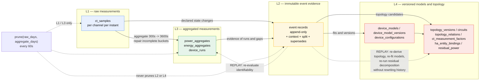

# 08 — Storage and Data Lifecycle

**SPEC_STATUS: APPROVED_FOR_IMPLEMENTATION** — Specification. Defines the logical storage tiers, retention, aggregation, compression, indexing, replay and recovery rules for the load-disaggregation system, expressed over the existing single SQLite database.

**Purpose:** To state, in one place, what the system stores, for how long, in what shape, and what it must never store — so that future algorithm work can replay history without rewriting it.

> **Scope note.** The four tiers below are a **logical** separation expressed over **one** SQLite database. They are **not** four new databases, not four schemas, and not four services. The governing decisions in `docs/implementation_plan_v2.md` §0 forbid a new database, a new runtime dependency, a new service and a message bus; this document does not propose any of them. The tier model exists so that retention, indexing and replay rules can differ per class of data while the physical storage remains what it already is.

---

## 1. Storage engine: what exists today

| Property | Current state | Evidence |
|---|---|---|
| Engine | SQLite, one file | `engine/wattmosaic_engine/storage/database.py:74` (`Database`) |
| Journal mode | WAL | `engine/wattmosaic_engine/storage/database.py:92-99` (`_configure`) |
| Durability | `synchronous=NORMAL` | `engine/wattmosaic_engine/storage/database.py:92-99` |
| Foreign keys | `ON` | `engine/wattmosaic_engine/storage/database.py:92-99` |
| Lock wait | `busy_timeout=10000` (10 s) | `engine/wattmosaic_engine/storage/database.py:92-99` |
| Auto-checkpoint | `wal_autocheckpoint=1000` pages | `engine/wattmosaic_engine/storage/database.py:92-99` |
| Write serialization | one `threading.RLock` for the writer; a separate reader path | `engine/wattmosaic_engine/storage/database.py:100-133` (`_reader`) |
| Checkpoint API | `checkpoint()` | `engine/wattmosaic_engine/storage/database.py:169-171` |
| Retention pass | `prune(raw_days=30, aggregate_days=730)` | `engine/wattmosaic_engine/storage/database.py:1304-1344` |
| Integrity | `integrity_check()` | `engine/wattmosaic_engine/storage/database.py:151-167` |
| Schema version | `schema_version` / `latest_schema_version` exposed via `stats()` | `engine/wattmosaic_engine/storage/database.py:1365-1380` |
| Migrations | forward-only, `BEGIN IMMEDIATE` … `PRAGMA user_version = N` … `COMMIT`, rollback on error | `engine/wattmosaic_engine/storage/migrations.py:799-816` (`apply_migrations`) |
| Migration count | the current schema version (11 migrations), computed from the migrations tuple; 30 tables' DDL | `engine/wattmosaic_engine/storage/migrations.py:792`, `:266-789` |
| Migration registry | `Migration` dataclass + `MIGRATIONS` tuple | `engine/wattmosaic_engine/storage/migrations.py:17-28`, `:260` |
| Prune exemptions | 7 audit tables exempt from pruning | `engine/wattmosaic_engine/storage/migrations.py:122-134` (`AUDIT_TABLES`) |
| Corruption policy | refuse to run on corruption rather than silently lose data | `docs/architecture.md:142-149` |

**Rule.** The storage engine is a single SQLite file. Any proposal that adds a second database, a time-series extension, a column store or a cold-storage tier must carry a measurement that justifies it (see §3.3 and §5.2).

---

## 2. The four logical tiers

### 2.0 Tier map

| Tier | Content | Grain | Append-only? | Default retention | Configurable |
|---|---|---|---|---|---|
| **L1** | high-resolution raw measurements | one reading per CT channel per sample instant | yes (until pruned) | 30 d (`OD-03` target: 7–14 d) | yes |
| **L2** | immutable event evidence | one meaningful event | yes, forever (until an explicit horizon) | none — long-term | horizon only |
| **L3** | aggregated measurements | one bucket per window | yes | 730 d | yes |
| **L4** | versioned models and topology | one version record | versioned, never rewritten | none — long-term | horizon only |

**Rule.** The tiers are a **logical** separation over **one** SQLite database (`engine/wattmosaic_engine/storage/database.py:74`). No tier is a separate file, process or service.

### 2.1 L1 — high-resolution raw measurements

**Holds** the per-reader samples as they arrive from the CT channels: instantaneous power per channel plus the sample timestamp.

| Property | Value |
|---|---|
| Table | `ct_samples` (existing) |
| Grain | one row per channel per sample instant |
| Write path | persist queue → writer loop → batched insert |
| Retention default | 30 d (`config/settings.py:150-152`, `retention_days_raw` 30) |
| Env var | `WM_RETENTION_DAYS_RAW` (`config/settings.py:257-261`) |
| Pruning | `Database.prune(raw_days=…)` (`engine/wattmosaic_engine/storage/database.py:1304-1344`), driven by the maintenance loop (`main.py:1308-1319`) |

**Target horizon (`OD-03`).** `docs/specs/load-disaggregation/00-project-overview.md:433` already fixes the raw-horizon assumption as *"7–14 d configurable, 30 d default until an operator opts in"*. This document adopts that statement unchanged: the shipped default stays at 30 days, and a 7–14 day default is available to an operator who explicitly opts in.

**Consequence of moving the default.** If the default is lowered from 30 d to 14 d, every L1 row older than the new default is deleted at the next maintenance pass (`main.py:1308-1319` → `self.db.prune(retention_days_raw, retention_days_aggregates)`). That pass is unconditional and irreversible. **Lowering the L1 default is therefore a one-way operation with respect to already-stored history**, and it must be announced, not silently applied by a release.

**What L1 must be able to answer.** What did channel *c* report at time *t*? What was the sample spacing actually achieved? Did a gap occur, and how long was it?

**Rule.** Missing is never zero. A missing L1 sample is a gap in the record; it is never back-filled with a synthesized 0 W reading. Gaps are carried explicitly (see §2.2 and `docs/interface_contracts.md:184-185`).

### 2.2 L2 — immutable event evidence

**Holds** the long-lived, append-only record of *meaningful* events, where "meaningful" means: the state of the system changed in a way a later model, a replay or an operator would need to explain.

Event classes carried in L2:

| Event class | Current home | Fit |
|---|---|---|
| measurement events (sample anomalies, stale channels, gaps) | `device_events` | partial |
| HA events (entity state changes) | `device_events` | partial |
| unknown residual events | `device_events` | partial |
| residual changes | `device_events` | partial |
| configuration changes | `device_configurations` (L4 history) | partial |
| topology changes | `topology_versions` (L4 history) | partial |
| disaggregation verdicts | `isolation_verdicts` | partial |
| inference records | `inference_records` | partial |

`device_events` is a partial fit because it is **not** immutable in practice: it is a general-purpose event table whose rows are subject to the same growth pressure as any append-only log, and the documented pathology is that writing every *undeclared* change grew it at ~1.5 GB/day, 99.98 % of all rows (`main.py:886-890`).

**What "immutable" means operationally.**

1. An evidence record is **never updated** in place.
2. An evidence record is **never deleted** by a later model version, a later configuration, or a re-analysis.
3. A **correction is a new record** that supersedes an earlier one by reference, not by mutation.
4. Only an explicit, separately-configured horizon may delete evidence, and it does so on an explicit operator action — never as a side effect of a release or a model change.

**Rule.** A new model version never deletes historical evidence (§2.4).

**Schema of an evidence record.** Each L2 record must carry, at minimum, and additively:

| Field | Purpose |
|---|---|
| `event_id` | stable, unique identity of the record |
| `event_type` | the event class (measurement, HA, residual, config, topology, verdict, inference) |
| `occurred_at` | the instant the event happened |
| `recorded_at` | the instant the record was written (separate from occurrence) |
| `source` | producing component / device identity |
| `payload` | the event-specific body |
| `context` | the state the event was observed under (topology version, model version, configuration version) |
| `supersedes` | optional reference to a record this one corrects |
| `split` | `train` / `evaluation` / `none` — see below |
| `quality` | whether the record is trustworthy enough to fit against |

**Physical target for each field.** Every field above lands on a named table — either an existing table it extends, or a new table it requires:

| Field | Existing table extended | New table required | Migration |
|---|---|---|---|
| `event_id`, `event_type`, `occurred_at`, `recorded_at`, `source`, `payload` | `device_events` (existing event log) | — | additive columns on `device_events` |
| `context` | `device_events` | — | additive column on `device_events` |
| `split` | `device_events` | — | additive column on `device_events` |
| `supersedes` | `device_events` | — | additive column on `device_events` |
| `quality` | `device_events` | — | additive column on `device_events` |
| verdict evidence | `isolation_verdicts` (existing) | — | additive context/split columns |
| inference evidence | `inference_records` (existing) | — | additive context/split columns |
| topology-change evidence | `topology_versions` (existing, L4) | — | additive evidence pointer column |
| configuration-change evidence | `device_configurations` (existing, L4) | — | additive evidence pointer column |
| `event_id` correlation across classes | — | `evidence_records` (new) — an index/registry over the evidence rows, carrying `event_id`, the event class, the version context, the split label and the supersession chain, so that a replay can enumerate all evidence for an interval without knowing in advance which table holds it | new table + migration |

**Rule.** The physical split between `device_events` (the event log) and the new `evidence_records` (the replay registry) is an implementation choice, not a contract change: `OD-71` records that open decision. Either way, the contract is the field set above, and it is additive.

**Rule.** `context` is mandatory. An evidence record without the topology/model/configuration version in force when it occurred cannot be replayed, because a replay would apply a different interpretation than the original.

**Requirement: future algorithm improvement and replay.** An evidence record must retain enough information that a future algorithm — one that does not exist today — can fit against it and reach the same conclusion the live system reached, or a better one, without the original raw stream. That means it must carry:

- the **observed** values, not just the derived verdict;
- the **state context** (version identifiers) in force at the time;
- the **missing/gap** markers, so that a replay does not treat an outage as a 0 W reading;
- the **split label** (`train` / `evaluation`), so that training can be separated from evaluation without hindsight.

**Rule (training/evaluation split).** An evidence record must be usable for model fitting and must be identifiable as such when used for evaluation. The split must be assigned at record time — an operator-supplied or policy-assigned label stored on the record — not inferred later from the outcome. A record with no split label is not usable for evaluation; it is usable for fitting and for explanation only.

**Gap `G-STORE-01` — the split label is MISSING.** No evidence table in the current schema carries a train/evaluation split. The field is specified here as `split` on the evidence record, with the value `none` for records that are explicitly not eligible for either.

**Gap `G-STORE-02` — the context block is PARTIAL.** Version identity exists in L4 tables (`topology_versions`, `device_model_versions`), but it is not carried on the event rows themselves, so an evidence record cannot self-describe the state it was observed under. The `context` block is specified as additive.

**Gap `G-STORE-03` — the training/evaluation split is MISSING.** See `G-STORE-01`; the two are the same requirement seen from the modelling side.

### 2.3 L3 — aggregated measurements

**Holds** time-window statistics and integrated energy derived from L1.

| Table | Contents | Grain |
|---|---|---|
| `power_aggregates` | windowed power statistics | one row per bucket per subject |
| `energy_aggregates` | integrated energy | one row per bucket per subject |
| `device_runs` | contiguous run segments | one row per run |

**Existing cascade.** `docs/data_flow.md:81-91` records the flow as raw samples (30 d) → 5-minute power/energy aggregates → 1-hour aggregates → retained 730 d. The bucket sizes are `DEFAULT_BUCKET_SIZES = (300, 3600)` (`aggregation/aggregator.py:54`), i.e. 300 s and 3600 s.

**Bucket boundaries.** `_floor_bucket` (`aggregation/aggregator.py:112-115`) floors a timestamp to its bucket start, so a bucket boundary is aligned to the epoch, not to the first sample that happened to arrive. This makes buckets deterministic and re-derivable from a replay, which is the property L3 depends on.

**Energy integration.** Energy integrates with the trapezoidal rule on *actual elapsed time*, and gaps larger than `stale_after` accrue no energy (`docs/interface_contracts.md:184-185`; `aggregation/aggregator.py` `flush` at `:497-530`, `energy_total` at `:645`, `current_total_kwh` at `:657`). The existing model types are `EnergyBucket` (`aggregation/models.py:12`) and `DeviceRun` (`aggregation/models.py:40`).

**Retention.** Default 730 d (`config/settings.py:150-152`, `retention_days_aggregates` 730); env var `WM_RETENTION_DAYS_AGGREGATES` (`config/settings.py:257-261`); pruned by `Database.prune(aggregate_days=…)` (`engine/wattmosaic_engine/storage/database.py:1304-1344`) from the maintenance loop (`main.py:1308-1319`).

**Reconciliation between L3 and L2.** Aggregates are a *derivation* of L1; they are not independent truth. Where L2 carries a residual-change or configuration-change event inside a bucket window, that event is the authority for why the bucket differs from its neighbours; the aggregate itself is never edited to match the event. A correction to the aggregate is produced by re-running the aggregation over L1 (§13), not by patching L3.

**What L3 must be able to answer.** How much energy did device *d* consume in hour *h*? How long was it running? What was the peak demand in that window?

### 2.4 L4 — versioned models and topology

**Holds** the descriptive state of the installation: which CT is on which circuit, which HA entity maps to which device, which model version was in force, and what the residual baseline is.

| Table | Contents |
|---|---|
| `device_models` | model identity per device |
| `device_model_versions` | versioned model parameters |
| `device_configurations` | versioned device configuration |
| `topology_versions` | versioned topology snapshot |
| `circuits` | circuit identity and metadata |
| `topology_relations` | channel/circuit/device relations |
| `ct_measurement_factors` | per-CT calibration factors |
| `ha_entity_bindings` | HA entity ↔ device mapping |
| `residual_power` | residual baseline model |
| `schema_metadata` | schema bookkeeping |
| `device_flags` | per-device flags |
| `engine_state` | engine-level state |

**Version identifiers.** Four identifiers are in force, and every L2 record and every L3 aggregate must be interpretable against them:

| Identifier | Scope | Meaning |
|---|---|---|
| `topology_version` | installation | the wiring graph in force |
| `reader_configuration_version` | reader | the reader's electrical configuration in force |
| `device_mapping_version` | device ↔ HA | the entity mapping in force |
| `model_version` | device model | the fitted model in force |

**Validity intervals.** Each L4 version record carries `valid_from` and `valid_until` (exclusive end) so that a point-in-time query is answerable: "what was the topology on 2026-03-01 09:00:00?" The interval is closed by writing the successor row; the predecessor's `valid_until` is set to the successor's `valid_from`. There is no in-place edit of a versioned record's parameters.

**Rule.** A new model version never deletes historical evidence. A new model version appends a new L4 row; L2 evidence recorded under the previous `model_version` remains readable and remains attributable to that version. History is preserved so that a later operator can ask "why did the system report *X* on that day" and get an answer that reflects the model that was actually in force.

**What L4 must be able to answer.** What was the wiring at time *t*? Which model version produced the inference recorded at time *t*? Which HA entity was bound to device *d* at time *t*?

---

## 3. Retention policy

### 3.1 Per-tier table

| Tier | Default | Config field | Env var | Pruned by | Granularity | Long-term? |
|---|---|---|---|---|---|---|
| L1 | 30 d | `retention_days_raw` | `WM_RETENTION_DAYS_RAW` | `Database.prune(raw_days=…)` | row, by age | no |
| L2 | none | *(none — see below)* | *(none)* | nothing today | — | **yes** |
| L3 | 730 d | `retention_days_aggregates` | `WM_RETENTION_DAYS_AGGREGATES` | `Database.prune(aggregate_days=…)` | row, by age | no |
| L4 | none | *(none)* | *(none)* | nothing today | — | **yes** |

Evidence: `config/settings.py:150-152` and `:257-261`; `engine/wattmosaic_engine/storage/database.py:1304-1344`; maintenance loop `main.py:1308-1319`.

**Rule.** L2 and L4 are long-term. The retention pass must never prune them. If an operator needs to bound L2 or L4 for capacity reasons, that bound is a **separately configured, explicitly enabled horizon** — a distinct setting with its own default of "disabled", never a side effect of the L1/L3 settings.

**Gap `G-STORE-04` — the L2/L4 horizon is MISSING.** No configuration field or env var exists for bounding evidence or version history. The requirement is: an explicit, opt-in, separately named horizon that defaults to disabled, and whose use is logged.

> **Implementation status note.** The underlying config fields now exist (`EngineConfig.retention_days_evidence` / `retention_days_versions`, env `WM_RETENTION_DAYS_EVIDENCE` / `WM_RETENTION_DAYS_VERSIONS`, default `None` = disabled) and are exposed as App options in `addon/run.sh` and `addon/config.yaml`. This App-surface change does not by itself implement pruning of L2/L4 at the horizon; the `G-STORE-04` gap for the prune action and its logging remains open.

### 3.2 Pruning trigger and mechanics

- **Trigger:** the maintenance loop, every `MAINTENANCE_INTERVAL_S = 60.0` s (`main.py:98`, loop at `main.py:1308-1319`). The loop calls `self.aligner.prune()` then `self.db.prune(retention_days_raw, retention_days_aggregates)`.
- **Granularity:** row-level, by age. There is no bucket-level or tier-level coarse truncation.
- **Exemptions:** seven audit tables are exempt from pruning (`engine/wattmosaic_engine/storage/migrations.py:122-134`, `AUDIT_TABLES`).
- **Order:** the in-memory aligner buffer is pruned before the database, so the memory footprint falls before the disk footprint.

**Rule.** Pruning is age-based and unconditional once configured. A row that falls past its horizon is deleted on the next pass. There is no "keep because it is interesting" exception in the current implementation, and none is proposed.

### 3.3 Sizing before infrastructure

**Rule.** Measure storage usage before adding infrastructure. The row-count and file-size read surface (§15) must exist before any argument for a second database, a cold tier, an export pipeline or a compaction service is worth making.

**Rule.** Never introduce distributed infrastructure without a measurable justification.

---

## 4. Aggregation intervals and roll-ups

| Aspect | Behaviour | Evidence |
|---|---|---|
| Bucket sizes | 300 s and 3600 s | `aggregation/aggregator.py:54` |
| Bucket alignment | floor to bucket start | `aggregation/aggregator.py:112-115` |
| Bucket write | `flush()` | `aggregation/aggregator.py:497-530` |
| Partial-bucket repair | `recompute_incomplete_buckets()` — 72 h lookback, 4 buckets | `aggregation/aggregator.py:535-607` |
| Run segmentation | `close_open_runs`, `take_closed_runs` | `aggregation/aggregator.py` — **line reference not available in the evidence digest** |
| Energy rule | trapezoidal on actual elapsed time; no energy across a stale gap | `docs/interface_contracts.md:184-185` |

**The cascade.** L1 samples are floored into 300-second power buckets and integrated into 300-second energy buckets. The 300-second energy buckets roll up into 3600-second buckets. Runs of contiguous activity are closed into `device_runs`. The 1-hour layer is what survives longest (730 d) and is what most dashboard queries consume.

**Repair after an unclean stop.** A bucket that was being accumulated when the process died is, by definition, incomplete: its trapezoid integration is missing its final segment, and its power statistics are missing the tail samples. `recompute_incomplete_buckets()` (`aggregation/aggregator.py:535-607`) repairs this by re-deriving the affected buckets over a 72-hour lookback covering 4 buckets.

**What happens to the half-written bucket.** It is **not** left as-is and it is **not** filled with an invented final value. It is recomputed from the underlying L1 samples over the repair window and rewritten with the correct partial-interval arithmetic: the energy in a bucket that is still open at the time of the query is the energy integrated up to the last real sample, using the real elapsed time between samples. The rule that a gap accrues no energy (`docs/interface_contracts.md:184-185`) is what makes the recomputed bucket equal to the bucket that would have been written had the process not died.

**Rule.** The repair window is a lookback over L1. If L1 for that window has already been pruned, the affected bucket cannot be repaired from raw data and must be recomputed from the nearest surviving aggregate, or be left absent. It must never be filled with a zero that would read as "the device consumed nothing".

**Gap `G-STORE-05` — the repair window is PARTIAL.** The repair path requires L1 to still be present for the window. With the `OD-03` target horizon of 7–14 d, a 72-hour lookback survives comfortably; with an aggressive L1 horizon below 3 d the repair path would be short of raw data. The rule is recorded here: L1 retention must exceed the repair lookback, and the storage-health surface (§15) should report whether it currently does.

---

## 5. Compression and storage sizing

### 5.1 What the current schema supports

| Mechanism | Present? | Evidence |
|---|---|---|
| Page-level compression | no, beyond SQLite's own page encoding | — |
| WAL mode | yes | `engine/wattmosaic_engine/storage/database.py:92-99` |
| `synchronous=NORMAL` | yes | `engine/wattmosaic_engine/storage/database.py:92-99` |
| `wal_autocheckpoint=1000` | yes | `engine/wattmosaic_engine/storage/database.py:92-99` |
| Explicit checkpoint API | yes | `engine/wattmosaic_engine/storage/database.py:169-171` |
| Checkpoint on graceful shutdown | yes | `main.py:803-841` |
| Per-column compression / archival codec | no | — |
| Cold tier / object store | no | `docs/implementation_plan_v2.md` §0 |

SQLite in WAL mode does not compress the database file. What it does provide is that the WAL is bounded: `wal_autocheckpoint=1000` folds the WAL back into the main file periodically, and the graceful shutdown performs a final checkpoint (`main.py:803-841`; `engine/wattmosaic_engine/storage/database.py:169-171`).

### 5.2 Measured growth drivers

| Driver | Measured or documented rate | Evidence |
|---|---|---|
| Undeclared-change event spam | `device_events` grew at ~1.5 GB/day and accounted for 99.98 % of all rows | `main.py:886-890` |
| `inference_records` | ~37 rows/hour even when nothing changes | `docs/limitations_v2.md` §7.2 |
| `isolation_verdicts` | accumulate on disk indefinitely | `docs/limitations_v2.md` §7.2 |
| Audit tables | grow for the life of the file | `docs/limitations_v2.md` §7.2 |
| Export surface | `GET /export/{device_id}` reads `inference_results`, **not** `inference_records` | `docs/limitations_v2.md` §7.2 |

**The controlling number.** The event-spam measurement is the single most important sizing datum in the system: 1.5 GB/day is roughly 550 GB/year, from a write path that carries no information. Everything else is orders of magnitude smaller by comparison. Sizing work should therefore start by making the event path *selective*, not by building capacity for it.

**Rule.** No additional database, time-series extension or cold storage is introduced without a measurement that justifies it. The justification is a measurement of current bytes-per-day for the class of data that the new store would hold.

**Rule.** Every event that is written to L2 must be *declared* — it must be a state change the system understands, with a defined meaning. The undeclared-change path is the documented cause of the 1.5 GB/day growth (`main.py:886-890`) and it must not be reintroduced as a "write everything and filter later" design.

**Gap `G-STORE-06` — compaction/export is MISSING.** `docs/limitations_v2.md` §7.2 records that the audit tables grow for the life of the file and that there is **no compaction or export tool** beyond `GET /export/{device_id}`, which reads `inference_results` and not `inference_records`. The requirement here is a read-only export/compaction surface over L2 that does not mutate stored evidence.

---

## 6. Database indexes

### 6.1 Index policy

**Rule.** An index is added only for a **named query**. Every index in the schema must map to a specific read path that is either exercised by the product or by the storage-health/replay surfaces defined in this document. An index without a named query is not added.

**Rule.** A new read path must not replicate the unbounded covering-index scan of `latest_inference_results()` — measured at ~24 ms warm and ~590 ms cold at 343k rows (`docs/limitations_v2.md` §7.3). Any new read path that scans a growing table without a bounded predicate is a defect, not a feature.

### 6.2 Read surfaces and their index needs

| Read surface | Query | Index status |
|---|---|---|
| Latest inference per device | `latest_inference_results()` — covering-index scan, unbounded | EXISTS but unbounded — `docs/limitations_v2.md` §7.3 |
| Device list | `/devices` — runs the same path in a thread | EXISTS but unbounded — `docs/limitations_v2.md` §7.3 |
| Topology tree | `/topology/tree` — runs the same path in a thread | EXISTS but unbounded — `docs/limitations_v2.md` §7.3 |
| Topology version history | "all topology versions, ordered, for a date range" | MISSING — `G-STORE-07` |
| Mapping matrix | "the channel ↔ circuit ↔ device ↔ HA mapping at time *t*" | MISSING — `G-STORE-08` |
| Storage health | per-tier counts, oldest/newest, file size, WAL size, last prune, queue depth, schema version | MISSING — `G-STORE-09` (§15) |
| Event evidence by type and time | "all residual-change events in a window" | PARTIAL — `G-STORE-10` |

**Gap `G-STORE-07` — topology version history index is MISSING.** A point-in-time topology query (§2.4) requires an index over `topology_versions` on `(valid_from, valid_until)` or equivalent, so that "which topology covered instant *t*" is a bounded lookup rather than a scan.

**Gap `G-STORE-08` — mapping matrix index is MISSING.** The mapping matrix (§2.4, §14.2) requires an index over the relation tables (`topology_relations`, `ha_entity_bindings`, `ct_measurement_factors`) keyed by the version identifiers, so that a replay can materialize the matrix for a given version without scanning.

**Gap `G-STORE-10` — event evidence index is PARTIAL.** Event lookup by type and time is required for both replay and the storage-health surface. The existing event table's growth characteristics (`main.py:886-890`) make an index over `(event_type, occurred_at)` a named-query index; it does not exist today.

---

## 7. Partitioning

**Decision, stated honestly.** SQLite has **no native partitioning**. This document does not introduce a partitioning mechanism, and it does not propose replacing SQLite.

What is used instead:

| Mechanism | What it does | Evidence |
|---|---|---|
| Time-ordered keys | buckets are floored to epoch-aligned boundaries and rows are keyed by time, so a time range is a contiguous range scan on the natural key | `aggregation/aggregator.py:112-115` (`_floor_bucket`) |
| Index strategy | the index set of §6.2 is what makes the time-range reads bounded | §6.2 |
| PRAGMA configuration | WAL, `busy_timeout=10000`, `wal_autocheckpoint=1000` govern how the file grows and how concurrent readers behave | `engine/wattmosaic_engine/storage/database.py:92-99` |

**Measurement that justifies not partitioning.** The reference install (`data/wattmosaic.db`, 2026-11-07) holds the largest payload table, `inference_results`, at 320 852 rows and 16.1 MB of `explanation_json`; the newest `topology_versions` snapshot is 37 302 bytes raw and 3 151 bytes zlib-compressed. Against the documented ~1.5 GB/day event-spam rate (§5.2), the growth driver is the event path, not a per-partition access path; the access paths stay bounded because the read surfaces carry the index set of §6.2. SQLite has no native partitioning, and none of the measured tables needs it.

**Under what condition a different storage technology would be reconsidered.** Only when a measurement shows the single-file store misses a **stated requirement**: sustained write throughput above the single-writer path sustains, a dataset whose required queries exceed their latency budget, or a retention requirement pruning cannot meet. Any such proposal must state the measurement, the requirement it fails, and the operational cost of the alternative, and must be raised as an open decision rather than implemented.

**Rule.** Never introduce distributed infrastructure without a measurable justification. Partitioning is not a reason to shard; sharding is a reason to introduce distributed infrastructure.

---

## 8. Batch writes

### 8.1 The existing writer

| Aspect | Value | Evidence |
|---|---|---|
| Batch size | `SAMPLE_BATCH_SIZE = 100` | `main.py:96` |
| Flush interval | `SAMPLE_FLUSH_INTERVAL_S = 2.0` | `main.py:97` |
| Writer loop | drains and writes in batches | `main.py:966-986` |
| Persist queue drain | bounded chunks of 100, `await asyncio.sleep(0)` between chunks | `main.py:843-861` |
| Maintenance interval | `MAINTENANCE_INTERVAL_S = 60.0` | `main.py:98` |

**The threading constraint.** `_drain_persist_queue` (`main.py:843-861`) persists in bounded chunks of 100 with `await asyncio.sleep(0)` between them, deliberately **not** `asyncio.to_thread`, because the SQLite connection was created on the loop thread. Moving the write off the loop thread would move the connection off the thread that owns it, and SQLite connections are not safely usable from another thread without explicit configuration.

**Rule.** The write path stays on the loop thread, or the connection is explicitly rebuilt for the thread that will use it. This is not a performance preference; it is a correctness constraint.

### 8.2 The persist queue contract

`BoundedQueue` (`ingestion/queue.py:18-113`) is bounded and non-blocking: `put_nowait` returns `False` on a drop, and `total_dropped` counts the drops.

**Required behaviour when the queue is full.** A counted drop **plus** a rate-limited `system_events` row. The drop must be visible in metrics (`wattmosaic_queue_dropped_total`, `main.py:2964-2966`) and must be visible in the event log, so that an operator sees a gap rather than silence.

**Correction 1 — the queue-full path does NOT write a `system_events` row today. `PARTIAL`.** `docs/data_flow.md:100-102` claims it does. The code does not: the drop paths call `put_nowait` and **discard the return value** (`main.py:867`, `:915`, `:931`), so a drop increments `BoundedQueue.total_dropped` only (`ingestion/queue.py:18-113`). It is counted in `wattmosaic_queue_dropped_total` (`main.py:2964-2966`), but **no `system_events` row is written**. The documentation is wrong about the code. The target behaviour is: a counted drop plus a rate-limited `system_events` row. The rate limit prevents the failure mode from becoming the 1.5 GB/day growth driver (§5.2).

**Gap `G-STORE-11` — the queue-drop event row is MISSING.** As above. The `system_events` row is specified as rate-limited so that a sustained overload cannot itself become a storage problem.

### 8.3 Shutdown drain

The graceful shutdown (`main.py:803-841`) runs in order: stop the HA source → close the persist queue → cancel the worker tasks → drain with a 10 s bound → close the backend (which flushes the energy buckets) → WAL checkpoint → log the shutdown event. The 10 s bound is a deliberate trade: it bounds shutdown time at the cost of possibly discarding the tail of the queue.

**Rule.** The queue-full condition is a **recorded gap**, not an invisible one. Discarded samples must be counted and, once `G-STORE-11` is closed, evented.

---

## 9. Circular buffers

### 9.1 In-memory rings and their bounds

| Buffer | Bound | Persistence | Evidence |
|---|---|---|---|
| Aligner per-channel sample buffer | `DEFAULT_MAX_SAMPLES_PER_CHANNEL = 600` | in-memory only | `synchronization/aligner.py:15-16` |
| Aligner per-channel sample age | `DEFAULT_MAX_AGE_S = 180.0` | in-memory only | `synchronization/aligner.py:16` |
| Aligner measured MAD (noise floor) | published as `channel_noise_floor_w` | derived each pass | `main.py:1231-1241` |
| Audit verdict history | `DEFAULT_VERDICT_HISTORY = 512` | in-memory only | `disaggregation/audit.py:86` |
| Audit pending events | `DEFAULT_PENDING_EVENTS = 256` | in-memory only | `disaggregation/audit.py:94` |
| Audit heartbeat | `RECORD_HEARTBEAT_S = 3600.0` | — | `disaggregation/audit.py:107` |
| Pending transitions | deque `maxlen=4096` | in-memory only | `main.py:599` |

The aligner holds a per-channel `deque(maxlen=…)` and prunes it via `prune()` (`synchronization/aligner.py:818-829`).

### 9.2 What is persisted and what is not

**In-memory, lost on restart** — the aligner sample buffers and the per-channel MAD, the verdict history, the pending-events buffer and the pending-transition deque.

**Persisted** — L1 samples, L2 evidence, L3 aggregates and runs, L4 versions, and the audit tables that are exempt from pruning (`engine/wattmosaic_engine/storage/migrations.py:122-134`).

**What must be persisted for a restart to be correct.** The restart must be able to answer "what was the state of the world before the restart", which requires:

1. The most recent **aggregated** state per bucket — so that a bucket open across the restart is repairable (§4).
2. The **topology version, model version and configuration version** in force — so that post-restart inferences are attributed to the correct versions. These live in L4.
3. The **evidence** for any event that occurred before the restart and has not yet been written — so that no event is silently lost.

**Rule.** In-memory buffers are caches of derived state, never the only copy of a fact. Where a buffered fact matters beyond the current process — a pending transition, an open run, an unanalysed verdict — it must be reconstructible from L1/L2/L4 after a restart, or it must be persisted. The pending-transition deque (4096, `main.py:599`) is bounded precisely because it is reconstructible; it must stay reconstructible.

---

## 10. Restart recovery

### 10.1 Startup sequence

| Step | Action | Evidence |
|---|---|---|
| 1 | Open the database and apply migrations (`Database.__init__`) | `engine/wattmosaic_engine/storage/database.py:74`; `engine/wattmosaic_engine/storage/migrations.py:799-816` |
| 2 | `PRAGMA integrity_check` — refuse to run on corruption | `engine/wattmosaic_engine/storage/database.py:151-167`; `docs/architecture.md:142-149` |
| 3 | Cache the integrity verdict | `main.py:3162` calls `core.verify_integrity()`; cached at `main.py:1322-1344` |
| 4 | Rebuild the topology cache from the current topology version | **REQUIRED, not established by the evidence digest** — the cache is rebuilt from the `topology_versions` row and the relation tables (L4); no line reference is available for the load path |
| 5 | Repair half-written buckets over the lookback | `aggregation/aggregator.py:535-607` |

**Rule.** On detected corruption the engine refuses to run rather than silently losing data (`docs/architecture.md:142-149`). It does not start in a degraded write mode, and it does not "recover by recreating the table".

### 10.2 What is recovered

- **Half-written energy buckets** — repaired by `recompute_incomplete_buckets()` over a 72 h / 4-bucket lookback (`aggregation/aggregator.py:535-607`), subject to L1 still being present (§4).
- **The unflushed persist queue** — the graceful shutdown drains it with a 10 s bound (`main.py:803-841`). An *ungraceful* stop does not drain it: those samples are lost, and the loss is a gap, not a zero (§2.1).
- **The topology cache** — rebuilt from the current `topology_versions` row and the relation tables. **REQUIRED, not established by the evidence digest** (no line reference available).
- **Schema version** — from `PRAGMA user_version`, compared against `LATEST_VERSION = 11` (`engine/wattmosaic_engine/storage/migrations.py:792`).

### 10.3 What is deliberately not recovered

The in-memory buffers of §9.1: the aligner sample deque, the per-channel MAD, the verdict history, the pending-events buffer, the pending-transition deque.

**Why that is safe.** Each of them is a derived cache over data that is persisted elsewhere — L1 samples, L2 evidence, L4 versions — and each is reconstructible from that persisted state on demand. The aligner's noise floor (MAD) is recomputed from the incoming stream; the verdict history is re-derived from the audit tables; the pending transitions are re-derived from the last persisted topology and configuration versions.

**Rule.** A buffer may be lost on restart only if it is reconstructible from persisted state without ambiguity. If that ever stops being true for one of them, it moves from "in-memory" to "persisted" in this table.

---

## 11. Data migration

### 11.1 The discipline

**Rule.** Migrations are **forward-only**, **additive** and **idempotent**. `apply_migrations` (`engine/wattmosaic_engine/storage/migrations.py:799-816`) runs inside `BEGIN IMMEDIATE`, sets `PRAGMA user_version = N`, and commits; on error it rolls back. Each `Migration` (`engine/wattmosaic_engine/storage/migrations.py:17-28`) is a registry entry in the `MIGRATIONS` tuple (`engine/wattmosaic_engine/storage/migrations.py:260`) with the DDL for the 30 tables at `:266-789`.

**Rule.** A migration must not rewrite historical evidence. Migrations add structure; they do not re-interpret, re-derive or delete stored records.

**Rule.** Migrations are reversible in *design*, not in *execution*: the forward migration must be written so that a downgrade is possible by restoring a backup, and the restore path must be exercised (§12). Prefer additive migrations so that an older binary can still read the file.

### 11.2 The `save_topology` column-list trap

**Correction 2 — `save_topology` writes an explicit column list and silently drops new `CTChannel` fields. `PARTIAL`.** `engine/wattmosaic_engine/storage/database.py:230-234` writes an explicit list of columns. The live, current instance: the column list **omits `nominal_voltage` and `circuit_id`**, both of which exist on `CTChannel` (`engine/wattmosaic_engine/contracts.py:1147`, `:1173`). The values are accepted by the dataclass and then discarded on write.

**The general rule this proves.** Any new `CTChannel` or `DeviceTopology` field needs a migration **and** a matching update to the explicit column list, or it is silently dropped.

**The consequence.** A field can exist in the domain model, be populated by the operator or the reader, be visible in the in-memory topology, and still be absent from the database — with no error, no warning, and no migration counter change. The data is lost at write time and the loss is invisible until someone reads it back. This is the failure mode that a new storage field must be checked against, and it is why this document specifies the `context` block on L2 records (§2.2) and the version identifiers on L4 (§2.4): a field that is not in the explicit column list is not in the storage contract.

**Gap `G-STORE-12` — the explicit column list is PARTIAL.** As above. The named fields `nominal_voltage` and `circuit_id` are the concrete evidence. The requirement is that the column list and the contract model are checked against each other, and that a mismatch is a detectable condition rather than a silent one.

### 11.3 Testability

**Rule.** A migration must be testable by building a prior-schema database with **raw `sqlite3`** — not by constructing `Database`, because `Database.__init__` (`engine/wattmosaic_engine/storage/database.py:74`) runs the migrations immediately. A migration test that constructs `Database` against a prior-schema file has already applied the migration before the test starts and cannot observe the migration's effect. The test therefore: creates the old schema with raw `sqlite3`, sets `PRAGMA user_version` to the prior version, then applies the migration through the normal path and asserts both the new structure and the preserved old data.

---

## 12. Backup and restoration

### 12.1 What the Supervisor's backup covers

For the App deployment, `addon/config.yaml` maps the App to the `data` + `share` add-ons and sets `backup: cold`, so the Supervisor's backup **covers the DB volume**. For a `docker-compose` deployment, the equivalent is the named volume holding the SQLite file.

**Rule.** A backup that covers the DB volume must also cover the `-wal` and `-shm` sidecar files, or must be taken after a checkpoint. A copy of the main `.db` file taken while a WAL is outstanding is incomplete: it does not contain the transactions still resident in the WAL, and restoring it silently loses them. The engine's graceful shutdown performs a WAL checkpoint (`main.py:803-841`; `engine/wattmosaic_engine/storage/database.py:169-171`), which is the natural point to take a consistent copy.

**Rule.** Copy the database file **together with its `-wal` and `-shm` files, or after a checkpoint**. Never copy the `.db` file alone while the engine is running.

### 12.2 Restore procedure

1. Stop the engine (or the App) so no writer is active.
2. Place the restored `.db` file, with its `-wal` and `-shm` files if they were part of the backup, in the DB volume at the configured `database_path` (`config/settings.py:150-152`).
3. Start the engine. `Database.__init__` applies any pending migrations (`engine/wattmosaic_engine/storage/database.py:74`; `engine/wattmosaic_engine/storage/migrations.py:799-816`).
4. Verify integrity (below).
5. Verify the schema version.

### 12.3 Restore verification

| Check | Command / API | Expected |
|---|---|---|
| Integrity | `PRAGMA integrity_check` | `ok` |
| Schema version | `schema_version` vs `latest_schema_version` via `stats()` (`engine/wattmosaic_engine/storage/database.py:1365-1380`) | equal, or the file is migrated forward and then equal |
| Engine startup | `core.verify_integrity()` (`main.py:3162`) | passes and caches the verdict (`main.py:1322-1344`) |

**Rule.** A restore is not complete until `PRAGMA integrity_check` returns `ok` and the schema version matches `latest_schema_version`. A backup that has never been restored and verified is not a backup.

---

## 13. Historical replay

### 13.1 What replay must be able to do

From stored evidence alone, without rewriting history:

1. **Re-derive topology candidates** — which channels could have been on which circuit, under the versions in force.
2. **Re-fit device models** — fit a model against the evidence, using the stored split label to keep training separate from evaluation.
3. **Re-run the residual decomposition** — recompute the unexplained residual from stored measurements.
4. **Re-evaluate identifiability** — decide, with today's better criteria, whether a device was ever identifiable.
5. **Re-run the aggregator** — rebuild L3 buckets from L1 (or from the surviving aggregates) and compare against what was stored, without overwriting it.

**Rule.** Replay **never rewrites history.** A replay writes new records — new model versions in L4, new evidence in L2 with `supersedes` pointing at what it corrects — and leaves the original records intact and readable.

### 13.2 What L2 must carry that today's schema does not keep

| Requirement | Today | Gap |
|---|---|---|
| Observed values, not just the verdict | partially — `isolation_verdicts` and `inference_records` carry derived rows | `G-STORE-13` |
| The state context (version identifiers) in force | not on the event rows | `G-STORE-02` |
| Explicit gap/missing markers | partial — the trapezoid rule stops energy across a stale gap (`docs/interface_contracts.md:184-185`) | `G-STORE-14` |
| Train/evaluation split | absent | `G-STORE-01` / `G-STORE-03` |
| A correction chain (`supersedes`) | absent | `G-STORE-15` |
| The raw inputs behind a derived verdict, at replay resolution | absent beyond L1's horizon | `G-STORE-16` |

**Gap `G-STORE-16` — replay resolution is MISSING.** With L1 at 30 d (and the `OD-03` target of 7–14 d), the raw inputs behind an old evidence record are gone. This is the direct consequence of the L1 horizon and it is the reason L2 must carry enough context to be interpretable **without** the raw stream. A replay that requires L1 for a 90-day-old record is not a replay; it is a re-analysis of whatever survives.

### 13.3 Existing replay tooling

| Tool | Capability | Evidence |
|---|---|---|
| `AuditPass.reanalyze` | re-runs analysis over stored records | `disaggregation/audit.py:832` |
| `tools/audit/replay_capture.py` | replay from a read-only engine SQLite file | `tools/audit/replay_capture.py:719-756` |
| ↳ flags | `--db` (read-only engine SQLite), `--jsonl`, `--minutes`, `--out`, `--max-age-s` | `tools/audit/replay_capture.py:719-756` |
| ↳ shape report | `evaluation_shape` (`:643`) reports **no per-device error** | `tools/audit/replay_capture.py:643` |
| `docs/inference_audit.md` §4 | documented replay procedure | `docs/inference_audit.md` §4 |

**The tool's limit.** `evaluation_shape` reports no per-device error (`tools/audit/replay_capture.py:643`), so a replay that fails for one device is indistinguishable from a replay where that device simply was not evaluated. A per-device error field is needed for the replay surface to be trustworthy.

**Gap `G-STORE-17` — per-device replay error is MISSING.** As above.

---

## 14. What is deliberately NOT stored

### 14.1 No intermediate-calculation store

**Rule.** Intermediate calculations are **not** permanently stored per sample. The system does not write a row per sample per intermediate quantity. The measured reason is the event path: writing every undeclared change grew `device_events` at ~1.5 GB/day and 99.98 % of all rows (`main.py:886-890`). The same shape applied to per-sample intermediates would be worse.

What is stored instead: the inputs, the declared state changes, the version context, and the derived aggregates that are actually consumed.

### 14.2 No full matrix snapshot per sample

**Rule.** A **full measurement-matrix snapshot per sample** is not stored.

**What it would cost.** The measurement matrix has one column per CT channel and one row per device (plus a residual row). A snapshot per sample stores `channels × (devices + 1)` values at the sample rate, for every sample. At the sample rate the current design targets, that is a multiplicative blow-up over L1 of the order of the number of channels times the number of devices — for a 12-channel, 8-device installation, roughly 100+ values per sample where L1 stores 12. That is an order-of-magnitude-plus increase in the highest-volume table, on the axis (`main.py:886-890`) already shown to be the dominant cost driver, and it would make L1 the thing that forces a storage-engine change rather than the thing that stays on SQLite.

**What is stored instead.** The **evidence** that lets the matrix be reconstructed:

- the raw channel samples (L1), for as long as L1 lives;
- the topology version and the relation tables that define the matrix layout (L4);
- the CT measurement factors that scale each channel (L4);
- the model versions and the residual baseline (L4);
- the declared event evidence — including the residual-change events — which record the moments where the decomposition changed (L2).

With those, the matrix at any past instant is *derivable*; it does not need to have been stored. A snapshot is the thing you store when you cannot reconstruct the inputs; here the inputs are recoverable.

**Rule.** The prohibition on the per-sample matrix snapshot is a standing constraint. It is reopened only by a measurement showing that reconstruction is impossible or too slow for a named query — and then by an open decision, not by a change to the writer loop.

### 14.3 No deletion of historical evidence

**Rule.** Historical evidence is **not** deleted merely because a new model version was created. A model version change appends to L4; it never removes, rewrites or truncates L2.

### 14.4 Other exclusions

| Not stored | Reason |
|---|---|
| Per-sample intermediate calculations | §14.1 |
| Full matrix snapshot per sample | §14.2 |
| Invented 0 W fill for a gap | missing is never zero (§2.1, §14) |
| A copy of the raw stream inside every evidence row | the raw stream is L1; duplicating it multiplies the dominant cost driver |
| A queue-drop event without a rate limit | the failure mode becomes the growth driver (`main.py:886-890`) |

---

## 15. Storage-health read surface

**This is a MISSING capability.** There is currently no read surface that shows an operator how much data is stored, how old it is, or whether the storage layer is healthy. The row counts are obtainable via `stats()` (`engine/wattmosaic_engine/storage/database.py:1365-1380`), which also exposes `schema_version` and `latest_schema_version`, but there is no per-tier view, no file-size view, no prune timestamp and no queue-depth view.

**What an operator must be able to see:**

| Item | Definition | Gap |
|---|---|---|
| Per-tier row counts | L1 `ct_samples`; L2 evidence tables; L3 aggregate tables; L4 version tables | `G-STORE-09` |
| Oldest / newest timestamp per tier | the age span of each tier's data | `G-STORE-09` |
| DB file size | bytes of the SQLite main file | `G-STORE-09` |
| WAL size | bytes of the `-wal` sidecar — the indicator that a checkpoint is overdue | `G-STORE-09` |
| Last prune time | when `Database.prune()` last ran and with which horizons | `G-STORE-09` |
| Pending-queue depth | current depth of the persist queue, against the bound | `G-STORE-09` |
| Migration / schema version | `schema_version` vs `latest_schema_version` | EXISTS via `stats()` — `engine/wattmosaic_engine/storage/database.py:1365-1380` |
| L1 horizon vs repair lookback | whether L1 retention still exceeds the 72 h repair window (§4) | `G-STORE-05` |
| Queue drops | `wattmosaic_queue_dropped_total` (`main.py:2964-2966`) | EXISTS as a metric — `G-STORE-11` for the event row |

**Where it belongs.** The existing HTTP read surface, alongside `/devices` and `/topology/tree` — the same place the current unbounded reads are served (`docs/limitations_v2.md` §7.3). It must be a **bounded** read: it must not use a scan over a growing table, per §6.1.

**Rule.** The storage-health surface is the input to every storage decision. Until it exists, arguments about a second database are arguments without data.

---

## 16. Tier flow

**Reading the diagram.** Solid arrows are the live write path. Dashed arrows are the replay path: a replay reads **L2** and writes **new** L4 versions and **new** L2 records with `supersedes` references — it never overwrites. The retention pass touches only L1 and L3; L2 and L4 are outside its reach.

---

## 17. Gap register (locally scoped)

These IDs are **local to this document** and are **registered** in the canonical gap register at `docs/specs/load-disaggregation/00-project-overview.md` §13.2, which is the register of record and the single source of truth for gap identifiers; a locally-scoped ID is valid only together with its entry there. The table below is the upstream source for the gaps it lists. The local namespace is used because `03-…` already collided on `G21`–`G24` and `06-…` had used `G25`–`G34`.

| ID | Capability | State | Shortfall |
|---|---|---|---|
| `G-STORE-01` | Evidence train/evaluation split | MISSING | no split field on any evidence table |
| `G-STORE-02` | Evidence state context | PARTIAL | versions live in L4, not on the event rows |
| `G-STORE-03` | Split usable for fitting and identifiable for evaluation | MISSING | same requirement, modelling side |
| `G-STORE-04` | Explicit L2/L4 horizon | MISSING | no config field; evidence/versions unbounded |
| `G-STORE-05` | L1 horizon exceeds the repair lookback | PARTIAL | 72 h lookback vs 7–14 d target horizon |
| `G-STORE-06` | Compaction / export over L2 | MISSING | `GET /export/{device_id}` reads `inference_results`, not `inference_records` |
| `G-STORE-07` | Topology version-history index | MISSING | no bounded point-in-time lookup |
| `G-STORE-08` | Mapping-matrix index | MISSING | relation tables lack a version-keyed index |
| `G-STORE-09` | Storage-health read surface | MISSING | no per-tier counts, sizes, prune time or queue depth |
| `G-STORE-10` | Event evidence index by type and time | PARTIAL | no `(event_type, occurred_at)` index |
| `G-STORE-11` | Queue-drop `system_events` row | MISSING | drop is counted only; `docs/data_flow.md:100-102` overstates the code |
| `G-STORE-12` | Explicit column list vs contract model | PARTIAL | `nominal_voltage`, `circuit_id` dropped (`database.py:230-234`) |
| `G-STORE-13` | Observed values on evidence records | PARTIAL | derived rows exist; observations are not retained on the record |
| `G-STORE-14` | Explicit gap markers on evidence records | PARTIAL | gaps respected in aggregation, not recorded on the record |
| `G-STORE-15` | Correction chain (`supersedes`) | MISSING | no linkage between a correction and its predecessor |
| `G-STORE-16` | Replay resolution beyond the L1 horizon | MISSING | raw inputs are pruned with L1 |
| `G-STORE-17` | Per-device replay error | MISSING | `evaluation_shape` reports no per-device error |

---

## 18. Open decisions

This document's own decisions occupy the **`OD-67`–`OD-73`** band allocated to it by the canonical register in `13-open-decisions-and-assumptions.md` §5.2. `00-…` holds OD-01–OD-08; the sibling decisions are in the same register.

| ID | Decision | Assumption proceeded on |
|---|---|---|
| `OD-67` | Default L1 raw horizon: ship 30 d, offer 7–14 d as an operator opt-in | `OD-03` in `00-…:433` already fixes this; adopted unchanged |
| `OD-68` | Default L2/L4 horizon: disabled (long-term) | Evidence and version history are treated as long-term; an opt-in horizon is added later |
| `OD-69` | Split-assignment policy: who labels train vs evaluation | The label is stored on the record; the *policy* that assigns it is not specified here |
| `OD-70` | Where the storage-health surface lives: HTTP read endpoint vs the existing diagnostics path | Placed on the HTTP read surface alongside `/devices`; the exact route is a design decision |
| `OD-71` | Whether L2 is one new table or an extension of `device_events` | A dedicated evidence record shape is specified; the physical table choice is left open, since both are additive |
| `OD-72` | Queue-drop `system_events` rate limit | A rate limit is required; the specific window and cap are not fixed here |
| `OD-73` | Whether the `context` block is a JSON column or discrete columns | The content is specified; the physical encoding is a schema decision |

---

## 19. Cross-cutting rules

- **Evidence must be immutable.** Append-only; corrections are new records; a model version never deletes history (§2.2, §2.4, §14.3).
- **Missing is never zero.** A retention gap or an outage is recorded as a gap and never filled with an invented 0 W reading (§2.1, §4, §14).
- **Never introduce distributed infrastructure without a measurable justification** (§3.3, §7).
- **Prefer reversible configuration and database migrations** — forward-only, additive, idempotent, and never rewriting historical evidence (§11.1).
- **Measure actual storage usage and performance before introducing additional databases** (§3.3, §5.2).
- **Contract changes additive and optional; the existing suite stays green** (§11, §12).

---

## Related documents

- [00 — Project overview](00-project-overview.md) — canonical gap register and `OD-01`–`OD-08`; `OD-03` raw-horizon assumption
- [01 — Requirements](01-requirements.md) — `REQ-STORAGE-001`…`REQ-STORAGE-012` (`:549-659`)
- [02 — Architecture](02-architecture.md) — the L1–L4 table contents (`:305-331`)
- [06 — Device and load model spec](06-device-and-load-model-spec.md) — gap IDs `G64`–`G73`
- [10 — UI and user experience spec](10-ui-and-user-experience-spec.md) — open decisions `OD-81`–`OD-87`
- [12 — Deployment and rollback](12-deployment-and-rollback.md) — open decisions `OD-99`–`OD-103`
- [13 — Open decisions and assumptions](13-open-decisions-and-assumptions.md) — open-decision registry
- [`docs/implementation_plan_v2.md`](../../implementation_plan_v2.md) — §0 governing decisions (no new database, dependency, service or bus)
- [`docs/data_flow.md`](../../data_flow.md) — existing retention flow (`:81-91`); queue-full claim (`:100-102`, contradicted by the code)
- [`docs/architecture.md`](../../architecture.md) — reliability model (`:142-149`)
- [`docs/limitations_v2.md`](../../limitations_v2.md) — §7.1–7.3 known storage limits
- [`docs/interface_contracts.md`](../../interface_contracts.md) — energy integration and stale-gap rule (`:184-185`)
- [`docs/inference_audit.md`](../../inference_audit.md) — §4 replay procedure
- [`engine/wattmosaic_engine/storage/database.py`](../../../engine/wattmosaic_engine/storage/database.py) — `Database`, `_configure`, `_reader`, `checkpoint`, `prune`, `stats`, `integrity_check`
- [`engine/wattmosaic_engine/storage/migrations.py`](../../../engine/wattmosaic_engine/storage/migrations.py) — `Migration`, `MIGRATIONS`, `apply_migrations`, `AUDIT_TABLES`
- [`engine/wattmosaic_engine/main.py`](../../../engine/wattmosaic_engine/main.py) — writer loop, shutdown, maintenance loop, metrics
- [`engine/wattmosaic_engine/config/settings.py`](../../../engine/wattmosaic_engine/config/settings.py) — retention settings and env vars
- [`engine/wattmosaic_engine/aggregation/aggregator.py`](../../../engine/wattmosaic_engine/aggregation/aggregator.py) — bucket sizes, `_floor_bucket`, `flush`, `recompute_incomplete_buckets`
- [`engine/wattmosaic_engine/synchronization/aligner.py`](../../../engine/wattmosaic_engine/synchronization/aligner.py) — in-memory ring buffers
- [`engine/wattmosaic_engine/disaggregation/audit.py`](../../../engine/wattmosaic_engine/disaggregation/audit.py) — verdict history, `reanalyze`
- [`engine/wattmosaic_engine/ingestion/queue.py`](../../../engine/wattmosaic_engine/ingestion/queue.py) — `BoundedQueue`
- [`engine/wattmosaic_engine/contracts.py`](../../../engine/wattmosaic_engine/contracts.py) — `CTChannel` (`:1147`, `:1173`)
- [`tools/audit/replay_capture.py`](../../../tools/audit/replay_capture.py) — replay tooling
- [`addon/config.yaml`](../../../addon/config.yaml) — App `data` + `share` mapping and `backup: cold`
