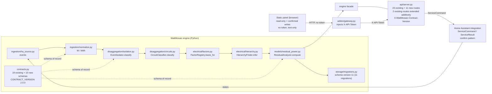

# 09 — API and Data Contracts

> **SPEC_STATUS: APPROVED_FOR_IMPLEMENTATION** — Normative. **Contract version:** `2.1.0` (`engine/wattmosaic_engine/contracts.py:32`).
> **Purpose:** this document pins every name, shape, unit, nullability, version and error semantic that crosses a module boundary, so that builders working in parallel emit byte-compatible payloads instead of inventing their own.

## How to read this document

- **Rule.** A **Normative** callout, a table column marked `REQUIRED` / `OPTIONAL` / `DEPRECATED`, and a bold `**Rule.**` paragraph are binding. Everything else is explanatory.
- Claims about what the code does **today** cite `file:line`. Everything without a citation is a specification of what must be built.
- **Gap IDs here are locally scoped** (`G-API-01`, `G-API-02`, …). They are **registered** in the canonical gap register at `00-project-overview.md` §13.2, which is the register of record and the single source of truth for gap identifiers; a locally-scoped ID is valid only together with its entry there. The local namespace is used because `03-…` already collided on `G21`–`G24`, so this document does not mint `G2x` IDs (§14.2).
- **Open decisions** continue the numbering of `00-…` (`OD-01`…`OD-08`) and `03-…` (`OD-03.1`…`OD-03.4`); this document's own decisions occupy the **`OD-74`–`OD-80`** band allocated to it by the canonical register in `13-open-decisions-and-assumptions.md` §5.2 (§14.1).
- Field names for the **19 existing exported schema models** are fixed by the generated JSON Schema, not by this document (§4.0). The **10 new contracts** in §7 are specified field-by-field here and become fixed once exported (§7.0).

---

## 1. Contract principles

| ID | Principle | Rule |
|---|---|---|
| P-01 | **Additive only** | Within a major contract version, fields are only added and only made optional. No field is removed, renamed, re-typed, re-scoped or re-unit-ed. |
| P-02 | **Strict at the boundary** | Every request and ingested model derives from the base `Model` with `extra="forbid"` (`engine/wattmosaic_engine/contracts.py:464-465`). Unknown fields are rejected, not ignored. |
| P-03 | **Enums serialise as values** | `use_enum_values=True` (`contracts.py:465`): a serialised enum is its *value* string, never its Python member name. |
| P-04 | **Units are declared** | Every physical quantity carries its unit in the field name or in the units registry (§5). A unit is never inferred and never converted implicitly across domains. |
| P-05 | **`None` means absent** | `None` is never coerced to `0`, `0.0`, `False`, `""` or an empty list. "Missing is never zero" applies to power, energy, confidence and counts alike. |
| P-06 | **Provenance is explicit** | Every energy figure carries one of `MEASURED` / `ESTIMATED` / `ALLOCATED` / `UNKNOWN` via `MeasurementBasis` (`contracts.py:186`). An estimated or allocated figure is never presented as a direct measurement. |
| P-07 | **Confidence is multidimensional** | `ConfidenceVector` (`contracts.py:476`) carries one entry per `ConfidenceDimension` (`contracts.py:214`). The engine never blends dimensions into a scalar; consumers render dimensions separately. |
| P-08 | **Timestamps carry their clock** | Every timestamp is UTC and identifies which of the three clocks produced it (§6). |
| P-09 | **Unknown enum values are tolerated** | Adding an enum member is an additive change. A consumer must accept a member it does not know and take the conservative branch; it must never raise, never default to a numeric zero. |
| P-10 | **One source of truth per schema** | The exported JSON Schema *is* the field-level contract (§4.0). Prose tables in this document are summaries; on conflict the exported schema wins and this document is amended in the same change. |
| P-11 | **The change protocol is mandatory** | Every contract change follows bump → regenerate → document → test (`docs/interface_contracts.md:195-200`), and the CI schema-drift gate (`.github/workflows/ci.yml:26-29`) must stay green. |
| P-12 | **One major version per breaking set** | A breaking change requires a major bump of `CONTRACT_VERSION` (`contracts.py:32`) **and** a migration path (§10.4). |

**Rule.** The engine never reads the HA registry; the integration never computes power (§2.1).

---

## 2. The module boundary map

### 2.1 Dependency direction

The engine depends **downward** only (`docs/architecture.md:78-82`): modules below may be replaced, modules above may not be re-implemented by them. The engine never reads the HA registry; the HA integration never computes power.

### 2.2 Boundary table

| # | Boundary | Owner package | Existing interface (verified) | Direction | Frozen |
|---|---|---|---|---|---|
| B-01 | HA states → events | `ingestion/ha_source.py` | event identity built with `uuid.uuid4()` (`ingestion/ha_source.py:1186`) | HA → engine | **No** — see `OD-03.1` (§14.1) |
| B-02 | raw → normalised sample | `ingestion/normalize.py` | unit normalisation (`ingestion/normalize.py:20-21, 41-64`) | downward | **No** (internal) |
| B-03 | event ↔ observation | `disaggregation/association.py` | `Observation` (`disaggregation/association.py:344`), `AssociationFinder.observe` (`disaggregation/association.py:584`) | downward | **Yes** (§3) |
| B-04 | event → isolation | `disaggregation/isolation.py` | `EventIsolator.classify` (`disaggregation/isolation.py:619`); fallback id `device@timestamp` (`disaggregation/isolation.py:356-369`) | downward | **Yes** (§3) |
| B-05 | events → circuits | `disaggregation/circuits.py` | `CircuitClassifier.classify` (`disaggregation/circuits.py:511`) | downward | **Yes** (§3) |
| B-06 | circuit → measurement basis | `electrical/factors.py` | `FactorRegistry.basis_for` (`electrical/factors.py:621`) | downward | **Yes** (§3) |
| B-07 | circuits → hierarchy | `electrical/hierarchy.py` | `HierarchyFinder.infer` (`electrical/hierarchy.py:568`) | downward | **Yes** (§3) |
| B-08 | equations → identifiability | `electrical/solver.py` | `Identifiability` (`electrical/solver.py:60`) | downward | No (internal) |
| B-09 | inference → residual | `models/residual_power.py` | `ResidualAnalyzer.compute` (`models/residual_power.py:374`), `ResidualDecomposition` (`models/residual_power.py:925`), `ResidualScope` (`models/residual_power.py:195`) | downward | **Yes** (§3) |
| B-10 | engine → schema | `engine/wattmosaic_engine/contracts.py` | 19 exported models (`tools/dev/export_schemas.py:26-46`); base `Model` (`contracts.py:464-465`) | downward | **Yes** (§4) |
| B-11 | engine → HTTP | `api/server.py` | `API_PREFIX` (`api/server.py:57`), 23 registered routes (`api/server.py:760-784`) | engine → HTTP | Additive only (§10) |
| B-12 | engine ↔ HA services | `custom_components/wattmosaic/` | `ServiceCommand` / `ServiceResult` (`contracts.py:1795, :1820`); confirm pattern (`custom_components/wattmosaic/const.py:257-297`, `service_logic.py:234-297`) | engine → HA | **Yes** (§8.2) |
| B-13 | browser → gateway → engine | `addon/gateway.py` | token injection (`addon/gateway.py:56,79,385,398,488,573`; `addon/run.sh:246-252`) | browser → engine | **Yes** (§12) |
| B-14 | engine → storage | `storage/migrations.py` | the current schema version (11 migrations), computed from the migrations tuple (`storage/migrations.py:792`); `topology_versions` is an opaque payload table (`storage/migrations.py:308-316`); `AUDIT_TABLES` exemption (`storage/migrations.py:118-121`) | engine → storage | No (internal) |
| B-15 | engine → audit | `disaggregation/audit.py` | `WM_AUDIT_ALGORITHM_VERSION`, default `disagg@2.0` (`config/settings.py:220,313-318`; `disaggregation/audit.py:81`) | downward | No (internal) |

---

## 3. The six frozen internal interfaces

**Rule.** The literal signatures are frozen at `docs/implementation_plan_v2.md:312-322`. The table below fixes the **type contract** of each interface. Changing the input type, the output type, or the refusal behaviour of any of them is a breaking change and requires a contract-version bump (§10.4). No caller may bypass an interface by calling a deeper module directly.

**Rule.** The **literal** call signature of each interface is the one recorded in `docs/implementation_plan_v2.md:312-322`, and that text is authoritative. The table below restates each interface's **name**, its **implementation location**, its **input type**, its **output type** and its **refusal behaviour**; it does not replace the frozen signature text. A builder who needs the exact parameter list reads `docs/implementation_plan_v2.md:312-322` and does not infer it from this table.

| # | Interface (verified location) | Input type | Output type | Refusal / error behaviour |
|---|---|---|---|---|
| F-01 | `EventIsolator.classify` (`disaggregation/isolation.py:619`) | a device event plus its observations | `EventIsolation` (`contracts.py:987`), carrying `IsolationStatus` (`contracts.py:307`) | must never raise on a malformed or unclassifiable event; returns an isolation result with an explicit status and `None` for every quantity it could not establish. |
| F-02 | `FactorRegistry.basis_for` (`electrical/factors.py:621`) | a circuit/branch request | `MeasurementBasis` (`contracts.py:186`) + factor magnitudes | must return an explicit basis for every factor; a factor with no defensible basis returns `UNKNOWN` and a `None` magnitude — never `0` and never a default `MEASURED`. |
| F-03 | `AssociationFinder.observe` (`disaggregation/association.py:584`) | an observation from the event stream | `Observation` (`disaggregation/association.py:344`) | must be side-effect free and order-independent; an unusable observation is rejected with `SampleRejection` (`contracts.py:109`), never coerced to zero. |
| F-04 | `CircuitClassifier.classify` (`disaggregation/circuits.py:511`) | isolated events / observations | `Circuit` (`contracts.py:686`) with `CircuitClass` (`contracts.py:158`) | must return a class for every input; an inconclusive classification returns the neutral class with `MeasurementBasis` = `UNKNOWN` and `None` measurements. |
| F-05 | `ResidualAnalyzer.compute` (`models/residual_power.py:374`) | a window of samples | `ResidualDecomposition` (`models/residual_power.py:925`) scoped by `ResidualScope` (`models/residual_power.py:195`) | must decompose into baseline / dynamic / noise; if any component is undeterminable the component is `None` and the decomposition is marked incomplete — components are never forced to sum to the total by construction. |
| F-06 | `HierarchyFinder.infer` (`electrical/hierarchy.py:568`) | classified circuits and their relations | hierarchy of `TopologyRelation` (`contracts.py:762`) with `RelationKind` (`contracts.py:254`) | must not create a relation it cannot support; unsupported relations are emitted as candidates with an explicit basis, and `None` fields where a fact is unknown. |

**Rule.** These six interfaces are the *only* sanctioned seams between the disaggregation modules. New cross-module data must be added as a new frozen interface with a contract-version bump, not by widening an existing one.

---

## 4. The shared value objects

### 4.0 Where the field-level truth lives

**Rule.** The 19 exported schema models (`tools/dev/export_schemas.py:26-46`) are serialised with `model.model_json_schema(mode="serialization")`, carry `$id = "https://wattmosaic.local/schemas/<name>.json"` and an `x-contract-version`; `data/schemas/index.json` carries `{contract_version, schemas}` = `2.0.0`. **That exported JSON Schema is the authoritative field-level definition** of every existing model: it fixes each field's exact name, type, default, nullability and enum members. The tables in §4.1–§4.5 fix the *semantics*, *invariants* and *cross-module usage* and must never contradict the exported schema.

**Rule.** Everything in §4 is **normative** for semantics, nullability and cross-module use. The field-level names, types and defaults are the ones in the exported JSON Schema; a builder implementing against §4 uses the exported schema for field names and this document for meaning. Neither may change without the change protocol in §1 P-11.

**Rule.** `None` semantics, uniform across every model in §4: a `null` field means **absent / not determined**. It never means zero, never means "empty", never means "the same as the last value" and never means "defaulted". A consumer that receives `null` MUST render it as unknown and MUST NOT substitute a numeric zero (P-05). A field that is absent from a response is treated exactly like a `null` field.

**Rule.** Unit and nullability for existing models are those declared in the exported schema; §5 (units) and §6 (timestamps) apply to them unchanged. Where a model carries a power quantity the unit is **W**; where it carries an energy total the unit is **kWh**.

### 4.1 Measurement and channel primitives

| Model (`contracts.py` line) | Semantics fixed here | Invariants |
|---|---|---|
| `Measurement` (`:1062`) | one normalised power sample | power is **W** (§5); carries `Source` (`:62`), `QualityStatus` (`:76`), `MeasurementBasis` (`:186`); a rejected sample is marked with `SampleRejection` (`:109`) and carries `None` values, never `0` |
| `CTChannel` (`:1116`) | one current-transformer channel | carries `CTType` (`:44`), `Phase` (`:50`), `Polarity` (`:57`), `MonitoringLevel` (`:351`); a channel that is not monitored carries `None` for its contribution, not `0` |
| `MeasurementFactor` (`:585`) | a factor applied to a channel | carries its basis; a factor with basis `UNKNOWN` has a `None` magnitude |
| `HaEntityBinding` (`:660`) | binding of a HA entity to a device/channel | carries `HaConnectivity` (`:339`); a binding whose connectivity is not `CONNECTED` never yields a `MEASURED` basis |

### 4.2 Topology primitives

| Model (`contracts.py` line) | Semantics fixed here | Invariants |
|---|---|---|
| `Topology` (`:1216`) | the current topology aggregate | carries `TopologyStatus` (`:84`) and `DeviceTopology` (`:1199`) entries |
| `DeviceTopology` (`:1199`) | one device's position in the topology | carries `MonitoringLevel` (`:351`); an unmonitored device has `None` contribution fields |
| `TopologyRelation` (`:762`) | one edge between two endpoints | carries `RelationKind` (`:254`); a relation whose kind is unknown is reported with basis `UNKNOWN` |
| `Circuit` (`:686`) | one electrical branch | carries `CircuitClass` (`:158`), `Phase` (`:50`), `Polarity` (`:57`); the branch total is `None` when it is not observed directly |

**Rule.** The current `Topology` aggregate is **not** diffable and **not** rollbackable today (`topology_versions` is an opaque payload table, `storage/migrations.py:308-316`). `TopologyEdge` (§7.1) and `TopologyVersion` (§7.2) are the new diffable/rollbackable contracts; the legacy aggregate keeps working unchanged.

### 4.3 Inference and residual primitives

| Model (`contracts.py` line) | Semantics fixed here | Invariants |
|---|---|---|
| `InferenceResult` (`:1642`) | one device's disaggregated result | carries `ModelType` (`:90`), `ModelStatus` (`:100`), `StageStatus` (`:123`), `InferenceRecord` (`:870`), `DeviceModelVersion` (`:1599`), `ConfidenceVector` (`:476`) |
| `DeviceModelVersion` (`:1599`) | the model version that produced an inference | the version string is opaque and compared by equality only |
| `ResidualPower` (`:529`) | an unexplained power quantity | carries `ResidualKind` (`:238`) and a `ConfidenceVector`; the value is **W**; an unquantified residual is `None` |
| `ConfidenceVector` (`:476`) | multidimensional confidence | one entry per `ConfidenceDimension` (`:214`); **never blended** by the engine; a dimension the engine could not evaluate is absent/unset, never `0.0` |
| `ConfidenceTier` (`:423`) | a discrete confidence band | a *presentation* projection of the vector, never a substitute for it |

### 4.4 Event, status and enums

| Enum (`contracts.py` line) | Members / use |
|---|---|
| `Source` (`:62`) | provenance of a measurement — a measurement's origin, not a confidence |
| `QualityStatus` (`:76`) | quality of a sample or window; travels with every rendered value (§12) |
| `TopologyStatus` (`:84`) | lifecycle state of a topology aggregate |
| `ModelType` (`:90`) | kind of inference model |
| `ModelStatus` (`:100`) | lifecycle of a model |
| `SampleRejection` (`:109`) | why a sample was rejected; a rejected sample is dropped, not zeroed |
| `StageStatus` (`:123`) | per-stage outcome of a pipeline run |
| `CircuitClass` (`:158`) | classification of a branch |
| `MeasurementBasis` (`:186`) | `MEASURED` / `ESTIMATED` / `ALLOCATED` / `UNKNOWN` — carried explicitly on every energy figure |
| `ConfidenceDimension` (`:214`) | the dimensions of a `ConfidenceVector` |
| `ResidualKind` (`:238`) | kind of residual |
| `RelationKind` (`:254`) | kind of topology relation |
| `IsolationStatus` (`:307`) | outcome of event isolation |
| `HaConnectivity` (`:339`) | connectivity of a HA entity |
| `MonitoringLevel` (`:351`) | how well a device or channel is monitored |
| `Phase` (`:50`), `Polarity` (`:57`), `CTType` (`:44`) | electrical attributes of a channel/branch |

### 4.5 Mandatory field groups

**Rule.** For every shared model the **exact field names and types** are those of the exported JSON Schema (§4.0). The table below pins, per model, the **mandatory field groups** a consumer may rely on, together with the unit, nullability, default and `None` semantics that apply to each group. A group whose slot is absent in a given instance is treated as `null` (§4.0).

| Model | Mandatory field group | Unit | Nullability | Default | `None` means |
|---|---|---|---|---|---|
| `Measurement` (`:1062`) | the power value | **W** | `REQUIRED` | — | never null in a valid sample |
| | the measurement instant | — | `REQUIRED` | — | never null |
| | provenance (`Source`, `:62`) | — | `REQUIRED` | — | never null |
| | quality (`QualityStatus`, `:76`) | — | `REQUIRED` | — | never null |
| | basis (`MeasurementBasis`, `:186`) | — | `REQUIRED` | — | never null |
| | rejection reason (`SampleRejection`, `:109`) | — | `OPTIONAL` | absent | the sample was not rejected |
| | the measured value of a rejected sample | **W** | `OPTIONAL` | absent | the value was not established — **not** `0` |
| `CTChannel` (`:1116`) | channel type (`CTType`, `:44`), phase (`Phase`, `:50`), polarity (`Polarity`, `:57`) | — | `REQUIRED` | — | never null |
| | monitoring level (`MonitoringLevel`, `:351`) | — | `REQUIRED` | — | never null |
| | the channel's contribution | **W** | `OPTIONAL` | absent | the channel is not observed |
| `Topology` (`:1216`) | topology status (`TopologyStatus`, `:84`) | — | `REQUIRED` | — | never null |
| | device entries (`DeviceTopology`, `:1199`) | — | `REQUIRED` | `[]` | empty is a legitimate value; it is not "unknown" |
| `DeviceTopology` (`:1199`) | device id | — | `REQUIRED` | — | never null |
| | monitoring level (`MonitoringLevel`, `:351`) | — | `REQUIRED` | — | never null |
| | the device's contribution | **W** | `OPTIONAL` | absent | the device is not observed |
| `TopologyRelation` (`:762`) | relation kind (`RelationKind`, `:254`) | — | `REQUIRED` | — | never null |
| | the relation's basis | — | `REQUIRED` | — | never null |
| `Circuit` (`:686`) | circuit class (`CircuitClass`, `:158`), phase, polarity | — | `REQUIRED` | — | never null |
| | the branch total | **W** | `OPTIONAL` | absent | the branch is not observed directly |
| `DeviceEvent` (`:1547`) | isolation status (`IsolationStatus`, `:307`) | — | `REQUIRED` | — | never null |
| | connectivity (`HaConnectivity`, `:339`) | — | `REQUIRED` | — | never null |
| | isolation detail (`EventIsolation`, `:987`) | — | `REQUIRED` | — | never null |
| | confidence (`ConfidenceVector`, `:476`) | unitless | `REQUIRED` | — | never null; individual dimensions may be unset |
| `InferenceResult` (`:1642`) | model type (`:90`), model status (`:100`), stage status (`:123`) | — | `REQUIRED` | — | never null |
| | the inferred value | **W** | `OPTIONAL` | absent | no inference was produced |
| | the inference record (`InferenceRecord`, `:870`) | — | `REQUIRED` | — | never null |
| | the model version (`DeviceModelVersion`, `:1599`) | — | `REQUIRED` | — | never null |
| | confidence (`ConfidenceVector`, `:476`) | unitless | `REQUIRED` | — | never null |
| `Reconciliation` (`:1685`) | the predicted total | **W** | `OPTIONAL` | absent | that side was not predicted |
| | the measured total | **W** | `OPTIONAL` | absent | that side was not measured — **not** `0` |
| | the basis of each side | — | `REQUIRED` | `UNKNOWN` | never null |
| `ResidualPower` (`:529`) | the residual value | **W** | `OPTIONAL` | absent | the residual was not quantified |
| | the residual kind (`ResidualKind`, `:238`) | — | `REQUIRED` | — | never null |
| | confidence (`ConfidenceVector`, `:476`) | unitless | `REQUIRED` | — | never null |
| `ConfidenceVector` (`:476`) | one entry per `ConfidenceDimension` (`:214`) | unitless `0.0`–`1.0` | `REQUIRED` per dimension | absent | that dimension was not evaluated — **not** `0.0` |
| `ConfidenceTier` (`:423`) | the tier and its basis | — | `REQUIRED` | — | never null |
| `DeviceModelVersion` (`:1599`) | the version string | — | `REQUIRED` | — | never null; compared by equality only |
| `MeasurementFactor` (`:585`) | the factor magnitude | unitless or **W** | `OPTIONAL` | absent | the factor was not established — **not** `0` |
| | the factor's basis | — | `REQUIRED` | `UNKNOWN` | never null |
| `HaEntityBinding` (`:660`) | the bound entity id and its connectivity (`HaConnectivity`, `:339`) | — | `REQUIRED` | — | never null |
| `ErrorResponse` (`:1789`) | `error`, `detail`, `retryable` | — | `REQUIRED` | — | never null; shape fixed by §9 |
| `ServiceCommand` (`:1795`) | the command name | — | `REQUIRED` | — | never null |
| | the confirmation flag | — | `REQUIRED` for destructive commands | — | never null for a destructive command |
| `ServiceResult` (`:1820`) | the command's correlation id and the outcome | — | `REQUIRED` | — | never null |
| `HealthResponse` (`:1760`) | the contract version | — | `REQUIRED` | — | never null |

### 4.6 Operational notes on the primitives in §4.5

- `DeviceEvent` (`:1547`) — one observed state change; its isolation, connectivity and confidence fields are the output of `EventIsolator.classify` (§3 F-01) and are never recomputed by a consumer.
- `Reconciliation` (`:1685`) — carries an **explicit basis per side**; a side that was not measured is `None`, never `0`; a reconciliation with a `None` side is incomplete, not balanced.
- `ErrorResponse` (`:1789`) — the API error body; shape and status mapping fixed by §9.
- `ServiceCommand` (`:1795`) / `ServiceResult` (`:1820`) — the command/result pair of the HA integration; **destructive services require `confirm: true`** (`custom_components/wattmosaic/const.py:257-297`; `service_logic.py:234-297`); the same requirement governs the two state-changing endpoints in §8.2. A `ServiceResult` never carries an *engine* outcome — engine outcomes use the §8 response envelope.
- `HealthResponse` (`:1760`) — the liveness payload; carries the contract version and is callable without a token.

**Rule.** `Source` (`:62`), `QualityStatus` (`:76`), `MeasurementBasis` (`:186`), `RelationKind` (`:254`), `IsolationStatus` (`:307`), `CircuitClass` (`:158`), `MonitoringLevel` (`:351`), `Phase` (`:50`), `Polarity` (`:57`), `CTType` (`:44`), `ModelType` (`:90`) are **existing enums and are not re-declared here**. Their member sets are fixed by the exported JSON Schema. This document adds new members to **none** of them; where a new lifecycle is needed (edges, unknown-load profiles, mapping cells, configuration changes) a **new** enum is declared in §7 instead, so that no existing member's meaning can shift.

---

## 5. Units registry

**Rule.** A unit is never inferred from a field name, never carried implicitly in a payload, and never converted implicitly across domains. A quantity that appears without a unit from this registry is a contract error.

| Quantity | Unit | Allowed values | Where it lives | Notes |
|---|---|---|---|---|
| Power | `W` | any finite float ≥ 0 | `Measurement`, `ResidualPower`, `InferenceResult`, `ResidualDecompositionRecord`, `DeviceReaderMappingCell`, `UnknownLoadProfile` | the only power unit in the system |
| Energy | `kWh` | any finite float ≥ 0 | aggregate/rollup fields where an interval total is reported | the only energy unit in the system |
| Ratio / fraction | unitless | `0.0`–`1.0` inclusive | `ConfidenceVector` entries, `QualityStatus`-derived scores, profile signatures | never converted to a percentage in the contract; a UI may format it |
| Duration | `s` | integer ≥ 0 | window lengths, timeouts | not a stored payload field |
| Timestamp | ISO-8601 UTC, `Z` suffix | — | every timestamp field (§6) | never a local time, never a unix epoch integer |
| Count | unitless integer | ≥ 0 | `evidence_count`, `event_count`, `row_count`, `pending_queue_depth` | `0` means "counted, none found", never "unknown" |
| Size | bytes | integer ≥ 0 | `db_size_bytes`, `wal_size_bytes`, `size_bytes` | — |

**Rule.** Only **W** and **kWh** exist as measurements. There is no V, A, VA, kW or kVA field in any contract; a current transformer is reported as the **power in W** it implies, never as a current.

**Rule.** A payload carrying a unit outside this registry is **rejected, never converted**. At the API boundary this is `bad_request` (400, `retryable: false`); at the ingestion boundary the sample is rejected at the normalisation step (`ingestion/normalize.py:48`) and recorded with `SampleRejection` (`contracts.py:109`). A rejected sample never enters the pipeline as `0 W`.

---

## 6. Timestamp registry

The three timestamps are those fixed by `docs/data_flow.md:59-63`; this document names them `timestamp`, `last_updated` and `recorded_at` and requires every contract field to use exactly one of them.

| Timestamp | Clock | Nullability | Meaning | Carried by |
|---|---|---|---|---|
| `timestamp` | meter / CT device clock | `REQUIRED` on a measurement, `OPTIONAL` elsewhere | the instant the energy was measured | `Measurement` and the measurements inside a `ResidualDecompositionRecord` window |
| `last_updated` | HA server clock | `REQUIRED` on an event | the instant of the HA state change | `DeviceEvent`, `EventEvidenceRecord.observed_at`, `ConfigurationChangeEvent.occurred_at` |
| `recorded_at` | engine clock | `REQUIRED` | the instant the engine persisted the record | every persisted contract (§7) |

**Rule.** These are the **only three clocks**. A contract MUST NOT introduce a fourth clock.

**Rule.** Every other timestamp field in this document is a **derived name** for one of the three, and MUST carry the clock of its source:

| Derived field name | Clock | Source |
|---|---|---|
| `created_at`, `updated_at`, `recorded_at` | engine | the engine's own write |
| `generated_at`, `computed_at` | engine | the engine's own computation |
| `valid_from`, `valid_until` | engine | engine-issued validity range (§11) |
| `first_seen_at`, `last_seen_at` | engine | engine-observed presence |
| `last_validated_at`, `last_prune_at`, `oldest_at`, `newest_at` | engine | engine-observed maintenance or storage extents |
| `window_start`, `window_end` | engine | the engine's own window bounds |
| `observed_at` | HA `last_updated` | the HA state change |
| `occurred_at` | HA `last_updated` | the HA state change |

**Rule.** Ordering: `timestamp <= recorded_at` and `last_updated <= recorded_at` for every ingested record. Records are ordered by `timestamp` first, then `last_updated`, then `recorded_at`. A record whose `timestamp` is in the future relative to `recorded_at` is rejected (`SampleRejection`, `contracts.py:109`).

**Rule.** Derived validity ranges (`valid_from`, `valid_until`, §11) use the **engine** clock and are half-open: `valid_from <= t < valid_until`.

---

## 7. The ten new contracts

### 7.0 Definition, export and versioning rules

**Rule.** All ten contracts are defined in `engine/wattmosaic_engine/contracts.py` — the same module as the 19 existing schema models — so they inherit `extra="forbid"` and `use_enum_values=True` from the base `Model` (`contracts.py:464-465`).

**Rule.** Each of the ten contracts MUST be added to the `MODELS` list in `tools/dev/export_schemas.py` (`:26-46`) and exported. Export produces `data/schemas/<name>.json` with `$id = "https://wattmosaic.local/schemas/<name>.json"` and `x-contract-version`, and regenerates `data/schemas/index.json` (`{contract_version, schemas}`). The CI schema-drift gate (`.github/workflows/ci.yml:26-29`) must stay green.

**Rule.** The ten exported schema models are exactly: `TopologyEdge` (§7.1), `TopologyVersion` (§7.2), `ResidualDecompositionRecord` (§7.3), `UnknownLoadProfile` (§7.4), `DeviceReaderMappingCell` (§7.5), `ConfigurationChangeEvent` (§7.6), `EventEvidenceRecord` (§7.7), `StorageHealthReport` (§7.8), `UnknownResidualEvent` (§7.9) and `ResidualBaselineChange` (§7.10).

**Rule.** The ten **response/request shapes** of §8 — `TopologyDiff`, `MappingView`, `MappingRollup`, `IdentifiabilityView`, `StorageTierRow`, `QueueDepthRow`, `TopologyRollbackRequest`, `TopologyRollbackResult`, `EventReplayRequest`, `EventReplayResult` — are **response-only**. They are **not** schema models: they are not defined in `contracts.py`, they are **not** added to the `MODELS` list in `tools/dev/export_schemas.py`, and they produce **no** `data/schemas/<name>.json` file. They are defined in the API layer — in `engine/wattmosaic_engine/api/schemas.py` (new) for the request bodies, and in the route handlers of `engine/wattmosaic_engine/api/server.py` for the response shapes that are assembled from §7 contracts. A response-only shape that a client must **send** (`TopologyRollbackRequest`, `EventReplayRequest`) is still validated with `extra="forbid"` and the same error model as a §7 contract (P-02, §9).

**Rule.** The split is by **direction of use**, not by importance: a shape is a schema model exactly when it is a persisted or engine-owned object that the exported JSON Schema is the field-level contract for (§4.0, P-10); it is response-only exactly when it is a projection or a transport envelope assembled at the API boundary from §7 models.

**Rule.** All ten ship as part of the `2.0.0` series (`contracts.py:32`) because each is purely additive (P-01); none of them changes an existing field, enum member or route. The minor bump to `2.1.0` happens at the release boundary chosen by the orchestrator — that cadence is an open decision (`OD-74`, §14.1). Until it is resolved, the assumption is: the schemas are exported and the contract version reads `2.0.0` at merge time, and the minor bump is applied at the release.

**Rule.** In every table below, `Null` = may the field be `null`; `Default` = value used when the field is absent from a request. `None` always means *absent*, never zero.

### 7.1 `TopologyEdge`

A directed, time-scoped edge between two device/channel endpoints. Edge lifecycle is `EdgeLifecycle`.

`EdgeLifecycle` (**new enum**, `OPTIONAL` unknown-member tolerance per P-09): `CANDIDATE`, `PROVISIONAL`, `CONFIRMED`, `SUSPECTED_CHANGE`, `UNDER_REVIEW`, `CONFLICTED`, `REJECTED`, `RETIRED`.

| Field | Type | Unit | Null | Default | Required | Notes |
|---|---|---|---|---|---|---|
| `edge_id` | `str` | — | no | — | `REQUIRED` | opaque, stable, deterministic: `edge-<sha1(from_device_id + from_channel_id + to_device_id + to_channel_id + valid_from)>`; never reused after `RETIRED` |
| `from_device_id` | `str` | — | no | — | `REQUIRED` | |
| `from_channel_id` | `str` | — | **yes** | `None` | `REQUIRED` | `None` = device-level edge (no channel) |
| `to_device_id` | `str` | — | no | — | `REQUIRED` | |
| `to_channel_id` | `str` | — | **yes** | `None` | `REQUIRED` | `None` = device-level edge |
| `relation_kind` | `RelationKind` (`contracts.py:254`) | — | no | — | `REQUIRED` | reuse the existing enum; no new member is minted here |
| `circuit_id` | `str` | — | **yes** | `None` | `REQUIRED` | `None` = edge not yet bound to a `Circuit` (`:686`) |
| `lifecycle` | `EdgeLifecycle` | — | no | `CANDIDATE` | `REQUIRED` | |
| `confidence` | `ConfidenceVector` (`contracts.py:476`) | unitless, per dimension | no | — | `REQUIRED` | per-edge vector; dimensions are never blended; an unevaluated dimension is left unset, never `0.0` |
| `basis` | `MeasurementBasis` (`contracts.py:186`) | — | no | `UNKNOWN` | `REQUIRED` | `MEASURED` only when directly observed |
| `valid_from` | `datetime` (UTC) | — | no | — | `REQUIRED` | engine clock |
| `valid_until` | `datetime` (UTC) | — | **yes** | `None` | `REQUIRED` | `None` = still current |
| `evidence_count` | `int` | count | no | `0` | `REQUIRED` | number of supporting observations |
| `last_validated_at` | `datetime` (UTC) | — | **yes** | `None` | `REQUIRED` | `None` = never validated |
| `created_at` | `datetime` (UTC) | — | no | — | `REQUIRED` | |
| `updated_at` | `datetime` (UTC) | — | no | — | `REQUIRED` | |
| `version` | `int` | — | no | `1` | `REQUIRED` | row version for optimistic concurrency; increments on every update |

**Rule.** `valid_until` is `None` **only** while `lifecycle` ∈ {`CANDIDATE`, `PROVISIONAL`, `CONFIRMED`, `SUSPECTED_CHANGE`, `UNDER_REVIEW`, `CONFLICTED`}. `REJECTED` and `RETIRED` edges must carry a `valid_until`.

### 7.2 `TopologyVersion`

A diffable, rollbackable snapshot of the edge set.

| Field | Type | Unit | Null | Default | Required | Notes |
|---|---|---|---|---|---|---|
| `version_id` | `str` | — | no | — | `REQUIRED` | opaque `tv-<zero-padded sequence>`; never reused |
| `version_number` | `int` | — | no | — | `REQUIRED` | monotonically increasing per topology; never reused after rollback |
| `parent_version_id` | `str` | — | **yes** | `None` | `REQUIRED` | `None` = the first version |
| `edge_ids` | `list[str]` | — | no | `[]` | `REQUIRED` | the complete edge set of this version, ordered by `edge_id` |
| `edge_count` | `int` | count | no | `0` | `REQUIRED` | redundant with `edge_ids` for cheap display |
| `status` | `TopologyStatus` (`contracts.py:84`) | — | no | the default used by `Topology` (`contracts.py:1216`) | `REQUIRED` | copy that default verbatim; no new status member is minted here |
| `created_at` | `datetime` (UTC) | — | no | — | `REQUIRED` | engine clock |
| `created_by` | `str` | — | no | — | `REQUIRED` | one of `scheduler`, `ha_service`, `user`, `replay` |
| `change_event_id` | `str` | — | **yes** | `None` | `REQUIRED` | link to `ConfigurationChangeEvent.change_id` (§7.6) |
| `rollback_of` | `str` | — | **yes** | `None` | `REQUIRED` | the version that this version superseded via rollback; `None` = normal creation |
| `summary` | `str` | — | no | `""` | `REQUIRED` | human text, never parsed |

**Rule.** Rollback is **append-only**: a rollback creates a *new* `TopologyVersion` whose `parent_version_id` is the version rolled back to and whose `rollback_of` names the version it replaces (`OD-76`, §14.1). History is never destroyed or rewritten.

### 7.3 `ResidualDecompositionRecord`

The three components of an unexplained power window plus an unknown-event reference.

| Field | Type | Unit | Null | Default | Required | Notes |
|---|---|---|---|---|---|---|
| `record_id` | `str` | — | no | — | `REQUIRED` | opaque |
| `window_start` | `datetime` (UTC) | — | no | — | `REQUIRED` | engine clock; inclusive |
| `window_end` | `datetime` (UTC) | — | no | — | `REQUIRED` | engine clock; exclusive |
| `total_residual_w` | `float` | **W** | no | — | `REQUIRED` | total unexplained power over the window |
| `baseline_w` | `float` | **W** | **yes** | `None` | `REQUIRED` | `None` = no baseline model available |
| `dynamic_w` | `float` | **W** | **yes** | `None` | `REQUIRED` | `None` = dynamic component undeterminable |
| `noise_w` | `float` | **W** | **yes** | `None` | `REQUIRED` | `None` = noise component undeterminable |
| `is_complete` | `bool` | — | no | `False` | `REQUIRED` | `True` only when all three components are present |
| `unknown_event_id` | `str` | — | **yes** | `None` | `REQUIRED` | reference to the `UnknownResidualEvent.event_id` (§7.9) that explains the residual; `None` = not attributable |
| `decomposition` | `dict[str, Any]` — the **wire form** of `ResidualDecomposition` (`models/residual_power.py:925`) | W | no | — | `REQUIRED` | the computed decomposition as produced by `ResidualAnalyzer.compute` (§3 F-05), in the form the API serialises |
| `decomposition_scope` | `dict[str, Any]` — the **wire form** of `ResidualScope` (`models/residual_power.py:195`) | — | no | — | `REQUIRED` | the existing type's shape, in the form the API serialises |
| `kind` | `ResidualKind` (`contracts.py:238`) | — | no | — | `REQUIRED` | reuse the existing enum |
| `confidence` | `ConfidenceVector` (`contracts.py:476`) | unitless | no | — | `REQUIRED` | never blended |
| `basis` | `MeasurementBasis` (`contracts.py:186`) | — | no | `UNKNOWN` | `REQUIRED` | a residual is `ESTIMATED` unless directly measured |
| `quality` | `QualityStatus` (`contracts.py:76`) | — | no | — | `REQUIRED` | |
| `rejected_samples` | `int` | count | no | `0` | `REQUIRED` | samples dropped inside the window |
| `created_at` | `datetime` (UTC) | — | no | — | `REQUIRED` | |

**Rule.** When `is_complete` is `True`, `baseline_w + dynamic_w + noise_w` must equal `total_residual_w` within the engine's stated tolerance. When `is_complete` is `False`, the components are individually `None` where undeterminable and are **not** back-filled to force the identity.

#### 7.3.1 Deviation — `decomposition` and `decomposition_scope` carry the wire form, not the model dataclasses

**Deviation.** The two fields above are typed as the **wire form** (`dict[str, Any]`) rather than importing `ResidualDecomposition` (`models/residual_power.py:925`) and `ResidualScope` (`models/residual_power.py:195`) from the model layer, and **the exported JSON Schema is the authority** (`data/schemas/residual_decomposition_record.json`): both properties export as `{"type": "object", "additionalProperties": true}`.

**Rule.** The deviation is deliberate and has two causes, both of which are properties of the repository rather than of this contract:

1. **The contract layer must not import from the model layer.** `docs/architecture.md:78-84` fixes the dependency direction as strictly downward and states that "`contracts.py` imports nothing from the package" — "`storage` imports only `contracts`" — "to keep the schema stable and testable in isolation". Importing `models.residual_power` from `contracts.py` would invert that rule.
2. **The reverse edge is a circular import.** `models/__init__.py:21` imports `models.registry`, which imports `storage.database` (`models/registry.py:17`), which imports `contracts` (`storage/database.py:22`). A `contracts.py` → `models.residual_power` edge closes the cycle `contracts` → `models/__init__` → `models.registry` → `storage.database` → `contracts`, and the **storage layer stops being importable on its own**: `import wattmosaic_engine.storage` then raises `ImportError: cannot import name 'Database' from partially initialized module 'wattmosaic_engine.storage.database' (most likely due to a circular import)`, and so do `import wattmosaic_engine.storage.database` and `import wattmosaic_engine.storage.migrations`. That layer is the foundation of the engine: 39 test modules import `wattmosaic_engine.storage` (`tests/unit/test_contracts.py:48`, `tests/unit/test_migrations.py:60`, `tests/unit/test_learning.py:59`, `tests/unit/test_aggregation.py:34`, and 35 more) and 7 import `wattmosaic_engine.models` (`tests/unit/test_learning.py:56`, `tests/unit/test_residual_power.py:46`, `tests/unit/test_circuits.py:73`, and 4 more) — 39 in total, every one of them downstream of `storage.database`. The suite survives the cycle today only because collection happens to import a higher layer first; the storage layer's own entry point does not.

**Rule.** The source dataclasses stay where they are — `ResidualDecomposition` at `models/residual_power.py:925` and `ResidualScope` at `models/residual_power.py:195` — so the mapping is discoverable from either side. A producer that holds a `ResidualDecomposition` or a `ResidualScope` **serialises it** and puts the resulting mapping in these fields; the mapping is what the API serialises, and the exported schema for the record is generated from these two fields.

**Rule.** The wire form carries the fields of the source dataclasses as they are serialised. `decomposition` mirrors `ResidualDecomposition`: `timestamp`, `before_w`, `unexplained_w`, `explained_by_device_w`, `resolved`, `conflict`, `reason_code`, `detail`, `basis`, `quality_status` and `evidence`. `decomposition_scope` mirrors `ResidualScope`: `scope_id`, `ct_id`, `basis`, `multiplicity`, `is_nested_under`, `device_contributions`, `ct_ids`, `readings`, `contribution_bases`, `contribution_cts`, `conversions`, `explained_by_device_w`, `quality_status`, `window_w` and `unresolved_since`. The mapping is **not** validated field-by-field by this contract (`extra="forbid"` applies to the record's own fields, not to the contents of a free-form mapping); a producer that omits a key of the source dataclass produces a mapping that is missing it, and that is the producer's decision to make visible.

**Rule.** The deviation is **additive and reversible**: no field of the record is removed, renamed, re-typed or made mandatory by it, and a payload written before the change still validates. Narrowing the two fields to the model dataclasses is a **major** contract change (P-12) and requires the import cycle to be broken first — it is not a change this specification set makes.

### 7.4 `UnknownLoadProfile`

A recurring, un-attributed load signature with an explicit lifecycle.

`UnknownLoadLifecycle` (**new enum**): `OBSERVING`, `CHARACTERISED`, `CANDIDATE`, `RETIRED`.

**Rule.** This is the **only** lifecycle vocabulary for an unknown-load profile across the specification set. Its states, entry conditions and transitions are fixed by `05-residual-model-spec.md` §10.3 — the authority for this concept. There is no `CONFIRMED` state and no `MERGED` state: under the project owner's decision the system may **propose** a candidate name for an unknown load, and a proposed identity is never auto-confirmed. A profile that now has a confirmed device carries that device in `promoted_device_id`; the device is a **device**, not a profile state.

| Field | Type | Unit | Null | Default | Required | Notes |
|---|---|---|---|---|---|---|
| `profile_id` | `str` | — | no | — | `REQUIRED` | opaque `ulp-<n>`; never reused |
| `label` | `str` | — | no | `""` | `REQUIRED` | user-facing text; never parsed by the engine; a **proposed** name, never a confirmed one |
| `lifecycle` | `UnknownLoadLifecycle` | — | no | `OBSERVING` | `REQUIRED` | the four states above; the transitions are fixed by `05-…` §10.3 |
| `signature` | `list[float]` | unitless `0.0`–`1.0` | no | `[]` | `REQUIRED` | normalised daily profile; `[]` = no signature computed yet |
| `scope_id` | `str` | — | no | — | `REQUIRED` | the scope the pattern was observed on |
| `reader_id` | `str` | — | no | — | `REQUIRED` | the canonical `ct_id` of the Reader the pattern was observed on |
| `first_seen_at` | `datetime` (UTC) | — | no | — | `REQUIRED` | engine clock |
| `last_seen_at` | `datetime` (UTC) | — | no | — | `REQUIRED` | engine clock; `>= first_seen_at` |
| `event_count` | `int` | count | no | `0` | `REQUIRED` | the number of qualifying runs; `05-…` §10.1 `occurrences` |
| `mean_power_w` | `float` | **W** | **yes** | `None` | `REQUIRED` | `None` = not yet estimated |
| `peak_power_w` | `float` | **W** | **yes** | `None` | `REQUIRED` | `None` = not yet estimated |
| `median_duration_s` | `float` | **s** | **yes** | `None` | `REQUIRED` | median duration of a qualifying run; `None` = not yet measured |
| `retirement_horizon_s` | `float` | **s** | no | the configured horizon (default **30 days**, `05-…` `OD-43`) | `REQUIRED` | the configurable horizon after which an unobserved profile is retired |
| `promoted_device_id` | `str` | — | **yes** | `None` | `REQUIRED` | the device this profile was promoted to, if any; `None` = not promoted. A promoted identity is a **device reference**, never a lifecycle state |
| `requires_confirmation` | `bool` | — | no | `True` | `REQUIRED` | `True` while the profile is a proposal; never `False` before the association is confirmed |
| `confidence` | `ConfidenceVector` (`contracts.py:476`) | unitless | no | — | `REQUIRED` | never blended |
| `basis` | `MeasurementBasis` (`contracts.py:186`) | — | no | `UNKNOWN` | `REQUIRED` | a profile is never `DIRECT_MEASURED` |
| `evidence_event_ids` | `list[str]` | — | no | `[]` | `REQUIRED` | `UnknownResidualEvent.event_id` values (§7.9) |
| `created_at` | `datetime` (UTC) | — | no | — | `REQUIRED` | |
| `updated_at` | `datetime` (UTC) | — | no | — | `REQUIRED` | |
| `version` | `int` | — | no | `1` | `REQUIRED` | row version |

**Rule.** The profile is a **projection** over the residual evidence, never a replacement for it (`05-…` §10.1): the residual remains the authoritative total, and a profile is never presented as an identified device. A retired profile is retained, never deleted (`05-…` §10.3).

### 7.5 `DeviceReaderMappingCell`

One cell of the device ↔ reader mapping matrix: how much a reader contributes to a device.

`MappingObservability` (**new enum**): `DIRECT`, `DERIVED`, `INDIRECT`, `UNKNOWN`.
`MappingCellStatus` (**new enum**): `VALID`, `STALE`, `INVALID`, `UNKNOWN`.

| Field | Type | Unit | Null | Default | Required | Notes |
|---|---|---|---|---|---|---|
| `device_id` | `str` | — | no | — | `REQUIRED` | |
| `reader_id` | `str` | — | no | — | `REQUIRED` | the CT reader / channel identifier |
| `reader_configuration_version` | `str` | — | no | — | `REQUIRED` | §11 |
| `observability` | `MappingObservability` | — | no | `UNKNOWN` | `REQUIRED` | |
| `estimated_contribution_w` | `float` | **W** | **yes** | `None` | `REQUIRED` | `None` = not estimated |
| `min_contribution_w` | `float` | **W** | **yes** | `None` | `REQUIRED` | `None` = no lower bound established |
| `max_contribution_w` | `float` | **W** | **yes** | `None` | `REQUIRED` | `None` = no upper bound established |
| `confidence` | `ConfidenceVector` (`contracts.py:476`) | unitless | no | — | `REQUIRED` | per dimension; never blended |
| `evidence_count` | `int` | count | no | `0` | `REQUIRED` | |
| `last_validated_at` | `datetime` (UTC) | — | **yes** | `None` | `REQUIRED` | `None` = never validated |
| `version` | `int` | — | no | `1` | `REQUIRED` | row version; increments when the cell is recomputed |
| `status` | `MappingCellStatus` | — | no | `UNKNOWN` | `REQUIRED` | `STALE` when the cell's `reader_configuration_version` differs from the current one (§11) |
| `basis` | `MeasurementBasis` (`contracts.py:186`) | — | no | `UNKNOWN` | `REQUIRED` | |

**Rule.** When all three contribution fields are present, `min_contribution_w <= estimated_contribution_w <= max_contribution_w`. A cell with `observability = UNKNOWN` carries `None` for all three.

**Rule.** A cell's `status` is derived from its `reader_configuration_version` and its `last_validated_at`:
`VALID` when the cell's `reader_configuration_version` equals the current one (§11) **and** `last_validated_at` is not `None`; `STALE` when the versions differ; `INVALID` when the cell was invalidated by a `READER_REMOVAL` (§7.6); `UNKNOWN` before the cell has ever been validated.

### 7.6 `ConfigurationChangeEvent`

A recorded configuration change with its effect on the version identifiers.

`ConfigurationChangeKind` (**new enum**, exactly the nine kinds): `SMART_PLUG_RELOCATION`, `CT_READER_RELOCATION`, `READER_REPLACEMENT`, `CT_DIRECTION_CHANGE`, `CALIBRATION_CHANGE`, `CIRCUIT_RECONFIGURATION`, `READER_INSTALLATION`, `READER_REMOVAL`, `MEASUREMENT_SCOPE_CHANGE`.
`ChangeDetection` (**new enum**): `DECLARED`, `OBSERVED`, `INFERRED`.

| Field | Type | Unit | Null | Default | Required | Notes |
|---|---|---|---|---|---|---|
| `change_id` | `str` | — | no | — | `REQUIRED` | opaque `chg-<n>` |
| `kind` | `ConfigurationChangeKind` | — | no | — | `REQUIRED` | one of the nine kinds above |
| `detection` | `ChangeDetection` | — | no | `OBSERVED` | `REQUIRED` | how the change was learned |
| `occurred_at` | `datetime` (UTC) | — | no | — | `REQUIRED` | HA `last_updated` where known, else engine clock |
| `device_id` | `str` | — | **yes** | `None` | `REQUIRED` | `None` = change is not device-specific |
| `reader_id` | `str` | — | **yes** | `None` | `REQUIRED` | `None` = change is not reader-specific |
| `from_reader_id` | `str` | — | **yes** | `None` | `REQUIRED` | for relocation / replacement kinds |
| `to_reader_id` | `str` | — | **yes** | `None` | `REQUIRED` | for relocation / replacement kinds |
| `reader_configuration_version` | `str` | — | no | — | `REQUIRED` | §11; incremented by reader-side kinds |
| `device_mapping_version` | `str` | — | no | — | `REQUIRED` | §11; incremented by mapping-side kinds |
| `topology_version` | `str` | — | **yes** | `None` | `REQUIRED` | `None` = the change did not alter the topology |
| `reported_by` | `str` | — | no | — | `REQUIRED` | `ha`, `user`, `scheduler` |
| `notes` | `str` | — | **yes** | `None` | `REQUIRED` | free text, never parsed |
| `evidence_event_ids` | `list[str]` | — | no | `[]` | `REQUIRED` | `EventEvidenceRecord.event_id` values |
| `created_at` | `datetime` (UTC) | — | no | — | `REQUIRED` | |
| `superseded_by` | `str` | — | **yes** | `None` | `REQUIRED` | a later `change_id` that replaces this one |

**Rule.** A change of kind `READER_REMOVAL` must not delete history: the affected `DeviceReaderMappingCell` rows move to `status = INVALID` and are retained.

### 7.7 `EventEvidenceRecord`

An immutable, replay-sufficient record of one observed event.

| Field | Type | Unit | Null | Default | Required | Notes |
|---|---|---|---|---|---|---|
| `event_id` | `str` | — | no | — | `REQUIRED` | **identity is open as `OD-03.1`** (§14.1); the documented derivation is `sha1(entity_id + last_updated + new_state)` (`docs/data_flow.md:76-78`). The runtime `uuid.uuid4()` (`ingestion/ha_source.py:1186`) and the `device@timestamp` fallback (`disaggregation/isolation.py:356-369`) are **transient ids, not durable keys** |
| `entity_id` | `str` | — | no | — | `REQUIRED` | HA entity id |
| `device_id` | `str` | — | **yes** | `None` | `REQUIRED` | `None` = not bound to a device |
| `observed_at` | `datetime` (UTC) | — | no | — | `REQUIRED` | the HA `last_updated` of the state change |
| `recorded_at` | `datetime` (UTC) | — | no | — | `REQUIRED` | engine clock |
| `new_state` | `str` | — | **yes** | `None` | `REQUIRED` | |
| `old_state` | `str` | — | **yes** | `None` | `REQUIRED` | |
| `payload_hash` | `str` | — | no | — | `REQUIRED` | sha1 of the canonical payload; enables dedup without replaying the payload |
| `payload` | `dict` | — | **yes** | `None` | `REQUIRED` | raw (redacted) attribute snapshot; `None` = not retained |
| `attributes` | `dict[str, float]` | per the units registry (§5) | **yes** | `None` | `REQUIRED` | numeric attributes only |
| `power_w` | `float` | **W** | **yes** | `None` | `REQUIRED` | `None` = the event carried no power figure |
| `quality` | `QualityStatus` (`contracts.py:76`) | — | no | — | `REQUIRED` | |
| `source` | `Source` (`contracts.py:62`) | — | no | — | `REQUIRED` | |
| `isolation` | `EventIsolation` (`contracts.py:987`) | — | no | — | `REQUIRED` | result of `EventIsolator.classify` (§3 F-01) |
| `confidence` | `ConfidenceVector` (`contracts.py:476`) | unitless | no | — | `REQUIRED` | never blended |
| `related_event_ids` | `list[str]` | — | no | `[]` | `REQUIRED` | other `event_id` values |
| `replay_sufficient` | `bool` | — | no | `False` | `REQUIRED` | `True` when `payload`/`attributes` + `isolation` are sufficient to recompute downstream results |
| `version` | `int` | — | no | `1` | `REQUIRED` | row version; because the record is immutable it is always `1` for a stored record and is reserved for a future schema revision |

**Rule.** `EventEvidenceRecord` is **immutable**. A correction is a new record with a new `event_id` and a link in `related_event_ids`; no field of an existing record is ever updated in place.

**Rule.** Replay (`POST /events/replay`, §8) consumes only `EventEvidenceRecord`s whose `replay_sufficient` is `True`; any other record is counted as `skipped`, never silently replayed.

**Consequence of `OD-03.1` for replay and deduplication.** Until the identity derivation is settled, the same underlying HA state change can appear twice under two different ids (`uuid.uuid4()`) or under two different ids again via the `device@timestamp` fallback (`disaggregation/isolation.py:356-369`). Deduplication therefore MUST use `payload_hash` (plus `entity_id`, `observed_at`) and MUST NOT rely on `event_id` alone; replay MUST be idempotent **by content**, and a replay MUST NOT create a second durable record for the same `payload_hash`. This document does not re-open `OD-03.1`; it constrains the behaviour that is safe while that decision is open.

### 7.8 `StorageHealthReport`

Per-tier row counts, timestamp extents, sizes, prune time, queue depth and schema version.

| Field | Type | Unit | Null | Default | Required | Notes |
|---|---|---|---|---|---|---|
| `generated_at` | `datetime` (UTC) | — | no | — | `REQUIRED` | engine clock |
| `schema_version` | `int` | — | no | — | `REQUIRED` | the storage schema version; the current schema version (11 migrations), computed from the migrations tuple (`storage/migrations.py:792`) |
| `tiers` | `list[StorageTierRow]` | — | no | `[]` | `REQUIRED` | one row per tier (§7.8.1); the tier vocabulary is `L1`/`L2`/`L3`/`L4` (`08-…` §2) |
| `db_size_bytes` | `int` | bytes | no | `0` | `REQUIRED` | |
| `wal_size_bytes` | `int` | bytes | **yes** | `None` | `REQUIRED` | `None` = WAL not applicable/disabled |
| `last_prune_at` | `datetime` (UTC) | — | **yes** | `None` | `REQUIRED` | `None` = never pruned |
| `pending_queue_depth` | `int` | count | no | `0` | `REQUIRED` | total depth of all pending queues |
| `queues` | `list[QueueDepthRow]` | — | no | `[]` | `REQUIRED` | per-queue detail (§7.8.2) |
| `audit_algorithm_version` | `str` | — | no | — | `REQUIRED` | `WM_AUDIT_ALGORITHM_VERSION`, default `disagg@2.0` (`config/settings.py:220,313-318`; `disaggregation/audit.py:81`) |
| `degraded` | `bool` | — | no | `False` | `REQUIRED` | `True` when any tier is behind or a queue is growing |
| `issues` | `list[str]` | — | no | `[]` | `REQUIRED` | machine-readable issue codes; free text only in `detail` |

#### 7.8.1 `StorageTierRow`

One row per storage tier, using the tier vocabulary fixed by
[`08-storage-and-data-lifecycle.md`](08-storage-and-data-lifecycle.md) §2:
`L1` (high-resolution raw measurements), `L2` (immutable event evidence),
`L3` (aggregated measurements), `L4` (versioned models and topology). No other
tier name is valid.

| Field | Type | Unit | Null | Default | Required | Notes |
|---|---|---|---|---|---|---|
| `tier` | `str` | — | no | — | `REQUIRED` | exactly one of `L1`, `L2`, `L3`, `L4` |
| `table_name` | `str` | — | **yes** | `None` | `REQUIRED` | the table or table class the row reports, e.g. `ct_samples` (L1), `device_events` (L2), `power_aggregates` (L3), `topology_versions` (L4); `None` = the row reports the tier as a whole |
| `row_count` | `int` | count | no | `0` | `REQUIRED` | |
| `oldest_at` | `datetime` (UTC) | — | **yes** | `None` | `REQUIRED` | `None` = tier empty |
| `newest_at` | `datetime` (UTC) | — | **yes** | `None` | `REQUIRED` | `None` = tier empty |
| `size_bytes` | `int` | bytes | **yes** | `None` | `REQUIRED` | `None` = not measured for this tier |

**Rule.** `tier` is a member of the one tier vocabulary this specification set
uses; a consumer must not have to know a per-table name to interpret a row.
Sub-classification within a tier is carried by `table_name`, never by inventing
a new tier name.

#### 7.8.2 `QueueDepthRow`

| Field | Type | Unit | Null | Default | Required | Notes |
|---|---|---|---|---|---|---|
| `name` | `str` | — | no | — | `REQUIRED` | queue name |
| `depth` | `int` | count | no | `0` | `REQUIRED` | |
| `oldest_at` | `datetime` (UTC) | — | **yes** | `None` | `REQUIRED` | `None` = queue empty |

**Rule.** `topology_versions` is an opaque payload table today (`storage/migrations.py:308-316`); when it is migrated to `TopologyVersion` (§7.2) the tier row must still report `row_count` and the timestamp extents, and the payload remains opaque to consumers. The `AUDIT_TABLES` exemption (`storage/migrations.py:118-121`) means audit tables are never pruned by the standard retention job; `last_prune_at` therefore refers to the non-exempt tiers only.

### 7.9 `UnknownResidualEvent`

A sustained, σ-relative departure of a Reader's residual from its own baseline, on a scope no device explains. The evidence record of the residual event; specified in detail by `05-residual-model-spec.md` §7.5, whose field semantics are the authority for this type.

**Rule.** The **API home** of this contract is the **event-evidence surface**: `GET /events` (§8.1 N-07) returns it as the `unknown_residual_event` payload of an `EventItem` whose `kind` is `UNKNOWN_RESIDUAL`, filtered by `scope_id?` / `reader_id?` / `kind?`. It is **not** a `ConfigurationChangeEvent` and does **not** appear in `GET /changes`.

**Rule.** `ResidualDecompositionRecord` (§7.3) references this contract through its `unknown_event_id` field: a decomposition names the event that explains its residual.

| Field | Type | Unit | Null | Default | Required | Notes |
|---|---|---|---|---|---|---|
| `event_id` | `str` | — | no | — | `REQUIRED` | content-addressed over the run's identity — scope, window, baseline, threshold and the version identifiers (`05-…` §12.4); a replayed window produces the same id and never duplicates the event |
| `scope_id` | `str` | — | no | — | `REQUIRED` | the scope the event was observed on |
| `reader_id` | `str` | — | no | — | `REQUIRED` | the canonical `ct_id` of the Reader |
| `window_start` | `datetime` (UTC) | — | no | — | `REQUIRED` | engine clock; the run's first observation; inclusive |
| `window_end` | `datetime` (UTC) | — | no | — | `REQUIRED` | engine clock; the run's last observation; exclusive |
| `window` | `list[float]` | **W** | no | `[]` | `REQUIRED` | the residual observations in the run, oldest first; `[]` = the observations were not retained |
| `baseline_w` | `float` | **W** | **yes** | `None` | `REQUIRED` | the baseline in force at the run's start; `None` = no baseline was in force |
| `dynamic_w` | `float` | **W** | **yes** | `None` | `REQUIRED` | the run's peak departure from the baseline; `None` = not established |
| `residual_w` | `float` | **W** | **yes** | `None` | `REQUIRED` | the residual at the run's peak; `None` = not established |
| `noise_floor_w` | `float` | **W** | **yes** | `None` | `REQUIRED` | the σ_r the threshold was applied against; `None` = no measured noise floor, in which case no event is produced |
| `noise_source` | `str` | — | **yes** | `None` | `REQUIRED` | `measured_mad` / `row_mad` / `None` (`05-…` §3.3.2) |
| `threshold_w` | `float` | **W** | no | — | `REQUIRED` | the threshold applied: `max(k·σ_r, absolute_floor_w)` |
| `k` | `float` | unitless | no | — | `REQUIRED` | the σ multiplier; configurable, default **3** (`05-…` §7.2) |
| `min_duration_s` | `float` | **s** | no | — | `REQUIRED` | the duration rule applied |
| `observed_cadence_s` | `float` | **s** | **yes** | `None` | `REQUIRED` | the cadence the duration rule was derived from; `None` = not observed |
| `estimator` | `str` | — | no | — | `REQUIRED` | `median_of_window` / `no_window_current_only` (`models/residual_power.py:848`, `:852`) |
| `basis` | `MeasurementBasis` (`contracts.py:186`) | — | no | `UNKNOWN` | `REQUIRED` | the scope's basis |
| `quality` | `QualityStatus` (`contracts.py:76`) | — | no | — | `REQUIRED` | the input quality |
| `contract_version` | `str` | — | no | — | `REQUIRED` | the contract the record was written against (`contracts.py:32`) |
| `topology_version` | `str` | — | no | — | `REQUIRED` | the topology the record was produced under |
| `algorithm_version` | `str` | — | no | — | `REQUIRED` | the derivation that produced it, e.g. `residual@1` |
| `recorded_at` | `datetime` (UTC) | — | no | — | `REQUIRED` | engine clock; the instant the engine persisted the record |

**Rule.** The evidence record is **complete**: a reader can recompute the threshold, the duration and the decision from it without re-reading the raw samples (`05-…` §7.5). An event whose evidence is incomplete is not published.

### 7.10 `ResidualBaselineChange`

A slow, persistent movement of a Reader's residual baseline, recorded as a new, versioned observation. Specified in detail by `05-residual-model-spec.md` §6.4, whose field semantics are the authority for this type.

**Rule.** The **API home** of this contract is the **change surface**: it is **its own item in the change list**, not a `ConfigurationChangeKind` variant. `GET /changes` (§8.1 N-04) returns a **discriminated union** of the two change records, tagged by `kind`:

| Tag on the change item | Payload | Source |
|---|---|---|
| `kind = "CONFIGURATION"` | `ConfigurationChangeEvent` (§7.6) | a configuration change; `kind` names one of the nine `ConfigurationChangeKind` members |
| `kind = "RESIDUAL_BASELINE_CHANGE"` | `ResidualBaselineChange` (§7.10) | a residual baseline drift |

**Rule.** The `ConfigurationChangeKind` enum of §7.6 therefore keeps **exactly nine** members and is **not** extended: a residual baseline drift is not a configuration change, and folding it into that enum would blur the nine configuration kinds that `01-requirements.md` REQ-CHANGE-001 names. The change surface's discriminator is a separate, wider vocabulary; §8.1 N-04's `kind?` filter accepts **both** vocabularies.

**Rule.** A consumer that receives a change item reads its `kind` tag first and then reads the matching payload; the two payloads share only `change_id`, `recorded_at` and the version identifiers. An unknown tag is tolerated per P-09: the consumer takes the conservative branch and does not raise.

| Field | Type | Unit | Null | Default | Required | Notes |
|---|---|---|---|---|---|---|
| `change_id` | `str` | — | no | — | `REQUIRED` | opaque `chg-<n>`; the same identity space as `ConfigurationChangeEvent.change_id` (§7.6) |
| `scope_id` | `str` | — | no | — | `REQUIRED` | the scope whose baseline moved |
| `reader_id` | `str` | — | no | — | `REQUIRED` | the canonical `ct_id` of the Reader |
| `previous_baseline_w` | `float` | **W** | **yes** | `None` | `REQUIRED` | the baseline before the move; `None` = no previous baseline was in force |
| `new_baseline_w` | `float` | **W** | **yes** | `None` | `REQUIRED` | the baseline after the move; `None` = not established |
| `delta_w` | `float` | **W** | **yes** | `None` | `REQUIRED` | `new_baseline_w − previous_baseline_w`; `None` = not established |
| `direction` | `str` | — | no | — | `REQUIRED` | `UP` / `DOWN`; the sign of the move |
| `window_count` | `int` | count | no | `0` | `REQUIRED` | the number of consecutive windows in the same direction |
| `window_samples` | `int` | count | no | `0` | `REQUIRED` | the number of observations the baseline was based on |
| `window_start` | `datetime` (UTC) | — | no | — | `REQUIRED` | engine clock; the start of the drift window; inclusive |
| `window_end` | `datetime` (UTC) | — | no | — | `REQUIRED` | engine clock; the end of the drift window; exclusive |
| `noise_floor_w` | `float` | **W** | **yes** | `None` | `REQUIRED` | the σ_r in force when the drift was detected |
| `estimator` | `str` | — | no | — | `REQUIRED` | `median_of_window` / `no_window_current_only` (`models/residual_power.py:848`, `:852`) |
| `basis` | `MeasurementBasis` (`contracts.py:186`) | — | no | `UNKNOWN` | `REQUIRED` | the scope's basis |
| `quality` | `QualityStatus` (`contracts.py:76`) | — | no | — | `REQUIRED` | the input quality |
| `contract_version` | `str` | — | no | — | `REQUIRED` | the contract the record was written against (`contracts.py:32`) |
| `topology_version` | `str` | — | no | — | `REQUIRED` | the topology the record was produced under |
| `algorithm_version` | `str` | — | no | — | `REQUIRED` | the derivation that produced it |
| `recorded_at` | `datetime` (UTC) | — | no | — | `REQUIRED` | engine clock; the instant the engine persisted the record |

**Rule.** A drift is recorded as a new, versioned observation: the previously stored residual points are **not** rewritten, and a published baseline is never mutated in place (`05-…` §6.4; `REQ-STORAGE-003`).

---

## 8. The new API endpoints

### 8.0 Common rules — apply to every endpoint in §8

- **Rule.** All paths in this section are written **relative to `API_PREFIX`** (`api/server.py:57`), exactly as the candidate paths are written in `02-architecture.md:183, :186-187, :474-475`. The prefix value itself is not restated here.
- **Rule.** Every request carries `X-API-Token` (`api/server.py:59`). The **browser never sends it**: the gateway injects it (`addon/gateway.py:56,79,385,398,488,573`; `addon/run.sh:246-252`).
- **Rule.** Every response — success or error — carries `X-WattMosaic-Contract-Version` (`api/server.py:58, :295`).
- **Rule.** **422 is never exposed.** Request-validation failures return **400** (`api/server.py:13, :341, :365`).
- **Rule.** Every error body is exactly `{error, detail, retryable}` (`api/server.py:130-132`) — no additional keys, no missing keys.
- **Rule.** A lookup that resolves to nothing returns **404**; the API's central `None` → 404 rule applies (`api/server.py:138-140`).
- **Rule.** Status codes used by the new endpoints are exactly `200`, `400`, `401`, `404`, `503`, `504`.
- **Rule.** The new endpoints use the response envelope below. **Existing routes keep their current bodies unchanged**; the envelope applies to the new endpoints only.

**Response envelope**

| Field | Type | Unit | Null | Required | Notes |
|---|---|---|---|---|---|
| `contract_version` | `str` | — | no | `REQUIRED` | same value as the `X-WattMosaic-Contract-Version` header |
| `generated_at` | `datetime` (UTC) | — | no | `REQUIRED` | engine clock |
| `data` | endpoint-specific | — | no | `REQUIRED` | shape fixed per endpoint below |
| `next_cursor` | `str` | — | **yes** | `OPTIONAL` | present only on paginated endpoints; `None` = last page |

**Rule.** Query parameters are additive and optional. Unknown query parameters MUST be rejected with `400` (`bad_request`), not ignored.

**Rule.** `from` and `to` are Python keywords and are therefore **wire-level aliases**: the query key on the wire is literally `from` / `to` (as in `GET /topology/diff?from=&to=`), while the Python parameter is named `from_version` / `to_version` with an explicit alias. Builders must not rename the wire key to `from_version` or `start`/`end`.

**Rule.** Pagination: `limit` defaults to `200`, maximum `1000`; a request with `limit` outside `[1, 1000]` is a `400`. `cursor` is opaque and comes from the previous page's `next_cursor`.

### 8.1 Read-only endpoints

| # | Method | Path | Auth | Request | Response `data` | Status codes |
|---|---|---|---|---|---|---|
| N-01 | `GET` | `/topology/edges` | `X-API-Token` | query: `device_id?`, `lifecycle?` (repeatable, `EdgeLifecycle` values), `from?`, `to?` (ISO-8601 UTC), `limit?`, `cursor?` | `list[TopologyEdge]` (§7.1) | `200` `400` `401` `404` `503` `504` |
| N-02 | `GET` | `/topology/versions` | `X-API-Token` | query: `limit?`, `cursor?` | `list[TopologyVersion]` (§7.2), newest first | `200` `400` `401` `404` `503` `504` |
| N-03 | `GET` | `/topology/diff?from=&to=` | `X-API-Token` | query: **`from` and `to` are `REQUIRED`**, each a `version_id`; `limit?`, `cursor?` | `TopologyDiff` (below) | `200` `400` `401` `404` `503` `504` |
| N-04 | `GET` | `/changes` | `X-API-Token` | query: `device_id?`, `reader_id?`, `kind?` (repeatable; `CONFIGURATION` or a `ConfigurationChangeKind` value or `RESIDUAL_BASELINE_CHANGE`), `from?`, `to?`, `limit?`, `cursor?` | `list[ChangeItem]` (below), newest first | `200` `400` `401` `404` `503` `504` |
| N-05 | `GET` | `/mapping` | `X-API-Token` | query: `view?` (`device` \| `reader`, default `device`), `device_id?`, `reader_id?`, `limit?`, `cursor?` | `MappingView` (below) | `200` `400` `401` `404` `503` `504` |
| N-06 | `GET` | `/unknown-loads` | `X-API-Token` | query: `lifecycle?` (repeatable), `device_id?`, `from?`, `to?`, `limit?`, `cursor?` | `list[UnknownLoadProfile]` (§7.4) | `200` `400` `401` `404` `503` `504` |
| N-07 | `GET` | `/events` | `X-API-Token` | query: `device_id?`, `entity_id?`, `scope_id?`, `reader_id?`, `kind?` (repeatable; `DEVICE` or `UNKNOWN_RESIDUAL`), `from?`, `to?`, `limit?`, `cursor?` | `list[EventItem]` (below), newest first | `200` `400` `401` `404` `503` `504` |
| N-08 | `GET` | `/storage` | `X-API-Token` | none | `StorageHealthReport` (§7.8) | `200` `400` `401` `404` `503` `504` |
| N-09 | `GET` | `/identifiability` | `X-API-Token` | query: `device_id?`, `circuit_id?`, `at?` (ISO-8601 UTC) | `IdentifiabilityView` (below) | `200` `400` `401` `404` `503` `504` |

**`ChangeItem` (`data` of N-04)** — the discriminated union of the change surface (§7.10)

| Field | Type | Null | Required | Notes |
|---|---|---|---|---|
| `kind` | `str` (`CONFIGURATION` \| `RESIDUAL_BASELINE_CHANGE`) | no | `REQUIRED` | the discriminator; the tag that names which payload follows |
| `change_id` | `str` | no | `REQUIRED` | the item's identity; the same identity space across both payloads |
| `recorded_at` | `datetime` (UTC) | no | `REQUIRED` | engine clock; the instant the engine persisted the record |
| `configuration_change` | `ConfigurationChangeEvent` | **yes** | `OPTIONAL` | present when `kind = CONFIGURATION`; `None` otherwise |
| `baseline_change` | `ResidualBaselineChange` | **yes** | `OPTIONAL` | present when `kind = RESIDUAL_BASELINE_CHANGE`; `None` otherwise |

**Rule.** Exactly one of `configuration_change` and `baseline_change` is present, and it is the one named by `kind`. The two payloads are never both present and never both absent.

**`EventItem` (`data` of N-07)** — the discriminated union of the event-evidence surface (§7.9)

| Field | Type | Null | Required | Notes |
|---|---|---|---|---|
| `kind` | `str` (`DEVICE` \| `UNKNOWN_RESIDUAL`) | no | `REQUIRED` | the discriminator; the tag that names which payload follows |
| `event_id` | `str` | no | `REQUIRED` | the item's identity; the same identity space across both payloads |
| `recorded_at` | `datetime` (UTC) | no | `REQUIRED` | engine clock; the instant the engine persisted the record |
| `device_event` | `EventEvidenceRecord` | **yes** | `OPTIONAL` | present when `kind = DEVICE`; `None` otherwise |
| `unknown_residual_event` | `UnknownResidualEvent` | **yes** | `OPTIONAL` | present when `kind = UNKNOWN_RESIDUAL`; `None` otherwise |

**Rule.** Exactly one of `device_event` and `unknown_residual_event` is present, and it is the one named by `kind`. The two payloads are never both present and never both absent.

**`TopologyDiff` (`data` of N-03)**

| Field | Type | Null | Required | Notes |
|---|---|---|---|---|
| `from_version` | `TopologyVersion` | no | `REQUIRED` | |
| `to_version` | `TopologyVersion` | no | `REQUIRED` | |
| `added_edges` | `list[TopologyEdge]` | no | `REQUIRED` | present in `to_version`, absent from `from_version` |
| `removed_edges` | `list[TopologyEdge]` | no | `REQUIRED` | present in `from_version`, absent from `to_version` |
| `changed_edges` | `list[TopologyEdge]` | no | `REQUIRED` | present in both, with at least one differing field |
| `changed_fields` | `list[str]` | no | `REQUIRED` | sorted union of field names that differ across `changed_edges` |
| `added_count` / `removed_count` / `changed_count` | `int` | no | `REQUIRED` | counts of the three lists |

**`MappingView` (`data` of N-05)**

| Field | Type | Null | Required | Notes |
|---|---|---|---|---|
| `view` | `str` (`device` \| `reader`) | no | `REQUIRED` | echoes the requested view |
| `cells` | `list[DeviceReaderMappingCell]` | no | `REQUIRED` | §7.5 |
| `rollups` | `list[MappingRollup]` | no | `REQUIRED` | one per device (`view=device`) or per reader (`view=reader`) |
| `reader_configuration_version` | `str` | **yes** | `REQUIRED` | `None` = the view spans more than one reader configuration |

**`MappingRollup`**

| Field | Type | Unit | Null | Required | Notes |
|---|---|---|---|---|---|
| `key` | `str` | — | no | `REQUIRED` | the device id or reader id |
| `estimated_total_w` | `float` | **W** | **yes** | `REQUIRED` | `None` = no cell contributed an estimate |
| `min_total_w` / `max_total_w` | `float` | **W** | **yes** | `REQUIRED` | `None` = the corresponding bound is unknown |
| `basis` | `MeasurementBasis` | — | no | `REQUIRED` | the **weakest** basis present among the cells (`UNKNOWN` wins) |
| `confidence` | `ConfidenceVector` | — | no | `REQUIRED` | the **minimum** of each dimension across the cells; never blended |
| `cell_count` | `int` | count | no | `REQUIRED` | |
| `evidence_count` | `int` | count | no | `REQUIRED` | sum of the cells' `evidence_count` |

**`IdentifiabilityView` (`data` of N-09)** — built from `Identifiability` (`electrical/solver.py:60`)

| Field | Type | Unit | Null | Required | Notes |
|---|---|---|---|---|---|
| `device_id` | `str` | — | **yes** | `REQUIRED` | `None` = the query spanned several devices |
| `circuit_id` | `str` | — | **yes** | `REQUIRED` | `None` = the query spanned several circuits |
| `identifiable` | `bool` | — | no | `REQUIRED` | `False` = the system cannot separate this load |
| `rank` | `int` | — | **yes** | `REQUIRED` | `None` = not computed |
| `unknowns` | `list[str]` | — | no | `REQUIRED` | names of the unidentifiable quantities |
| `observation_count` | `int` | count | no | `REQUIRED` | |
| `basis` | `MeasurementBasis` | — | no | `REQUIRED` | `UNKNOWN` when `identifiable` is `False` |
| `computed_at` | `datetime` (UTC) | — | no | `REQUIRED` | engine clock |

### 8.2 State-changing endpoints

| # | Method | Path | Auth | Request body | Response `data` | Status codes |
|---|---|---|---|---|---|---|
| N-10 | `POST` | `/topology/rollback` | `X-API-Token` | `TopologyRollbackRequest` | `TopologyRollbackResult` | `200` `400` `401` `404` `503` `504` |
| N-11 | `POST` | `/events/replay` | `X-API-Token` | `EventReplayRequest` | `EventReplayResult` | `200` `400` `401` `404` `503` `504` |

**`TopologyRollbackRequest`**

| Field | Type | Null | Required | Notes |
|---|---|---|---|---|
| `version_id` | `str` | no | `REQUIRED` | the `version_id` to roll back to |
| `confirm` | `bool` | no | `REQUIRED` | **must be `true`**; `false` → `400 bad_request` |
| `reason` | `str` | **yes** | `OPTIONAL` | free text, stored in `TopologyVersion.summary` |

**`TopologyRollbackResult`**

| Field | Type | Null | Required | Notes |
|---|---|---|---|---|
| `version` | `TopologyVersion` | no | `REQUIRED` | the newly created version (§7.2) |
| `previous_version_id` | `str` | no | `REQUIRED` | the version that was superseded |
| `rolled_back_to` | `str` | no | `REQUIRED` | the `version_id` requested |

**`EventReplayRequest`**

| Field | Type | Null | Required | Notes |
|---|---|---|---|---|
| `event_ids` | `list[str]` | no | `OPTIONAL` | explicit ids; empty means "use the window" |
| `from` / `to` | `datetime` (UTC) | **yes** | `OPTIONAL` | window selection; required when `event_ids` is empty |
| `mode` | `str` (`evidence` \| `inference`) | no | `REQUIRED` | `evidence` = recompute isolation only; `inference` = recompute isolation and inference |
| `confirm` | `bool` | no | `REQUIRED` | **must be `true`**; `false` → `400 bad_request` |
| `dry_run` | `bool` | no | `OPTIONAL` | default `false`; when `true` nothing is written |

**`EventReplayResult`**

| Field | Type | Null | Required | Notes |
|---|---|---|---|---|
| `requested` | `int` | no | `REQUIRED` | |
| `replayed` | `int` | no | `REQUIRED` | records actually reprocessed |
| `skipped` | `int` | no | `REQUIRED` | records with `replay_sufficient = False` |
| `failed` | `int` | no | `REQUIRED` | records that raised; each is reported in `detail` |
| `results` | `list[EventEvidenceRecord]` | no | `REQUIRED` | the recomputed records, in request order |

**Rule.** `POST /topology/rollback` and `POST /events/replay` use the confirmation pattern the repository already has for destructive services — a `ServiceCommand`-shaped request with `confirm: true` (`custom_components/wattmosaic/const.py:257-297`; `service_logic.py:234-297`). A request with `confirm` absent or `false` is a `400`, never a partial execution.

**Rule.** Rollback is append-only (§7.2). Replay never deletes or mutates an existing `EventEvidenceRecord` (§7.7).

### 8.3 Extensions to existing endpoints (additive only)

| # | Method | Path | Change | Compatibility |
|---|---|---|---|---|
| N-12 | `GET` | `/residuals` | **additive** query params `decomposition?` (bool, default `false`) and `from?`/`to?`; when `decomposition=true` the response gains `decomposition: list[ResidualDecompositionRecord]` (§7.3) **alongside** the existing fields | the existing response fields are untouched; `decomposition` is `OPTIONAL` and absent unless requested |
| N-13 | `POST` | `/topology/confirm` | **additive** optional request fields `version_id?` (pin the confirmation to a specific `TopologyVersion`) and `confirm?` (bool; `false` → `400`). The existing behaviour is unchanged when they are absent | existing callers are unaffected |

**Rule.** Every extension is additive and optional (P-01). No existing field is renamed, removed, re-typed or re-ordered.

---

## 9. Error semantics

**Rule.** The error body is exactly `{error, detail, retryable}` (`api/server.py:130-132`). `error` is a stable machine code, `detail` is human text, `retryable` is a boolean.

| `error` code | HTTP status | `retryable` | Conditions |
|---|---|---|---|
| `bad_request` | `400` | `false` | request-validation failure (never `422`, `api/server.py:13, :341, :365`); unknown query parameter; unsupported unit in the payload (§5); `confirm` absent or `false`; `limit` out of range |
| `unauthorized` | `401` | `false` | `X-API-Token` missing, malformed or rejected |
| `not_found` | `404` | `false` | the referenced entity does not exist — a `version_id`, `event_id`, `device_id`, `reader_id` or `profile_id` that resolves to nothing (central `None` → 404 rule, `api/server.py:138-140`) |
| `unavailable` | `503` | `true` | the engine facade behind the route is unavailable, not initialised, or the route is saturated beyond `DEFAULT_MAX_CONCURRENCY = 32` (`api/server.py:61`) |
| `timeout` | `504` | `true` | the route exceeded its budget (`DEFAULT_REQUEST_TIMEOUT_S = 30.0`, `api/server.py:60`; per-route budgets in `DEFAULT_ROUTE_TIMEOUTS`, `api/server.py:90`) |
| `internal_error` | `500` | `false` | an unhandled engine exception; `detail` carries the exception class only, never a stack trace or a path |
| `conflict` | `409` | `false` | a write lost an optimistic-concurrency check on a `version` field (`TopologyEdge`, `UnknownLoadProfile`, `DeviceReaderMappingCell`) |

**Rule.** The status codes listed per endpoint in §8 are the codes that endpoint can return. `409` and `500` are part of the **general** error model of the API and are **reserved**: none of the eleven new endpoints in §8.1–§8.2 can currently return `409` (no new endpoint writes a versioned row in place), and `500` is reserved for an unhandled defect rather than a designed outcome. A future endpoint that writes a versioned row in place MUST add `409` to its own status list in the same change.

**Rule.** `retryable: true` means *the same request may succeed later without being changed* — the caller must retry with backoff and must not treat the failure as a fact about the data. `retryable: false` means the request will fail identically until it is changed; the caller must not retry blindly.

**Rule.** `detail` MUST NOT contain secrets, tokens, absolute filesystem paths or raw HA payloads.

---

## 10. Compatibility requirements

### 10.1 What a `2.0.0`-era reader may assume

- Every `REQUIRED` field is present in every response of that contract; every `OPTIONAL` field may be absent or `null`.
- `null` means *absent*, never zero, never "empty" (P-05).
- Enums are serialised as their value strings (P-03).
- Units are exactly those in §5; no conversion is applied by the server.
- Every response carries `X-WattMosaic-Contract-Version` (`api/server.py:58, :295`).
- Every request body is validated with `extra="forbid"` (`contracts.py:464-465`); unknown request fields are rejected with `400`.
- Response bodies may contain fields the reader does not know; the reader MUST ignore unknown **response** fields.

### 10.2 Additive and optional changes

- New optional fields, new endpoints, new enum members and new contract versions are **minor** changes.
- A new enum member is additive: a consumer that does not know it MUST take the conservative branch (treat as "unknown/unrecognised"), MUST NOT raise, and MUST NOT substitute a numeric zero.

### 10.3 Checking the contract version

**Rule.** A client SHOULD read `X-WattMosaic-Contract-Version` on every response and compare it against its supported range. On a **major** mismatch the client MUST degrade to read-only or refuse the feature rather than guess. On a **minor** mismatch the client MAY continue, provided it tolerates unknown fields and unknown enum members.

**Rule.** The version header is authoritative. `docs/api.md:7` still reports `1.6.0` while the code is `2.0.0` (`contracts.py:32`) — that document drift is a documentation defect (`G-API-02`), not a licence to accept either version silently.

### 10.4 What breaks a consumer

Removing a field; renaming a field; changing a field's type or nullability from `OPTIONAL`/`null` to `REQUIRED`; changing a field's unit; changing the meaning of an existing enum member; changing an endpoint path or method; changing an `error` code or the error body shape; changing the meaning of an existing version identifier.

**Rule.** A breaking change requires a **major** bump of `CONTRACT_VERSION` (`contracts.py:32`), a regeneration of the exported schemas (`tools/dev/export_schemas.py:26-46`), an update to `data/schemas/index.json`, a migration path for existing consumers, and the change protocol in `docs/interface_contracts.md:195-200`. The CI schema-drift gate (`.github/workflows/ci.yml:26-29`) must pass.

---

## 11. Version identifiers

| Identifier | Form | Increments when | Invalidates | Source |
|---|---|---|---|---|
| `topology_version` | opaque `tv-<n>` | any accepted topology mutation: edge confirmation, topology confirmation, rollback | cached `DeviceReaderMappingCell` rows derived from the previous topology; cached topology-dependent inferences | §7.2 |
| `reader_configuration_version` | opaque `rc-<n>` | any reader-side change: `CT_READER_RELOCATION`, `READER_REPLACEMENT`, `CT_DIRECTION_CHANGE`, `CALIBRATION_CHANGE`, `READER_INSTALLATION`, `READER_REMOVAL`, `MEASUREMENT_SCOPE_CHANGE` | `DeviceReaderMappingCell` rows for that reader; their `confidence` and `last_validated_at` | §7.5, §7.6 |
| `device_mapping_version` | opaque `dm-<n>` | when the device ↔ reader mapping is recomputed, or a mapping-side change is recorded (`SMART_PLUG_RELOCATION`, `CIRCUIT_RECONFIGURATION`) | cached mapping cells and mapping rollups | §7.5, §7.6 |
| `model_version` | opaque, from `DeviceModelVersion` (`contracts.py:1599`) | the inference model for a device is retrained, replaced or invalidated | cached `InferenceResult`s and everything derived from them (allocations, residuals) | §4.3 |
| `valid_from` / `valid_until` | ISO-8601 UTC | — | scope of a `TopologyEdge` / `TopologyVersion`; half-open `[valid_from, valid_until)` | §6, §7.1 |
| `audit_algorithm_version` | `WM_AUDIT_ALGORITHM_VERSION`, default `disagg@2.0` | the audit computation changes | previously computed audit rows; replayed audit results | `config/settings.py:220,313-318`; `disaggregation/audit.py:81` |
| `contract_version` | semver, currently `2.0.0` | per §10.4 | — | `contracts.py:32` |
| storage `schema_version` | integer, currently `11` | a storage migration runs | readers of changed tables | `storage/migrations.py:792` |

**Rule.** Version identifiers are compared by **equality within one kind** only. They are never ordered across kinds, never compared lexicographically, and never reused after a rollback or a deletion.

**Rule.** Every `ConfigurationChangeEvent` (§7.6) records the `reader_configuration_version` and `device_mapping_version` it produced, so a consumer can tell which cached artefacts a change invalidated.

---

## 12. The UI's consumption contract

This subsection is the contract that lets the panel be built in parallel with the backend.

- **Rule.** The panel reads **only** through the endpoints in §8 (plus the existing `/health`, `/status`, `/snapshot`, `/quality`, `/circuits`, `/relations`, `/devices`, `/devices/{id}`, `/confidence_tiers`, `/topology` GET/PUT, `/topology/nesting`, `/topology/tree`, `/diagnostics`, `/models/{id}`, `/commands`, `/discover/placements`, `/export/{id}`, `/metrics` that exist today).
- **Rule.** The panel **never** sends `X-API-Token` and never handles a token; the gateway injects it (`addon/gateway.py:56,79,385,398,488,573`; `addon/run.sh:246-252`).
- **Rule.** The panel inserts engine-provided strings (`lifecycle`, `basis`, `quality`, `error`, `detail`, `label`, `notes`) as **text only** — never as markup, never as HTML, never evaluated.
- **Rule.** Every value the panel renders carries (a) its basis label — `MEASURED` / `ESTIMATED` / `ALLOCATED` / `UNKNOWN` — and (b) its quality status and freshness relative to `generated_at`. A value without a basis is not renderable.
- **Rule.** The panel renders `null` as "unknown"/"—". It MUST NOT render `null` as `0`, `0 W`, `0%` or an empty bar.
- **Rule.** The panel MUST NOT average, blend or sum confidence dimensions; it renders each `ConfidenceDimension` separately.
- **Rule.** The panel MUST NOT convert units. The API returns `W` and `kWh`; the panel may add a unit label and nothing else.
- **Rule.** The panel MUST NOT present an `ESTIMATED` or `ALLOCATED` value as a measurement — a distinct label and colour are mandatory for those bases.
- **Rule.** The panel MUST NOT trigger a state change except through the confirmed endpoints in §8.2, and MUST send `confirm: true` only after an explicit user action.

---

## 13. Contract surfaces and consumers

**Rule.** The engine never reads the HA registry; the integration never computes power (§2.1).

---

## 14. Gaps and open decisions

### 14.1 Open decisions opened by this document

| ID | Question | Assumption proceeded on |
|---|---|---|
| `OD-74` | When is `CONTRACT_VERSION` bumped for the ten new contracts — at merge, or at a release boundary? | The schemas are exported and the version reads `2.0.0` at merge (the ten are purely additive); the minor bump to `2.1.0` is applied at the release boundary chosen by the orchestrator. |
| `OD-75` | Does `POST /events/replay` run in production? | It is gated behind the same confirmation/feature-flag path as the destructive HA services and is admin-only by default. |
| `OD-76` | Is rollback append-only or in-place? | Append-only: a rollback creates a new `TopologyVersion` with `rollback_of` set; history is never destroyed (§7.2). |
| `OD-77` | What basis does a mapping rollup carry when its cells have mixed bases? | The weakest basis present (`UNKNOWN` wins) and the per-dimension minimum confidence; never blended (§8.1). |
| `OD-78` | Who prunes, and is pruning triggerable through the API? | Pruning stays engine-managed and is only *reported* (`last_prune_at`); no prune endpoint is defined in this document. |
| `OD-79` | How is `X-API-Token` scoped and rotated for browser-facing reads? | The gateway injects a single token; no per-route scope is defined here; rotation is out of scope. |
| `OD-80` | Is `EventEvidenceRecord.payload` retained by default (storage cost) or only `payload_hash`? | The record carries `payload = null` by default and only `payload_hash`; `replay_sufficient` is then `false` for those records. |

**Cross-reference (not re-opened):** the event-identity derivation is **already open as `OD-03.1`** in the `03-…` sibling spec. This document does not reopen it; it constrains the safe behaviour while it is open (§7.7, "Consequence of `OD-03.1`").

### 14.2 Locally-scoped gaps

**Rule.** These IDs are local to this document. They are **registered** in the canonical gap register at `00-project-overview.md` §13.2, which is the single source of truth for gap identifiers; a locally-scoped ID is valid only together with its entry there. This document deliberately does not mint `G2x` IDs because `03-…` already collided on `G21`–`G24`.

| ID | Gap | Where addressed |
|---|---|---|
| `G-API-01` | Event identity is generated, not derived (`ingestion/ha_source.py:1186`; `disaggregation/isolation.py:356-369`), so replay and dedup cannot rely on `event_id` | §7.7, `OD-03.1` |
| `G-API-02` | `docs/api.md:7` reports contract version `1.6.0` while the code is `2.0.0` (`contracts.py:32`) | §10.3 |
| `G-API-03` | No route exposes the topology as diffable edges with a lifecycle | §7.1, §8.1 N-01 |
| `G-API-04` | `topology_versions` is an opaque payload table with no diff or rollback semantics (`storage/migrations.py:308-316`) | §7.2, §8.2 N-10 |
| `G-API-05` | No route exposes storage health, prune time, queue depth or schema version | §7.8, §8.1 N-08 |
| `G-API-06` | `Identifiability` (`electrical/solver.py:60`) is not exposed over HTTP | §8.1 N-09 |
| `G-API-07` | Residual decomposition is computed internally but not exposed per window | §7.3, §8.3 N-12 |
| `G-API-08` | No replay entry point for stored evidence | §7.7, §8.2 N-11 |
| `G-API-09` | The device ↔ reader mapping is not a first-class contract, so contribution bounds and observability have no home | §7.5, §8.1 N-05 |
| `G-API-10` | No version identifier links a configuration change to the artefacts it invalidates | §11 |
| `G-API-11` | `WM_AUDIT_ALGORITHM_VERSION` (`disagg@2.0`) is configuration-only and is not surfaced | §7.8, §11 |
| `G-API-12` | There is no concept of an unknown-load profile in the current contracts | §7.4 |
| `G-API-13` | Rollback semantics are undefined for the topology aggregate | §7.2, `OD-76` |
| `G-API-14` | The contract-version bump cadence for additive changes is undefined | §7.0, `OD-74` |

---

## 15. Related documents

- `./00-project-overview.md` — canonical gap register (`G21`–`G32`) and open decisions `OD-01`…`OD-08`.
- `./02-architecture.md` — module boundaries and the candidate route paths confirmed at `:183, :186-187, :474-475`.
- `./03-measurement-and-electrical-domain.md` — sibling spec holding `OD-03.1`…`OD-03.4`, including the event-identity decision.
- `./05-residual-model-spec.md` — the residual model this document's decomposition contract serves.
- `./06-device-and-load-model-spec.md` — the device and load model behind `DeviceReaderMappingCell` and `UnknownLoadProfile`.
- `./10-ui-and-user-experience-spec.md` — the panel that consumes the contract in §12.
- `./12-deployment-and-rollback.md` — the deployment and rollback procedures referenced by §7.2 and §8.2.
- `./13-open-decisions-and-assumptions.md` — the running register of open decisions, including `OD-74`…`OD-80` opened here.
- `../../implementation_plan_v2.md` — the frozen signatures of the six internal interfaces (`:312-322`).
- `../../architecture.md` — the engine's downward dependency rule (`:78-82`).
- `../../interface_contracts.md` — the contract change protocol (`:195-200`).
- `../../data_flow.md` — the three timestamps (`:59-63`) and the documented event-identity derivation (`:76-78`).
- `../../api.md` — the current published API description (see `G-API-02`).
