# 10 — UI and User Experience Specification

**Status:** Specification for the load-disaggregation panel, in the approved specification set. It plans UI capabilities only; it writes no code and changes no `addon/ui/*` file.

**Scope:** the static, CSP-safe, build-less vanilla-JS panel served by the gateway at `addon/ui/index.html`, `addon/ui/app.js` and `addon/ui/app.css`. It is the only user-facing surface of this project, so every user-visible capability of the disaggregation engine has to be reachable from it.

**Out of scope:** requirements text, architecture, code, and the Home Assistant write surface.

---

## 1. Purpose and audience

### 1.1 Audience

| Audience | What they are doing | What they need from the panel |
|---|---|---|
| Home owner | Checking whether the home is behaving | A trustworthy total, a clear split of what is measured vs. estimated vs. unknown, and a plain statement when the numbers are not trustworthy |
| Energy analyst | Validating an inference before acting on it | Per-dimension confidence, the residual decomposition, the topology evidence, the model version, and the event trail that produced the number |
| Installer / integrator | Confirming a CT placement or a topology relation | The candidate relations with their evidence and refusal reasons, and a way to confirm, retire or flag a relation |
| Support / maintainer | Diagnosing a silent or wrong engine | Storage health, retention state, runtime errors, restart counts, stale readers and the contract version |

### 1.2 Questions the panel must answer

The panel must let a reader answer, without leaving the page:

1. What is the home drawing right now, and how much of that is measured rather than estimated?
2. Which devices are measured directly, which are inferred, and which are unknown?
3. How confident is the engine in each device, and **in which dimension**?
4. What does the measurement topology actually look like, and which parts of it are only partially observed?
5. What changed recently, and what did the engine do about it?
6. Is the system healthy — is the data fresh, are the readers talking, is storage filling up?
7. What can I legitimately assert or correct, and what is recorded when I do?

### 1.3 The governing principle

**Rule.** The panel reports the engine's decisions; it never recomputes them.

Every number, verdict, tier, vector and version shown in the panel is read from a backend response and rendered as-is. The panel may format, group, sort and colour, but it must not derive a power value, a confidence value, a residual, a tier or a verdict from other values it received. The one write the panel performs today — `POST /topology/confirm` (`addon/ui/app.js:2597-2603`) — posts an assertion about an engine-proposed relation; it does not compute the relation.

**Rule.** The panel is read-only with respect to the engine's measurements. Per ADR-0027 (`docs/decisions/README.md:1399`) the panel is read-only; the 13 Home Assistant services, three of which are destructive and require `confirm: true` (`reset_device_model`, `rebuild_topology`, `reject_sample`), remain the write surface.

### 1.4 Current capability state

The panel today exposes topology and per-device confidence/tier, but none of the confidence vector, the residual decomposition, the isolation verdicts, the association candidates, the circuit-classification detail, the topology version history, the suspected topology changes, the mapping matrix, the storage health, or the per-device model detail (`docs/limitations_v2.md` §8; `docs/final_validation_report.md:187`).

| Capability | State | Route | Evidence |
|---|---|---|---|
| Home totals and reconciliation | EXISTS | `GET /snapshot` (existing) | `overviewStats` / `overviewHero` / `reconciliationBreakdown` (`addon/ui/app.js:834-960`) |
| Per-device power with provenance | EXISTS | `GET /devices/:id` (existing) | `deviceSummary` (`addon/ui/app.js:1106`), `deviceHero` (`:1324`), `deviceSourceCard` (`:1477`) |
| Device confidence tier badge | EXISTS | `GET /devices` (existing) | `tierInfo` / `tierBadge` (`addon/ui/app.js:358-371`) |
| Per-dimension confidence vector | MISSING | `GET /devices/:id` (existing, extended) | No renderer for `ConfidenceVector` / `ConfidenceDimension` (`engine/wattmosaic_engine/contracts.py:214`, `:476`) exists in `app.js`; `deviceTierCard` (`addon/ui/app.js:1492`) shows only the tier |
| Residual decomposition | MISSING | `GET /residuals` (existing), `GET /unknown-loads` (new — to be created) | `ResidualPower` / `ResidualKind` (`contracts.py:238`, `:529`) have no UI representation |
| Measurement topology tree | EXISTS | `GET /topology` (existing) | `renderTopology` (`addon/ui/app.js:1642`), `hierarchyNodes` (`:1951`), `paintHierarchy` (`:2177`), `renderEntry` (`:2226`) |
| Edge type / lifecycle / confidence on topology edges | PARTIAL | `GET /topology/edges` (new — to be created) | `topologyChannelsCard` (`addon/ui/app.js:2381`) and `topologyCandidatesSlot` (`:2429`) render channels and candidates; the edge itself carries no lifecycle state or confidence rendering |
| Isolation verdicts (`IsolationStatus`) | MISSING | `GET /isolation` (existing) | `contracts.py:307`; no renderer in `app.js` |
| Association candidates and refusal reasons | PARTIAL | `GET /quality` (existing), `GET /topology` (existing) | `topologyCandidatesSlot` (`addon/ui/app.js:2429`) lists candidates; no verdict, no refusal reason, no evidence rendering |
| Circuit classification detail (`CircuitClass`) | MISSING | `GET /topology` (existing) | `contracts.py:158`; the tree shows CT placement but not the class detail |
| Topology version history and diff | MISSING | `GET /topology/versions`, `GET /topology/diff?from=&to=` (new — to be created) | `LATEST_VERSION` exists in `engine/wattmosaic_engine/storage/migrations.py:792`; no endpoint and no UI |
| Suspected topology changes | MISSING | `GET /changes` (new — to be created) | `EventIsolation` / `InferenceRecord` history (`contracts.py:987`, `:870`) are not surfaced |
| Device ↔ reader mapping matrix | MISSING | `GET /mapping` (new — to be created) | `Circuit` / `TopologyRelation` (`contracts.py:686`, `:762`) have no matrix view |
| Device power model detail | PARTIAL | `GET /models/:id` (existing) | `deviceModelCard` (`addon/ui/app.js:1517`) shows a summary; `DeviceModelParameters` / `DeviceModelVersion` (`contracts.py:1582`, `:1599`) detail is not shown |
| Identifiability status | MISSING | `GET /identifiability` (new — to be created) | `MonitoringLevel` (`contracts.py:351`) and identifiability verdicts have no UI |
| Storage health and retention | MISSING | `GET /storage` (new — to be created) | `storage.database` exposes `prune` (`engine/wattmosaic_engine/storage/database.py:1304`) and `stats` (`:1365`); no endpoint and no UI |
| Processing health, runtime errors, restart counts | PARTIAL | `GET /status` (existing, extended) | `renderDiagnostics` (`addon/ui/app.js:3595`) renders `channelHealthCard` (`:3712`), `errorsCard` (`:3755`) and `modelsTable` (`:3677`); no restart counters, no storage health, no contract version |
| Historical events and inference records | PARTIAL | `GET /events` (new — to be created), `GET /devices/:id/records` (existing) | `deviceHistoryCard` (`addon/ui/app.js:1362`) and `deviceEvidenceCard` (`:1440`) render a history and an evidence card; the engine's `EventIsolation` / `InferenceRecord` records are not the source |
| Manual topology confirmation | EXISTS | `POST /topology/confirm` (existing, extended) | `confirmTopology` → `POST /topology/confirm` (`addon/ui/app.js:2597-2603`) |
| Reader inventory and status | PARTIAL | `GET /quality` (existing), `GET /topology` (existing) | `qualityChannelsCard` (`addon/ui/app.js:3537`) / `qualityChannelRow` (`:3568`) exist per reader; no inventory-level status or last-seen sweep |
| Data freshness / staleness | PARTIAL | `GET /snapshot` (existing) | The `ago` helper exists (`addon/ui/app.js:262`) and `stale` is a `STRINGS` key (`:264-292`); there is no global freshness strip |

**Rule.** Every gap in this table is tracked under the canonical gap id `G27` (the UI gap), **registered** in `00-project-overview.md` §13.2 — the register of record for gap identifiers — with `00-project-overview.md` §13.1 as its upstream source; this document's own gaps occupy the `G80`–`G95` band allocated to it by the canonical register in `00-project-overview.md` §13.2. Open decisions occupy the `OD-81`–`OD-87` band allocated to this document by `13-open-decisions-and-assumptions.md` §5.2 (`00-…` holds OD-01–OD-08).

---

## 2. Design principles

### 2.1 Provenance

**Rule.** Every power value carries its provenance: `MEASURED`, `ESTIMATED`, `ALLOCATED` or `UNKNOWN`, and the provenance is rendered with the existing `sourceTone` / `SOURCE_SWATCH` / `STRINGS` vocabulary (`addon/ui/app.js:317-333`, `:264-292`). A value whose provenance the engine did not state is `UNKNOWN`, never `MEASURED`.

**Rule.** The four provenance kinds are not decorations; they are part of the value. `ESTIMATED 420 W` and `MEASURED 420 W` are different claims, and the panel must never show the bare number without its kind.

**Rule.** A sum of mixed provenance is decomposed, never blended. The overview shows `measured + estimated + allocated + unknown = total`, not one number.

### 2.2 Quality and freshness

**Rule.** Every value carries its quality (`QualityStatus`, `contracts.py:76`) and its freshness (the `ago` helper, `addon/ui/app.js:262`).

**Rule.** A stale reading is never presented as current. The staleness boundary is `stale_after_s = 120.0` (`engine/wattmosaic_engine/learning/thresholds.py:45`; `engine/wattmosaic_engine/config/settings.py:157`). At or beyond that age the panel marks the value stale using the existing `stale` label (`STRINGS`, `addon/ui/app.js:264-292`) and the `bad`/`warn` tone, and the age is shown.

**Rule.** Missing is never zero. A device with no reading renders the `missing` state with `unknown` provenance. It never renders `0 W`, and it never contributes a zero to a total — it contributes to `unknown`.

### 2.3 Uncertainty

**Rule.** Uncertainty is shown, not implied. The tier badge (`tierInfo`, `addon/ui/app.js:358-369`) is retained **and** the per-dimension confidence vector (`ConfidenceVector`, `contracts.py:476`) is broken out per dimension (`ConfidenceDimension`, `contracts.py:214`).

**Rule.** The panel states, next to the vector, that these numbers are **not probabilities** and are **not comparable across dimensions**, per `docs/confidence_model.md` §1, §5, §6. The panel never averages dimensions into a single confidence number and never renders a percentage sign on a dimension value.

### 2.4 Ambiguity and identifiability

**Rule.** Ambiguity is visible. A device the engine cannot separate says so — it shows `group_estimated`, `range_only`, `non_identifiable` or `unattributed` — rather than showing a confident number. The identifiability status is a first-class field, not a footnote.

### 2.5 Versioning

**Rule.** The active topology version and the active model version are stated wherever an inference is shown. A number without the versions that produced it is not interpretable.

### 2.6 No decoration

**Rule.** No decorative dashboards. Every panel, card, row, badge and chart in the target state exposes real backend data through a named endpoint. A card with no endpoint behind it does not ship.

**Rule.** The physical electrical topology is shown separately from the measurement topology, and only when declared. The panel never infers physical wiring from measurement relationships.

---

## 3. Information architecture

### 3.1 Routes

Per `OD-08` the topology content **extends `#/topology`**; no new route is introduced. The five existing hash routes stay (`parseHash`, `addon/ui/app.js:655-662`; nav links at `addon/ui/index.html:33-39`).

| Route | Target contents |
|---|---|
| `#/overview` | Home totals; accounted/unknown breakdown; data-freshness and processing-health strip; measured/estimated/allocated/unknown split of the whole home; storage-health strip (`GET /storage`, new — to be created); suspected-topology-change alert (`GET /changes`, new — to be created) |
| `#/devices` | Device list with provenance, tier, monitoring level, identifiability status and last-seen time; must include `unknown` and `unmonitored` devices, not only identified ones |
| `#/device/:id` | Power estimate with provenance; confidence vector broken out per dimension; model detail (type, version, status, validity, state→power table); device↔reader mapping (observability, contribution bounds); identifiability status; residual contribution; event history; inference-record history; available manual actions |
| `#/topology` | Measurement-topology visualisation: the existing panel tree (`renderEntry`, `addon/ui/app.js:2226`) extended with edge type, edge lifecycle state and edge confidence, plus the physical-vs-measurement distinction; suspected-change list; topology version history with a diff view; manual confirm/retire flows |
| `#/quality` | Per-reader quality; noise floor; staleness; isolation verdicts; association candidates with verdicts and refusal reasons |
| `#/diagnostics` | Processing health; runtime errors; component restart counts; storage health and retention state; schema/contract version (`CONTRACT_VERSION = "2.0.0"`, `contracts.py:32`) |

### 3.2 Global chrome

The shell is fixed (`addon/ui/index.html`): brand, nav, connection indicator and refresh button; `
` (`:56`); `<main id="main" tabindex="-1">

</main>` (`:67-69`); footer with version, contract and a "Read-only" note (`:76`); `
` (`:79`).

**Rule.** The banner is the only global error surface. View-level failures render inside the view using the existing `errorState` (`addon/ui/app.js:425-468`); they do not raise the global banner, which is reserved for the whole panel being unreachable.

### 3.3 Overview — target layout

| Block | Content | Endpoint |
|---|---|---|
| Hero | Home total now, with provenance of the total itself and the last-update age | `GET /snapshot` (existing) |
| Reconciliation breakdown | accounted vs. unknown vs. unexplained | `GET /snapshot` (existing); `GET /unknown-loads` (new — to be created) for the unknown-load breakdown |
| Provenance split | measured / estimated / allocated / unknown as four separate figures with their shares | `GET /snapshot` (existing) |
| Freshness + processing-health strip | oldest reader age vs. the 120 s boundary; engine alive; last successful inference | `GET /status` (existing); `GET /snapshot` (existing) for the current per-reader readings |
| Suspected-change alert | count and latest suspected topology change, link into `#/topology` | `GET /changes` (new — to be created) |
| Storage-health strip | rows, bytes, oldest retained sample, retention horizon | `GET /storage` (new — to be created) |

**Rule.** The overview does not show a device ranking chart whose only source is a re-derived sort of the device list; if a chart is shown it must aggregate a named endpoint field.

### 3.4 Devices — target layout

| Block | Content | Endpoint |
|---|---|---|
| Filter row | by provenance, tier, monitoring level, identifiability status | local filter over `GET /devices` (existing) |
| Device row/card | name, power with provenance badge, tier badge, monitoring level, identifiability status, last-seen age | `GET /devices` (existing) |
| Unknown / unmonitored section | devices with `unknown` provenance or `unmonitored` monitoring level, listed explicitly | `GET /devices` (existing) |

**Rule.** The device list never filters out `unknown` or `unmonitored` devices by default. A list that only contains what the engine understands hides exactly the information the user most needs.

### 3.5 Device detail — target layout

| Block | Content | Endpoint |
|---|---|---|
| Hero | Power now, provenance badge, tier badge, freshness | `GET /devices/:id` (existing) |
| Confidence vector | one row per `ConfidenceDimension`, with the non-probability caveat | `GET /devices/:id` (existing, extended) |
| Model detail | `ModelType`, `ModelStatus`, version, validity window, state→power table (`DeviceModelParameters`) | `GET /models/:id` (existing) |
| Reader mapping | which readers observe the device, observability, contribution bounds | `GET /mapping` (new — to be created); `GET /devices/:id` (existing) if the mapping is embedded in the device payload |
| Identifiability | `separable` / `group_estimated` / `range_only` / `non_identifiable` | `GET /identifiability` (new — to be created); `GET /devices/:id` (existing) if the verdict is embedded |
| Residual contribution | the device's share of `ResidualPower`, by `ResidualKind` | `GET /devices/:id` (existing) and `GET /residuals` (existing); `GET /unknown-loads` (new — to be created) for the home-level unknown remainder |
| Event history | `EventIsolation` records | `GET /events` (new — to be created) |
| Inference records | `InferenceRecord` history with model + topology version per record | `GET /devices/:id/records` (existing) |
| Manual actions | what the user may assert here (see §6) | HA services (out of panel scope) + `POST /topology/confirm` (existing) |

### 3.6 Topology — target layout

| Block | Content | Endpoint |
|---|---|---|
| Topology summary + head | current topology version, reader count, relation count | `GET /topology` (existing) |
| Measurement tree | existing hierarchy (`renderEntry`, `addon/ui/app.js:2226`) extended with edge type, lifecycle state and confidence | `GET /topology` (existing) for the tree; `GET /topology/edges` (new — to be created) for edge type, lifecycle state and confidence |
| Channels card | existing `topologyChannelsCard` (`addon/ui/app.js:2381`), extended with per-reader status | `GET /topology` (existing) for the channel inventory; `GET /snapshot` (existing) for current readings |
| Physical topology | shown separately, only when declared | `GET /topology` (existing, `Circuit` at `contracts.py:686`) |
| Suspected changes | list of suspected topology changes with evidence, read from the change list of `GET /changes` (a list of change items whose kinds are `ConfigurationChangeEvent` and `ResidualBaselineChange`) | `GET /changes` (new — to be created) |
| Version history | version list with author, timestamp, relation count | `GET /topology/versions` (new — to be created) |
| Version diff | relation-level diff between two versions | `GET /topology/diff?from=&to=` (new — to be created) |
| Candidates | association candidates with verdict and refusal reason | `GET /topology` (existing candidates payload); `GET /quality` (existing) for the verdicts and refusal reasons |
| Confirm / retire / flag | the existing `confirmTopology` write, extended | `POST /topology/confirm` (existing, extended) |
| Rollback | revert a topology version | `POST /topology/rollback` (new — to be created) |

### 3.7 Quality — target layout

| Block | Content | Endpoint |
|---|---|---|
| Per-reader rows | existing `qualityChannelRow` (`addon/ui/app.js:3568`) extended with noise floor and last-seen age | `GET /quality` (existing) for per-channel quality and noise floor; `GET /snapshot` (existing) for the current readings |
| Isolation verdicts | `IsolationStatus` per reader/relation | `GET /isolation` (existing) |
| Association candidates | candidate, verdict, refusal reason, evidence | `GET /quality` (existing) for the verdicts and refusal reasons; `GET /topology` (existing) for the candidate list |

### 3.8 Diagnostics — target layout

| Block | Content | Endpoint |
|---|---|---|
| Processing health | engine state, last inference, queue depth | `GET /status` (existing) |
| Runtime errors | existing `errorsCard` (`addon/ui/app.js:3755`), extended with restart counts | `GET /status` (existing, extended) |
| Channel health | existing `channelHealthCard` (`addon/ui/app.js:3712`) | `GET /quality` (existing) |
| Model table | existing `modelsTable` (`addon/ui/app.js:3677`) | `GET /models/:id` (existing) per device, `GET /status` (existing) for the model summary |
| Storage health and retention | rows, bytes, oldest sample, retention horizon, prune state | `GET /storage` (new — to be created) |
| Contract and schema version | `CONTRACT_VERSION` and the applied schema version (`LATEST_VERSION`, `storage/migrations.py:792`) | `GET /status` (existing, extended) for the contract version; `GET /storage` (new — to be created) for the schema version |

---

## 4. The measurement-topology visualisation

### 4.1 Model

| Element | Meaning | Rendered from |
|---|---|---|
| Node | A reader / measurement endpoint: type (`main` / `branch`), phase (`l1` / `l2` / `both`, `contracts.py:186` `MeasurementBasis`), polarity, status (`TopologyStatus`, `contracts.py:84`) | `GET /topology` (existing) |
| Edge | A typed relationship (`RelationKind`, `contracts.py:254`) with a lifecycle state (`confirmed` / `candidate` / `rejected` / `retired`, `contracts.py:84`) and a confidence value | `GET /topology/edges` (new — to be created) |
| Device node | A device bound to a circuit (`DeviceType`, `contracts.py:386`) with `MonitoringLevel` (`contracts.py:351`) | `GET /topology` (existing) |

**Rule.** The edge carries three separate facts and the panel renders them separately: the **type** (what the relation is), the **lifecycle state** (whether it is accepted), and the **confidence** (how well supported it is). A `candidate` edge is never rendered as if it were `confirmed`; the visual difference must survive without colour (see §9).

### 4.2 Layout

**Rule.** The primary layout is the existing recursive tree (`hierarchyNodes` → `paintHierarchy` → `renderEntry`, `addon/ui/app.js:1951`, `:2177`, `:2226`), with `TREE_PATH` (`:1591`) and `CT_TONES` (`:1592`) retained.

**Rule.** Shared-load and correlated relations are rendered as **non-tree edges** — a separate panel or a distinct edge band — never forced into the tree, because they are not parent/child relations and forcing them would misrepresent the measurement graph.

**Rule.** The tree renders **partially observed** graphs without inventing missing nodes. If the engine knows a relation's target but not the target's attributes, the node renders with its known attributes and an explicit `unknown` marker for the rest. It is never omitted and never guessed.

**Rule.** The physical electrical topology (`Circuit`, `contracts.py:686`) is shown in a separate, clearly-labelled section and **only when declared**. The panel never infers physical wiring from measurement relationships, and never draws a wire that the backend did not declare.

### 4.3 Interaction affordances

| Affordance | Behaviour | Notes |
|---|---|---|
| Expand / collapse a subtree | Existing tree affordance, retained | Must remain keyboard operable |
| Filter by relation type | Narrows visible edges to one `RelationKind` | Filter state shown in the UI, not implied |
| Filter by lifecycle state | Narrows visible edges to one lifecycle state | Default: show all, distinguish `candidate` visually |
| Show only suspected changes | Narrows the topology view to relations implicated by `GET /changes` (new — to be created) | Empty result must render an empty state, not a blank area |
| Hover / focus an edge | Shows type, lifecycle, confidence, evidence count, and the source of the relation | Tooltip must be reachable by keyboard, not hover only |

**Rule.** No affordance hides the fact that data is missing. A filter that yields nothing says "no relations match this filter", not "no relations exist".

---

## 5. Manual correction and confirmation flows

### 5.1 Scope

**Rule.** The panel's write surface is the existing `POST /topology/confirm` pattern (`addon/ui/app.js:2597-2603`) and its extensions for retire and flag. The 13 Home Assistant services, including the three destructive ones requiring `confirm: true` (`reset_device_model`, `rebuild_topology`, `reject_sample`), and the config-flow wizard stay the write surface for device identification, CT role/phase/polarity/leg-pairing/parent/multiplier confirmation and model resets.

### 5.2 The topology edge confirmation flow

| Stage | What the user sees | What they can assert |
|---|---|---|
| 1. Evidence | The candidate relation, its edge type, its confidence, the supporting evidence count, and the refusal reasons if it was refused | — |
| 2. Decision | Three actions: **Confirm**, **Retire**, **Flag for review** | Confirm: the relation is real. Retire: the relation existed and no longer holds. Flag: the relation is questionable and should be re-examined without changing its state |
| 3. Effect | The new lifecycle state appears in the tree and in the version history | — |

**Rule.** The user must see the evidence before the decision. A confirm button with no evidence panel above it does not ship.

**Rule.** The user asserts a **relationship**, never a number. The panel must not offer a power value, a confidence value or a tier as a user-assertable field.

### 5.3 What the system records

**Rule.** Every manual assertion records a traceable configuration event: the relation, the previous lifecycle state, the new lifecycle state, the actor, the timestamp, and the topology version it produced.

**Rule.** A manual change is reversible. `confirm` can be undone by `retire`; `retire` can be undone by re-`confirm`; `flag` can be cleared. The version history and the diff view must show the reversal as a new event, never as a silent edit of the past.

### 5.4 What the panel must not do

**Rule.** The panel must not silently apply a change the engine has not validated.

**Rule.** The panel must not offer a "force" action, or any other control that bypasses the evidence bar. If the engine refused a relation, the panel shows the refusal and the evidence — it does not offer an override.

**Rule.** The panel must not present a write as complete before the backend confirms it. The optimistic-update pattern is forbidden; the UI updates from the re-fetched state.

**Rule.** The panel must not offer destructive engine operations. `reset_device_model`, `rebuild_topology` and `reject_sample` are not reachable from the panel; the panel may link to their existence in the diagnostics view but not invoke them.

---

## 6. Uncertainty indicators — full inventory

**Rule.** Every indicator below renders with the existing vocabulary (`STRINGS`, `addon/ui/app.js:264-292`; `badge` / `statusBadge`, `:342-348`; `toneFor`, `:295-315`; `sourceTone`, `:317-325`) and every one of them is accompanied by the same caveat where relevant: the confidence numbers are **not probabilities** and are **not comparable across dimensions** (`docs/confidence_model.md` §1, §5, §6).

| # | Indicator | Where it appears | Rendering | Source |
|---|---|---|---|---|
| U1 | Confidence tier | Device card, device hero, device row | Existing tier badge `T0`–`T4` (`tierInfo`, `addon/ui/app.js:358-369`) | `ConfidenceTier` (`contracts.py:423`) |
| U2 | Confidence vector, per dimension | Device detail only | One labelled row per `ConfidenceDimension`; the dimension's own scale; **never** averaged, **never** a percentage | `ConfidenceVector` (`contracts.py:476`) |
| U3 | Source / provenance badge | Everywhere a power value appears | Existing source badge + swatch (`sourceTone`, `SOURCE_SWATCH`, `addon/ui/app.js:317-333`) | `Source` (`contracts.py:62`) |
| U4 | Quality badge | Reader rows, device cards | Existing `good` / `degraded` / `bad` / `missing` / `stale` labels | `QualityStatus` (`contracts.py:76`) |
| U5 | Identifiability status | Device card, device detail, overview breakdown | Text label: `separable`, `group_estimated`, `range_only`, `non_identifiable` | `MonitoringLevel` (`contracts.py:351`) + identifiability verdict |
| U6 | Evidence count and coverage | Device detail, topology edges, candidates | A count plus a coverage statement, e.g. "observed by 2 of 3 readers" | `InferenceRecord` (`contracts.py:870`) |
| U7 | Freshness / age | Every value-bearing card | The existing `ago` helper (`addon/ui/app.js:262`); `stale` when ≥ `stale_after_s` (120 s) | `stale_after_s` (`learning/thresholds.py:45`) |
| U8 | Residual uncertainty | Overview, device detail | The device's share of the unexplained power, by `ResidualKind`, with the unknown total | `ResidualPower` (`contracts.py:529`) |
| U9 | Topology-consistency status | Device card, topology edges | A relation-level status: the relation's confidence and lifecycle together | `TopologyStatus` (`contracts.py:84`) |
| U10 | Measurement-quality status | Reader rows, quality view | The reader's quality status plus its noise floor | `QualityStatus` (`contracts.py:76`) |

**Rule.** No indicator may be replaced by a single composite "confidence %". The tier is a coarse index; the vector is the detail; they are shown together precisely because neither is sufficient.

---

## 7. Value-provenance vocabulary

### 7.1 Normative mapping

| Engine value | Panel rendering | Provenance class | Existing `STRINGS` key? |
|---|---|---|---|
| `direct_measured` | `Direct measured` | MEASURED | Yes (`addon/ui/app.js:264-292`) |
| `inferred` | `Inferred` | ESTIMATED | Yes |
| `model_estimated` | `Model estimated` | ESTIMATED | Yes |
| `configured_prior` | `Configured prior` | ESTIMATED | Yes |
| `allocated` (new attribution kind) | `Allocated` | ALLOCATED | **No — must be added** |
| `measured` (new attribution kind) | `Measured` | MEASURED | **No — must be added** |
| `estimated` (new attribution kind) | `Estimated` | ESTIMATED | **No — must be added** |
| `group_estimated` | `Group estimated` | ESTIMATED | **No — must be added** |
| `range_only` | `Range only` | ESTIMATED (bounded, not a point) | **No — must be added** |
| `non_identifiable` | `Non-identifiable` | UNKNOWN | **No — must be added** |
| `unattributed` | `Unattributed` | UNKNOWN | **No — must be added** |
| `unmonitored` | `Unmonitored` | UNKNOWN | Yes |
| `home_total_only` | `Home total only` | UNKNOWN | Yes |
| `unknown` / `missing` | `Unknown` / `Missing` | UNKNOWN | Yes |

### 7.2 The four provenance classes

**Rule.** MEASURED means a real meter or CT reading for that quantity, at that instant, for that boundary.

**Rule.** ESTIMATED means the value was inferred — from a model, a prior configuration, a group allocation, or a bounded range. The panel must distinguish a point estimate (`inferred`, `model_estimated`, `group_estimated`) from a bounded range (`range_only`), and must not render a range as a point.

**Rule.** ALLOCATED means the value is a share of a measured total, allocated by the engine. The panel shows it as a share and, where the engine provides it, the allocation basis.

**Rule.** UNKNOWN means the engine cannot attribute the power. The panel shows it as unknown; it never rounds it to zero, never folds it into another device, and never omits it from a total.

### 7.3 New `STRINGS` keys required

`allocated`, `measured`, `estimated`, `provisional`, `suspected_change`, `under_review`, `conflicted`, `retired`, `separable`, `group_estimated`, `range_only`, `non_identifiable`, `isolated`, `contaminated`, `insufficient_data`, `partially_understood`, `unattributed`. (`candidate`, `confirmed` and `rejected` already exist.)

**Rule.** Every new label is added to the panel's own `STRINGS` table (`addon/ui/app.js:264-292`) and the static gate's replay check (`tools/dev/check_panel.py:111-140`, `:222`) is extended so the gate proves each new key resolves through `label` (`addon/ui/app.js:293`).

**Rule.** New lifecycle states (`retired`, `under_review`, `conflicted`, `provisional`, `suspected_change`) get their own `STRINGS` keys and their own `toneFor` mapping; none may fall through to `titleCase`, because `titleCase` output is not a reviewed vocabulary.

---

## 8. State coverage

**Rule.** Every view must define all seven states. A view that defines only "loaded" and "error" does not ship.

| State | Overview | Devices | Device detail | Topology | Quality | Diagnostics |
|---|---|---|---|---|---|---|
| **Loading** | Existing `loadingCards` skeleton (`addon/ui/app.js:425-468`) in the card positions | Skeleton rows in the device grid | Skeleton in each card | Existing `topologySkeleton` (`addon/ui/app.js:1631`) | Skeleton rows | Skeleton cards |
| **Empty** | `emptyState` with "no readings yet" | `emptyState` listing that no devices are known | `emptyState` for an unknown device id | `emptyState` — no topology built yet | `emptyState` — no readers reporting | `emptyState` — no diagnostics available |
| **Error** | `errorState` + `describeError` inside the view, not the banner | Same | Same | Same | Same | Same |
| **Stale** | A stale badge on the hero; totals keep their last values but are marked with age | Every row shows `ago`; stale rows marked | Same | Topology version age shown; edges keep their state | Stale readers listed first and marked | Last-known processing state with age |
| **Offline** | The last known values, clearly marked **last known**, with their age, plus an explicit offline badge | Same | Same | Same | Same | Same |
| **Degraded** | A degraded badge; the affected part of the view marked, the rest still rendered | Affected devices marked, not removed | Affected field marked, not blanked | Suspected/candidate edges marked as degraded | Affected readers marked | Degraded components listed with restart counts |
| **Partial** | "Accounted for X of Y" wording plus the unknown remainder | Unknown/unmonitored devices listed explicitly | Missing sub-blocks render as `unknown`, not omitted | Partially observed graph shown without invented nodes | Readers with no data listed | Sections that failed to load are listed as unavailable |

**Rule.** The banner (`addon/ui/index.html:56`) is the only global error surface. View failures use the in-view `errorState`.

**Rule.** A stale system shows a stale badge, not a zeroed table. Zeroing a table destroys the distinction between "nothing is happening" and "we stopped hearing about it".

**Rule.** An offline engine shows the last known values, clearly marked as last-known and with their age. It never shows zeros and never shows the last-known values unqualified.

**Rule.** A degraded subsystem is marked in place. It never causes a whole view to be replaced by an error.

**Rule.** A partially available view names what is missing. A blank region is never used to mean "unknown".

---

## 9. Accessibility and responsiveness

### 9.1 Live regions and structure

| Element | Attribute | Line |
|---|---|---|
| Skip link | links to `#main` | `addon/ui/index.html` (skip link) |
| `#banner` | `role="alert"`, `hidden` by default | `:56` |
| `#view` | `aria-live="polite"` | `:69` |
| `#main` | `tabindex="-1"` | `:68` |
| `#toasts` | `role="status"`, `aria-live="polite"` | `:79` |
| `<noscript>` | present | `:81` |

**Rule.** The existing live-region roles stay exactly as they are. New content announces through the existing regions; the panel does not add a second announcer.

**Rule.** The focus order is: skip link → nav links → refresh control → view content → (view-local controls in DOM order). Focus is never moved by a background refresh; a refresh updates `#view` in place and leaves focus where it is.

**Rule.** Every new interactive control is a real focusable element with an accessible name, operable by keyboard alone, and reveals its state to assistive technology (`aria-expanded` for expand/collapse, `aria-pressed` for filters).

**Rule.** A tooltip or hover-only disclosure is not the only way to reach information; the same information is reachable by focus and by a static, always-available label.

### 9.2 Contrast and schemes

**Rule.** Dark and light schemes are both maintained. The light-mode block (`addon/ui/app.css:68-97`) redefines every colour token, so any new colour must be introduced as a token in `:root` (`:23-66`) and redefined in the light block. A hard-coded colour is a defect.

**Rule.** Colour never carries meaning alone. Provenance, lifecycle state and quality are distinguishable by label and/or shape in addition to tone, using the existing `toneFor` / `sourceTone` mappings (`addon/ui/app.js:295-325`).

### 9.3 Responsive and print

**Rule.** The responsive breakpoints 1060 / 980 / 760 / 480 (`addon/ui/app.css:902-952`) are maintained. Any new grid is expressed in the existing token system (`--pad`, `--maxw`, `--radius*`, `:23-66`) so it reflows at 760 and 480 without bespoke overrides.

**Rule.** The print stylesheet (`addon/ui/app.css:962-966`) is maintained. Anything the panel adds must degrade sensibly in print: hidden interactive affordances still leave their information visible as text.

---

## 10. API dependency table

**Rule.** This table is the contract between the UI work and the backend work. A card may not ship before its endpoint exists and is listed here.

Every route below carries exactly one of three labels:

- **existing** — the route is registered in the engine's router (`engine/wattmosaic_engine/api/server.py:760-784`);
- **existing, extended** — the route exists and this target adds fields to its response;
- **new (to be created)** — the route does not exist yet; the API spec defines its contract.

| Panel element | Route | Reads | Writes | State |
|---|---|---|---|---|
| Overview hero, reconciliation, provenance split | `GET /snapshot` | home totals, `Reconciliation` (`contracts.py:1685`), `results_by_id`, sources | — | **existing** |
| Home-level unknown-load breakdown | `GET /unknown-loads` | unexplained power by `ResidualKind` (`:238`), attribution share | — | **new (to be created)** |
| Device list | `GET /devices` | devices, `Source`, `ConfidenceTier`, `MonitoringLevel`, identifiability, last-seen | — | **existing** |
| Device detail hero, source, tier | `GET /devices/:id` | power, `Source`, tier, freshness | — | **existing** |
| Device model detail | `GET /models/:id` | `DeviceModelParameters` (`contracts.py:1582`), `DeviceModelVersion` (`:1599`), `ModelType` (`:90`), `ModelStatus` (`:100`) | — | **existing** |
| Device confidence vector | `GET /devices/:id` | `ConfidenceVector` (`contracts.py:476`), `ConfidenceDimension` (`:214`) | — | **existing, extended** |
| Device residual contribution | `GET /devices/:id` and `GET /residuals` | `ResidualPower` (`:529`), `ResidualKind` (`:238`) | — | **existing** |
| Device event history | `GET /events` | `EventIsolation` (`:987`) | — | **new (to be created)** |
| Device inference-record history | `GET /devices/:id/records` | `InferenceRecord` (`:870`) with model and topology version per record | — | **existing** |
| Device ↔ reader mapping | `GET /mapping` | `Circuit` (`:686`), `TopologyRelation` (`:762`), observability, contribution bounds | — | **new (to be created)** |
| Identifiability verdicts | `GET /identifiability` | `separable` / `group_estimated` / `range_only` / `non_identifiable` per device | — | **new (to be created)** |
| Topology tree, channels, candidates | `GET /topology` | `TopologyStatus` (`:84`), `RelationKind` (`:254`), `CircuitClass` (`:158`), `MeasurementBasis` (`:186`), `HaConnectivity` (`:339`), `PowerBehavior` (`:367`), `DeviceType` (`:386`) | — | **existing** |
| Topology edge type, lifecycle state and confidence | `GET /topology/edges` | edge type, lifecycle state, edge confidence, evidence count | — | **new (to be created)** |
| Topology confirm / retire / flag | `POST /topology/confirm` | — | lifecycle transition + configuration event | **existing, extended** |
| Topology rollback | `POST /topology/rollback` | — | revert a topology version to a prior state | **new (to be created)** |
| Suspected topology changes | `GET /changes` | the change list — a list of change items, of which the kinds are `ConfigurationChangeEvent` (suspected-change records, evidence) and `ResidualBaselineChange` | — | **new (to be created)** |
| Topology version history | `GET /topology/versions` | versions, authors, timestamps, relation counts | — | **new (to be created)** |
| Topology version diff | `GET /topology/diff?from=&to=` | relation-level diff between two versions | — | **new (to be created)** |
| Reader inventory and channel quality | `GET /quality` | `Measurement` (`:1062`), `QualityStatus` (`:76`), noise floor, last-seen | — | **existing** |
| Isolation verdicts | `GET /isolation` | `IsolationStatus` (`:307`) | — | **existing** |
| Association candidates with verdicts and refusal reasons | `GET /quality` | candidate, verdict, refusal reason, evidence | — | **existing** |
| Processing health, restart counts, contract version | `GET /status` | engine state, last inference, restart counts, `CONTRACT_VERSION` (`contracts.py:32`) | — | **existing, extended** |
| Storage health and retention | `GET /storage` | row counts, bytes, oldest sample, retention horizon, prune state | — | **new (to be created)** |
| Schema version | `GET /storage` | `LATEST_VERSION` (`storage/migrations.py:792`) | — | **new (to be created)** |

### 10.1 Route inventory and labelling rules

The engine's router registers 23 routes under `/api/v1` (`engine/wattmosaic_engine/api/server.py:760-784`): `GET /health`, `GET /status`, `GET /snapshot`, `GET /devices`, `GET /devices/{device_id}`, `GET /confidence_tiers`, `GET /topology`, `PUT /topology`, `POST /topology/confirm`, `GET /topology/nesting`, `GET /topology/tree`, `GET /quality`, `GET /diagnostics`, `GET /circuits`, `GET /relations`, `GET /devices/{device_id}/records`, `GET /residuals`, `GET /isolation`, `GET /models/{device_id}`, `POST /commands`, `POST /discover/placements`, `GET /export/{device_id}`, `GET /metrics`.

**Rule.** There is no `GET /state`, no `GET /reconciliation`, no `GET /readings` and no `GET /inference`. The panel's home totals, reconciliation and device results all come from `GET /snapshot` (`SnapshotResponse`, carrying `results_by_id` and the reconciliation); the per-device `InferenceRecord` history comes from `GET /devices/{device_id}/records`. This document names no such route.

**Rule.** No panel card may be built against a route that does not exist. Where this table says **new (to be created)**, the UI work is blocked on that route's contract and may proceed against a fixture of the same shape.

**Rule.** The new routes named here are the ones the API spec fixes: `GET /topology/edges`, `GET /topology/versions`, `GET /topology/diff?from=&to=`, `POST /topology/rollback`, `GET /changes`, `GET /mapping`, `GET /unknown-loads`, `GET /events`, `POST /events/replay`, `GET /storage`, `GET /identifiability`. The UI does not depend on `POST /events/replay` (it is an engine-side operation, not a panel read). Any further route the UI needs must be reconciled with the API spec at the review gate before it is added here.

**Rule.** The `GET /changes` response is a **list of change items**, not a list of configuration events. Each item carries a `kind` discriminator, and the kinds are `ConfigurationChangeEvent` (a configuration change) and `ResidualBaselineChange` (a residual baseline drift). The panel reads the `kind` first and then the matching payload; it never assumes every item is a configuration event, and a residual baseline drift is never rendered as one. The route's path, method, auth, status codes and error body are fixed by the API spec (`09-api-and-data-contracts.md` §8.1 N-04) and are not changed by this rule.

**Rule.** A live-reading surface (`GET /readings`) is **not** required by the panel: `GET /snapshot` carries the current per-reader readings and `GET /quality` carries the per-channel quality and noise floor. If a distinct live-reading route is added to the API spec later, the panel may adopt it, but it is not a dependency of this spec.

**Rule.** Path parameters are written two ways in this document. The **router form** (`{device_id}`) matches the engine's registered path; the **panel form** (`:id`) matches the path the panel's `api()` helper builds (`addon/ui/app.js:88-147`). They denote the same route: `GET /devices/:id` = `GET /devices/{device_id}`, `GET /devices/:id/records` = `GET /devices/{device_id}/records`, `GET /models/:id` = `GET /models/{device_id}`. The API spec is authoritative for the router form.

---

## 11. The static gate

**Rule.** Every UI change must keep `tools/dev/check_panel.py` passing, with the success message `panel check: 4 assets, self-contained and CSP-safe`.

The gate enforces eight rules:

| # | Rule | Location |
|---|---|---|
| 1 | No external origins in any of the four files | `tools/dev/check_panel.py:157` |
| 2 | No inline event handlers in `index.html` | `:170` |
| 3 | No inline `<script>` / `<style>` blocks | `:175` |
| 4 | Every relative asset the shell names is shipped | `:181` |
| 5 | Balanced tags for `html, head, body, header, nav, main, footer` | `:192` |
| 6 | No runtime code building in `app.js` | `:199` |
| 7 | No retired "dedicated CT" vocabulary; one allowlisted line matched by content | `:210`, allowlist `:51`/`:59` |
| 8 | The AC-7 render smoke: parse `STRINGS` out of the shipped `app.js` and replay the panel's own `label` lookup in Python | `:222`, regex `:83-84`, `:92-97`, replay `:111-140` |

### 11.1 Gate extension required for this spec

**Rule.** The `STRINGS` replay check must be extended to cover every new label added by this spec, so the gate proves that each new vocabulary word resolves through `label` (`addon/ui/app.js:293`) exactly as the panel would resolve it.

Concretely: the replay corpus in `tools/dev/check_panel.py` must gain one representative token per new `STRINGS` key — `allocated`, `measured`, `estimated`, `provisional`, `suspected_change`, `under_review`, `conflicted`, `retired`, `separable`, `group_estimated`, `range_only`, `non_identifiable`, `isolated`, `contaminated`, `insufficient_data`, `partially_understood`, `unattributed` — and each must assert the expected rendered label, so a rename or a dropped key fails the gate rather than the UI.

**Rule.** The retired-vocabulary rule is unchanged. No new "dedicated" terminology is introduced by this spec, and the one allowlisted alias line (`addon/ui/app.js` `dedicated_device` → 'Branch CT') is not edited.

### 11.2 Constraints the gate enforces on new UI code

**Rule.** No build step. Vanilla JS/CSS/HTML only; no node toolchain, no bundler, no framework, no CDN. Files are copied verbatim into the image.

**Rule.** CSP-safe. No external origins, no inline event handlers, no inline `<script>`/`<style>`, no `eval` / `new Function` / `document.write`. All CSS in `app.css`, all behaviour in `app.js`.

**Rule.** Text-only insertion. Engine strings are inserted with `props.text`; there is deliberately no `html` key in the `el()` factory (`addon/ui/app.js:156-179`), so a device name can never become markup. All new rendering uses `el()` and `frag()`.

**Rule.** No token in the browser. The panel never sends `X-API-Token`; the gateway injects it for trusted ingress peers. The `api()` helper (`addon/ui/app.js:88-147`) keeps `cache:'no-store'`, `credentials:'same-origin'` and the `Accept: application/json` header.

**Rule.** Every asset named by the shell is shipped; the shell tags are balanced.

---

## 12. UI verification plan

### 12.1 Current state, stated honestly

**The repository has no browser test harness today.** There is no DOM-level test, no headless browser runner and no node dependency in the project. This section specifies what is proposed without adding one.

### 12.2 Proposed checks

| # | Check | Method | Requires a node dependency? |
|---|---|---|---|
| V1 | Static gate | `tools/dev/check_panel.py` (existing) | No |
| V2 | `STRINGS` replay | Python replay of the shipped `app.js` `STRINGS` table, extended per §11.1 (existing mechanism, extended corpus) | No |
| V3 | DOM-level render test | A **pure-JS assertion harness** run in the browser's own console against the shipped `app.js`: the harness constructs fixture response objects with the exact shapes of the existing routes `GET /snapshot`, `GET /devices`, `GET /devices/:id`, `GET /devices/:id/records`, `GET /models/:id`, `GET /topology`, `GET /quality`, `GET /isolation`, `GET /residuals` and `GET /status`, plus the new (to be created) routes `GET /mapping`, `GET /identifiability`, `GET /unknown-loads`, `GET /changes`, `GET /topology/edges`, `GET /topology/versions`, `GET /topology/diff?from=&to=` and `GET /storage`, calls the render functions, and asserts on the resulting DOM (text content, badge classes, `aria-*` attributes). It is a file the developer opens and runs, not a CI dependency. | **No** — no bundler, no test framework |
| V4 | API-binding check | A **Python-side fixture replay** in `tools/dev/`: load each JSON fixture, check that every field the panel reads is present with the right type, and that every field the panel reads has a live producer in the backend response builders. This catches "the UI reads a field the API does not send" without a browser. It must also assert that every route named in §10 is either registered in `engine/wattmosaic_engine/api/server.py` or listed in the API spec as new — so a route cannot silently drift out of both. | No |
| V5 | Manual checklist | See §12.3 | No |

### 12.3 Manual checklist

- [ ] Every route loads with no console errors and no failed requests.
- [ ] With no readings: overview, devices, topology, quality and diagnostics each show an empty state, not a blank view.
- [ ] With the engine stopped: each route shows last-known values marked with age, plus an offline indication.
- [ ] With a reader stale beyond 120 s: the reader is marked stale and the age is visible.
- [ ] A device with `unknown` provenance renders as unknown, never as `0 W`.
- [ ] A `non_identifiable` device shows its identifiability status, not a confident point estimate.
- [ ] A `range_only` device renders as a range, not a midpoint.
- [ ] The device detail shows one row per confidence dimension, and the non-probability caveat is visible.
- [ ] The topology tree shows a partially observed graph without inventing nodes.
- [ ] A `candidate` edge is visually distinct from a `confirmed` edge in both colour schemes and without relying on colour.
- [ ] The suspected-change list, version history and diff render against fixtures, and an empty result renders an empty state.
- [ ] Confirming a candidate updates the tree from the re-fetched state, not optimistically.
- [ ] No "force" control exists anywhere in the panel.
- [ ] Keyboard-only: the skip link, nav, refresh, filters, tree expand/collapse and confirm/retire/flag are all reachable and operable; focus is visible.
- [ ] `#view`, `#banner` and `#toasts` announce appropriately; a background refresh does not steal focus.
- [ ] Dark and light schemes both render with adequate contrast; no hard-coded colours.
- [ ] At 1060 / 980 / 760 / 480 px the layout reflows without horizontal scrolling.
- [ ] The print stylesheet renders every view with its information intact.
- [ ] `tools/dev/check_panel.py` passes.

---

## 13. Wireframe

```mermaid
flowchart TD
  SHELL["Shell: topbar / nav / banner / view / footer / toasts"]

  SHELL --> OV["#/overview"]
  SHELL --> DV["#/devices"]
  SHELL --> DT["#/device/:id"]
  SHELL --> TP["#/topology"]
  SHELL --> QL["#/quality"]
  SHELL --> DG["#/diagnostics"]

  OV --> OV1["Hero: home total + provenance + age"]
  OV --> OV2["Reconciliation: accounted vs unknown"]
  OV --> OV3["Provenance split: measured / estimated / allocated / unknown"]
  OV --> OV4["Freshness + processing health strip"]
  OV --> OV5["Suspected change alert"]
  OV --> OV6["Storage health strip"]

  DV --> DV1["Filters: provenance / tier / monitoring / identifiability"]
  DV --> DV2["Device rows: power, provenance, tier, identifiability, last seen"]
  DV --> DV3["Unknown + unmonitored devices, listed explicitly"]

  DT --> DT1["Hero: power + provenance + tier + freshness"]
  DT --> DT2["Confidence vector, per dimension"]
  DT --> DT3["Model detail: type, version, status, validity, state to power"]
  DT --> DT4["Reader mapping: observability, contribution bounds"]
  DT --> DT5["Identifiability status"]
  DT --> DT6["Residual contribution"]
  DT --> DT7["Event history + inference record history"]
  DT --> DT8["Manual actions"]

  TP --> TP1["Topology summary + current version"]
  TP --> TP2["Measurement tree: nodes, typed edges, lifecycle, confidence"]
  TP --> TP3["Non-tree edges: shared load, correlated"]
  TP --> TP4["Physical topology, declared only"]
  TP --> TP5["Suspected changes"]
  TP --> TP6["Version history + diff"]
  TP --> TP7["Candidates with verdict + refusal reason"]
  TP --> TP8["Confirm / retire / flag"]

  QL --> QL1["Reader rows: quality, noise floor, staleness"]
  QL --> QL2["Isolation verdicts"]
  QL --> QL3["Association candidates + refusal reasons"]

  DG --> DG1["Processing health"]
  DG --> DG2["Runtime errors + restart counts"]
  DG --> DG3["Storage health + retention"]
  DG --> DG4["Contract + schema version"]
```

---

## 14. Gap register

The canonical gap for the UI is **`G27`** (the UI gap), **registered** in `00-project-overview.md` §13.2 — the register of record for gap identifiers — with `00-project-overview.md` §13.1 as its upstream source. This document's own gaps occupy the `G80`–`G95` band allocated to it by the canonical register in `00-project-overview.md` §13.2; the table below is the upstream source for the gaps it lists.

| Gap | Title | Sections | Endpoints needed |
|---|---|---|---|
| G27 | UI capability gap (canonical) | §1.4, §3 | all |
| G80 | Per-dimension confidence vector has no UI | §3.5, §6 (U2) | `GET /devices/:id` (existing, extended) |
| G81 | Residual decomposition has no UI | §3.5, §6 (U8) | `GET /devices/:id` (existing), `GET /residuals` (existing), `GET /unknown-loads` (new — to be created) |
| G82 | Isolation verdicts have no UI | §3.7, §6 | `GET /isolation` (existing) |
| G83 | Association candidate verdicts and refusal reasons have no UI | §3.7, §3.6 | `GET /quality` (existing) |
| G84 | Circuit-classification detail has no UI | §4.1, §4.2 | `GET /topology` (existing) |
| G85 | Topology version history and diff have no UI | §3.6, §5.3 | `GET /topology/versions`, `GET /topology/diff?from=&to=`, `POST /topology/rollback` (new — to be created) |
| G86 | Suspected topology changes have no UI | §3.3, §3.6 | `GET /changes` (new — to be created) |
| G87 | Device↔reader mapping matrix has no UI | §3.5 | `GET /mapping` (new — to be created) |
| G88 | Device power model detail is only summarised | §3.5 | `GET /models/:id` (existing) |
| G89 | Identifiability status has no UI | §3.4, §3.5, §6 (U5) | `GET /identifiability` (new — to be created), `GET /devices` (existing) |
| G90 | Storage health and retention have no UI | §3.3, §3.8 | `GET /storage` (new — to be created) |
| G91 | Processing-health strip, restart counts and contract version have no UI | §3.3, §3.8 | `GET /status` (existing, extended) |
| G92 | Topology edges carry no lifecycle state or confidence in the tree | §4.1, §4.2 | `GET /topology/edges` (new — to be created) |
| G93 | Topology edge retire and flag flows do not exist | §5.2 | `POST /topology/confirm` (existing, extended) |
| G94 | Event and inference-record history have no UI | §3.5 | `GET /events` (new — to be created), `GET /devices/:id/records` (existing) |
| G95 | No UI test harness exists | §12 | — (local harness only) |

---

## 15. Open decisions

Existing open decisions `OD-01`…`OD-08` are held in `00-project-overview.md`. This document's own decisions occupy the **`OD-81`–`OD-87`** band allocated to it by the canonical register in `13-open-decisions-and-assumptions.md` §5.2.

| Id | Decision | Assumption this spec proceeds on | Why it is not decided here |
|---|---|---|---|
| OD-81 | Does the device↔reader mapping get its own `GET /mapping` endpoint, or is it embedded in `GET /devices/:id` and `GET /topology`? | Both are acceptable; the UI reads it through one accessor function so the endpoint can change without touching the renderers. The table in §10 lists `GET /mapping` (new — to be created) as the candidate. | An API surface choice owned by the backend work. |
| OD-82 | Is the confidence vector shown on the device card, or only on the device detail? | Device detail only, on the device card the tier badge plus a link. A card has no room for five dimensions without becoming unreadable. | A density trade-off that is a product decision. |
| OD-83 | Do the provenance split and the storage strip appear on the overview, or only in diagnostics? | Both, on the overview, because the overview is the only surface a daily user reaches; storage is collapsed to a single strip. | Placement is a product decision. |
| OD-84 | Are the destructive engine operations (`reset_device_model`, `rebuild_topology`, `reject_sample`) reachable from the panel at all? | No. They stay Home Assistant services only, per ADR-0027. | Already constrained by ADR-0027; this spec does not relax it. |
| OD-85 | Is the topology diff a text diff, a relation-level diff, or a visual overlay? | Relation-level diff (added / removed / lifecycle-changed edges), because a text diff of JSON is not reviewable by an installer. | A presentation choice that affects the endpoint's response shape. |
| OD-86 | What is the retention horizon the storage strip shows, and is it configurable by the user? | The strip reports the configured horizon and the oldest retained sample; it does not let the user change retention. | Retention policy is a product and operations decision. |
| OD-87 | Does the panel show live-updating values (polling) or a manual refresh only? | Manual refresh only, using the existing refresh button; the `api()` helper already uses `cache:'no-store'`. | Polling has load and battery implications. |

**Rule.** Where this spec proceeds on an assumption, the assumption is recorded here and is not silently treated as decided.

---

## 16. Traceability

Requirements `REQ-UI-001`…`REQ-UI-013` are defined in `01-requirements.md:1049-1164`.

The **Subject** column below is the requirement's own heading text in `01-requirements.md` §3.13, reproduced verbatim; the **Satisfied by** column names the section of *this* document that delivers it.

| Requirement | Subject | Satisfied by | Endpoint needed | Status |
|---|---|---|---|---|
| REQ-UI-001 | The reader inventory and its status are visible | §3.7 (per-reader rows), §3.6 (channels card) | `GET /quality` (existing), `GET /topology` (existing), `GET /snapshot` (existing) | covered by design |
| REQ-UI-002 | A measurement is shown with its quality and its provenance | §2.1, §2.2, §6 (U3, U4, U7, U10) | `GET /snapshot` (existing), `GET /devices` (existing), `GET /devices/:id` (existing), `GET /quality` (existing) | covered by design |
| REQ-UI-003 | The topology is drawn with per-edge confidence and lifecycle status | §4.1–§4.3 | `GET /topology` (existing), `GET /topology/edges` (new — to be created) | covered by design; one new route to specify |
| REQ-UI-004 | Residuals and unknown loads are visible | §3.5 (residual contribution), §3.3 (reconciliation breakdown), §6 (U8) | `GET /snapshot` (existing), `GET /devices/:id` (existing), `GET /residuals` (existing), `GET /unknown-loads` (new — to be created) | covered by design; one new route to specify |
| REQ-UI-005 | Device power models are visible per device | §3.5 (model detail) | `GET /models/:id` (existing) | covered by design |
| REQ-UI-006 | The device↔reader mapping is visible | §3.5 (reader mapping), §6 (U9) | `GET /mapping` (new — to be created, see OD-81), `GET /devices/:id` (existing) | covered by design; endpoint to specify |
| REQ-UI-007 | Per-device estimates distinguish measured, estimated, allocated and unknown | §7, §2.1 | `GET /devices` (existing), `GET /devices/:id` (existing) | covered by design |
| REQ-UI-008 | Identifiability status is visible per device | §6 (U5), §3.5 (identifiability), §2.4 | `GET /identifiability` (new — to be created), `GET /devices` (existing), `GET /devices/:id` (existing) | covered by design; one new route to specify |
| REQ-UI-009 | Historical events and their evidence are visible | §3.5 (event history, inference records), §6 (U6) | `GET /events` (new — to be created), `GET /devices/:id/records` (existing) | covered by design; one new route to specify |
| REQ-UI-010 | Version history and suspected changes are visible | §3.6 (version history, version diff, suspected changes), §5.3 | `GET /topology/versions` (new — to be created), `GET /topology/diff?from=&to=` (new — to be created), `GET /changes` (new — to be created) | covered by design; endpoints to specify |
| REQ-UI-011 | A reader can correct and confirm configuration | §5.1–§5.4 | `POST /topology/confirm` (existing, extended) | covered by design |
| REQ-UI-012 | Storage health and processing health are visible | §3.8 (diagnostics), §3.3 (storage-health strip, processing-health strip), §6 | `GET /storage` (new — to be created), `GET /status` (existing) | covered by design; endpoint to specify |
| REQ-UI-013 | Every view handles its empty, error, stale and degraded states, and never invents a zero | §8 | — | covered by design |

### 16.1 Supporting sections

| Section | Purpose |
|---|---|
| §1 | Purpose, audience, questions, governing principle, current capability state (EXISTS / PARTIAL / MISSING) |
| §2 | Design principles: provenance, quality and freshness, uncertainty, ambiguity, versioning, no decoration |
| §3 | Information architecture for the five routes |
| §4 | The measurement-topology visualisation |
| §5 | Manual correction and confirmation flows, and the panel's prohibitions |
| §6 | The full uncertainty-indicator inventory |
| §7 | The value-provenance vocabulary and the new `STRINGS` keys |
| §8 | The state-coverage matrix (loading, empty, error, stale, offline, degraded, partial) |
| §9 | Accessibility, contrast, responsiveness, print |
| §10 | The API dependency table |
| §11 | The static gate and its extension |
| §12 | The UI verification plan |
| §13 | The Mermaid wireframe |
| §14 | Gap register (G27 canonical, new from G80) |
| §15 | Open decisions (OD-81–OD-87) |

---

## Related documents

- [Specification index and roadmap](./README.md)
- [00 — Project overview](./00-project-overview.md) — the gap register (G21–G32) and the open-decision register (OD-01–OD-08)
- [01 — Requirements](./01-requirements.md) — `REQ-UI-001`…`REQ-UI-013` (`:1049-1164`)
- [02 — Architecture](./02-architecture.md) — route inventory and the candidate endpoints (`:474-475`)
- [03 — Measurement and electrical domain](./03-measurement-and-electrical-domain.md)
- [Confidence model](../../confidence_model.md) — §1, §5, §6: confidence values are not probabilities and are not comparable across dimensions
- [Limitations v2](../../limitations_v2.md) — §8: the eight audit/output gaps
- [Final validation report](../../final_validation_report.md) — `:187`: the UI's current exposure gap
- [Decisions (ADR-0027, read-only panel)](../../decisions/README.md) — `:1399`
