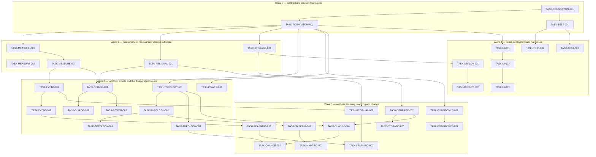

# 15 — Implementation plan

**SPEC_STATUS: APPROVED_FOR_IMPLEMENTATION** — **PLAN_STATUS: APPROVED_FOR_IMPLEMENTATION** — 36 tasks in 5 dependency waves, with the
parallelization rules, the one-file-one-owner matrix, the contract-freeze list,
the acceptance gates, and the progress tracker that governs the build.

---

## 1. Scope and approach

This plan decomposes the approved specification set — 130 requirements in
[`01-requirements.md`](01-requirements.md) — into 36 independently verifiable
tasks. The task IDs are the ones defined in
[`14-requirement-traceability.md`](14-requirement-traceability.md) §4.2. They are
stable: this plan elaborates them, it does not renumber them.

**Rule.** The plan implements the specification as **additive, contract-versioned
deltas on the existing engine**. The engine keeps its ten-step inference cycle,
its single process, its single SQLite file and its five panel routes.

**Rule.** The task IDs come from `14-requirement-traceability.md` §4.2 and are
used exactly. No task is added, removed or renumbered by this plan.

### 1.1 The governing constraints — binding on every task

| # | Constraint | How it is honoured |
| --- | --- | --- |
| C1 | **No new runtime dependency** | `pyproject.toml` is owned by `TASK-FOUNDATION-002`; a dependency change is a blocked task, not a silent edit. The build reuses the existing image and GHCR pipeline (`TASK-DEPLOY-001`). |
| C2 | **No new database** | The target reuses the existing SQLite file. `storage/migrations.py` receives forward-only, additive, idempotent numbered migrations only (`TASK-STORAGE-001` … `003`). |
| C3 | **No new service** | One process, one loop, the existing supervised loops in `main.py`. `TASK-FOUNDATION-002` proves this with `UT-app-startup::test_one_process_one_database`. |
| C4 | **No message bus** | Every hand-off is a direct call inside the existing dependency direction, or a row in the existing SQLite file. |
| C5 | **Contract changes are additive and optional** | A pre-change payload must still validate. Each wave produces exactly **one** `CONTRACT_VERSION` bump and one `data/schemas/` regeneration. |
| C6 | **The existing test suite stays green after every wave** | `GATE-verify-all` and the `mypy engine` error-count delta are wave exit criteria (`TASK-TEST-001`). |
| C7 | **One file, one owner, per wave** | See §4.5. A contested file has a single named write owner for that wave; other claimants file a write request. |
| C8 | **Every new inference rule has a test that fails first** | The red-then-green record is a required artefact (`TASK-TEST-001`, `REQ-TEST-001`). |
| C9 | **No clamping of a negative residual, no fabricated 0 W, no invented device** | Enforced by `TASK-RESIDUAL-001`, `TASK-RESIDUAL-002`, `TASK-DISAGG-002`, `TASK-UI-001`. |
| C10 | **No completion claim without an orchestrator-run test log** | The seven acceptance gates of `docs/implementation_plan_v2.md` §7 are run by the orchestrator, independently of the builder's report. |
| C11 | **Do not blind the orchestrator to its own integration mismatches** | The orchestrator reviews every delivered file and runs the full suite itself. A builder's self-report never substitutes for it (`docs/agent_assignments.md:26-28`). |

**Rule.** A task is complete only after its acceptance criteria **and** its
verification have passed. Writing the code is not completion.

### 1.2 What the plan does not do

- It does not change any contract. Contract shape is settled inside the task
  that owns it, under the freeze list in §5.
- It does not write code, and it does not add a dependency, a database, a
  service or a message bus.
- It does not replace `14-requirement-traceability.md`; it elaborates it.
- It does not schedule work behind an unresolved product decision. Where a
  decision is missing, the task records a blocker and states the assumption it
  proceeds under (§8.2).

---

## 2. The task list

36 tasks. **Wave** is the dependency wave (§4). **Segment** is the position
inside the wave; tasks in different segments of the same wave are serialised
and must not run concurrently (§4.3). **File group** is the set of paths the
task writes.

| Task ID | Title | Requirement IDs | Wave · segment | File group owned |
| --- | --- | --- | --- | --- |
| `TASK-FOUNDATION-001` | Specification status and the additive contract workflow | `REQ-FOUNDATION-001`, `REQ-FOUNDATION-002`, `REQ-FOUNDATION-003` | 0 · 0.1 | `docs/specs/load-disaggregation/README.md`, `contracts.py`, `tools/dev/export_schemas.py`, `tools/dev/verify.py`, `docs/interface_contracts.md` |
| `TASK-FOUNDATION-002` | Runtime boundary, the four-state label and one owner per wave | `REQ-FOUNDATION-004`, `REQ-FOUNDATION-005`, `REQ-FOUNDATION-006` | 0 · 0.2 | `pyproject.toml`, `main.py`, `disaggregation/engine.py`, `15-implementation-plan.md` |
| `TASK-MEASURE-001` | Measurable quantities, units, phase and polarity | `REQ-MEASURE-001`, `REQ-MEASURE-002`, `REQ-MEASURE-003`, `REQ-MEASURE-004` | 1 · 1.1 | `contracts.py`, `ingestion/normalize.py`, `electrical/factors.py` |
| `TASK-MEASURE-002` | Leg pairs, reverse flow and the reader declaration surface | `REQ-MEASURE-005`, `REQ-MEASURE-006`, `REQ-MEASURE-007` | 1 · 1.2 | `disaggregation/engine.py`, `electrical/matrix.py`, `ingestion/correlation.py` |
| `TASK-MEASURE-003` | Timestamps, repeat suppression and cadence derivation | `REQ-MEASURE-008`, `REQ-MEASURE-009`, `REQ-MEASURE-010` | 1 · 1.2 | `synchronization/`, `config/settings.py` |
| `TASK-RESIDUAL-001` | Signed residual, decomposition, history and the unresolved state | `REQ-RESIDUAL-001`, `REQ-RESIDUAL-002`, `REQ-RESIDUAL-003`, `REQ-RESIDUAL-004`, `REQ-RESIDUAL-008` | 1 · 1.4 | `models/residual_power.py`, `storage/database.py`, `api/server.py`, `api/facade.py` |
| `TASK-STORAGE-001` | Tier registry, retention and payload encoding | `REQ-STORAGE-001`, `REQ-STORAGE-002`, `REQ-STORAGE-008`, `REQ-STORAGE-009` | 1 · 1.3 | `storage/tiers.py`, `config/settings.py`, `storage/database.py`, `storage/migrations.py`, `addon/run.sh` |
| `TASK-TOPOLOGY-001` | Typed edge contract and the lifecycle vocabulary | `REQ-TOPO-001`, `REQ-TOPO-002` | 2 · 2.1 | `contracts.py`, `disaggregation/association.py` |
| `TASK-TOPOLOGY-002` | Containment evidence bar, violations and residual awareness | `REQ-TOPO-003`, `REQ-TOPO-004`, `REQ-TOPO-005`, `REQ-TOPO-006`, `REQ-TOPO-007` | 2 · 2.2 | `electrical/hierarchy.py`, `electrical/matrix.py`, `disaggregation/association.py` |
| `TASK-TOPOLOGY-003` | Versioned topology, change detection and reconciliation | `REQ-TOPO-008`, `REQ-TOPO-009` | 2 · 2.2 | `electrical/topology.py`, `storage/database.py`, `disaggregation/audit.py` |
| `TASK-TOPOLOGY-004` | Incomplete topology and the circuit scope | `REQ-TOPO-010`, `REQ-TOPO-011` | 2 · 2.3 | `disaggregation/circuits.py`, `api/server.py` |
| `TASK-EVENT-001` | Event kinds, grouping, lag and window sizing | `REQ-EVENT-001`, `REQ-EVENT-002`, `REQ-EVENT-003`, `REQ-EVENT-004` | 2 · 2.3 | `contracts.py`, `ingestion/ha_source.py`, `disaggregation/isolation.py`, `disaggregation/configuration.py`, `disaggregation/association.py` |
| `TASK-EVENT-002` | Cross-reader vector, late data, duplicates and incomplete groups | `REQ-EVENT-005`, `REQ-EVENT-006`, `REQ-EVENT-007`, `REQ-EVENT-008`, `REQ-EVENT-009` | 2 · 2.4 | `disaggregation/isolation.py`, `disaggregation/events.py`, `ingestion/ha_source.py`, `synchronization/`, `storage/database.py` |
| `TASK-DISAGG-001` | Joint inference, identifiability and group estimates | `REQ-DISAGG-001`, `REQ-DISAGG-002`, `REQ-DISAGG-003`, `REQ-DISAGG-004` | 2 · 2.2 | `disaggregation/engine.py`, `electrical/solver.py` |
| `TASK-DISAGG-002` | No fabrication, single counting and the balance identity | `REQ-DISAGG-005`, `REQ-DISAGG-006`, `REQ-DISAGG-007` | 2 · 2.4 | `disaggregation/engine.py`, `electrical/matrix.py`, `contracts.py` |
| `TASK-POWER-001` | Load-shape class and the model-version surface | `REQ-POWER-001`, `REQ-POWER-002`, `REQ-POWER-004`, `REQ-POWER-008` | 2 · 2.2 | `contracts.py`, `models/registry.py`, `models/device_profile.py` (new) |
| `TASK-POWER-002` | Measured-step attribution, non-HA devices, entity separation and declared bounds | `REQ-POWER-003`, `REQ-POWER-005`, `REQ-POWER-006`, `REQ-POWER-007` | 2 · 2.5 | `disaggregation/attachment.py` (new), `disaggregation/engine.py`, `contracts.py`, `api/server.py` |
| `TASK-RESIDUAL-002` | Drift events, the unknown-residual hand-off and the non-redistribution guard | `REQ-RESIDUAL-005`, `REQ-RESIDUAL-006`, `REQ-RESIDUAL-007` | 3 · 3.2 | `models/residual_power.py`, `disaggregation/events.py`, `learning/pipeline.py`, `disaggregation/engine.py` |
| `TASK-STORAGE-002` | Evidence immutability, batched writes, indexes and version identifiers | `REQ-STORAGE-003`, `REQ-STORAGE-004`, `REQ-STORAGE-005`, `REQ-STORAGE-006`, `REQ-STORAGE-007` | 3 · 3.1 | `storage/migrations.py`, `storage/database.py`, `main.py` |
| `TASK-STORAGE-003` | Recovery, migration safety and replay | `REQ-STORAGE-010`, `REQ-STORAGE-011`, `REQ-STORAGE-012` | 3 · 3.6 | `storage/migrations.py`, `storage/database.py`, `main.py`, `tools/audit/replay_capture.py` |
| `TASK-LEARNING-001` | Sample intake, the rejection ledger and per-device thresholds | `REQ-LEARNING-001`, `REQ-LEARNING-002`, `REQ-LEARNING-006` | 3 · 3.1 | `learning/pipeline.py`, `disaggregation/configuration.py`, `disaggregation/isolation.py` |
| `TASK-LEARNING-002` | Promotion, factor timing and measurement precedence | `REQ-LEARNING-003`, `REQ-LEARNING-004`, `REQ-LEARNING-005`, `REQ-LEARNING-007` | 3 · 3.4 | `learning/pipeline.py`, `electrical/factors.py`, `disaggregation/engine.py`, `storage/database.py` |
| `TASK-CONFIDENCE-001` | Confidence dimensions, the calibration flag and tier monotonicity | `REQ-CONFIDENCE-001`, `REQ-CONFIDENCE-002`, `REQ-CONFIDENCE-003`, `REQ-CONFIDENCE-004` | 3 · 3.1 | `contracts.py`, `disaggregation/confidence.py`, `disaggregation/tiers.py`, `addon/ui/app.js` |
| `TASK-CONFIDENCE-002` | Live confidence dimensions and per-edge evidence | `REQ-CONFIDENCE-005`, `REQ-CONFIDENCE-006`, `REQ-CONFIDENCE-007` | 3 · 3.3 | `disaggregation/audit.py`, `disaggregation/association.py`, `disaggregation/confidence.py` |
| `TASK-MAPPING-001` | The derived mapping projection | `REQ-MAPPING-001`, `REQ-MAPPING-002`, `REQ-MAPPING-003`, `REQ-MAPPING-006`, `REQ-MAPPING-007` | 3 · 3.1 | `disaggregation/mapping.py` (new), `api/server.py` |
| `TASK-MAPPING-002` | Unknown-load entries and the evidence-triggered refresh | `REQ-MAPPING-004`, `REQ-MAPPING-005` | 3 · 3.5 | `disaggregation/mapping.py` (new), `models/residual_power.py`, `storage/database.py` |
| `TASK-CHANGE-001` | Configuration events and the hypothesis lifecycle | `REQ-CHANGE-001`, `REQ-CHANGE-002`, `REQ-CHANGE-005` | 3 · 3.2 | `disaggregation/audit.py`, `storage/migrations.py`, `contracts.py` |
| `TASK-CHANGE-002` | Four version identifiers, immutable history, rollback and reconciliation | `REQ-CHANGE-003`, `REQ-CHANGE-004`, `REQ-CHANGE-006`, `REQ-CHANGE-007` | 3 · 3.3 | `contracts.py`, `electrical/topology.py`, `storage/database.py`, `api/server.py` |
| `TASK-UI-001` | Panel vocabulary: inventory, quality, the four-state label and the view states | `REQ-UI-001`, `REQ-UI-002`, `REQ-UI-007`, `REQ-UI-013` | 4 · 4.1 | `addon/ui/app.js`, `tools/dev/check_panel.py` |
| `TASK-UI-002` | Panel views: topology, residual, model, mapping and identifiability | `REQ-UI-003`, `REQ-UI-004`, `REQ-UI-005`, `REQ-UI-006`, `REQ-UI-008` | 4 · 4.2 | `addon/ui/app.js`, `tools/dev/check_panel.py` |
| `TASK-UI-003` | Panel evidence, version history, operator correction and storage health | `REQ-UI-009`, `REQ-UI-010`, `REQ-UI-011`, `REQ-UI-012` | 4 · 4.3 | `addon/ui/app.js`, `api/server.py` |
| `TASK-DEPLOY-001` | Build pipeline, option surface, startup migrations and backup | `REQ-DEPLOY-001`, `REQ-DEPLOY-002`, `REQ-DEPLOY-003`, `REQ-DEPLOY-004` | 4 · 4.1 | `Dockerfile`, `addon/config.yaml`, `addon/run.sh`, `addon/healthcheck.py`, `config/settings.py`, `main.py`, `storage/migrations.py`, `.env.example` |
| `TASK-DEPLOY-002` | Deployment procedure, smoke tests, rollback and operational metrics | `REQ-DEPLOY-005`, `REQ-DEPLOY-006`, `REQ-DEPLOY-007`, `REQ-DEPLOY-008` | 4 · 4.2 | `scripts/smoke_test.sh` (new), `addon/healthcheck.py`, `main.py`, `docs/deployment.md`, `docs/risks.md` |
| `TASK-TEST-001` | Unit-rule coverage, regression and negative verification | `REQ-TEST-001`, `REQ-TEST-006`, `REQ-TEST-007` | 0 · continuous | `tests/unit/`, `tools/dev/negverify_nesting.py`, `tools/dev/verify.py` (from wave 1) |
| `TASK-TEST-002` | API surface, replay and migration harnesses | `REQ-TEST-002`, `REQ-TEST-005`, `REQ-TEST-008` | 4 · 4.1 | `tests/integration/`, `tests/end_to_end/`, `tests/simulation/`, `api/facade.py`, `tools/audit/replay_capture.py` |
| `TASK-TEST-003` | The T01–T15 builders, the matrix reconciliation and the performance and accuracy harnesses | `REQ-TEST-003`, `REQ-TEST-004`, `REQ-TEST-009`, `REQ-TEST-010` | 4 · 4.2 | `tools/simulator/scenarios.py` (new), `tests/simulation/test_simulator_fixtures.py` (new), `tests/unit/test_simulator_fixtures.py` (new), `tests/unit/test_health_probe_cost.py`, `tests/unit/test_nesting_perf.py`, `tests/simulation/test_accuracy.py`, `docs/test_scenario_matrix.md` |

**Rule.** Every task above has a file in [`tasks/`](tasks/) named
`tasks/<task-id-lowercased>.md`. Every file in `tasks/` that names a task ID
appears in this table. The count is 36.

**Note — wave placement.** `14-requirement-traceability.md` §5 is indicative
only: it groups `TASK-CHANGE-001 … 002` into wave 3 and places neither
`TASK-STORAGE-002` nor `TASK-STORAGE-003` in any wave row. This plan's §4.3
segment matrix is authoritative for wave and segment placement. It places
`TASK-CHANGE-002` in wave 3, segment 3.3, and places `TASK-STORAGE-002` in
wave 3, segment 3.1, with `TASK-STORAGE-003` in wave 3, segment 3.6, because
`TASK-CHANGE-001` depends on `TASK-STORAGE-002` and `TASK-CHANGE-002` depends
on `TASK-TOPOLOGY-003`. The task IDs, the requirement coverage and the
dependency edges are unchanged; only the placement label moves, and it moves
so that the one-file-one-owner matrix has no contested file inside a single
segment. The orchestrator confirms or corrects the placement.

**Note — the `TASK-TEST-*` family.** `TASK-TEST-001` is listed in wave 0 with
the marker `continuous`: it starts in wave 0 and runs alongside every wave. It
is not a terminal wave.

---

## 3. The dependency graph

**Rule.** An arrow `A --> B` means `B` depends on `A`: `A` must be `VERIFIED`
before `B` starts. The arrows are the dependency edges of the task files;
adding an arrow is a change to a task's `Dependencies` field in the same
commit.

### 3.1 The critical path

**Critical path — 8 tasks:**
`TASK-FOUNDATION-001` → `TASK-FOUNDATION-002` → `TASK-MEASURE-001` →
`TASK-MEASURE-003` → `TASK-EVENT-001` → `TASK-EVENT-002` →
`TASK-LEARNING-001` → `TASK-LEARNING-002`.

**Rule.** The critical path is the measurement-and-event chain, because it is
the longest chain in the graph — 8 tasks, and no other chain reaches that
length — and because it gates the learning work. The orchestrator schedules
it first and gives it the earliest builder slots.

**Rule.** Two runner-up chains are protected from starvation in the same way:
the inference chain
(`FOUNDATION-001 → FOUNDATION-002 → MEASURE-001 → MEASURE-003 → DISAGG-001 →
POWER-002`), 6 tasks as listed, and the storage chain
(`FOUNDATION-001 → FOUNDATION-002 → STORAGE-001 → STORAGE-002 → STORAGE-003`),
5 tasks as listed. Both are shorter than the critical path.

---

## 4. The waves and the parallelization plan

### 4.1 Wave shape

| Wave | Content | Tasks | Exit gate |
| --- | --- | --- | --- |
| 0 | Contract and process foundation | `TASK-FOUNDATION-001`, `TASK-FOUNDATION-002`, `TASK-TEST-001` (starts) | contract bump landed, schemas regenerated, `GATE-contract_schema_sync` green |
| 1 | Measurement, residual and storage substrate | `TASK-MEASURE-001`, `TASK-MEASURE-002`, `TASK-MEASURE-003`, `TASK-RESIDUAL-001`, `TASK-STORAGE-001` | signed residual, declared cadence, tier registry, `GATE-verify-all` green |
| 2 | Topology, events and the disaggregation core | `TASK-TOPOLOGY-001` … `004`, `TASK-EVENT-001` … `002`, `TASK-DISAGG-001` … `002`, `TASK-POWER-001` … `002` | typed edges, event kinds, joint inference, `GATE-verify-all` green |
| 3 | Analysis, learning, mapping and change | `TASK-RESIDUAL-002`, `TASK-STORAGE-002`, `TASK-STORAGE-003`, `TASK-LEARNING-001` … `002`, `TASK-CONFIDENCE-001` … `002`, `TASK-MAPPING-001` … `002`, `TASK-CHANGE-001` … `002` | live confidence dimensions, derived mapping, versioned change, `GATE-verify-all` green |
| 4 | Panel, deployment and the end-to-end harnesses | `TASK-UI-001` … `003`, `TASK-DEPLOY-001` … `002`, `TASK-TEST-002`, `TASK-TEST-003` | panel gate, `GATE-deployment_valid`, `GATE-verify-all` green |

**Rule.** The `TASK-TEST-*` family is the verification vehicle for every wave.
It is not a terminal wave; `TASK-TEST-001` starts in wave 0 and runs
continuously, and `TASK-TEST-002` / `TASK-TEST-003` land their harnesses in
wave 4.

### 4.2 Parallelisation rules

| # | Rule |
| --- | --- |
| P1 | A task starts only when every dependency in its task file is `VERIFIED`. |
| P2 | Two tasks may run concurrently in the same wave **only** if their write sets are disjoint. |
| P3 | Where two tasks in the same wave share a write file, that file has **one write owner for the wave** — the task earlier in the wave's segment order. The other task files a **write request** to the owner, and the owner applies it inside the same wave. The owner is named in §4.5. |
| P4 | A write request that would change one of the six frozen interfaces (§5.2) is **not** a write request. It is escalated to the orchestrator as a contract bump decision. |
| P5 | A task whose interface is not yet defined does not start. The plan does not parallelise components whose interfaces are undefined. |
| P6 | Shared foundation and data contracts are prioritised before dependents: `contracts.py` is settled in wave 0 and wave 1 before the wave-2 consumers. |
| P7 | No two agents modify the same core file at the same time. The one-file-one-owner matrix (§4.5) is the authority. |
| P8 | Each builder works in an isolated worktree on a **fresh branch**. This repository already holds 16 worktrees under `~/.local/share/opencode/worktree/d661cf/`; a new task needs a **fresh directory and a fresh branch**, never a reused one. |
| P9 | A builder never merges to the shared line. The orchestrator reviews every delivered file and runs the full suite itself. |

### 4.3 Wave segments

Segments fix the serial order inside a wave. Tasks in the same segment may run
in parallel; tasks in different segments of the same wave must not overlap.

| Wave | Segment | Tasks | Serial reason |
| --- | --- | --- | --- |
| 0 | 0.1 | `TASK-FOUNDATION-001` | the single contract bump; `contracts.py` owner |
| 0 | 0.2 | `TASK-FOUNDATION-002` | consumes the bumped contract; `disaggregation/engine.py` owner |
| 0 | 0.3 (continuous) | `TASK-TEST-001` | the verification vehicle; runs alongside every wave |
| 1 | 1.1 | `TASK-MEASURE-001` | `contracts.py` owner for the wave |
| 1 | 1.2 | `TASK-MEASURE-002`, `TASK-MEASURE-003` | parallel: `disaggregation/engine.py`/`electrical/matrix.py` vs `synchronization/`/`config/settings.py` |
| 1 | 1.3 | `TASK-STORAGE-001` | after `TASK-MEASURE-003` on `config/settings.py` |
| 1 | 1.4 | `TASK-RESIDUAL-001` | after `TASK-STORAGE-001` on `storage/database.py` |
| 2 | 2.1 | `TASK-TOPOLOGY-001` | `contracts.py` and `disaggregation/association.py` owner for the wave |
| 2 | 2.2 | `TASK-TOPOLOGY-002`, `TASK-TOPOLOGY-003`, `TASK-DISAGG-001`, `TASK-POWER-001` | parallel set; disjoint write sets |
| 2 | 2.3 | `TASK-EVENT-001`, `TASK-TOPOLOGY-004` | after their 2.1/2.2 prerequisites |
| 2 | 2.4 | `TASK-EVENT-002`, `TASK-DISAGG-002` | after their 2.3 prerequisites |
| 2 | 2.5 | `TASK-POWER-002` | after `TASK-DISAGG-002` on `disaggregation/engine.py` |
| 3 | 3.1 | `TASK-STORAGE-002`, `TASK-LEARNING-001`, `TASK-CONFIDENCE-001`, `TASK-MAPPING-001` | parallel set; disjoint write sets |
| 3 | 3.2 | `TASK-RESIDUAL-002`, `TASK-CHANGE-001` | after 3.1 on `learning/pipeline.py` and `storage/migrations.py` |
| 3 | 3.3 | `TASK-CONFIDENCE-002`, `TASK-CHANGE-002` | after 3.2 on `disaggregation/audit.py` |
| 3 | 3.4 | `TASK-LEARNING-002` | after 3.3 on `disaggregation/engine.py` |
| 3 | 3.5 | `TASK-MAPPING-002` | after 3.4 on `storage/database.py` |
| 3 | 3.6 | `TASK-STORAGE-003` | after 3.5 on `storage/migrations.py` and `main.py` |
| 4 | 4.1 | `TASK-UI-001`, `TASK-DEPLOY-001`, `TASK-TEST-002` | parallel set; disjoint write sets |
| 4 | 4.2 | `TASK-UI-002`, `TASK-DEPLOY-002`, `TASK-TEST-003` | after 4.1 |
| 4 | 4.3 | `TASK-UI-003` | after `TASK-UI-002` on `addon/ui/app.js` |

**Rule.** Two tasks in the same segment have disjoint write sets. Where that is
not true, the later task is placed in a later segment and depends on the
earlier one, so that a contested file is never owned by two tasks at the same
time. This is why `TASK-CHANGE-001` sits in segment 3.2 and
`TASK-CHANGE-002` in segment 3.3: they share `contracts.py` and
`storage/database.py`.

**Rule.** `TASK-TEST-001` is segment 0.3 and is marked continuous. It runs
alongside every wave and is never the terminal work.

### 4.4 Parallel work that is genuinely independent

These task groups share no file and no interface, and may run concurrently.
Each line is one segment.

| Segment | Parallel group | Why it is safe |
| --- | --- | --- |
| 1.2 | `TASK-MEASURE-002` ∥ `TASK-MEASURE-003` | `disaggregation/engine.py` + `electrical/matrix.py` + `ingestion/correlation.py` vs `synchronization/` + `config/settings.py` |
| 2.2 | `TASK-TOPOLOGY-002` ∥ `TASK-TOPOLOGY-003` ∥ `TASK-DISAGG-001` ∥ `TASK-POWER-001` | `electrical/hierarchy.py`, `electrical/topology.py`, `electrical/solver.py` and `models/` are separate modules |
| 2.3 | `TASK-EVENT-001` ∥ `TASK-TOPOLOGY-004` | `ingestion/`, `disaggregation/isolation.py`, `disaggregation/configuration.py` vs `disaggregation/circuits.py` |
| 3.1 | `TASK-STORAGE-002` ∥ `TASK-LEARNING-001` ∥ `TASK-CONFIDENCE-001` ∥ `TASK-MAPPING-001` | `storage/`, `learning/`, `disaggregation/confidence.py`, `disaggregation/tiers.py` and the new `disaggregation/mapping.py` are separate modules |
| 4.1 | `TASK-UI-001` ∥ `TASK-DEPLOY-001` ∥ `TASK-TEST-002` | `addon/ui/`, the packaging files and the test suites are disjoint |

**Rule.** Work is **not** parallelised when the interfaces are undefined. The
mapping projection (`TASK-MAPPING-001` … `002`) waits for the topology
relations to be typed; the panel waits for the four-state label and the API
read surfaces; the deployment task waits for the option surface to be settled.

### 4.5 The one-file-one-owner matrix

Cell = the **write owner** of that file in that wave. `—` = the file is not
written in that wave. A cell marked with `‡` means the file has a second
claimant in that wave, which files a **write request** to the owner (rule P3).

| File | Wave 0 | Wave 1 | Wave 2 | Wave 3 | Wave 4 |
| --- | --- | --- | --- | --- | --- |
| `.env.example` | — | — | — | — | `TASK-DEPLOY-001` |
| `Dockerfile` | — | — | — | — | `TASK-DEPLOY-001` |
| `addon/config.yaml` | — | — | — | — | `TASK-DEPLOY-001` |
| `addon/healthcheck.py` | — | — | — | — | `TASK-DEPLOY-001` ‡ (`TASK-DEPLOY-002`) |
| `addon/run.sh` | — | `TASK-STORAGE-001` | — | — | `TASK-DEPLOY-001` |
| `addon/ui/app.js` | — | — | — | `TASK-CONFIDENCE-001` | `TASK-UI-001` ‡ (`TASK-UI-002`, `TASK-UI-003`) |
| `docs/deployment.md` | — | — | — | — | `TASK-DEPLOY-002` |
| `docs/interface_contracts.md` | `TASK-FOUNDATION-001` | — | — | — | — |
| `docs/risks.md` | — | — | — | — | `TASK-DEPLOY-002` |
| `docs/specs/load-disaggregation/15-implementation-plan.md` | `TASK-FOUNDATION-002` | — | — | — | — |
| `docs/specs/load-disaggregation/README.md` | `TASK-FOUNDATION-001` | — | — | — | — |
| `docs/test_scenario_matrix.md` | — | — | — | — | `TASK-TEST-003` |
| `engine/wattmosaic_engine/api/facade.py` | — | `TASK-RESIDUAL-001` | — | — | `TASK-TEST-002` |
| `engine/wattmosaic_engine/api/server.py` | — | `TASK-RESIDUAL-001` | `TASK-TOPOLOGY-004` ‡ (`TASK-POWER-002`) | `TASK-MAPPING-001` ‡ (`TASK-CHANGE-002`) | `TASK-UI-003` |
| `engine/wattmosaic_engine/config/settings.py` | — | `TASK-MEASURE-003` ‡ (`TASK-STORAGE-001`) | — | — | `TASK-DEPLOY-001` |
| `engine/wattmosaic_engine/contracts.py` | `TASK-FOUNDATION-001` ‡ (`TASK-FOUNDATION-002`) | `TASK-MEASURE-001` | `TASK-TOPOLOGY-001` ‡ (`TASK-POWER-001`, `TASK-EVENT-001`, `TASK-DISAGG-002`, `TASK-POWER-002`) | `TASK-CONFIDENCE-001` ‡ (`TASK-CHANGE-001`, `TASK-CHANGE-002`) | — |
| `engine/wattmosaic_engine/disaggregation/association.py` | — | — | `TASK-TOPOLOGY-001` ‡ (`TASK-TOPOLOGY-002`, `TASK-EVENT-001`) | `TASK-CONFIDENCE-002` | — |
| `engine/wattmosaic_engine/disaggregation/attachment.py` | — | — | `TASK-POWER-002` | — | — |
| `engine/wattmosaic_engine/disaggregation/audit.py` | — | — | `TASK-TOPOLOGY-003` | `TASK-CHANGE-001` ‡ (`TASK-CONFIDENCE-002`) | — |
| `engine/wattmosaic_engine/disaggregation/circuits.py` | — | — | `TASK-TOPOLOGY-004` | — | — |
| `engine/wattmosaic_engine/disaggregation/confidence.py` | — | — | — | `TASK-CONFIDENCE-001` ‡ (`TASK-CONFIDENCE-002`) | — |
| `engine/wattmosaic_engine/disaggregation/configuration.py` | — | — | `TASK-EVENT-001` | `TASK-LEARNING-001` | — |
| `engine/wattmosaic_engine/disaggregation/engine.py` | `TASK-FOUNDATION-002` | `TASK-MEASURE-002` | `TASK-DISAGG-001` ‡ (`TASK-DISAGG-002`, `TASK-POWER-002`) | `TASK-RESIDUAL-002` ‡ (`TASK-LEARNING-002`) | — |
| `engine/wattmosaic_engine/disaggregation/events.py` | — | — | `TASK-EVENT-002` | `TASK-RESIDUAL-002` | — |
| `engine/wattmosaic_engine/disaggregation/isolation.py` | — | — | `TASK-EVENT-001` ‡ (`TASK-EVENT-002`) | `TASK-LEARNING-001` | — |
| `engine/wattmosaic_engine/disaggregation/mapping.py` | — | — | — | `TASK-MAPPING-001` ‡ (`TASK-MAPPING-002`) | — |
| `engine/wattmosaic_engine/disaggregation/tiers.py` | — | — | — | `TASK-CONFIDENCE-001` | — |
| `engine/wattmosaic_engine/electrical/factors.py` | — | `TASK-MEASURE-001` | — | `TASK-LEARNING-002` | — |
| `engine/wattmosaic_engine/electrical/hierarchy.py` | — | — | `TASK-TOPOLOGY-002` | — | — |
| `engine/wattmosaic_engine/electrical/matrix.py` | — | `TASK-MEASURE-002` | `TASK-TOPOLOGY-002` ‡ (`TASK-DISAGG-002`) | — | — |
| `engine/wattmosaic_engine/electrical/solver.py` | — | — | `TASK-DISAGG-001` | — | — |
| `engine/wattmosaic_engine/electrical/topology.py` | — | — | `TASK-TOPOLOGY-003` | `TASK-CHANGE-002` | — |
| `engine/wattmosaic_engine/ingestion/correlation.py` | — | `TASK-MEASURE-002` | — | — | — |
| `engine/wattmosaic_engine/ingestion/ha_source.py` | — | — | `TASK-EVENT-001` ‡ (`TASK-EVENT-002`) | — | — |
| `engine/wattmosaic_engine/ingestion/normalize.py` | — | `TASK-MEASURE-001` | — | — | — |
| `engine/wattmosaic_engine/learning/pipeline.py` | — | — | — | `TASK-LEARNING-001` ‡ (`TASK-RESIDUAL-002`, `TASK-LEARNING-002`) | — |
| `engine/wattmosaic_engine/main.py` | `TASK-FOUNDATION-002` | — | — | `TASK-STORAGE-002` ‡ (`TASK-STORAGE-003`) | `TASK-DEPLOY-001` ‡ (`TASK-DEPLOY-002`) |
| `engine/wattmosaic_engine/models/device_profile.py` | — | — | `TASK-POWER-001` | — | — |
| `engine/wattmosaic_engine/models/registry.py` | — | — | `TASK-POWER-001` | — | — |
| `engine/wattmosaic_engine/models/residual_power.py` | — | `TASK-RESIDUAL-001` | — | `TASK-RESIDUAL-002` ‡ (`TASK-MAPPING-002`) | — |
| `engine/wattmosaic_engine/storage/database.py` | — | `TASK-STORAGE-001` ‡ (`TASK-RESIDUAL-001`) | `TASK-TOPOLOGY-003` ‡ (`TASK-EVENT-002`) | `TASK-STORAGE-002` ‡ (`TASK-CHANGE-002`, `TASK-LEARNING-002`, `TASK-MAPPING-002`, `TASK-STORAGE-003`) | — |
| `engine/wattmosaic_engine/storage/migrations.py` | — | `TASK-STORAGE-001` | — | `TASK-STORAGE-002` ‡ (`TASK-CHANGE-001`, `TASK-STORAGE-003`) | `TASK-DEPLOY-001` |
| `engine/wattmosaic_engine/storage/tiers.py` | — | `TASK-STORAGE-001` | — | — | — |
| `engine/wattmosaic_engine/synchronization/` | — | `TASK-MEASURE-003` | `TASK-EVENT-002` | — | — |
| `pyproject.toml` | `TASK-FOUNDATION-002` | — | — | — | — |
| `scripts/smoke_test.sh` | — | — | — | — | `TASK-DEPLOY-002` |
| `tests/end_to_end/` | — | — | — | — | `TASK-TEST-002` |
| `tests/integration/` | — | — | — | — | `TASK-TEST-002` |
| `tests/simulation/` | — | — | — | — | `TASK-TEST-002` |
| `tests/simulation/test_accuracy.py` | — | — | — | — | `TASK-TEST-003` |
| `tests/simulation/test_simulator_fixtures.py` | — | — | — | — | `TASK-TEST-003` |
| `tests/unit/` | `TASK-TEST-001` | — | — | — | — |
| `tests/unit/test_health_probe_cost.py` | — | — | — | — | `TASK-TEST-003` |
| `tests/unit/test_nesting_perf.py` | — | — | — | — | `TASK-TEST-003` |
| `tests/unit/test_simulator_fixtures.py` | — | — | — | — | `TASK-TEST-003` |
| `tools/audit/replay_capture.py` | — | — | — | `TASK-STORAGE-003` | `TASK-TEST-002` |
| `tools/dev/check_panel.py` | — | — | — | — | `TASK-UI-001` ‡ (`TASK-UI-002`) |
| `tools/dev/export_schemas.py` | `TASK-FOUNDATION-001` | — | — | — | — |
| `tools/dev/negverify_nesting.py` | `TASK-TEST-001` | — | — | — | — |
| `tools/dev/verify.py` | `TASK-FOUNDATION-001` ‡ (`TASK-TEST-001`) | — | — | — | — |
| `tools/simulator/scenarios.py` | — | — | — | — | `TASK-TEST-003` |

**Rule.** The `‡` cells are the write requests. The complete write-request
list, which is a message to the orchestrator and not an uncoordinated edit, is:

| Wave | File | Owner | Requesting task | Change requested |
| --- | --- | --- | --- | --- |
| 0 | `contracts.py` | `TASK-FOUNDATION-001` | `TASK-FOUNDATION-002` | the four-state power-state label on `Source`, `MeasurementBasis` and `InferenceResult` |
| 0 | `tools/dev/verify.py` | `TASK-FOUNDATION-001` | `TASK-TEST-001` | the `GATE-spec_status` entry; `TASK-TEST-001` owns the file from wave 1 onward |
| 1 | `config/settings.py` | `TASK-MEASURE-003` | `TASK-STORAGE-001` | the per-tier retention settings and their validated ranges |
| 1 | `storage/database.py` | `TASK-STORAGE-001` | `TASK-RESIDUAL-001` | the residual read and write path columns and indexes |
| 2 | `api/server.py` | `TASK-TOPOLOGY-004` | `TASK-POWER-002` | the reader-declaration and device-identity read routes |
| 2 | `contracts.py` | `TASK-TOPOLOGY-001` | `TASK-POWER-001`, `TASK-EVENT-001`, `TASK-DISAGG-002`, `TASK-POWER-002` | the load-shape axis, the event-kind member, the published-source fields and the declared bound |
| 2 | `disaggregation/association.py` | `TASK-TOPOLOGY-001` | `TASK-TOPOLOGY-002`, `TASK-EVENT-001` | the residual-aware evidence path and the lag-aware observation |
| 2 | `disaggregation/engine.py` | `TASK-DISAGG-001` | `TASK-DISAGG-002`, `TASK-POWER-002` | the source/quality/tier publication, the single-counting rule and the measured-step attachment |
| 2 | `disaggregation/isolation.py` | `TASK-EVENT-001` | `TASK-EVENT-002` | the cross-reader effect vector |
| 2 | `electrical/matrix.py` | `TASK-TOPOLOGY-002` | `TASK-DISAGG-002` | the outermost-feed-only counting rule |
| 2 | `ingestion/ha_source.py` | `TASK-EVENT-001` | `TASK-EVENT-002` | the re-delivery handling and the duplicate recognition |
| 2 | `storage/database.py` | `TASK-TOPOLOGY-003` | `TASK-EVENT-002` | the duplicate-event identity column and the append-only guard |
| 3 | `api/server.py` | `TASK-MAPPING-001` | `TASK-CHANGE-002` | the change reconciliation read route |
| 3 | `contracts.py` | `TASK-CONFIDENCE-001` | `TASK-CHANGE-001`, `TASK-CHANGE-002` | the configuration-event model and the four version identifiers |
| 3 | `disaggregation/audit.py` | `TASK-CHANGE-001` | `TASK-CONFIDENCE-002` | the per-edge confidence derivation and the configuration-event emission |
| 3 | `disaggregation/confidence.py` | `TASK-CONFIDENCE-001` | `TASK-CONFIDENCE-002` | the live dimension derivations |
| 3 | `disaggregation/engine.py` | `TASK-RESIDUAL-002` | `TASK-LEARNING-002` | the measurement-over-model precedence guard |
| 3 | `disaggregation/mapping.py` | `TASK-MAPPING-001` | `TASK-MAPPING-002` | the unknown-load entry and the evidence-triggered refresh |
| 3 | `learning/pipeline.py` | `TASK-LEARNING-001` | `TASK-RESIDUAL-002`, `TASK-LEARNING-002` | the unknown-residual intake and the promotion gate |
| 3 | `main.py` | `TASK-STORAGE-002` | `TASK-STORAGE-003` | the startup integrity check and the recovery path |
| 3 | `models/residual_power.py` | `TASK-RESIDUAL-002` | `TASK-MAPPING-002` | the unknown-load profile fields |
| 3 | `storage/database.py` | `TASK-STORAGE-002` | `TASK-CHANGE-002`, `TASK-LEARNING-002`, `TASK-MAPPING-002`, `TASK-STORAGE-003` | the version columns, the learning decision row, the refresh marker and the replay manifest |
| 3 | `storage/migrations.py` | `TASK-STORAGE-002` | `TASK-CHANGE-001`, `TASK-STORAGE-003` | the configuration-event table and the replay-manifest table |
| 4 | `addon/healthcheck.py` | `TASK-DEPLOY-001` | `TASK-DEPLOY-002` | the smoke-test separation |
| 4 | `addon/ui/app.js` | `TASK-UI-001` | `TASK-UI-002`, `TASK-UI-003` | the panel views and the operator actions |
| 4 | `main.py` | `TASK-DEPLOY-001` | `TASK-DEPLOY-002` | the operational metrics publication |
| 4 | `tools/dev/check_panel.py` | `TASK-UI-001` | `TASK-UI-002` | the new string and view-state checks |

### 4.6 Isolation policy for builders

**Rule.** A task is built in a **fresh worktree on a fresh branch**. The
repository already holds 16 worktrees under
`~/.local/share/opencode/worktree/d661cf/`; those belong to other tasks. A
builder never reuses an existing worktree directory, never reuses an existing
branch, and never merges into the shared line.

**Rule.** The orchestrator owns the merge. It reviews every delivered file and
runs the full suite itself, so that an integration mismatch is never hidden
behind a builder's self-report.

---

## 5. The contract-freeze list

### 5.1 Contracts that must be settled before the dependent wave

| Contract | Settled by | Frozen at the end of | Consumers that wait |
| --- | --- | --- | --- |
| `CONTRACT_VERSION`, the payload shape, the contract-change workflow | `TASK-FOUNDATION-001` | wave 0 | every task |
| The four-state power-state label (`measured` / `estimated` / `allocated` / `unknown`) | `TASK-FOUNDATION-002` | wave 0 | `TASK-DISAGG-002`, `TASK-UI-001` |
| `Measurement`, `MeasurementBasis`, `CTChannel` — units, phase, polarity, resolution, reliability, expected interval | `TASK-MEASURE-001` | wave 1 | `TASK-MEASURE-002`, `TASK-MEASURE-003`, `TASK-DISAGG-001` |
| The three-timestamp vocabulary and the cadence derivation | `TASK-MEASURE-003` | wave 1 | `TASK-EVENT-001`, `TASK-DISAGG-001` |
| The signed residual, its decomposition and its unresolved state | `TASK-RESIDUAL-001` | wave 1 | `TASK-DISAGG-001`, `TASK-TOPOLOGY-002` |
| The storage tier registry and the per-tier retention policy | `TASK-STORAGE-001` | wave 1 | `TASK-STORAGE-002`, `TASK-DEPLOY-001` |
| `TopologyRelation`, `RelationKind`, the edge lifecycle vocabulary | `TASK-TOPOLOGY-001` | wave 2 | `TASK-TOPOLOGY-002`, `TASK-CHANGE-001`, `TASK-MAPPING-001` |
| The three event kinds and the event-window vocabulary | `TASK-EVENT-001` | wave 2 | `TASK-EVENT-002`, `TASK-RESIDUAL-002`, `TASK-LEARNING-001` |
| The published-source fields, the quality status and the evidence tier | `TASK-DISAGG-002` | wave 2 | `TASK-UI-002`, `TASK-MAPPING-001` |
| The load-shape axis and the model-version surface | `TASK-POWER-001` | wave 2 | `TASK-POWER-002` |
| The four version identifiers and their validity intervals | `TASK-CHANGE-002` | wave 3 | `TASK-UI-003`, `TASK-MAPPING-001` |
| The confidence member names and the calibration flag | `TASK-CONFIDENCE-001` | wave 3 | `TASK-CONFIDENCE-002`, `TASK-UI-001` |
| The mapping-cell shape and the coverage block | `TASK-MAPPING-001` | wave 3 | `TASK-UI-002` |
| The configuration-event model | `TASK-CHANGE-001` | wave 3 | `TASK-CHANGE-002`, `TASK-UI-003` |

**Rule.** A frozen contract changes only inside the task that owns it, in that
task's wave, and only as an additive optional field. A change to a frozen
contract that is not owned by the running wave is a **contract bump** and is
escalated to the orchestrator.

### 5.2 The six frozen internal interfaces

These six signatures may not change without a contract bump and an explicit
orchestrator decision. They are the seam between the reused subsystems and the
target behaviour.

| # | Interface | Frozen because |
| --- | --- | --- |
| 1 | `EventIsolator.classify` | every event verdict depends on it; the three kinds and the lag rule hang off its return value |
| 2 | `FactorRegistry.basis_for` | the factor-timing rule (`REQ-LEARNING-005`) resolves against the reading's timestamp through it |
| 3 | `AssociationFinder.observe` | it produces the typed edge and the per-edge evidence that the confidence dimensions read |
| 4 | `CircuitClassifier.classify` | the circuit scope and the `PARTIALLY_UNDERSTOOD` status depend on it |
| 5 | `ResidualAnalyzer.compute` | the signed residual and its decomposition are the substrate of the balance identity |
| 6 | `HierarchyFinder.infer` | the containment evidence bar and the tolerance rule are enforced here |

**Rule.** A change to any of these six is a contract bump. It requires a new
`CONTRACT_VERSION`, a regenerated schema set, a recorded orchestrator decision
and a full-suite run — not a quiet edit inside a wave.

---

## 6. The acceptance gates

### 6.1 Gates that run at the end of every wave

| Gate | Command | Fails when |
| --- | --- | --- |
| Full suite | `pytest` over the existing suites | any existing test fails; the suite result is not smaller than the baseline |
| Type check | `mypy engine` | the error count increases against the baseline |
| Contract/schema sync | `python tools/dev/verify.py:contract_schema_sync` | `data/schemas/` differs from a regeneration of the current contracts |
| Schema drift | the CI drift check on `data/schemas/` | a regenerated schema differs from the committed one without a committed bump |
| Negative verification | `python tools/dev/verify.py:negverify` | a new guard has no negative-verification record |
| Panel gate | `python tools/dev/check_panel.py` | a panel string is missing, or DOM is inserted as markup rather than text |
| Deployment gate | `python tools/dev/verify.py:deployment_valid` | the option surface, the image or the addon manifest is inconsistent |

**Rule.** The orchestrator runs the gates. A builder's report of a green run is
not a gate result. The seven acceptance gates of `docs/implementation_plan_v2.md`
§7 are the governing set; the table above is how this plan reaches them.

### 6.2 Wave exit criteria

| Wave | The wave is closed when |
| --- | --- |
| 0 | the single contract bump landed, `data/schemas/` regenerated with no diff, `GATE-spec_status` and `GATE-contract_schema_sync` pass, the runtime-boundary test passes |
| 1 | the signed residual, the derived cadence and the tier registry are published; the full suite is green; the negative-verification record exists |
| 2 | every edge is typed, every event names a kind, an inseparable set publishes a range and not a number, and the balance identity holds for every written row |
| 3 | the two dead confidence dimensions carry values, the mapping is derived and not written, the four version identifiers travel with every artefact, and the configuration event is a hypothesis before it is a change |
| 4 | every panel view has its six states and never renders a fabricated zero, the deployment procedure names a command per step, the smoke script is separate from the watchdog probe, and the scenario builders are deterministic |

### 6.3 The orchestrator's independent run

**Rule.** The orchestrator runs the gates itself, on its own checkout, after
merging the delivered files. It does not accept a builder's transcript as
evidence. `VERIFIED` in [`tasks/progress.md`](tasks/progress.md) is set only
from that run (`docs/agent_assignments.md:26-28`).

---

## 7. Risks to the plan

| # | Risk | Likelihood | Impact | Mitigation |
| --- | --- | --- | --- | --- |
| R1 | Two builders edit the same core file and the merge loses a change | medium | high | The §4.5 matrix names one write owner per file per wave; contested files use the write-request rule; the orchestrator merges and reviews every file |
| R2 | Contract drift between the wave-2 consumers of `contracts.py` | medium | high | One bump per wave, one steward per wave, a freeze list (§5.1) and a pre-change payload that must still validate |
| R3 | A frozen interface changes silently inside a wave | low | high | Rule P4 escalates it to the orchestrator as a contract bump; the six interfaces in §5.2 are listed by name |
| R4 | The suite regresses and the wave is closed anyway | medium | high | `GATE-verify-all` and the mypy delta are wave exit criteria; the orchestrator runs them (§6.3) |
| R5 | A task is reported complete on a self-report | medium | high | `VERIFIED` requires an orchestrator-run test log; `progress.md` records the log reference |
| R6 | A builder picks up an unrelated failure and "fixes" it | medium | medium | Out-of-scope observations are listed, not fixed; every task owns a bounded file group |
| R7 | A scope-creep request adds a dependency, a database or a service | low | high | `pyproject.toml` is owned by one task; C1–C4 are checked at the wave exit |
| R8 | The critical path starves behind the large parallel waves | medium | medium | The critical path (§3.1) is scheduled first and given the earliest slots; the two runner-up chains are protected |
| R9 | An unresolved product decision blocks a task mid-wave | medium | medium | Each such task carries a recorded blocker and a stated assumption (§8.2); the orchestrator decides without re-planning the wave |
| R10 | The orchestrator is blind to an integration mismatch | low | high | P9: the orchestrator reviews every delivered file and runs the full suite itself; builders never merge |
| R11 | A wave-2 task starts before its interface is defined | low | high | Rule P5: a task whose interface is undefined does not start; the mapping and panel tasks wait explicitly |
| R12 | The plan drifts from `14-requirement-traceability.md` | low | medium | The task IDs come from `14` and are stable; §8 re-checks the coverage count against `01-requirements.md` |

---

## 8. Requirement coverage

### 8.1 The coverage check

**Rule.** Every requirement in `01-requirements.md` is covered by at least one
task. The count is **130 of 130**.

| Area | Requirements | Tasks | Covered |
| --- | --- | --- | --- |
| Foundation | 6 | 2 | 6 |
| Measurement | 10 | 3 | 10 |
| Measurement topology | 11 | 4 | 11 |
| Residual | 8 | 2 | 8 |
| Disaggregation | 7 | 2 | 7 |
| Device and load models | 8 | 2 | 8 |
| Storage and lifecycle | 12 | 3 | 12 |
| Event and inference | 9 | 2 | 9 |
| Learning | 7 | 2 | 7 |
| Confidence and identifiability | 7 | 2 | 7 |
| Mapping matrix | 7 | 2 | 7 |
| Dynamic topology and change | 7 | 2 | 7 |
| User interface | 13 | 3 | 13 |
| Deployment | 8 | 2 | 8 |
| Testing | 10 | 3 | 10 |
| **Total** | **130** | **36** | **130 of 130** |

**Rule.** No requirement appears in two tasks' "Requirement IDs" and none is
absent. The task-to-requirement mapping is taken verbatim from
`14-requirement-traceability.md` §4.2 and §7.

### 8.2 Carried blockers — decisions that are not yet taken

These come from `14-requirement-traceability.md` §9.3. The task continues under
the stated assumption; the orchestrator settles the decision.

**Rule.** A decision that has been settled stays in the table with its
resolution recorded, so the history of the decision remains traceable. A
settled decision is not a carried blocker and places no constraint on the
task.

| Task | Decision | Collision | Stated assumption |
| --- | --- | --- | --- |
| all tasks | `OD-38` | **RESOLVED.** The specification set is approved (`SPEC_STATUS: APPROVED_FOR_IMPLEMENTATION`); the orchestrator's review gate has passed | the set is approved for implementation; the task still starts `NOT_STARTED` and proceeds on the §6 defaults of `13-open-decisions-and-assumptions.md` |
| `TASK-MAPPING-001`, `TASK-MAPPING-002` | `ASM-06` | **RESOLVED.** The owner decided the mapping module is built in V1 ("Build it in V1.", 2026-11-16); the collision that previously held these two tasks is gone | the mapping module is built; the seven `REQ-MAPPING-*` requirements stand unchanged and both tasks proceed |
| `TASK-CONFIDENCE-002` | `OD-34` | `OD-34` keeps the two dimensions declared-but-unpopulated in V1 | the requirement wins: `topology` and `residual` carry a value wherever the evidence exists, `null` otherwise |
| `TASK-STORAGE-001` | `OD-31` | the requirement's range is 7–14 days; `OD-31` keeps the shipped 30-day default | the validator accepts the superset `{7, 14, 30}`; the stated range is met by the superset, and the shipped default stays valid |
| `TASK-TEST-002` | `OD-36` | nine live-capture tests skip without a local `WATTMOSAIC_REAL_DB` | the skip is recorded in the release note with its reason; it is not deleted to make CI green |

**Rule.** A task that cannot be specified without a product decision records
the decision as a blocker on the task and proceeds under the stated assumption.

---

## 9. The progress tracker

[`tasks/progress.md`](tasks/progress.md) is the single source of truth for task
status.

**Rule.** A task is complete only after its acceptance criteria **and** its
verification have passed. Code having been written is not completion.

**Rule.** The status vocabulary is closed: `NOT_STARTED`, `READY`, `IN_PROGRESS`,
`BLOCKED`, `IN_REVIEW`, `VERIFIED`, `FAILED`. Every task starts at
`NOT_STARTED`.

**Rule.** `VERIFIED` requires an orchestrator-run test log. A builder's
self-report never sets it (`docs/agent_assignments.md:26-28`).

---

## 10. Related documents

- [`README.md`](README.md) — the specification index and the conventions.
- [`00-project-overview.md`](00-project-overview.md) — goals, scope, invariants, risks.
- [`01-requirements.md`](01-requirements.md) — the 130 normative requirements.
- [`02-architecture.md`](02-architecture.md) — the module boundaries and the new-versus-reused table.
- [`05-residual-model-spec.md`](05-residual-model-spec.md) — the residual model detail.
- [`06-device-and-load-model-spec.md`](06-device-and-load-model-spec.md) — the device and load model detail.
- [`10-ui-and-user-experience-spec.md`](10-ui-and-user-experience-spec.md) — the panel specification.
- [`12-deployment-and-rollback.md`](12-deployment-and-rollback.md) — deployment, backup and rollback.
- [`13-open-decisions-and-assumptions.md`](13-open-decisions-and-assumptions.md) — the decision IDs referenced in §8.2.
- [`14-requirement-traceability.md`](14-requirement-traceability.md) — the task-ID list and the 130-row matrix this plan elaborates.
- [`tasks/progress.md`](tasks/progress.md) — the progress tracker.
- [`tasks/`](tasks/) — one file per task, 36 files.
- [`../../interface_contracts.md`](../../interface_contracts.md) — the frozen contracts and the change protocol.
- [`../../implementation_plan_v2.md`](../../implementation_plan_v2.md) — the governing decisions and the seven acceptance gates.
- [`../../agent_assignments.md`](../../agent_assignments.md) — workstream ownership and the orchestrator-run evidence rule.
- [`../../assessment_gap_analysis.md`](../../assessment_gap_analysis.md) — the `G1`–`G20` gap register.
