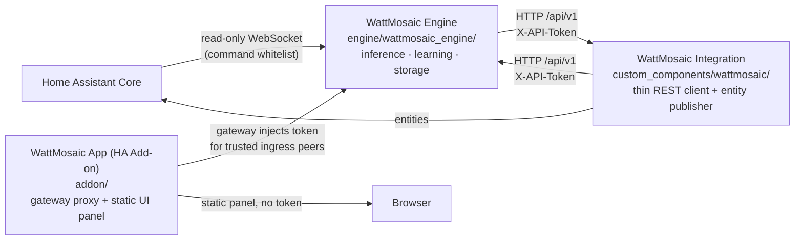

# Phase 0 — Repository and Environment Discovery

**Status:** Phase 0 discovery output — repository architecture summary and implementation constraints
**Date:** 2026-11-16
**Baseline:** branch `main`, HEAD `612e1233c2665c206d0a3fdc8a4fbc4ed531df01`, engine version `0.2.1-dev.36`, `CONTRACT_VERSION = "2.0.0"` (`engine/wattmosaic_engine/contracts.py:32`), SQLite schema `LATEST_VERSION = 11` (`engine/wattmosaic_engine/storage/migrations.py:792`).

This is the input to `00-project-overview.md`, `01-requirements.md` and `02-architecture.md`. It contains no requirements, no architecture design and no task breakdown. It records what the repository *is* today and what the new work is *not allowed to break*.

**Quantifier convention used throughout:** **measured** = read directly from the source or a committed artifact; **estimated** = derived from a measurement by a stated rule; **allocated** = assigned by a model or heuristic; **unknown** = not present in the repository.

---

## 1. Repository architecture summary

### 1.1 Languages, frameworks and dependencies

| Aspect | Value | Evidence |
| --- | --- | --- |
| Language | Python ≥ 3.11 | `pyproject.toml:10` |
| CI matrix | Python 3.11 and 3.12 | `.github/workflows/ci.yml:13` |
| Container runtime | `python:3.12-slim-bookworm` | `Dockerfile:20`, `Dockerfile:50` |
| Package root | `engine/wattmosaic_engine/` | `pyproject.toml:34-36` |
| Distribution | `wattmosaic-engine` `0.2.1-dev.36` | `pyproject.toml:6-7` |
| Build backend | setuptools + PEP 621 | `pyproject.toml:1-3` |
| Console script | `wattmosaic-engine = "wattmosaic_engine.main:main"` | `pyproject.toml:31-32` |
| Contract models | pydantic ≥ 2.6, < 3 | `pyproject.toml:14` |
| HTTP server | aiohttp ≥ 3.9, < 4 | `pyproject.toml:15` |
| HA transport | websockets ≥ 12, < 16 | `pyproject.toml:16` |
| Numerics | numpy ≥ 1.26, < 3; scipy ≥ 1.11, < 2 | `pyproject.toml:17-18` |
| Config | PyYAML ≥ 6, < 7 | `pyproject.toml:19` |
| Dev deps | pytest ≥ 8, pytest-asyncio, pytest-cov, ruff ≥ 0.6, mypy ≥ 1.10 | `pyproject.toml:23-29` |
| Lint config | ruff, line-length 110, `target-version = "py311"`, `select = ["E","F","I","UP","B","SIM"]`, `ignore = ["E501","UP042"]`, `extend-exclude = ["custom_components","addon","data"]` | `pyproject.toml:44-57` |
| Test config | `testpaths = ["tests"]`, `asyncio_mode = "auto"`, `addopts = "-q"` | `pyproject.toml:38-42` |
| UI | vanilla JS/CSS/HTML, **no build step, no Node toolchain** | `addon/ui/` (4 files); `Dockerfile:74` copies them verbatim |

`UP042` is ignored deliberately: contracts use `class X(str, Enum)` and Pydantic serialises the *value* only for str subclasses; `StrEnum` would change the generated schema text (`pyproject.toml:52-56`).

**Non-Python surfaces.** The Home Assistant integration (`custom_components/wattmosaic/`) is pure Python and is **excluded from ruff** (`pyproject.toml:47`). The panel (`addon/ui/app.js`, 165 KB) is excluded from lint and has its own static gate (`tools/dev/check_panel.py`).

### 1.2 The three-component architecture

The engine owns inference; the integration never computes power; the App packages and exposes the engine.



**The single most important architectural rule: the integration never computes power — it renders what the engine already decided** (`docs/architecture.md:46-48`). The reverse direction is also closed: the engine never consumes the entities the integration publishes, because ingestion and topology discovery exclude entities whose registry `platform` is `wattmosaic` (`docs/architecture.md:50-53`).

The engine must run outside Home Assistant (`docs/architecture.md:43`), which is why the engine owns long-term storage and the integration owns entity creation (`docs/architecture.md:40-44`).

### 1.3 Top-level directory responsibilities

| Path | Responsibility | Evidence |
| --- | --- | --- |
| `engine/wattmosaic_engine/` | The Python engine: contracts, ingestion, synchronization, quality, electrical, disaggregation, models, learning, aggregation, storage, api, diagnostics, config, `main.py`, `integration.py`, `device_links.py`, `entity_evidence.py` | `docs/architecture.md:53-70`; directory listing |
| `custom_components/wattmosaic/` | HA integration: `sensor`, `binary_sensor`, `button` platforms, config flow with CT assignment wizard, 13 services, `api_client.py`, `coordinator.py` | `custom_components/wattmosaic/services.yaml:11-185` |
| `addon/` | HA OS App: `config.yaml` manifest, `run.sh` entrypoint, `gateway.py`, `healthcheck.py`, `discovery.py`, `constraints.txt`, `Dockerfile`, `ui/` | `addon/` listing; `addon/config.yaml` |
| `tools/` | `audit/` (capture path), `dev/` (gates and verifiers), `simulator/` (synthetic household generator) | `tools/` listing |
| `tests/` | `unit/` (63 files), `integration/` (18), `simulation/` (13), `end_to_end/` (9), `fixtures/` (3) | directory listing |
| `data/` | `schemas/` (20 files: 19 per-schema JSON documents plus `index.json`), `examples/reference_house/` (the only committed household), git-ignored live artifacts | `data/schemas/`; `.gitignore:24,29,31,48` |
| `docs/` | 36 entries: `decisions/README.md` (34 ADRs), `specs/`, the 13 governing prose documents | `docs/` listing |
| `scripts/` | `validate_addon.sh`, `package_addon.sh`, `generate_icons.py` | `scripts/` listing |
| `build/`, `logs/` | local scratch; no source content | directory listing |

`data/` mixes committed and untracked content. The committed part is `data/schemas/`, `data/examples/` and `data/verification.json`. The untracked part is `data/*.db`, `data/raw/`, `data/passive/`, `data/ct_update_profile.json`, `data/entity_registry.json` and the other live audit outputs (`.gitignore:24,29,31,48`; verified with `git check-ignore`).

### 1.4 Engine module map and dependency direction

```text
engine/wattmosaic_engine/
├── contracts.py        # authoritative schemas (depends only on __version__)
├── config/             # env loading, validation, redaction
├── storage/            # SQLite, migrations, repositories
├── ingestion/          # HA WebSocket read-only client
├── synchronization/    # per-channel buffers, alignment, staleness
├── quality/            # data-quality scoring
├── electrical/         # topology graph, measurement matrix, NNLS
├── disaggregation/     # inference orchestration, residual, confidence
├── models/             # device model classes + registry
├── learning/           # sample collection, filtering, training, promotion
├── aggregation/        # energy integration, buckets, runs
├── api/                # aiohttp v1 API
├── diagnostics/        # health/diagnostics report
└── main.py             # process lifecycle
```

Source: `docs/architecture.md:53-70`.

**Dependency direction is strictly downward** (`docs/architecture.md:78-82`):

```text
main → api → disaggregation → electrical → contracts
     → learning → models → storage → contracts
     → ingestion → synchronization → quality → contracts
```

`contracts.py` imports nothing from the package — only `__version__`, `pydantic` and the standard library (`engine/wattmosaic_engine/contracts.py:21-30`). `storage` imports only `contracts`. This keeps the schema stable and testable in isolation (`docs/architecture.md:84-85`).

Sub-packages in full: `electrical/` = `__init__, direct, factors, hierarchy, main_power, matrix, models, nesting, panel_tree, solver, topology, window`; `disaggregation/` = `__init__, association, audit, auto_placement, circuits, confidence, configuration, engine, events, group_fit, isolation, tiers`.

### 1.5 Process lifecycle

**Startup** (`engine/wattmosaic_engine/main.py:3121-3173`):

| Step | Line | What it does |
| --- | --- | --- |
| 1 | `main.py:3124` | `Database(config.database_path)` — migrations run in `__init__` |
| 2 | `main.py:3125` | `EngineCore(config, db)` |
| 3 | `main.py:3126` | `APIServer(core, api_token, host, port)` |
| 4 | `main.py:3153` | `db.log_system_event("info", "lifecycle", "engine starting", …)` |
| 5 | `main.py:3162` | `core.verify_integrity()` — the only whole-file `PRAGMA integrity_check`; the verdict is cached for `/health` |
| 6 | `main.py:3166` | `await api.start()` |
| 7 | `main.py:3167` | `await core.start(start_loops=False)` |
| 8 | `main.py:3169-3173` | Five supervised components: `ha_source`, `writer`, `quality`, `inference`, `maintenance` |
| 9 | `main.py:3174` | `await stop_event.wait()` |

`verify_integrity()` runs *before* the server starts: on corruption the engine refuses to run rather than silently losing data (`docs/architecture.md:148`).

**Loops.**

| Loop | Entry | Cadence | Source |
| --- | --- | --- | --- |
| writer | `_writer_loop` | batch 100, flush every 2.0 s | `main.py:96-97`, `:966` |
| quality | `_quality_loop` | every `max(1.0, inference_interval_s)` = 5.0 s | `main.py:1168`; `settings.py:158,267` |
| inference | `_inference_loop` | every `max(1.0, inference_interval_s)` = 5.0 s | `main.py:1183`; `settings.py:158,267` |
| maintenance | `_maintenance_loop` | every 60 s; prunes the aligner and calls `db.prune(retention_days_raw, retention_days_aggregates)` | `main.py:1308` |
| reanalysis | inside the inference loop | `reanalysis_interval_s` = 3600 s, lookback `reanalysis_lookback_s` = 21600 s | `settings.py:223,225` |

**One inference cycle** (`run_inference_once`, `main.py:1198-1302`): topology lookup (bootstrap candidate discovery when none exists) → build the power window → rebuild metadata once per cycle (measured dimmer levels, per-channel measured MAD noise floor) → attach pending declared-link transitions → `backend.process(window, device_states, topology, models, events)` → merge and persist results plus reconciliation → sync learning state.

**The audit pass is not in `main.py`.** It runs inside the backend: `integration.py:347` `self._analyze(...)` and `integration.py:348` `self._maybe_reanalyze(...)`, both on the inference loop. `_maybe_reanalyze` (`integration.py:804-835`) reads the clock and returns when the interval has not elapsed. **Periodic work follows the "read the clock, never start a thread" pattern** — a new subsystem must not introduce a thread.

**Shutdown** (`core.stop()`, `main.py:803-841`): stop the HA source → close the persist queue → cancel worker tasks → drain the persist queue with a 10 s timeout → close the backend (flushes energy buckets) → WAL checkpoint → log the shutdown event. The `finally` in `_run_engine` (`main.py:3175-3192`) additionally stops the supervisor and the API and closes the DB, each step individually guarded.

### 1.6 API surface and auth model

`aiohttp`, prefix `/api/v1` (`api/server.py:57`), response header `X-WattMosaic-Contract-Version` (`api/server.py:58`), request header `X-API-Token` with a constant-time compare (`api/server.py:59`, `:285`). `DEFAULT_REQUEST_TIMEOUT_S = 30.0`, `DEFAULT_MAX_CONCURRENCY = 32` (`api/server.py:60-61`).

Registered routes (`api/server.py:760-784`):

```
GET    /health                  GET    /quality
GET    /status                  GET    /diagnostics
GET    /snapshot                GET    /circuits
GET    /devices                 GET    /relations
GET    /devices/{device_id}     GET    /devices/{device_id}/records
GET    /confidence_tiers        GET    /residuals
GET    /topology                GET    /isolation
PUT    /topology                GET    /models/{device_id}
POST   /topology/confirm        POST   /commands
GET    /topology/nesting        POST   /discover/placements
GET    /topology/tree           GET    /export/{device_id}
                                GET    /metrics
```

**Error model: request-validation failures return HTTP 400 with `{"error":"bad_request","detail":…}`; 422 is never exposed** (`api/server.py:12-13`, `:341` — `422: "bad_request",  # never expose 422 as a distinct code`). `ErrorResponse` = `{error, detail, retryable}` (`contracts.py:1789-1792`). `NullFacade` → 503, `NotFound` → 404, `InvalidRequest` → 400.

**Network shape.** The **code default** is `api_host = "0.0.0.0"` and `api_port = 8787` (`config/settings.py:145-146`). The **deployment** overrides that to `127.0.0.1:8788` inside the container (`Dockerfile:62-63`; `docker-compose.yml` `environment:` block; `addon/run.sh:249`), so the engine API is loopback-only in the shipped images. The App gateway publishes `:8787` (`addon/run.sh:250`, `Dockerfile:80`), serves `/healthz` unauthenticated for the Supervisor watchdog (`addon/gateway.py:398`, `addon/config.yaml:95`), injects `X-API-Token` for trusted ingress peers (`addon/gateway.py:18-19`, `:239`, `:260`) and hosts the static panel. **The browser never receives a token** (`docs/architecture.md:156-158`).

`EngineCore` implements the `EngineFacade` protocol (`api/facade.py:94-148`).

### 1.7 Storage model

Raw SQLite with `journal_mode=WAL`, `synchronous=NORMAL`, `busy_timeout=10000`, `wal_autocheckpoint=1000`, `foreign_keys=ON`, one connection serialised behind an `RLock` (`docs/limitations_v2.md:182-186`; `storage/database.py:74`).

Schema version 11 (`migrations.py:792`). Migration discipline: forward-only, additive, idempotent; each migration runs inside `BEGIN IMMEDIATE` … `PRAGMA user_version = N` … `COMMIT` and rolls back on error, so a partially applied migration leaves the version behind (`migrations.py:4`, `:805`, `:811`).

Tables, by family (`migrations.py:266-744`):

| Family | Tables |
| --- | --- |
| Raw | `ct_samples`, `device_events`, `device_state_samples`, `inference_results`, `learning_samples`, `reconciliation_results`, `data_quality_events` |
| Aggregates | `power_aggregates`, `energy_aggregates`, `device_runs` |
| Configuration | `engine_state`, `ct_channels`, `devices`, `device_configurations`, `device_flags`, `device_models`, `device_model_versions`, `operating_stages`, `schema_metadata` |
| Audit (no retention horizon) | `circuits`, `topology_relations`, `inference_records`, `ct_measurement_factors`, `ha_entity_bindings`, `residual_power`, `isolation_verdicts` |

The seven audit tables are listed in `AUDIT_TABLES` (`migrations.py:122-134`) and are **exempt from pruning** — they grow for the life of the file (`docs/limitations_v2.md` §7.2).

Retention: raw samples (30 d default) → 5-minute power/energy aggregates → 1-hour aggregates → retained 730 d default (`docs/data_flow.md:84-87`; `settings.py:151-152`; `database.py:1304`).

### 1.8 The UI

Vanilla JS/CSS/HTML in `addon/ui/` — four files: `app.js`, `app.css`, `index.html`, `mark.svg`. **No build step, no Node toolchain**; the files are copied verbatim into the image (`Dockerfile:74`).

Five hash routes plus a device route: `#/overview`, `#/devices`, `#/topology`, `#/quality`, `#/diagnostics`, `#/device/:id` (`addon/ui/app.js:656`, `:1040`, `:1091`, `:1286`, `:3915`). Render functions: `renderOverview` 773, `renderDevices` 1071, `renderDevice` 1274, `renderTopology` 1642, `renderEntry` 2226, `renderQuality` 3466, `renderDiagnostics` 3595.

Key properties:

- Fetch is plain `fetch` with `BASE` derived from `document.baseURI` and `API_PREFIX = ${BASE}api/v1` (`addon/ui/app.js:30`, `:35`, `:103`). The panel therefore works under the Supervisor ingress path.
- **No `X-API-Token` is ever sent by the browser.**
- A tiny `el(tag, props, children)` factory inserts engine strings as **text only** — there is deliberately no `html` key, so a device name can never become markup (`addon/ui/app.js:156-161`).
- A `STRINGS` table is the single label vocabulary: `label = (value) => STRINGS[value] || titleCase(value || 'unknown')` (`addon/ui/app.js:264`, `:293`).
- CSS uses `:root` tokens with a light-scheme override.

### 1.9 The Home Assistant integration

Platforms `sensor`, `binary_sensor`, `button` (`custom_components/wattmosaic/`). Config flow with a CT assignment wizard. **13 services** (`services.yaml:11-185`): `start_learning`, `pause_learning`, `resume_learning`, `accept_sample`, `reject_sample`, `rebuild_model`, `freeze_model`, `unfreeze_model`, `reset_device_model`, `rebuild_topology`, `run_diagnostics`, `export_device_data`, `discover_placements`. Three of them require `confirm: true` (`services.yaml:49`, `:113`, `:135`).

`async_migrate_entry` exists (`custom_components/wattmosaic/__init__.py:71`). The coordinator polls with `scan_interval`, default 30 s (`const.py:70`, `coordinator.py:116`, `:136`). The integration never reads the HA registry to decide topology — the engine never reads the HA registry at all; the integration resolves links and writes entity ids into `DeviceTopology.metadata` (`docs/architecture.md:87-90`).

### 1.10 Deployment and release shapes

**Standalone image** (`Dockerfile`): 2-stage, runtime UID 10001, `/data` volume, `EXPOSE 8787`, `HEALTHCHECK` → `healthcheck.py`, `ENTRYPOINT ["/app/run.sh"]` (`Dockerfile:68-70`, `:79`, `:80`, `:86`, `:89`).

**Compose** (`docker-compose.yml`): service `engine`, published `${WM_BIND_ADDRESS:-0.0.0.0}:${WM_GATEWAY_PORT:-8787}:8787`, volume `wattmosaic-data:/data`, `read_only: true`, `cap_drop: ALL`, `no-new-privileges`, tmpfs `/tmp`, 1 g memory limit, json-file logging.

**HA OS App** (`addon/config.yaml`): `ingress: true`, `ingress_port: 8787`, `watchdog: "http://[HOST]:[PORT:8787]/healthz"`, `map: data + share`, `backup: cold`, `discovery: [wattmosaic]`, `ports: 8787/tcp: null` (disabled by default), `arch: [amd64, aarch64]`, image `ghcr.io/asxzy/wattmosaic-engine` (`addon/config.yaml:29-38`, `:53-54`, `:86-87`, `:95`, `:97-101`, `:105`, `:80-81`).

`run.sh` precedence is **options.json > environment > built-in defaults** (`addon/run.sh:165-166`); it parses options without `eval` (NUL-separated records read with `read -d ''`, `addon/run.sh:78-80`), falls back `ha_token` → `HA_TOKEN` → `SUPERVISOR_TOKEN`, validates that `WM_API_PORT` ≠ `WM_GATEWAY_PORT` (`addon/run.sh:260-261`), and drops privileges with `setpriv` after a write test performed as the service user (`addon/run.sh:329-339`). The engine is `exec`'d so it is PID 1 and receives SIGTERM directly (`addon/run.sh:400`).

**Release pipeline** (`.github/workflows/release.yaml`): trigger is push to `main` or `stable`, or `workflow_dispatch` (`release.yaml:44-52`). Four jobs chained by `needs`: `prepare` → `image` → `publish` → `prune` (`release.yaml:66`, `:196`, `:312`, `:420`). `main` is the development line: **every push publishes a prerelease** (`X.Y.Z-dev.N`); `stable` carries a plain `X.Y.Z` and is human-driven (`release.yaml:24-26`). The multi-arch image (`linux/amd64,linux/arm64`) is built by the `image` job and pushed to `ghcr.io/asxzy/wattmosaic-engine:<version>` (`release.yaml:287-295`).

**A stale-tag guard refuses to republish an image whose runtime inputs changed.** The guard compares the *runtime inputs* (not the SHA) so a docs-only commit does not raise a false alarm, and it refuses to guess when the published revision cannot be read (`release.yaml:234-285`, `:240-243`, `:256-259`).

**CI bumps the version as part of publishing**, because the Supervisor offers an App update only when `addon/config.yaml`'s `version:` string changes (`release.yaml:8-23`).

### 1.11 Test and simulation infrastructure

pytest + pytest-asyncio (`asyncio_mode = "auto"`), pytest-cov. Layout `tests/{unit,integration,simulation,end_to_end}` plus `tests/fixtures/labhouse.py`.

`tests/conftest.py` fixtures: `repo_root` (:40), `simulator_root` (:45), `rng` (:50, seeded `random.Random(20261105)`), `tmp_db_path` (:56), `sample_topology` (:61), `fast_scenario` (:84), `household_scenario` (:91), `lab_house` (:106), `lab_houses` (:133), `hot_tub_fixture` (:152). `tests/unit/conftest.py` provides `make_sample`, `binary_samples`, `series` (default `step_s: float = 15.7`, `tests/unit/conftest.py:93`), `FakeWindow`, `windows_over`, `BASE_TIME`.

The simulator (`tools/simulator/`) produces a record stream whose `ground_truth` block is computed independently of the measurement pipeline; the measurement pipeline only consumes the truth to corrupt it. `tools/simulator/frames.py` enforces the observation/truth seam (`assert_no_ground_truth_keys`, `observation_view`, `truth_view`, `OBSERVABLE_MEASUREMENT_FIELDS`). `tools/simulator/labhouse.py` exposes 21 named strata and a `LabHouse` with `observations()` and `ground_truth()` kept separate, plus `signature()` (SHA-256 over the observation stream).

`tests/fixtures/labhouse.py` holds `REQUIRED_STRATA` (21 names), `MATRIX_STRATA` (the matrix row → stratum map) and `REQUIRED_HOT_TUB_VARIANTS` (9 names, `tests/fixtures/labhouse.py:147`), plus `assert_matrix_coverage()`, which fails both when a required stratum is missing and when a buildable stratum is referenced by no row.

**`REQUIRED_HOT_TUB_VARIANTS` (9) and `HOT_TUB_VARIANTS` (10) are two different sets.** The former is the list of shorthand names the matrix rows reference (`tests/fixtures/labhouse.py:147`); the latter is the simulator's own mapping from shorthand to fixture and has one entry more (`tools/simulator/hot_tub.py:933`).

**`MATRIX_STRATA` has 75 row keys and no J row at all**: A1–A7, B1–B9, C1–C9, D1–D9, E1–E5, F1–F10, G1–G10, H1–H9, I1–I8 (verified by import; zero `J*` keys). `docs/test_scenario_matrix.md` nevertheless declares 84 rows including J1–J9 and has **no `T##` namespace** (verified: 0 matches).

**Nine live-capture tests skip without a local capture.** `tests/simulation/test_real_topology.py:60` applies `pytest.mark.skipif` on the presence of `WATTMOSAIC_REAL_DB` (or `data/wattmosaic.db`); the file contains 9 test functions (`:146`, `:181`, `:217`, `:267`, `:314`, `:352`, `:387`, `:406`, `:421`).

### 1.12 The contract-change workflow

`engine/wattmosaic_engine/contracts.py:1-11` states the workflow verbatim:

1. Edit the module and bump `CONTRACT_VERSION`.
2. Update `data/schemas/*.json` (generated by `tools/dev/export_schemas.py`).
3. Update affected implementations and run `pytest`.

`CONTRACT_VERSION = "2.0.0"` (`contracts.py:32`). Every response carries `X-WattMosaic-Contract-Version` (`api/server.py:58`).

**The schema-drift gate is a CI diff, not a script exit code.** `ci.yml:26-29` runs `python tools/dev/export_schemas.py` and then `git diff --exit-code data/schemas`: if the regenerated schemas differ from the committed ones, CI fails. The same work is the `contract_schema_sync` gate in the local harness (`tools/dev/verify.py:107`).

### 1.13 CI and gate toolchain

**`.github/workflows/ci.yml` has six jobs**, not five:

| Job | What it runs | Lines |
| --- | --- | --- |
| `test` | matrix 3.11/3.12: `ruff check engine tools tests`; `mypy engine/wattmosaic_engine \|\| true`; schema-drift `git diff --exit-code data/schemas`; `render_validation_docs.py --check`; `bash scripts/validate_addon.sh --no-build`; `pytest -q` | `ci.yml:9-35` |
| `privacy` | fails if live-install audit artifacts are tracked; asserts committed fixtures are synthetic and carry no `mac_address`/`serial`/`config_entry_id` | `ci.yml:37-59` |
| `secrets` | fails if a `.env` is tracked; runs `python tools/dev/check_secrets.py` | `ci.yml:61-76` |
| `integration-structure` | validates `custom_components/wattmosaic/manifest.json` and `addon/config.yaml` | `ci.yml:78-100` |
| `hacs` | `python tools/dev/check_hacs.py` plus the HACS action | `ci.yml:102-115` |
| `release` | `check_release.py`; `--channel` check on `main`/`stable` | `ci.yml:117-132` |

`mypy engine` is **non-blocking in CI** (`ci.yml:25` — `|| true`). Measured on this checkout at HEAD `612e1233`: **112 errors in 27 of 80 checked files** (`mypy engine/wattmosaic_engine`), against a recorded baseline of 120 errors with delta 0 (`docs/final_validation_report.md:23`, `:175-176`). The absolute count has therefore drifted **below** the recorded baseline, but the delta-zero *policy* still binds: new code must not add errors.

**Local verification gate: `python tools/dev/verify.py`** — 12 required gates + 1 optional (`tools/dev/verify.py:106-124`):

| Gate | Command | Line |
| --- | --- | --- |
| `contract_schema_sync` | `python tools/dev/export_schemas.py` | `:107` |
| `secret_scan` | `python tools/dev/check_secrets.py` | `:108` |
| `lint` | `ruff check engine tools tests` | `:112` |
| `unit_tests` | `pytest tests/unit -q` | `:113` |
| `integration_tests` | `pytest tests/integration -q` | `:114` |
| `simulation_tests` | `pytest tests/simulation -q` | `:115` |
| `end_to_end_tests` | `pytest tests/end_to_end -q` | `:116` |
| `manifest_valid` | `python tools/dev/check_manifests.py` | `:117` |
| `release_valid` | `python tools/dev/check_release.py` | `:118` |
| `docs_fresh` | `python tools/dev/render_validation_docs.py --check` | `:119` |
| `deployment_valid` | `bash scripts/validate_addon.sh --no-build` | `:120` |
| `hacs_valid` | `python tools/dev/check_hacs.py` | `:121` |
| `config_valid` *(optional)* | `python -m wattmosaic_engine.main --check-config` — requires `HA_TOKEN` | `:122-123` |

It forces `sys.executable` and points `PYTHONPATH` at **this checkout's** `engine/`, so a worktree cannot pass against the parent's code (`tools/dev/verify.py:67-78`). It writes `data/verification.json` and `docs/verification_report.md` (`verify.py:197-202`). Gate output is scrubbed of URLs, IPs and absolute paths before being written (`verify.py:42-61`).

**The panel gate is separate and static**: `tools/dev/check_panel.py` enforces 8 numbered rules (`check_panel.py:157-229`): no external origins; no inline event handlers; no inline `<script>`/`<style>`; every named asset shipped; balanced shell tags; no runtime `eval`/`new Function`/`document.write`; no retired "dedicated CT" vocabulary; and a replay of the panel's own `STRINGS` lookup so the check is not vacuous (`check_panel.py:222-229`).

---

## 2. Existing interfaces to preserve

### 2.1 The thirteen components that must not be rebuilt

`docs/assessment_gap_analysis.md:437-455` names thirteen load-bearing components under the heading "What must NOT be rebuilt" (`:437`), with the table itself at `:441-455` and thirteen rows at `:443-455`. They are "load-bearing and correct; changing them would destroy value" (`:439`). They are reproduced here with the current evidence, because several line numbers in the assessment predate the current tree — for example row 11 records "8 migrations" where there are now 11.

| # | Component | What it guarantees | Why it must not be rewritten | Evidence |
| --- | --- | --- | --- | --- |
| 1 | Three orthogonal taxonomy axes (`HaConnectivity`, `MonitoringLevel`, `PowerBehavior`) | Prevents the "one enum to rule them all" collapse that loses information | `contracts.py` enumerations; ADR-0011 | `docs/assessment_gap_analysis.md:443`; `docs/decisions/README.md` ADR-0011 |
| 2 | `Source` + `ConfidenceTier` separation | One answers *how obtained*, the other *what kind of evidence* | Merging them is the failure mode the brief warns about | `contracts.py:62`, `:223`; `disaggregation/tiers.py`; `docs/assessment_gap_analysis.md:444` |
| 3 | Read-only HA client | Structural safety: no service path exists, so no accidental actuation | `ingestion/ha_source.py:147-165`, `:932-935`; `docs/assessment_gap_analysis.md:445` |
| 4 | Declarative entity→device linking | Name/area similarity would fabricate attribution | `device_links.py:1-40`; `docs/assessment_gap_analysis.md:446` |
| 5 | Anchored step rescan | The single biggest accuracy mechanism | `disaggregation/engine.py`; `docs/assessment_gap_analysis.md:447` |
| 6 | Null-space identifiability + explicit ambiguity | "Unknown over fabricated" is the product's core promise | `electrical/solver.py:136`; `disaggregation/engine.py:1375-1421`; `docs/assessment_gap_analysis.md:448` |
| 7 | Residual never redistributed | Enforced in contract and in tests | `contracts.py`; `tests/integration/test_safety_invariants.py:265`; `docs/assessment_gap_analysis.md:449` |
| 8 | Canonical-alias and multiplier applied once, on read | Prevents double counting structurally | `electrical/topology.py:615-660`; `docs/assessment_gap_analysis.md:450` |
| 9 | Nested-CT refusal to auto-write parent links | R1/R11 risk register; confirmation is the mitigation | `electrical/nesting.py:574-607`; `main.py:1877`; `docs/assessment_gap_analysis.md:451` |
| 10 | `learning.effective_state` (`learning`/`blocked`/`off`) | Fixes the "ON but accepting nothing" invisibility | `learning/reporting.py:1-48`; `docs/assessment_gap_analysis.md:452` |
| 11 | Migration discipline (forward-only, additive, idempotent) | 11 migrations, `user_version`, no edits to released ones | `storage/migrations.py:1-12`, `:30-40`, `:455-470`; `docs/assessment_gap_analysis.md:453` (which still says "8 migrations") |
| 12 | Stratified simulation metrics + oracle self-check | The only defence against a single misleading aggregate | `tests/simulation/metrics.py:5`, `:948`; `tests/simulation/test_accuracy.py:98`; `docs/assessment_gap_analysis.md:454` |
| 13 | Panel tree as a read-time projection | Avoids a second source of truth for hierarchy | `electrical/panel_tree.py:1148`; `main.py:1840-1875`; `docs/assessment_gap_analysis.md:455` |

### 2.2 The public interface surface to preserve

| Interface | Where it lives | What it guarantees | Why it must not be rewritten | Evidence |
| --- | --- | --- | --- | --- |
| `Measurement`, `CTChannel`, `Topology`, `DeviceTopology`, `Circuit`, `TopologyRelation`, `DeviceConfiguration(Set)`, `DeviceEvent`, `InferenceResult`, `InferenceRecord`, `Reconciliation`, `ResidualPower`, `MeasurementFactor`, `HaEntityBinding`, `EventIsolation` | `engine/wattmosaic_engine/contracts.py` | The only schema; generated JSON schemas are the published interface | Inventing a parallel schema is explicitly forbidden | `contracts.py:1-11`; `data/schemas/` (20 files: 19 schemas + `index.json`) |
| `Source`, `ConfidenceTier`, `ConfidenceVector`, `QualityStatus`, `RelationKind`, `IsolationStatus`, `CircuitClass`, `MeasurementBasis`, `MonitoringLevel`, `ModelType`, `ModelStatus`, `Phase`, `Polarity`, `CTType`, `ServiceCommand`, `ServiceResult`, `HealthResponse`, `SnapshotResponse`, `ErrorResponse` | `contracts.py` | Typed, discriminated vocabulary | A parallel enum set silently forks the wire format | `contracts.py:44-60`, `:186`, `:223-225`, `:254-266`, `:476`, `:1789` |
| `HASource` | `ingestion/ha_source.py:337` | Read-only HA WebSocket client; command whitelist | Structural safety — no service path exists | `ha_source.py:147-164`, `:932` |
| `canonical_unit`, `normalize_unit`, `parse_float`, `parse_state_timestamp`, `is_own_entity`, `entity_allowed` | `ingestion/normalize.py` | kW→W and Wh→kWh normalisation; own-entity exclusion | Wrong normalisation silently rescales every reading | `normalize.py:41-64` |
| `correlate`, `CtCandidate`, `CorrelationReport`, `estimate_row_noise`, `observations_from_history`, `parse_history_payload` | `ingestion/correlation.py` | Correlation without topographical claims | Correlation is not topography | `docs/electrical_model.md:738-802` |
| `discover_candidate_topology` | `ingestion/discovery.py` | Candidate-only discovery | A candidate is a proposal | `contracts.py:791`; `docs/association_and_topology.md:363-372` |
| `BoundedQueue` | `ingestion/queue.py` | Bounded memory under backpressure | The engine must never grow without bound | `docs/architecture.md:151` |
| `SampleAligner` | `synchronization/aligner.py` | Per-channel alignment and staleness | Missing is never zero | `docs/electrical_model.md:561-583` |
| `ChannelReading`, `ObservationWindow`, `CoercedWindow`, `coerce_window`, `clamp_cadence` | `electrical/window.py` | Cadence-derived windows | Windows are derived from observed cadence, never hardcoded 2 s | ADR-0003 |
| `TopologyGraph`, `build_graph`, `MeasurementMatrix`, `build_measurement_matrix`, `ElectricalModel`, `Identifiability`, `SolveResult`, `analyse_identifiability`, `augment_with_unknown_slack`, `solve_constrained_nnls`, `residual_summary` | `electrical/` (`__init__.py:38-56`, `:87`) | The measurement model and its null-space analysis | Identifiability is the product's core promise | `electrical/__init__.py`; `docs/electrical_model.md:667-687` |
| `MainPower`, `main_power_w`, `phase_power_w`, `meter_spread_w` | `electrical/main_power.py` | Measured meter spread, never guessed | `unmonitored_w + meter_disagreement_w == unknown_residual_w` exactly | `docs/electrical_model.md:485-559` |
| `infer_nesting`, `containment`, `duplicate_evidence`, `closure_fraction`, `HierarchyFinder`, `parent_cycle` | `electrical/nesting.py`, `electrical/hierarchy.py` | Conservative hierarchy inference | Nested-CT refusal to auto-write parent links | `docs/assessment_gap_analysis.md:451` |
| `FactorRegistry`, `FactorResolution`, `FactorOwnership`, `resolve_factor_ownership`, `scale_reading` | `electrical/factors.py` | Multiplier applied exactly once, on read | Double counting is structurally prevented | `electrical/factors.py:440`; `docs/assessment_gap_analysis.md:450` |
| `build_panel_tree`, `ModelView`, `expected_power_w`, `resolve_model`, `model_upper_bounds` | `electrical/panel_tree.py` | The panel tree is a read-time projection | A second source of truth for hierarchy | `docs/assessment_gap_analysis.md:455` |
| `DisaggregationEngine`, `InferenceBatch`, `EventIsolator`, `physical_device_events`, `split_attribution`, `clean_attribution_inputs` | `disaggregation/` | Event isolation and attribution | A contaminated event is excluded, never decomposed | `docs/limitations_v2.md` §2 |
| `AssociationFinder`, `Observation`, `CircuitClassifier`, `compute_confidence`, `event_isolation_score`, `evidence_tier`, `grade`, `tier_rank` | `disaggregation/association.py`, `circuits.py`, `confidence.py`, `tiers.py` | Association, classification and tiering | Confidence is never blended into one score | `docs/confidence_model.md:31-34` |
| `EffectiveConfig`, `derive_monitoring`, `effective_config`, `configured_power`, `interpolate_curve`, `materialisation_blockers` | `disaggregation/configuration.py` | Device state → monitoring level derivation | A state that says "off" pins a device | `docs/electrical_model.md:561-583` |
| `AuditPass`, `AuditConfig`, `AuditReport`, `persist_records`, `persist_isolations` | `disaggregation/audit.py` | The versioned analysis pass | The audit trail is the product's auditable surface | `docs/confidence_model.md:38-72` |
| `Placement`, `PlacementPlan`, `plan_placements`, `merge_placements`, `auto_device_id` | `disaggregation/auto_placement.py` | Placement planning | A write must be something the user asked for | `settings.py:164-167`; `addon/config.yaml:121-126` |
| `StepChange`, `detect_step`, `detect_changes`, `StepTracker` | `disaggregation/events.py`, `engine.py` | Anchored step rescan | The single biggest accuracy mechanism | `docs/assessment_gap_analysis.md:445` |
| `LearningPipeline` (`consider`/`ingest_samples`/`train`/`validate_and_promote`/`retrain_device`/`freeze`/`rollback`), `SampleCollector`, `SampleFilter`, `Trainer`, `PromotionManager`, `split_holdout`, `validate_model`, `compare_models` | `learning/` | The learning lifecycle and promotion gate | Promotion is a gated transition, not an assignment | `learning/`; `docs/assessment_gap_analysis.md:452` |
| `DeviceModel` (ABC), `model_class_for`, `build_model`, `BinaryDeviceModel`, `DimmableDeviceModel`, `VariableSpeedDeviceModel`, `MultiStateDeviceModel`, `CompositeDeviceModel`, `TimeVaryingApplianceModel` | `models/` | Device model classes and the registry | One model per device behaviour class | `models/` |
| `ResidualAnalyzer`, `ResidualScope`, `ResidualDecomposition`, `ResidualTrend`, `bases_are_compatible`, `IncompatibleBasisError` | `models/residual.py` | Residual decomposition with basis compatibility | The signed residual is the only subtraction | `docs/residual_analysis.md:16-38` |
| `segment_power_series`, `robust_noise`, `Segment`, `SegmentationResult` | `models/segmentation.py` | Robust segmentation | MAD-robust change statistic | `docs/algorithms.md:98` |
| `QualityThresholds`, `score_to_status`, `OverlapCluster`, `DataQualityEngine` | `quality/engine.py` | Per-channel quality scoring; the measured MAD noise floor is published to inference | A missing reading is missing, not zero | `main.py:1231-1241` |
| `EnergyAggregator`, `EnergyBucket`, `DeviceRun`, `DeviceRunRepository` | `aggregation/` | Trapezoidal energy integration on real elapsed time | Gaps larger than `stale_after` accrue no energy | `aggregation/` |
| `Database`, `Migration`, `MIGRATIONS`, `apply_migrations`, `current_version`, `LATEST_VERSION`, `prune` | `storage/database.py:74`, `storage/migrations.py:260`, `:792-811`, `database.py:1304` | Forward-only additive migrations; retention | Two writers on one file contend | `docs/limitations_v2.md:182-192` |
| `APIServer`, `create_app`, `create_runner`, `ErrorResponse` handling | `api/server.py` | The `/api/v1` surface, 400-not-422 error model, token auth | The error model is a published contract | `api/server.py:12-13`, `:57-61` |
| `EngineFacade` protocol | `api/facade.py:94-148` | The engine's read/write surface as the API sees it | The API is written against the protocol, not the concrete core | `api/facade.py` |
| `state_entity_ids`, `config_load_entity_ids`, `link_state_entity_ids`, `runtime_state_entities`, `entity_links`, `ambiguous_entities`, `device_for_entity`, `state_key`, `supporting_ct_ids`, `state_entity_for_device` | `device_links.py` | The declarative entity→device rules | A power entity is measurable, not state-bearing | `device_links.py`; ADR-0028 |
| `MODE_ONLY_DOMAINS`, `LOAD_DOMAINS`, `LOAD_DEVICE_CLASSES`, `COMPLEX_DEVICE_TYPES`, `classify_entity`, `select_runtime_entities` | `entity_evidence.py` | Entity role classification (ADR-0012) | An explicit user declaration always wins; no friendly-name or area heuristics | `entity_evidence.py`; ADR-0012 |
| `WattMosaicBackend.process` | `integration.py:303-361` | The single production entry point for inference | A new subsystem unreachable from here **will not run in production** | `integration.py:303-361`; `main.py:495`, `:643-646` |
| `EngineConfig`, `from_env`, `validate`, `redacted` | `config/settings.py:137-231`, `:233`, `:332`, `:419` | The single configuration surface and the only log-safe view | `redacted()` is the only safe way to log config | `settings.py:419-452` |

---

## 3. Implementation constraints

Each constraint is `CON-###` with the constraint, its evidence and its consequence for the new work. Categories are given so the count can be audited.

### 3.1 Measurement and data reality (CON-001 – CON-006)

**CON-001 — The system is active-power-only plus cumulative energy. Voltage, RMS current, power factor, reactive power, apparent power and frequency do not exist.**
*Evidence:* `Measurement.unit` is `Literal["W","kW","kWh","Wh"]` (`contracts.py:1074`); `value_w` (`:1075`), `effective_power_w()` (`:1107`). kW is normalised to W at ingestion (`ingestion/normalize.py:48`, `:58`). Power detection is `unit in ("W","kW") or device_class == "power"`; energy is `unit in ("kWh","Wh") or device_class == "energy"` (`ha_source.py:1065-1066`). A repository-wide search of `engine/wattmosaic_engine/` for voltage/current/reactive/apparent/power-factor/frequency tokens returns no measurement quantity. `CTChannel.nominal_voltage` is a **declared constant only** (`contracts.py:1147`).
*Consequence:* Any new capability that assumes volts, amps, VAR, VA or Hz has no data source and must either derive it from active power alone (and say so) or be specified as an acquisition change outside this repository. The contract must not grow a field that no producer populates.

**CON-002 — The `Phase` / `Polarity` / `CTType` vocabulary is narrow and closed.**
*Evidence:* `Phase` = L1/L2/BOTH/UNKNOWN (`contracts.py:50-54`); `Polarity` = NORMAL/INVERTED with the sign preserved and never clamped (`contracts.py:57-60`, and `contracts.py:15-16`: "Sign is preserved… never clamped to zero"); `CTType` = MAIN/BRANCH/UNKNOWN only (`contracts.py:44-47`). `CTChannel` carries `phase` (`:1121`), `polarity` (`:1128`), `paired_ct_id` (`:1132`), `nominal_voltage` (`:1147`), `resolution_w` (`:1148`), `reliability`.
*Consequence:* `CTType` has exactly three members and the retired "dedicated CT" concept has been removed (`docs/specs/retire-dedicated-ct-concept/README.md:4`). New code must not reintroduce `DEDICATED` or assume a fourth `CTType`. `Polarity` is metadata, not a sign transformation: a negative reading is kept as negative.

**CON-003 — The audited CT state-update cadence is 15.7 s; the 2-second assumption is explicitly not supported.**
*Evidence:* median **15.7 s** from the operator's own audit (`PROJECT_STATUS.md:27`; `docs/decisions/README.md` ADR-0003:42-44 — "Median observed CT state-update interval is **15.7 s**, not the assumed ~2 s. Some channels exceed 30 s. Home Assistant exposes no hardware-sample timestamp for a polling power integration."); some channels exceed 30 s, one is under 1 s (`PROJECT_STATUS.md:297`); `two_second_assumption_supported` is false (`PROJECT_STATUS.md:28`). ADR-0003:51-53 — "Event windows are derived from observed cadence (configurable), never a hardcoded 2 s."

**`docs/ct_update_profile.md` is not the source of the 15.7 s figure.** It is the committed *synthetic* profile, generated from the reference household by `tools/dev/render_validation_docs.py` (`tools/dev/render_validation_docs.py:11-14`), and it reports `median_interval_s: 15.8` over 36 channels (`docs/ct_update_profile.md:3-4`, `:26-28`; `data/examples/reference_house/ct_update_profile.json`). Its own text says so: "**This profile is synthetic.** It is the committed example used by the test suite and documentation, not the operator's installation" (`docs/ct_update_profile.md:6-9`). The underlying live `data/ct_update_profile.json` is git-ignored and was not read.
*Consequence:* Window widths, sampling assumptions and simulator cadences must be derived from observed cadence. The default `default_sample_interval_s = 10.0` (`settings.py:156`) is a **configuration default, not a measurement**. Do not cite `docs/ct_update_profile.md` for the audited 15.7 s median — it is the synthetic 15.8 s profile.

**CON-004 — The engine never polls CT values; HA pushes `state_changed`, and the engine also reads recorder history.**
*Evidence:* `ha_source.py:830` subscribes to `state_changed`; history windows longer than 24 h are split into 12 h slices with a seam-exact merge (`ha_source.py:103-135`, `:231-334`).
*Consequence:* A new ingestion path must subscribe to events or read history; it may not introduce a polling loop.

**CON-005 — Three timestamps per observation, and staleness is measured from the HA state timestamp.**
*Evidence:* `state_timestamp` (HA `last_updated`), `received_at` (engine receipt), optional `physical_timestamp` (`contracts.py:14-17`; ADR-0003:46-49). Staleness is `age = received_at − state_timestamp`, default `stale_after_s` = 120 (`ha_source.py:1136-1137`; `settings.py:157`). Identical repeated values are flagged `repeated=True` and are not new evidence (ADR-0003:48-49).
*Consequence:* Age is never computed from arrival (ADR-0003, `docs/decisions/README.md:387-390`). A new consumer must use `state_timestamp`, and must not treat a repeated value as a second observation.

**CON-006 — The documented event-id derivation is a content address, but the code path does not implement it; `device_events` is idempotent by primary key.**
*Evidence:* the documentation states that device events carry an `event_id` derived from `sha1(entity_id + last_updated + new_state)` so an HA reconnect that re-sends an event does not duplicate it (`docs/data_flow.md:75-78`). The write is `INSERT OR IGNORE INTO device_events(...)` and `event_id TEXT PRIMARY KEY` (`storage/database.py:533`, `storage/migrations.py:336`), so the *storage* layer is idempotent by key. But the **current code path builds `event_id` as a random UUID** — `event_id=str(uuid.uuid4())` (`ingestion/ha_source.py:1186`) — and the deterministic fallback used downstream is `device@timestamp`, not a content address (`disaggregation/isolation.py:356-369`, which prefers the source's `event_id` and synthesises `f"{device_id}@{occurred_at.isoformat()}"` only when the source has none). A repository-wide search for `sha1` in `engine/wattmosaic_engine/` returns nothing.
*Consequence:* **The documented sha1 derivation was not located in the source** and is recorded as an unverified item in §7. A new event-producing path must not assume the sha1 derivation exists: it must either reuse the `event_id` the source already supplies or use the `device@timestamp` fallback shape, and it must rely on `INSERT OR IGNORE` plus the `event_id` primary key for idempotency. A new path that invents its own id scheme must state how reconnect duplicates are prevented.

### 3.2 Storage, schema and contracts (CON-007 – CON-013)

**CON-007 — SQLite is the only store and it has a single-writer limit.**
*Evidence:* `Database` opens one connection with `check_same_thread=False` and serialises every accessor behind a `threading.RLock` (`docs/limitations_v2.md:182-186`). WAL mode allows short-lived read-only connections beside the writer but **not** a second writer: two engine processes on one file contend and the loser gets a `busy` error after 10 s, not a merge (`docs/limitations_v2.md:188-192`).
*Consequence:* The new work must not introduce a second writer, a second database file, or an out-of-process store. Any background writer must go through the existing persist queue.

**CON-008 — Migrations are forward-only, additive and idempotent, and a released migration is never edited.**
*Evidence:* `migrations.py:1-12` (module docstring), `:30-40`, `:455-470`; each migration runs `BEGIN IMMEDIATE` … `PRAGMA user_version = N` … `COMMIT` and rolls back on error (`:805-811`); `user_version` means a partially applied migration rolls back (`:4`).
*Consequence:* A schema change is a **new** numbered migration appended to `MIGRATIONS`, not an edit to an existing one. `LATEST_VERSION` is derived (`migrations.py:792`), so it moves automatically.

**CON-009 — The contract version is bumped with every contract change, and the schema-drift gate is a git diff.**
*Evidence:* `contracts.py:1-11` states the three-step workflow; `CONTRACT_VERSION = "2.0.0"` (`contracts.py:32`); CI runs `python tools/dev/export_schemas.py` then `git diff --exit-code data/schemas` (`ci.yml:26-29`); the same work is the `contract_schema_sync` gate (`tools/dev/verify.py:107`).
*Consequence:* **A contract change is not finished until `data/schemas/*.json` is regenerated and committed.** A change to `contracts.py` without the regenerated schemas fails CI.

**CON-010 — Contract changes are additive and optional, and the existing test suite must stay green.**
*Evidence:* `docs/implementation_plan_v2.md:26-29` — "Every contract change is *additive and optional*. Existing 2177 tests must stay green after every wave. A subagent that breaks an existing test has not finished."
*Consequence:* New fields carry safe defaults; readers must keep validating old payloads. A contract break is a separate, explicitly authorised act.

**CON-011 — No new runtime dependency, no new database, no new service, no message bus.**
*Evidence:* `docs/implementation_plan_v2.md:17` — "**No new runtime dependencies. No new database. No new service. No message bus.**" Everything ships as additive contract fields, a migration, new modules inside existing packages, new tests in existing suites, simulator extensions inside `tools/simulator/` (`implementation_plan_v2.md:19-25`).
*Consequence:* A new capability must be expressible with the six runtime dependencies already declared (`pyproject.toml:13-20`). A new third-party library requires an explicit owner decision.

**CON-012 — The seven audit tables have no retention horizon and grow for the life of the file.**
*Evidence:* `AUDIT_TABLES` = `circuits`, `topology_relations`, `inference_records`, `ct_measurement_factors`, `ha_entity_bindings`, `residual_power`, `isolation_verdicts` (`migrations.py:122-134`), excluded from `prune` (`docs/limitations_v2.md` §7.2). `inference_records` appends rows even when nothing changes.
*Consequence:* Any new audit-family table joins this set by default. "Storage health" is not an existing surface; if the new work needs it, the retention story must be specified first.

**CON-013 — `topology_versions` rows are opaque payloads with no diffing, comparison or lifecycle.**
*Evidence:* `CREATE TABLE topology_versions (version INTEGER PRIMARY KEY AUTOINCREMENT, created_at, status, payload_json, note)` (`migrations.py:308-316`); writes at `database.py:257`, reads at `database.py:272`. `Topology.version` is an `int` (`contracts.py:1217`), and `TopologyStatus` is CANDIDATE/CONFIRMED/REJECTED (`contracts.py:84-87`).
*Consequence:* There is no version object to diff against, and no rollback path. A new topology-version artifact must be specified as a new object; it does not exist to be extended.

### 3.3 Hard numerical invariants (CON-014 – CON-021)

**CON-014 — The signed residual is the only subtraction: no `max(0.0, …)`, no `abs()`, no epsilon clamp.**
*Evidence:* `docs/residual_analysis.md:16-38` — `_signed_residual` "applies: no `max(0.0, ...)`, no `abs()`, no epsilon". `ZERO_TOL_W = 1e-9` exists for exactly one purpose (deciding whether the residual is resolved) and never moves a value toward zero (`residual_analysis.md:36-38`). `kind` comes from the single definition `derived_residual_kind` (`contracts.py:521`): `POSITIVE` for any residual above zero, `NEAR_ZERO` only at exactly zero (`contracts.py:516-524`).
*Consequence:* Any new arithmetic on power must not clamp. A negative residual is a real observation.

**CON-015 — A residual is never redistributed onto a device.**
*Evidence:* `docs/assessment_gap_analysis.md:451`; enforced in contract and in `tests/integration/test_safety_invariants.py:265`.
*Consequence:* Unknown consumption is preserved and reported, never allocated. "Allocating" the residual to devices is prohibited by test, not only by policy.

**CON-016 — Missing is never zero.**
*Evidence:* `docs/electrical_model.md:561-583`, `:611-643` — `unavailable` and `unknown` are missing information, not zero power; a model with no parameter for a state must not fall back to `estimated_power_w`; a stated standby is the only non-zero value an OFF device can carry (ADR-0026).
*Consequence:* A missing, NaN, stale or refused reading yields `MISSING` / `quality_status`, never 0 W and never an aggregation over absent data.

**CON-017 — A candidate is a proposal. `requires_confirmation` is always true; `MAX_CONFIDENCE = 0.99`; no automatic promotion.**
*Evidence:* `contracts.py:791` (`requires_confirmation: bool = True`); `MAX_CONFIDENCE = 0.99` (`disaggregation/circuits.py:130`, applied at `:807`, `:818`); `docs/association_and_topology.md:363-372`.
*Consequence:* Nothing new may write a confirmed relation or a promoted candidate without a user action.

**CON-018 — Confidence is never blended into one score, never averaged across dimensions, never presented as a probability.**
*Evidence:* `docs/confidence_model.md:31-34`, `:173-201`; `ConfidenceVector` has no aggregate field, no `__float__` and no arithmetic, and says so in its own docstring (`contracts.py:476-486`); `confidence_is_calibrated = False` (`disaggregation/engine.py:1645`; `disaggregation/confidence.py:6`).
*Consequence:* A new surface may report individual dimensions. A single "confidence %" requires a documented derivation.

**CON-019 — Correlation is not topography, and a bigger reading is not upstream.**
*Evidence:* `docs/electrical_model.md:738-802`; `docs/association_and_topology.md:363-372`. Child-to-parent correlation is containment evidence only when repeated and validated; an unexplained parent change does not disprove containment; exact parent–child power conservation is never enforced.
*Consequence:* A mapping or hierarchy artifact must record *why* an edge exists, and must not encode conservation as a checked invariant.

**CON-020 — A leg pair is usable only as a pair; a stale, missing or skewed leg excludes both rows.**
*Evidence:* `docs/electrical_model.md:255-295` — skew greater than `max_leg_skew_s` (default 20 s) excludes **both** rows.
*Consequence:* Double-pole handling must not degrade to "use the good leg".

**CON-021 — A declared wattage is a non-relaxable upper bound on a shared row, and the unknown-load slack is never written back into a device.**
*Evidence:* `docs/electrical_model.md:412-445` (declared wattage is a non-relaxable upper bound); `docs/electrical_model.md:359-381` (the unknown-load slack is never written back into a device).
*Consequence:* Both are enforced by tests; weakening either to make new work fit is a regression.

### 3.4 Gates, toolchain and CI (CON-022 – CON-027)

**CON-022 — `ruff check engine tools tests` is a blocking CI gate.**
*Evidence:* `ci.yml:22-23`; `tools/dev/verify.py:112` lints before it tests, with the comment that without this gate the harness could report "all required gates pass" for a tree CI then rejects on style (`verify.py:109-111`). Config: `pyproject.toml:44-57`.
*Consequence:* New code must satisfy `E,F,I,UP,B,SIM` at line-length 110. `UP042` stays ignored; `class X(str, Enum)` is the house style for contracts.

**CON-023 — `mypy engine` is non-blocking in CI but the delta-zero policy still binds.**
*Evidence:* `mypy engine/wattmosaic_engine || true` (`ci.yml:25`). Measured on this checkout: 112 errors in 27 files of 80 checked, against a recorded baseline of 120 with delta 0 (`docs/final_validation_report.md:23`, `:175-176`).
*Consequence:* New code must not **add** mypy errors. The absolute count is not a gate; the delta is.

**CON-024 — The four pytest suites are separate required gates and all must pass.**
*Evidence:* `tools/dev/verify.py:113-116` — `unit_tests`, `integration_tests`, `simulation_tests`, `end_to_end_tests`, each a required gate; CI runs `pytest -q` over `testpaths = ["tests"]` (`ci.yml:34-35`; `pyproject.toml:39`).
*Consequence:* A new capability needs tests in the suite that matches its layer, not only in `unit/`.

**CON-025 — The schema-drift, docs-fresh, deployment-valid, manifest-valid, release-valid and HACS gates are all required.**
*Evidence:* `tools/dev/verify.py:107`, `:117-121`; `ci.yml:26-33`.
*Consequence:* `data/schemas/`, `docs/verification_report.md`/`docs/ct_update_profile.md`/`docs/real_ha_validation.md` (rendered by `tools/dev/render_validation_docs.py:11-13`), `addon/`, the manifests and the release metadata must all be consistent with the change.

**CON-026 — `mypy` and the test suites may not be weakened; a guard is proved by removing it and watching the test fail.**
*Evidence:* negative-verification discipline is implemented at `tools/dev/negverify_nesting.py`; `docs/implementation_plan_v2.md:28-29` — "A subagent that breaks an existing test has not finished."
*Consequence:* Skipping, weakening or deleting an existing test to make a check pass is not an acceptable outcome.

**CON-027 — The local harness must verify *this* checkout, not the parent's code.**
*Evidence:* `tools/dev/verify.py:67-78` forces `sys.executable` and points `PYTHONPATH` at `ROOT / "engine"`, with the comment that a git worktree usually shares its parent's virtualenv and the gate could otherwise pass against code that is not being verified.
*Consequence:* Run the harness from inside the worktree that holds the change.

### 3.5 Boundaries, secrets and privacy (CON-028 – CON-033)

**CON-028 — The engine never calls Home Assistant services.**
*Evidence:* `docs/architecture.md:151-162`; the read-only command whitelist `READ_ONLY_COMMANDS` (`ingestion/ha_source.py:147-164`), enforced at `ha_source.py:932`; `addon/config.yaml:65-68` — "Read-only by construction: the engine never issues service calls."
*Consequence:* There is no service-call code path to extend, and adding one would be a structural change to the security model.

**CON-029 — The integration never computes power; it renders what the engine already decided.**
*Evidence:* `docs/architecture.md:46-48`.
*Consequence:* A new derived quantity belongs in the engine. The integration's job is transport and presentation.

**CON-030 — The engine never reads the HA entity or device registry.**
*Evidence:* `docs/architecture.md:87-90`; the integration resolves links and writes entity ids into `DeviceTopology.metadata` (`device_links.py`; ADR-0028).
*Consequence:* A new consumer of entity roles must use `device_links.py` / `entity_evidence.py`, not a registry read.

**CON-031 — Secrets are never logged, SQLite never stores tokens, and `EngineConfig.redacted()` is the only safe way to log config.**
*Evidence:* `docs/architecture.md:161-162`; `settings.py:419-452`; the module docstring "Secrets are read from the environment (or a .env file) and are never logged" (`settings.py:1-5`); the gateway injects `X-API-Token` for trusted ingress peers so the browser never receives it (`addon/gateway.py:18-19`; `docs/architecture.md:156-158`).
*Consequence:* A new setting that carries a secret must be masked in `redacted()` and must never reach a log line, a diagnostic bundle or the panel.

**CON-032 — Real household data must never be published; only the synthetic reference house is committed.**
*Evidence:* `PROJECT_STATUS.md:12-19` — the audit was run against a real HA, but the instance fingerprint is deliberately not published because a version, time zone, entity count and area count together identify a specific household. The CI `privacy` job fails if any live audit artifact is tracked (`ci.yml:41-45`) and asserts committed fixtures carry no `mac_address`, `serial` or `config_entry_id` (`ci.yml:46-59`). The committed fixture is `data/examples/reference_house/`.
*Consequence:* Any new artifact derived from a live install must be de-identified to the same shape before it can be committed, and the concrete data stays in git-ignored `data/*.json`.

**CON-033 — The secret scanner is a required gate, and `.env` must never be tracked.**
*Evidence:* `tools/dev/check_secrets.py` (patterns at `:22`, tracked-file scan at `:68`); CI `secrets` job (`ci.yml:61-76`) — "an inline pattern like `ghp_|` also matches the source of the scanner itself and this workflow, so it can never pass; the scanner matches complete token shapes and has documented allowlist markers."
*Consequence:* Do not add an inline secret grep to a workflow; extend `tools/dev/check_secrets.py` instead.

### 3.6 UI, configuration surface and deployment (CON-034 – CON-040)

**CON-034 — The UI has no build step and no Node toolchain; files are copied verbatim.**
*Evidence:* `addon/ui/` contains four files; `Dockerfile:74` — `COPY addon/ui /app/ui`. The `pyproject.toml` ruff exclusion `extend-exclude = [..., "addon", ...]` (`pyproject.toml:47`) means the panel is outside the lint gate.
*Consequence:* A new panel view is hand-written JS/CSS. Bundling, transpiling or a `package.json` is a change of architecture, not an implementation detail.

**CON-035 — The panel must satisfy the CSP: no external origins, no inline handlers, no inline `<script>`/`<style>`, no runtime code generation.**
*Evidence:* `tools/dev/check_panel.py:157-229` — 8 numbered rules; rule 1 "No external origins anywhere" (`:157`), rule 2 "No inline event handlers (CSP script-src 'self' blocks them)" (`:170`), rule 3 "No inline `<script>`/`<style>` blocks in the shell" (`:175`), rule 6 "The script must not build code at runtime… `eval`/`new Function` would reintroduce the same hole" (`:199-200`).
*Consequence:* Engine strings must reach the DOM as text. The `el()` factory has no `html` key by design (`addon/ui/app.js:156-161`), and that must stay true.

**CON-036 — Every named asset must be shipped, the shell tags must balance, and the retired vocabulary must not return.**
*Evidence:* `tools/dev/check_panel.py:181-198` (assets and tag balance), `:210-213` (retired "dedicated CT" vocabulary, with the `STRINGS.dedicated_device` alias allowlisted because it renders "Branch CT").
*Consequence:* A new asset referenced by the shell must be added to `addon/ui/`, and the retired-CT vocabulary scan applies to every shipped file.

**CON-037 — The panel's own label lookup must keep replaying in the static gate.**
*Evidence:* `tools/dev/check_panel.py:222-229` — "AC-7: a legacy payload must still render the branch label. This is a replay of the panel's own label lookup, not a DOM render — there is no JS runner in this repo, which is why the gate is static."
*Consequence:* The `STRINGS` table stays the single label vocabulary (`addon/ui/app.js:264`, `:293`), and a new label must be added there and to the replay.

**CON-038 — A new setting is a four-surface change.**
*Evidence:* a setting must be added to the dataclass, read in `from_env`, and validated in `validate()` (`config/settings.py:137-231`, `:233`, `:332`). If the App exposes it, it must also be added to `addon/run.sh`'s `OPTION_TABLE` **and** to `addon/config.yaml`'s `options` **and** `schema`, because `scripts/validate_addon.sh` compares those against `settings.py` (`addon/run.sh:36-38`; `scripts/validate_addon.sh:99`, `:359-378`).
*Consequence:* A setting added to only one surface fails the `deployment_valid` gate. `WM_API_PORT` and `WM_GATEWAY_PORT` must differ (`addon/run.sh:260-261`).

**CON-039 — The deployment trigger is: push to `main` → `release.yaml` builds and pushes the multi-arch image → `publish` creates the prerelease.**
*Evidence:* `release.yaml:44-52` (trigger: push to `main` or `stable`, or `workflow_dispatch`); job chain `prepare` → `image` → `publish` → `prune` (`release.yaml:66`, `:196`, `:312`, `:420`); the image is `linux/amd64,linux/arm64` pushed to `ghcr.io/asxzy/wattmosaic-engine:<version>` (`release.yaml:287-295`); `main` is the development line and every push publishes a prerelease (`release.yaml:24-26`); the Supervisor offers an App update only when `addon/config.yaml`'s `version:` string changes, so CI bumps the version as part of publishing (`release.yaml:8-23`).
*Consequence:* The version is not a manual step. A stale-tag guard refuses to republish an image whose runtime inputs changed (`release.yaml:234-285`).

**CON-040 — The engine is `exec`'d as PID 1 and receives SIGTERM directly; shutdown is graceful and bounded.**
*Evidence:* `addon/run.sh:400` (`exec setpriv …`); `ENGINE_CMD=(python3 -m wattmosaic_engine.main)` (`addon/run.sh:394`); signal handlers for SIGTERM and SIGINT are installed in `_run_engine` (`main.py:3141-3149`) and removed in the `finally` (`main.py:3188-3190`); the shutdown path drains the persist queue with a 10 s timeout (`main.py:803-841`).
*Consequence:* A new background worker must be cancelled in `core.stop()` and must not keep the process alive past the drain timeout.

### 3.7 Process, layout and ownership (CON-041 – CON-044)

**CON-041 — A new subsystem must be reachable through `WattMosaicBackend.process()`, or it will not run in production.**
*Evidence:* the production path is `integration.py:303-361` — `self._analyze(...)` at `:347` and `self._maybe_reanalyze(...)` at `:348` both run on the inference loop. The backend is loaded under a guard (`main.py:495`); without it the engine still runs ingestion, storage, quality and the API and reports degraded mode (`main.py:633-646`, `:17`).
*Consequence:* A new module that is only reachable from a test is not a delivered capability.

**CON-042 — Periodic work follows the "read the clock, never start a thread" pattern.**
*Evidence:* `_maybe_reanalyze` reads the clock and returns when the interval has not elapsed (`integration.py:804-835`); the reanalysis setting's own comment says "Reanalysis runs on the existing inference loop; it never starts a thread or a task" (`settings.py:222-223`).
*Consequence:* A new periodic capability must be a step in an existing loop, not a new thread or task group.

**CON-043 — The git/worktree layout constrains parallel work.**
*Evidence:* 18 worktrees are registered, 17 under `/Users/asxzy/.local/share/opencode/worktree/d661cf/` plus `/Users/asxzy/src/wattmosaic-ui` (`git worktree list`); 28 local branches. `docs/specs/retire-dedicated-ct-concept/README.md:4` names `…/worktree/d661cf/proud-garden` as that spec's workspace, and that spec has been executed (contract 2.0.0, schema 11, `CTType` narrowed to MAIN/BRANCH/UNKNOWN).
*Consequence:* Parallel implementation work needs a **fresh directory name and a fresh branch**. Existing worktree and branch names must not be reused. A worktree must run `tools/dev/verify.py` from inside itself (CON-027).

**CON-044 — One file has one owner per wave.**
*Evidence:* `docs/implementation_plan_v2.md:29` — "one file has one owner per wave."
*Consequence:* Two agents must not write the same file in the same wave. Concurrent spec files under `docs/specs/load-disaggregation/` are separate documents with separate owners.

### 3.5 Constraint count by category

| Category | IDs | Count |
| --- | --- | --- |
| Measurement and data reality | CON-001 – CON-006 | 6 |
| Storage, schema and contracts | CON-007 – CON-013 | 7 |
| Hard numerical invariants | CON-014 – CON-021 | 8 |
| Gates, toolchain and CI | CON-022 – CON-027 | 6 |
| Boundaries, secrets and privacy | CON-028 – CON-033 | 6 |
| UI, configuration surface and deployment | CON-034 – CON-040 | 7 |
| Process, layout and ownership | CON-041 – CON-044 | 4 |
| **Total** | | **44** |

---

## 4. Reusable vs. new

### 4.1 Modules that must be newly created

The new work extends existing packages. It does not create a new top-level package, a new service, a new database or a new dependency (CON-011).

| New module | Belongs in | Extends | Why it cannot live in the existing module |
| --- | --- | --- | --- |
| Topology version object: diff, comparison, lifecycle state, rollback | `engine/wattmosaic_engine/electrical/` | `electrical/topology.py` (`TopologyGraph`, `build_graph`) and `electrical/hierarchy.py` | `topology_versions` rows are opaque payloads with no diffing or comparison (`migrations.py:308-316`); `Topology.version` is an `int` with a three-value status (`contracts.py:1217`, `:84-87`) — there is no version object to extend, only a table to read |
| Device↔Reader mapping matrix as a first-class artifact | `engine/wattmosaic_engine/electrical/` | `electrical/matrix.py` (`MeasurementMatrix`, `build_measurement_matrix`) | `MeasurementMatrix` is the coefficient matrix `A(t)` — a different thing from a product-level device↔reader mapping. `docs/electrical_model.md` §10 records that the product cannot currently express multiple devices on one CT as a first-class artifact |
| Edge lifecycle on relations (validity intervals, lifecycle state) | `engine/wattmosaic_engine/electrical/` | `contracts.py:762-808` (`TopologyRelation`) | `TopologyRelation` already carries `status` (`:782`) and `valid_from`/`valid_to` (`:800`, `:803`) — **this is a partial gap, not an empty one**; what is missing is per-edge confidence *dimensions* (only a scalar `confidence` at `:785`) and a rollback path, not the interval fields themselves |
| Unknown-load profile artifact | `engine/wattmosaic_engine/models/` | `models/residual.py` (`ResidualAnalyzer`, `ResidualScope`, `ResidualDecomposition`) | Unknown consumption currently exists only as `Reconciliation.unknown_residual_w`, with no profile lifecycle. It is a residual-shaped value, so it belongs beside the residual models, not in `electrical/` |
| Identifiability reporting for non-identifiable groups | `engine/wattmosaic_engine/disaggregation/` | `disaggregation/group_fit.py` (`GroupFit`, `GroupMember`, `individually_identifiable`) and `disaggregation/tiers.py` | When two loads cannot be separated, the engine must report a group estimate, a range, or a non-identifiable status, never a fabricated per-device number (`docs/electrical_model.md:667-687`). That is a reporting surface over the existing group machinery, so it belongs in `disaggregation/`, not in the solver |
| Evidence ingestion for the new artifact families | `engine/wattmosaic_engine/ingestion/` | `ingestion/correlation.py`, `ingestion/discovery.py` | New evidence must enter through the read-only path (`ha_source.py:147-164`) and the declarative linking rules (`device_links.py`), never through a registry read (CON-028, CON-030) |
| Tiered retention and immutable event evidence | `engine/wattmosaic_engine/storage/` | `storage/database.py:1304` (`prune`), `storage/migrations.py:122-134` (`AUDIT_TABLES`) | Retention is a storage concern and `prune` is its only entry point. The seven audit tables are exempt and grow forever (`docs/limitations_v2.md` §7.2) |
| New read surfaces (mapping matrix, topology version history, residual decomposition detail, suspected topology changes, storage health) | `engine/wattmosaic_engine/api/` | `api/server.py:756-784` (`create_app`), `api/facade.py:94-148` (`EngineFacade`) | The API is written against the facade protocol, not the concrete core (`api/facade.py`). A new endpoint is a facade method plus a route, and it must return 400 (never 422) on validation failure (`api/server.py:341`) |
| New panel views | `addon/ui/` | `addon/ui/app.js` (`STRINGS`, `el()`, the five hash routes) | The panel has no build step (CON-034) and every string must go through `STRINGS` (CON-037). A new view is a new render function plus a route, not a new asset pipeline |
| Deterministic scenario family for the new behaviour | `tools/simulator/` + `tests/fixtures/labhouse.py` | `tools/simulator/labhouse.py` (21 strata), `tools/simulator/hot_tub.py` (`HOT_TUB_VARIANTS`, 10), `tools/simulator/frames.py` (the observation/truth seam) | `tests/fixtures/labhouse.py` is the natural home: `REQUIRED_STRATA`, `MATRIX_STRATA` and `assert_matrix_coverage()` already fail when a required stratum is missing or a buildable stratum is referenced by no row. `MATRIX_STRATA` currently has **75 row keys** (A1–A7, B1–B9, C1–C9, D1–D9, E1–E5, F1–F10, G1–G10, H1–H9, I1–I8) and **no J row**, while `docs/test_scenario_matrix.md` declares 84 rows including J1–J9 and has no `T##` namespace — so a new family needs a new namespace and a matrix row |
| Per-device error reporting for the capture replay | `tools/audit/` | `tools/audit/replay_capture.py` (already computes an `evaluation_shape`) | The replay tool reports no per-device error because there is no ground truth for a real house (`docs/limitations_v2.md` §1). This is a tool change, not an engine change, and it is bounded by owner decision (b) |

### 4.2 What is explicitly **not** new

| Already exists — do not create | Where |
| --- | --- |
| A read-only HA client | `ingestion/ha_source.py:337` |
| Device model classes and the registry | `models/` |
| The learning pipeline and promotion gate | `learning/` |
| The topology graph and the measurement matrix | `electrical/` |
| The audit pass and its artifacts | `disaggregation/audit.py` |
| The energy aggregator | `aggregation/` |
| The panel tree projection | `electrical/panel_tree.py` |
| The panel itself and the gateway | `addon/ui/`, `addon/gateway.py` |
| The simulator and its strata | `tools/simulator/` |
| The gate harness | `tools/dev/verify.py` |

---

## 5. Known contradictions and staleness in existing documentation

These are recorded so that downstream spec work does not propagate them. Each row states where the stale statement is, what is actually true, and what must not be copied.

| # | Item | Where the stale statement is | What is actually true | What downstream work must not copy |
| --- | --- | --- | --- | --- |
| 1 | Contract version in the architecture header | `docs/architecture.md:3` — "**Contract version:** 1.4.0" | `CONTRACT_VERSION = "2.0.0"` (`contracts.py:32`) | The 1.4.0 header. Cite `contracts.py:32`. |
| 2 | Contract version in the API reference | `docs/api.md:7`, `:32`, `:75`, `:92`, `:141`, `:808`, `:914`, `:1058` — all say `1.6.0` | `2.0.0` (`contracts.py:32`) | Any `1.6.0` string, including in example payloads and the `wattmosaic_contract_info` metric |
| 3 | `docs/api.md` version strings are stale | `docs/api.md:7`, `:32`, `:75`, `:92`, `:141`, `:808`, `:914`, `:1058` — all say `1.6.0` | `CONTRACT_VERSION = "2.0.0"` (`contracts.py:32`). **The file is not blank and contains no `XX` placeholder** — the literal-`XX` premise in the reconnaissance findings is false; the file is 1100 lines and `grep -n "XX" docs/api.md` returns nothing. What it *is* is stale in version, and **incomplete in coverage**: `/confidence_tiers` (`api/server.py:765`) and `/topology/nesting` (`api/server.py:769`) are registered routes that `docs/api.md` does not document | Any `1.6.0` string, including in example payloads and the `wattmosaic_contract_info` metric. Also do not treat `docs/api.md` as a complete route inventory — two registered routes are undocumented |
| 4 | Schema version in the limitations document | `docs/limitations_v2.md:255` — "\`LATEST_VERSION = 10\`; migration 10 adds \`isolation_verdicts\`" | `LATEST_VERSION = 11` (`migrations.py:792`, verified at runtime); 11 migrations in `MIGRATIONS` | The value 10. Cite `migrations.py:792`. |
| 5 | `PROJECT_STATUS.md` header | `PROJECT_STATUS.md:5-8` — "**Last updated:** 2026-11-10", "branch \`feature/app-ui\` on \`main\` (\`b23d6d3\`, \`0.2.1-dev.8\`)" | Branch `main`, HEAD `612e1233`, version `0.2.1-dev.36` (`pyproject.toml:7`; `engine/wattmosaic_engine/__init__.py:3`) | The branch, commit, version or date in that header |
| 6 | ADR count in `PROJECT_STATUS.md` | `PROJECT_STATUS.md:74` — "(ADR-0001…ADR-0028)" | `docs/decisions/README.md` contains **34** ADRs (`grep -c "^## ADR-"` = 34) | The "ADR-0028" ceiling. Note that `PROJECT_STATUS.md:4406` itself records ADR-0034, so the file contradicts its own header. |
| 7 | A non-existent CI workflow | `PROJECT_STATUS.md:672`, `:689`, `:1376`, `:1937`, `:2648`, `:3435` all reference `.github/workflows/app-image.yaml` | **The file does not exist.** `.github/workflows/` contains only `ci.yml` and `release.yaml` | Any reference to `app-image.yaml`. The image is built by `release.yaml`'s `image` job (`release.yaml:287-295`). |
| 8 | CI job count | the findings describe "5 jobs" | `ci.yml` has **6**: `test`, `privacy`, `secrets`, `integration-structure`, `hacs`, `release` (`ci.yml:9`, `:37`, `:61`, `:78`, `:102`, `:117`) | A five-job inventory. The `release` job (`check_release.py`) is easy to miss and is a real gate. |
| 9 | `EngineConfig` field count | the findings say "41 fields, 34 with env vars" | The dataclass has **39 fields** (`settings.py:137-231`, verified by `dataclasses.fields(EngineConfig)`). `settings.py` contains **33** `get("WM_…")` calls covering 33 distinct names, and mentions **34** distinct `WM_*` names in total — the one extra is `WM_AUDIT_ALGORITHM_VERSION`, which is referenced in `settings.py` but not read through `get()` | "41 fields". Use 39. Note that `WM_GATEWAY_PORT` is **not** an engine setting at all: it is absent from `settings.py` and is read only by `addon/run.sh:250`, so it must not be counted among the engine's environment variables |
| 10 | Engine API default bind | `docs/api.md:10` — "**Bind:** \`127.0.0.1:8787\` by default" | Both facts are true at once and must be stated together: the **code default** is `api_host = "0.0.0.0"` and `api_port = 8787` (`config/settings.py:145-146`), while the **container and `run.sh`** override the host to `127.0.0.1` and the port to `8788` (`Dockerfile:62-63`; `addon/run.sh:249`). The doc states the *deployment* bind as a *code* default, and the port it names is the one the deployment does **not** use | The doc's claim as a code fact. Quote it as: code default `0.0.0.0:8787`; deployed default `127.0.0.1:8788` |
| 11 | `Topology.version` as a string | the findings say "`Topology.version` is a string" | It is an `int` (`contracts.py:1217`), as are `DeviceTopology.topology_version` (`contracts.py:893`) and `Reconciliation.topology_version` (`contracts.py:1689`). The `topology_versions` **table** column is also `INTEGER` (`migrations.py:309`) | "a string". Any design that assumes a string version needs to say where the string comes from. |
| 12 | `TopologyRelation` has no validity interval | the findings say "no \`valid_from\`/\`valid_until\`" | `TopologyRelation` **does** carry `valid_from` (`contracts.py:800`) and `valid_to` (`contracts.py:803`), and it already carries a `status` (`contracts.py:782`, CANDIDATE/CONFIRMED/REJECTED via `TopologyStatus`, `contracts.py:84-87`). The real gaps are narrower: the field is spelled `valid_to` and not `valid_until`; there is a single scalar per-edge `confidence` (`contracts.py:785`) and no per-edge confidence *dimensions*; there is no edge lifecycle beyond the three-value `status`; and there is no rollback path | The claim that the interval fields or the status are absent. Specify the new work as extending `status` and `confidence`, not as introducing validity intervals from scratch. |
| 13 | `topology_versions` rows are opaque payloads | the findings say this | **Confirmed.** `payload_json TEXT NOT NULL` with no diffing or comparison columns (`migrations.py:308-316`); writes at `database.py:257` store the serialized topology | The opposite. There is genuinely no topology-version object to extend. |
| 14 | CI gates | the findings list the `test` job steps but not the `release` job | `ci.yml:117-132` adds a `release` job running `check_release.py`, plus `--channel` on `main`/`stable` | An incomplete CI inventory |
| 15 | `mypy` error count | `docs/final_validation_report.md:23`, `:175-176` records 120 errors, delta 0 | Measured on this checkout at HEAD `612e1233`: **112 errors in 27 of 80 checked files** (`mypy engine/wattmosaic_engine`) | "120" as a current measurement. The delta-zero *policy* still binds; the absolute number has drifted below the recorded baseline. |
| 16 | The retired-CT spec's workspace | `docs/specs/retire-dedicated-ct-concept/README.md:4` names `…/worktree/d661cf/proud-garden` | That worktree exists (`git worktree list`) but the spec has been executed: contract 2.0.0, schema 11, `CTType` narrowed to MAIN/BRANCH/UNKNOWN, the Level-1 direct-measurement path deleted | The retired spec's premises as current. In particular: there is no `dedicated` CT type and no direct-measurement level. |
| 17 | The matrix coverage gap | the findings say `MATRIX_STRATA` covers "rows A1–I8; **J1–J9 are absent**" | **Confirmed.** `MATRIX_STRATA` has 75 row keys: A1–A7, B1–B9, C1–C9, D1–D9, E1–E5, F1–F10, G1–G10, H1–H9, I1–I8. Zero `J` rows. `docs/test_scenario_matrix.md` nevertheless declares 84 rows including J1–J9 and has **no `T##` namespace** (0 matches) | The premise that the matrix is fully covered. Rows J1–J9 are declared in the document but have no strata. |
| 18 | Live-capture skip count | the findings say nine tests skip | **Confirmed.** `tests/simulation/test_real_topology.py` carries a module-level `pytest.mark.skipif` (`:60`) over 9 test functions | The number 9 |
| 19 | `docs/api.md` endpoint coverage | the findings say "§3.17–3.22 document newer endpoints" | Confirmed: §3.17 `/circuits`, §3.18 `/relations`, §3.19 `/devices/{id}/records`, §3.20 `/residuals`, §3.21 `/isolation`, §3.22 the shared read-only audit rules (`docs/api.md:816-1055`). **But** `docs/api.md` does **not** document `/confidence_tiers` or `/topology/nesting`, both of which are registered (`api/server.py:765`, `:769`) | That the API reference is complete. Two registered routes are undocumented. |
| 20 | The event-id derivation is a content address | `docs/data_flow.md:75-78` — device events carry an `event_id` derived from `sha1(entity_id + last_updated + new_state)` so a reconnect does not duplicate | **The derivation is documented but not implemented in the code path.** `sha1` does not appear anywhere in `engine/wattmosaic_engine/`. The production path builds `event_id=str(uuid.uuid4())` (`ingestion/ha_source.py:1186`), and the deterministic fallback is `device@timestamp` (`disaggregation/isolation.py:356-369`). Idempotency is enforced in storage instead: `event_id TEXT PRIMARY KEY` (`storage/migrations.py:336`) and `INSERT OR IGNORE` (`storage/database.py:533`) | The premise that a sha1 content address is produced. See CON-006 and the unverified item in §7 |
| 21 | The published CT cadence profile | `docs/ct_update_profile.md` is cited as "the audited CT cadence profile" | It is the **synthetic** reference-household profile: "**This profile is synthetic.** It is the committed example used by the test suite and documentation, not the operator's installation" (`docs/ct_update_profile.md:6-9`), source `synthetic reference household` (`:3-4`), `median_interval_s: 15.8` over 36 channels (`:26-28`), generated by `tools/dev/render_validation_docs.py` (`:11-14`). The **audited** 15.7 s median lives in `PROJECT_STATUS.md:27` and ADR-0003:42-44 | The 15.7 s median as coming from `docs/ct_update_profile.md`. That file reports 15.8 s and describes a synthetic house |
| 22 | Migration count in the gap analysis | `docs/assessment_gap_analysis.md:453` — "8 migrations, `user_version`, no edits to released ones" | There are **11** migrations and `LATEST_VERSION = 11` (`migrations.py:792`; `MIGRATIONS` verified at runtime) | "8 migrations". The *discipline* the row describes still holds; only the count is stale |

---

## 6. Owner decisions recorded

Three decisions were taken by the project owner and are binding on the downstream spec work.

### Decision A — The new core is specified as a side-by-side comparison against the existing core, and implemented as additive deltas

**Recorded.** The new disaggregation core is specified as a side-by-side comparison against the existing core, not as a replacement. Implementation is by additive deltas only.

**Consequences:**

- The spec must present the existing behaviour and the new behaviour in parallel columns; it may not describe a new system in isolation.
- Implementation is governed by CON-010 (additive and optional contract changes, existing tests stay green) and CON-011 (no new runtime dependency, no new database, no new service, no message bus).
- Every new capability must be reachable through `WattMosaicBackend.process()` (CON-041) and must live inside an existing package (§4.1).
- The thirteen components in §2.1 are preserved unchanged; the reuse table in §2.2 is the inventory of what "additive delta" is measured against.

### Decision B — Accuracy evidence comes from the synthetic simulator plus an authorized local live-capture replay

**Recorded.** Accuracy evidence has two sources: the deterministic synthetic simulator (`tools/simulator/`), and a local live-capture replay that the owner authorizes the operator to run against their own install.

**Consequences:**

- **No real-house per-device accuracy claim may be published.** Every published accuracy number must be simulator-derived. `docs/limitations_v2.md` §1 already states this: the replay tool reports **no per-device error at all**, because there is no ground truth for a real house and grading the engine against its own output would prove nothing.
- The live-capture path is `tools/audit/collect_samples.py` → `tools/audit/replay_capture.py`. The capture artifacts stay in git-ignored `data/raw/` and `data/passive/` (CON-032).
- Nine tests in `tests/simulation/test_real_topology.py` exercise the replay path and skip without a local capture (`:60`).
- **A local live-capture replay is not a per-device accuracy benchmark.** It can prove structural behaviour (an isolated verdict, a whole-home total counted once, a refused total excluded from the mean) and it cannot prove that a device's wattage is correct. Any spec section that wants a per-device live error figure must either add simulator ground truth or state the gap.
- This decision does not relax CON-032: the owner's own household data is never published.

### Decision C — Release publication to `main` is authorized, and CI publishes the prerelease

**Recorded.** The owner authorizes committing and pushing to `main`. CI publishes the prerelease; no manual publish step is required.

**Consequences:**

- The publish boundary is: **commit to `main` → `release.yaml` builds and pushes the multi-arch image → `publish` creates the prerelease** (`release.yaml:44-52`, `:287-295`, `:312`).
- CI bumps the version as part of publishing, because the Supervisor offers an App update only when `addon/config.yaml`'s `version:` string changes (`release.yaml:8-23`). The version is therefore **not** a manual step.
- `main` is the development line: every push publishes a prerelease (`X.Y.Z-dev.N`). `stable` carries a plain `X.Y.Z` and is human-driven (`release.yaml:24-26`). A prerelease on `main` cannot reach a stable user, and this is enforced by the Marketplace (`show_beta` defaults to false), not by trust (`release.yaml:27-31`).
- The stale-tag guard refuses to republish an image whose runtime inputs changed; a docs-only commit does not trigger it (`release.yaml:234-285`, `:265-279`).
- **Consequence for the release contract gate:** `tools/dev/check_release.py` requires every place that states a version to agree, the current version to be documented, and the branch to carry a version of its own kind (`ci.yml:117-132`). A change that touches `addon/config.yaml`'s `version:`, `pyproject.toml`'s `version:` or `engine/wattmosaic_engine/__init__.py`'s `__version__` must keep all three in step, or the `release_valid` gate and the `release` CI job fail.

---

## 7. Unverified items

These are the items that could not be confirmed from the repository in this pass. They are stated plainly so downstream work does not rely on them.

| Item | Status | What was tried |
| --- | --- | --- |
| `docs/api.md` line 7 is a literal `XX` placeholder | **Contradicted.** Line 7 reads `- **Contract version:** \`1.6.0\` (…)`. A search of the whole 1100-line file for the token `XX` returns nothing. The file is stale in version and incomplete in coverage, not blank. | `sed -n '7p' docs/api.md`; `grep -n "XX" docs/api.md`; `wc -l docs/api.md` |
| The tree was clean before this document | **Confirmed.** `git status --porcelain` returned 0 lines at HEAD `612e1233` on branch `main`. | `git status --short`; `git rev-parse HEAD` |
| `.github/workflows/app-image.yaml` does not exist | **Confirmed.** `.github/workflows/` contains only `ci.yml` and `release.yaml`. | `ls .github/workflows/` |
| `Topology.version` is a string | **Contradicted.** It is `int` (`contracts.py:1217`); so are `DeviceTopology.topology_version` (`:893`) and `Reconciliation.topology_version` (`:1689`). | `sed -n '1216-1221p' engine/wattmosaic_engine/contracts.py` |
| `TopologyRelation` has no `valid_from`/`valid_until` | **Partly contradicted.** `valid_from` (`:800`), `valid_to` (`:803`) and `status` (`:782`) all exist. What does not exist is `valid_until` under that name, per-edge confidence dimensions, an edge lifecycle beyond the three-value `status`, or a rollback path. | `sed -n '762-808p' engine/wattmosaic_engine/contracts.py`; `grep -rn "valid_until" engine/` |
| `EngineConfig` has 41 fields | **Contradicted.** 39 dataclass fields; 33 `get("WM_…")` calls over 33 distinct names; 34 distinct `WM_*` names in `settings.py` (the extra is `WM_AUDIT_ALGORITHM_VERSION`, referenced but not read via `get()`). `WM_GATEWAY_PORT` is not an engine setting — it is absent from `settings.py` and read only by `addon/run.sh:250`. | `dataclasses.fields(EngineConfig)`; `grep -c 'get("WM_' config/settings.py`; `grep -o 'WM_[A-Z_]*' config/settings.py \| sort -u` |
| The engine API listens on `:8788` loopback | **Confirmed for the deployment, not for the code default.** `EngineConfig.api_host` defaults to `0.0.0.0` and `api_port` to `8787` (`settings.py:145-146`); the container and `run.sh` override to `127.0.0.1:8788` (`Dockerfile:62-63`; `addon/run.sh:249`). | `grep -n "api_host\|api_port" settings.py`; `Dockerfile`; `addon/run.sh` |
| The CI workflow has 5 jobs | **Contradicted.** 6 jobs: `test` (`ci.yml:9`), `privacy` (`:37`), `secrets` (`:61`), `integration-structure` (`:78`), `hacs` (`:102`), `release` (`:117`). The `release` job is a real gate. | `.github/workflows/ci.yml` read in full |
| `REQUIRED_HOT_TUB_VARIANTS` has 9 names | **Confirmed, and a distinct set from `HOT_TUB_VARIANTS`.** `tests/fixtures/labhouse.py:147` lists 9 required shorthand names; `tools/simulator/hot_tub.py:933` defines **10** `HOT_TUB_VARIANTS` (shorthand → fixture). | `python3` with `PYTHONPATH=engine` importing both |
| `data/schemas/` holds 19 schemas | **Contradicted.** 20 files: 19 per-schema JSON documents plus `index.json`. | `ls data/schemas/ \| wc -l` |
| `docs/` holds 36 entries | **Confirmed.** | `ls docs/ \| wc -l` |
| The 2-second cadence assumption | **Confirmed unsupported**, not merely doubted. `PROJECT_STATUS.md:28` records `two_second_assumption_supported: false`; ADR-0003:42-44 gives the 15.7 s median. The underlying live `data/ct_update_profile.json` is git-ignored and was not read. | `PROJECT_STATUS.md:27-28`; `docs/decisions/README.md` ADR-0003 |
| `docs/ct_update_profile.md` is the source of the 15.7 s median | **Contradicted.** It is the committed **synthetic** profile and reports `median_interval_s: 15.8` over 36 channels (`docs/ct_update_profile.md:3-4`, `:26-28`), with the synthetic disclaimer at `:6-9`. The audited 15.7 s median is re-attributed to `PROJECT_STATUS.md:27` and `docs/decisions/README.md` ADR-0003:42-44. | full read of `docs/ct_update_profile.md`; `grep -rn "15\.7" docs/` |
| **The documented sha1 event-id derivation is produced by the code** | **Unverified — the derivation was not located in the source.** `docs/data_flow.md:75-78` states it, but `sha1` appears nowhere in `engine/wattmosaic_engine/`. The production path builds `event_id=str(uuid.uuid4())` (`ingestion/ha_source.py:1186`); the deterministic fallback is `device@timestamp` (`disaggregation/isolation.py:356-369`). Idempotency is enforced in storage by `event_id TEXT PRIMARY KEY` (`storage/migrations.py:336`) and `INSERT OR IGNORE` (`storage/database.py:533`). A search of every `event_id` construction site in the engine found no content-address derivation. | `grep -rn "sha1" engine/wattmosaic_engine/ --include=*.py` (no matches); `grep -rn "event_id" engine/wattmosaic_engine/ --include=*.py` |
| Whether the live-capture replay can produce per-device error | **Confirmed not.** `docs/limitations_v2.md` §1 states the replay reports no per-device error because there is no real-house ground truth. No live capture was run. | `docs/limitations_v2.md` §1; `tools/audit/replay_capture.py` |
| The HA integration's 13 services and 3 destructive ones | **Confirmed.** 13 top-level service keys (`services.yaml:11-185`); `confirm: true` is required by `reject_sample` (`:65`), `reset_device_model` (`:122`) and `rebuild_topology` (`:144`). | `grep -nE "^[a-z_]+:" custom_components/wattmosaic/services.yaml`; `grep -n "confirm" services.yaml` |
| The exact number of `mypy` errors | **Measured 112 errors in 27 of 80 checked files** at this commit, against a recorded baseline of 120 (`docs/final_validation_report.md:23`, `:175-176`). The absolute count is not a gate; the delta-zero policy still binds. | `mypy engine/wattmosaic_engine` |
| Behaviour of `tools/dev/verify.py` on a clean checkout | **Not run.** All 13 gates were read but not executed, because running them writes `data/verification.json` and `docs/verification_report.md`, which are outside this task's scope. | `tools/dev/verify.py` read in full |

---

## 8. Related documents

### 8.1 Sibling specifications in this directory

- [00-project-overview.md](00-project-overview.md) — project overview (concurrent author)
- [01-requirements.md](01-requirements.md) — requirements (concurrent author)
- [02-architecture.md](02-architecture.md) — architecture design (concurrent author)

### 8.2 Governing documents relied on

- [../../architecture.md](../../architecture.md) — component architecture, dependency direction, security boundary, deployment shapes *(header contract version is stale; see §5 row 1)*
- [../../interface_contracts.md](../../interface_contracts.md) — the interface surface
- [../../electrical_model.md](../../electrical_model.md) — measurement model, identifiability, meter spread, leg pairing, state constraints
- [../../residual_analysis.md](../../residual_analysis.md) — the signed-residual identity and its prohibitions
- [../../confidence_model.md](../../confidence_model.md) — confidence dimensions, what the audit pass populates, the two dead dimensions
- [../../association_and_topology.md](../../association_and_topology.md) — association, candidacy and confirmation
- [../../limitations_v2.md](../../limitations_v2.md) — measured limits of the shipped v2 feature set *(schema version is stale; see §5 row 4)*
- [../../assessment_gap_analysis.md](../../assessment_gap_analysis.md) — gap register and the "must not be rebuilt" list
- [../../implementation_plan_v2.md](../../implementation_plan_v2.md) — the governing constraints (no new dependency / database / service / bus)
- [../../data_flow.md](../../data_flow.md) — ingestion-to-storage flow, retention ladder, the documented event-id derivation *(see §5 row 20)*
- [../../ct_update_profile.md](../../ct_update_profile.md) — the **synthetic** reference-household cadence profile (median 15.8 s), *not* the audited 15.7 s figure *(see §5 row 21)*
- [../../test_scenario_matrix.md](../../test_scenario_matrix.md) — the scenario matrix (84 rows, no `T##` namespace)
- [../../algorithms.md](../../algorithms.md) — §13–20 document the newer algorithms (factor semantics, isolation, association, circuit classification, residual decomposition, hierarchy, the analysis pass)
- [../../api.md](../../api.md) — the HTTP surface reference *(version strings are stale; see §5 row 2)*
- [../../decisions/README.md](../../decisions/README.md) — 34 ADRs, including ADR-0003 (cadence), ADR-0011 (taxonomy axes), ADR-0012 (entity evidence), ADR-0021 (entity identity), ADR-0024 (placement consent), ADR-0026 (attribute the step, not the row), ADR-0028 (device links)
- [../../specs/retire-dedicated-ct-concept/README.md](../../specs/retire-dedicated-ct-concept/README.md) — the executed retirement of the dedicated-CT concept *(its premises are not current; see §5 row 16)*
